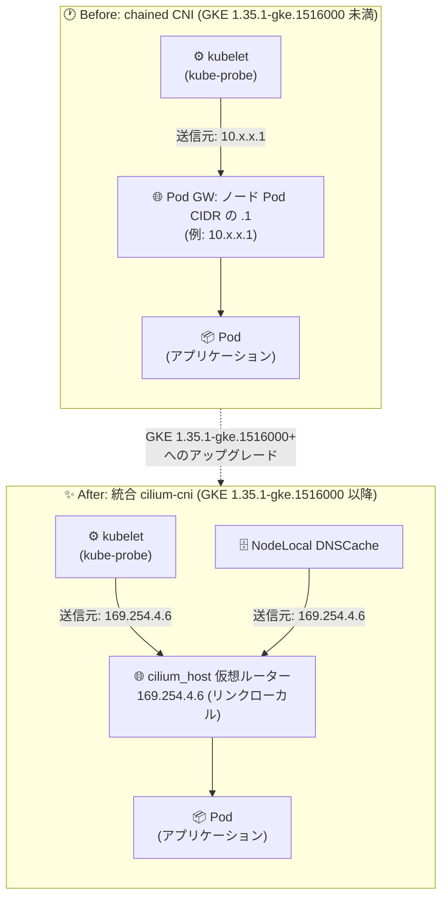

# Google Kubernetes Engine: Dataplane V2 の統合 cilium-cni 構成への移行 (ヘルスチェック送信元 IP の変更)

**リリース日**: 2026-11-12

**サービス**: Google Kubernetes Engine (GKE)

**機能**: Dataplane V2 統合 cilium-cni 構成 (チェーン CNI の廃止)

**ステータス**: Change (GKE 1.35.1-gke.1516000 以降で適用)

📊 [このアップデートのインフォグラフィックを見る](https://takech9203.github.io/google-cloud-news-summary/20261112-gke-dataplane-v2-unified-cilium-cni.html)

## 概要

GKE バージョン 1.35.1-gke.1516000 以降、GKE Dataplane V2 クラスタの CNI 構成が、従来の `ptp` と `cilium-cni` をチェーンする方式 (chained CNI) から、単一の統合された `cilium-cni` プラグイン構成に変更されました。この変更により、Cilium は Pod のデフォルトゲートウェイをノードローカルの仮想ルーターインターフェース `cilium_host` (静的に割り当てられたリンクローカル IP アドレス `169.254.4.6`) を使用して構成するようになります。

この変更の結果、ノードローカルで発生する kubelet のヘルスチェック (`kube-probe` による liveness / readiness / startup プローブ) と NodeLocal DNSCache のトラフィックは、従来のノードの Pod CIDR 範囲の `.1` アドレス (例: `10.x.x.1`) ではなく、`169.254.4.6` から発信されるようになります。

標準の Kubernetes NetworkPolicy はノードローカルのヘルスプローブ (`reserved:host`) を自動的に許可するため NetworkPolicy の変更は不要ですが、アプリケーションレベルの IP 許可リスト (アプリ内の allowlist や Web サーバーの ACL など) でヘルスチェックエンドポイントへのアクセスを制限しているワークロードは、アップグレード前に `169.254.4.6/32` からのトラフィックを許可する必要があります。対応しない場合、アップグレード後にヘルスチェックが失敗し、Pod の再起動ループや Ready にならない事象が発生する可能性があります。

**アップデート前の課題**

従来の chained CNI 構成には、以下のような構造的な複雑さがありました。

- CNI 構成が `ptp` プラグインと `cilium-cni` プラグインのチェーン (連鎖) で構成されており、Pod ネットワーク設定のアーキテクチャが複雑だった
- Pod のデフォルトゲートウェイがノードの Pod CIDR 範囲の `.1` アドレス (例: `10.x.x.1`) であり、ノードローカルトラフィックの送信元がノードごとに異なる IP アドレスだった
- kubelet ヘルスチェック (`kube-probe`) や NodeLocal DNSCache のトラフィックの送信元 IP がノードの Pod CIDR に依存するため、アプリケーションレベルで許可リストを管理する場合、クラスタの全 Pod CIDR 範囲を考慮する必要があった

**アップデート後の改善**

- CNI 構成が単一の統合された `cilium-cni` プラグインに一本化され、Dataplane V2 のネットワークアーキテクチャがシンプルになった
- Pod のデフォルトゲートウェイが、全ノード共通の静的なリンクローカルアドレス `169.254.4.6` (`cilium_host` インターフェース) に統一された
- ノードローカルの kubelet ヘルスチェックと NodeLocal DNSCache トラフィックの送信元 IP が `169.254.4.6` に固定され、許可リストの管理が単一の IP (`169.254.4.6/32`) で済むようになった

## アーキテクチャ図



GKE 1.35.1-gke.1516000 以降では、Pod のデフォルトゲートウェイが `cilium_host` インターフェース (`169.254.4.6`) に変更され、kubelet ヘルスチェックと NodeLocal DNSCache のトラフィックはこの IP から発信されます。

## サービスアップデートの詳細

### 主要機能

1. **統合 cilium-cni 構成への移行**
   - 従来の `ptp` + `cilium-cni` の chained CNI 構成を廃止し、単一の `cilium-cni` プラグインに統合
   - GKE バージョン 1.35.1-gke.1516000 以降の Dataplane V2 クラスタに適用

2. **Pod デフォルトゲートウェイの変更**
   - Cilium がノードローカルの仮想ルーターインターフェース `cilium_host` を使用して Pod のデフォルトゲートウェイを構成
   - `cilium_host` には静的なリンクローカル IP アドレス `169.254.4.6` が割り当てられる

3. **ノードローカルトラフィックの送信元 IP 変更**
   - kubelet の liveness / readiness / startup プローブ (`kube-probe`) の送信元が `169.254.4.6` に変更
   - NodeLocal DNSCache のトラフィックも同様に `169.254.4.6` から発信

4. **NetworkPolicy への影響なし**
   - 標準の Kubernetes NetworkPolicy はノードローカルのヘルスプローブを `reserved:host` エンティティとして自動的に許可するため、NetworkPolicy の変更は不要

## 技術仕様

### 変更内容の比較

| 項目 | 変更前 (chained CNI) | 変更後 (統合 cilium-cni) |
|------|---------------------|-------------------------|
| CNI 構成 | `ptp` + `cilium-cni` のチェーン | 単一の `cilium-cni` プラグイン |
| Pod デフォルトゲートウェイ | ノード Pod CIDR の `.1` (例: `10.x.x.1`) | `cilium_host` (`169.254.4.6`) |
| kube-probe の送信元 IP | `10.x.x.1` (ノードごとに異なる) | `169.254.4.6` (全ノード共通) |
| NodeLocal DNSCache の送信元 IP | `10.x.x.1` | `169.254.4.6` |
| 適用バージョン | 1.35.1-gke.1516000 未満 | 1.35.1-gke.1516000 以降 |

### 影響範囲の整理

| 構成 | 影響 | 対応 |
|------|------|------|
| 標準 Kubernetes NetworkPolicy | なし (`reserved:host` で自動許可) | 不要 |
| アプリケーションレベルの IP 許可リスト | ヘルスチェック失敗の可能性 | `169.254.4.6/32` (または `169.254.0.0/16`) を許可 |
| Web サーバーの ACL (nginx の `allow/deny` など) | ヘルスチェック失敗の可能性 | `169.254.4.6/32` を許可 |
| 送信元 IP に依存しないワークロード | なし | 不要 |

### 関連する既知の問題 (CNI spec 1.1.0)

GKE 1.35.1-gke.1616000 以降では、Dataplane V2 クラスタの CNI 構成ファイルが CNI バージョン 1.1.0 を使用します。Cloud Service Mesh (クラスタ内コントロールプレーン) などのダウンストリーム CNI プラグインを併用している場合は、CNI spec 1.1.0 に対応した Istio 1.23 以降へ事前にアップグレードする必要があります。対応していない場合、ノードが `NodeNotReady` 状態になる既知の問題が報告されています。

## 設定方法

### 前提条件

1. GKE Dataplane V2 が有効なクラスタを運用していること
2. GKE 1.35.1-gke.1516000 以降へのアップグレードを計画していること

### 手順

#### ステップ 1: 影響を受けるワークロードの特定

```bash
# ヘルスチェックプローブが設定されているワークロードを確認
kubectl get pods --all-namespaces -o json | jq -r '
  .items[] |
  select(.spec.containers[].livenessProbe or .spec.containers[].readinessProbe or .spec.containers[].startupProbe) |
  "\(.metadata.namespace)/\(.metadata.name)"' | sort -u
```

このうち、アプリケーションレベルの IP 許可リストや Web サーバーの ACL でヘルスチェックエンドポイントへのアクセスを制限しているワークロードを特定します。

#### ステップ 2: 許可リストへの追加 (アップグレード前)

```nginx
# 例: nginx でヘルスチェックエンドポイントを IP 制限している場合
location /healthz {
    allow 169.254.4.6/32;   # 新しい kube-probe 送信元 IP を追加
    allow 10.0.0.0/8;       # 既存の許可範囲 (移行期間中は残す)
    deny all;
}
```

アプリケーション側で送信元 IP を検証している場合も同様に、`169.254.4.6/32` (より広く取る場合は `169.254.0.0/16`) を許可リストに追加します。

#### ステップ 3: クラスタのアップグレードと動作確認

```bash
# クラスタのアップグレード後、Pod のヘルスチェック状態を確認
kubectl get pods --all-namespaces | grep -v Running

# プローブ失敗イベントの有無を確認
kubectl get events --all-namespaces --field-selector reason=Unhealthy
```

アップグレード後にプローブ失敗 (`Unhealthy` イベント) が発生していないことを確認します。

## メリット

### ビジネス面

- **運用の予測可能性向上**: ヘルスチェックの送信元 IP が全ノード共通の静的アドレスになり、許可リスト管理の運用負荷と設定ミスのリスクが低減される
- **トラブルシューティングの効率化**: ノードローカルトラフィックの送信元が一意に定まるため、ログ分析やパケット解析時の切り分けが容易になる

### 技術面

- **アーキテクチャの簡素化**: chained CNI の廃止により Pod ネットワーク設定のパスが単純化され、CNI レイヤーの管理・デバッグが容易になる
- **送信元 IP の静的化**: `169.254.4.6` はリンクローカルアドレスであり、クラスタの Pod CIDR 設計に依存しない。許可リストは単一の `/32` で全ノードをカバーできる
- **NetworkPolicy との互換性維持**: 標準 NetworkPolicy は `reserved:host` によりヘルスプローブを自動許可するため、ポリシー変更なしで移行できる

## デメリット・制約事項

### 制限事項

- GKE 1.35.1-gke.1516000 以降の Dataplane V2 クラスタに自動的に適用され、従来の chained CNI 構成を選択し続けることはできない
- 送信元 IP の変更はノードローカルトラフィック (kube-probe、NodeLocal DNSCache) に影響し、ワークロード側での事前対応が必要なケースがある

### 考慮すべき点

- **アップグレード前の許可リスト更新が必須**: アプリケーションレベルの IP 許可リストや Web サーバー ACL でヘルスチェックエンドポイントを制限している場合、アップグレード前に `169.254.4.6/32` を許可しないとヘルスチェックが失敗し、Pod の再起動ループや Service からの除外が発生する可能性がある
- **送信元 IP に依存したロジックの見直し**: NodeLocal DNSCache を利用している場合、DNS クエリの送信元 IP が変わるため、送信元 IP ベースのロギングや監査の仕組みがあれば確認が必要
- **Cloud Service Mesh との互換性**: クラスタ内コントロールプレーンの Cloud Service Mesh を使用している場合、GKE 1.35 へのアップグレード前に CNI コンポーネントを 1.23 (CNI spec 1.1.0 対応) にアップグレードする必要がある
- **Dataplane V1 からの移行要件にも関連**: Dataplane V1 から V2 への移行 (Preview) では、ノードプールバージョン 1.35.1-gke.1516000 以降が要件となっており、移行先は本統合 cilium-cni 構成となる

## ユースケース

### ユースケース 1: IP 許可リストを持つ社内 API のアップグレード準備

**シナリオ**: 社内 API サーバーが、ヘルスチェックエンドポイント `/healthz` へのアクセスをノードの Pod CIDR 範囲 (`10.x.x.0/24` の `.1` アドレス群) のみに制限している。GKE 1.35.1-gke.1516000 以降へのアップグレードを控えている。

**実装例**:
```yaml
# アプリケーションの許可リスト設定 (例)
healthcheck:
  allowed_sources:
    - "169.254.4.6/32"   # 新しい kube-probe 送信元 (追加)
    - "10.0.0.0/8"       # 既存の Pod CIDR 範囲 (移行期間中は維持)
```

**効果**: アップグレード前後の両方の送信元 IP を許可することで、ダウンタイムなしで安全に移行できる。移行完了後は Pod CIDR 側の許可を整理できる。

### ユースケース 2: NodeLocal DNSCache 利用クラスタでの監査ログ確認

**シナリオ**: NodeLocal DNSCache を有効化したクラスタで、DNS クエリログを送信元 IP ベースで分析している。

**効果**: アップグレード後は NodeLocal DNSCache トラフィックの送信元が `169.254.4.6` に統一されるため、分析クエリやダッシュボードの送信元 IP 条件を事前に更新しておくことで、ログ分析の継続性を確保できる。

## 料金

このアップデートは CNI 構成の変更であり、追加料金は発生しません。GKE の料金体系に変更はありません。

- [GKE 料金ページ](https://cloud.google.com/kubernetes-engine/pricing)

## 利用可能リージョン

GKE Dataplane V2 が利用可能なすべてのリージョンで、GKE 1.35.1-gke.1516000 以降にアップグレードされたクラスタに適用されます。

## 関連サービス・機能

- **GKE Dataplane V2**: eBPF と Cilium をベースにした GKE のデータプレーン。NetworkPolicy の常時有効化、ネットワークポリシーロギング、リアルタイムのネットワーク可視化を提供
- **NodeLocal DNSCache**: ノードローカルで DNS キャッシュを提供する GKE アドオン。本変更によりトラフィックの送信元 IP が `169.254.4.6` に変更される
- **Kubernetes NetworkPolicy / Cilium Cluster-wide Network Policy (CCNP)**: Pod 間通信を制御するポリシー機構。標準 NetworkPolicy は `reserved:host` によりヘルスプローブを自動許可するため本変更の影響を受けない
- **Cloud Service Mesh**: クラスタ内コントロールプレーンを使用する場合、GKE 1.35 へのアップグレード前に CNI spec 1.1.0 対応バージョン (Istio 1.23 以降) へのアップグレードが必要
- **Cloud Logging**: `anetd` (Dataplane V2 のネットワークコントローラー) のログ確認や、プローブ失敗のトラブルシューティングに利用

## 参考リンク

- 📊 [インフォグラフィック](https://takech9203.github.io/google-cloud-news-summary/20261112-gke-dataplane-v2-unified-cilium-cni.html)
- [公式リリースノート](https://docs.cloud.google.com/release-notes#November_12_2026)
- [Using GKE Dataplane V2 (既知の問題を含む)](https://docs.cloud.google.com/kubernetes-engine/docs/how-to/dataplane-v2)
- [GKE Dataplane V2 の概要](https://docs.cloud.google.com/kubernetes-engine/docs/concepts/dataplane-v2)
- [Dataplane V2 への移行の概要](https://docs.cloud.google.com/kubernetes-engine/docs/concepts/about-migrating-dataplane-v2)
- [GKE 料金ページ](https://cloud.google.com/kubernetes-engine/pricing)

## まとめ

GKE 1.35.1-gke.1516000 以降、Dataplane V2 クラスタの CNI 構成が統合 cilium-cni に変更され、kubelet ヘルスチェックと NodeLocal DNSCache の送信元 IP が `169.254.4.6` に変わります。標準 NetworkPolicy のみを使用している場合は対応不要ですが、アプリケーションレベルの IP 許可リストや Web サーバー ACL でヘルスチェックエンドポイントを制限している場合は、アップグレード前に必ず `169.254.4.6/32` を許可リストに追加してください。GKE 1.35 系へのアップグレード計画がある場合は、影響を受けるワークロードの棚卸しを早めに実施することを推奨します。

---

**タグ**: #GKE #DataplaneV2 #Cilium #CNI #eBPF #NetworkPolicy #Kubernetes #ネットワーク
