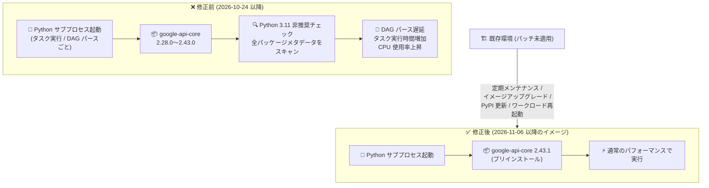

# Managed Service for Apache Airflow: Python 3.11 環境における google-api-core パフォーマンス劣化問題の修正

**リリース日**: 2026-11-12

**サービス**: Managed Service for Apache Airflow (旧 Cloud Composer)

**機能**: google-api-core (2.28.0〜2.43.0) 起因のパフォーマンス劣化問題の修正

**ステータス**: Fixed (修正)

📊 [このアップデートのインフォグラフィックを見る](https://takech9203.github.io/google-cloud-news-summary/20261112-managed-airflow-google-api-core-fix.html)

## 概要

Managed Service for Apache Airflow (Managed Airflow) において、Python 3.11 環境で google-api-core パッケージ (バージョン 2.28.0〜2.43.0) が引き起こしていたパフォーマンス劣化問題が、新規環境およびイメージ更新に対して解決されました。2026 年 11 月 6 日以降にリリースされたイメージ (composer-3-airflow-3.3.1-build.6、composer-3-airflow-3.2.2-build.10、composer-3-airflow-2.11.1-build.23、composer-2.17.17-airflow-2.11.1) には、修正版の google-api-core 2.43.1 がプリインストールされています。

この問題は、2026 年 10 月 24 日以降、google-api-core が Python 3.11 の非推奨チェックを実行するようになったことに起因します。Google Cloud クライアントライブラリが新しい Python サブプロセスでインポートされるたびに、インストール済みパッケージのメタデータをスキャンする動作が発生し、DAG 数が多い環境、短時間タスクが頻繁に実行される環境、データリネージ統合が有効な環境で特に顕著な性能劣化を引き起こしていました。

今回の修正では、影響を受けていた Managed Airflow (Gen 3) および (Gen 2) の以前のビルドについても、ベースコンテナイメージが全リージョンでパッチ適用済みとなりました。これにより、古いビルドで新規作成した環境も影響を受けません。ただし、既存環境はキャッシュされたコンテナイメージを使い続けるため、定期メンテナンスまたは手動の環境更新 (イメージバージョンのアップグレード、PyPI パッケージの更新、対象 Gen 3 リージョンでの Airflow ワークロードの再起動) が完了するまで影響が残る点に注意が必要です。

**アップデート前の課題**

2026 年 10 月 24 日以降、Python 3.11 を使用する Managed Airflow 環境では以下の問題が発生していました。

- google-api-core 2.28.0〜2.43.0 の Python 3.11 非推奨チェックにより、Google Cloud クライアントライブラリのインポートのたびにパッケージメタデータのスキャンが実行されていた
- DAG のパース時間の増加と、Airflow DAG プロセッサの CPU 使用率の上昇が発生していた
- タスク実行時間の長期化と、Airflow ワーカーの CPU 使用率の上昇が発生していた
- `google/api_core/_python_version_support.py` から「Python 3.11 サポートは 2027-10-24 に終了する」という FutureWarning ログが頻発していた
- 回避策として、互換性のあるビルドへの google-api-core>=2.43.1 の手動インストール、または sitecustomize.py によるランタイムパッチの適用が必要だった

**アップデート後の改善**

- 2026 年 11 月 6 日以降のイメージ (composer-3-airflow-3.3.1-build.6、composer-3-airflow-3.2.2-build.10、composer-3-airflow-2.11.1-build.23、composer-2.17.17-airflow-2.11.1) に修正版の google-api-core 2.43.1 がプリインストールされた
- 影響を受けていた以前のビルドのベースコンテナイメージが全リージョンでパッチ適用され、古いビルドを指定して新規作成した環境も影響を受けなくなった
- 既存環境についても、定期メンテナンスや手動の環境更新 (イメージアップグレード、PyPI パッケージ更新、対象 Gen 3 リージョンでのワークロード再起動) でパッチ適用済みイメージに切り替えられるようになった

## アーキテクチャ図



修正前は Python サブプロセス起動のたびに非推奨チェックによるメタデータスキャンが実行されていましたが、修正版 google-api-core 2.43.1 を含むイメージではこのオーバーヘッドが解消されます。既存環境はメンテナンスまたは手動更新でパッチ適用済みイメージに移行します。

## サービスアップデートの詳細

### 主要機能

1. **修正版イメージのリリース (2026 年 11 月 6 日以降)**
   - 以下のイメージに google-api-core 2.43.1 がプリインストールされ、問題が修正済み
     - composer-3-airflow-3.3.1-build.6
     - composer-3-airflow-3.2.2-build.10
     - composer-3-airflow-2.11.1-build.23
     - composer-2.17.17-airflow-2.11.1
   - これ以降のイメージも同様に修正済み

2. **既存ビルドのベースコンテナイメージのパッチ適用**
   - 影響を受けていた Managed Airflow (Gen 3) および (Gen 2) のビルドのベースコンテナイメージが全リージョンでパッチ適用済み
   - 古いビルドを指定して新規作成した環境も影響を受けない
   - 2026 年 11 月 5 日より前に作成された既存環境は、キャッシュ済みコンテナイメージを更新するまで影響が継続

3. **既存環境向けの複数の緩和オプション**
   - 定期メンテナンスによる自動的なイメージ更新
   - イメージバージョンのアップグレード (全リージョン)
   - PyPI パッケージの更新による環境イメージの再ビルド (全リージョン、PyPI リポジトリアクセスが必要)
   - 対象 Gen 3 リージョンでのプレースホルダー環境変数の設定による Airflow ワークロードの再起動 (ファストパス)

## 技術仕様

### 問題の技術的背景

| 項目 | 詳細 |
|------|------|
| 問題発生日 | 2026 年 10 月 24 日以降 |
| 原因 | google-api-core の Python 3.11 非推奨チェック。クライアントライブラリのインポート時に新しい Python サブプロセスごとにパッケージメタデータをスキャン |
| 影響バージョン | google-api-core 2.28.0〜2.43.0 (Python 3.11 環境) |
| 修正バージョン | google-api-core 2.43.1 |
| 特に影響が大きい環境 | DAG 数が多い環境、短時間タスクが頻繁な環境、データリネージ統合が有効な環境 |

### 症状

- Airflow DAG プロセッサでの DAG パース時間の増加と CPU 使用率の上昇
- Airflow ワーカーでのタスク実行時間の長期化と CPU 使用率の上昇
- `google/api_core/_python_version_support.py` からの FutureWarning ログの頻発

### 影響を受けていたビルド (パッチ適用前)

| 世代 | 影響ビルド |
|------|-----------|
| Managed Airflow (Gen 3) | composer-3-airflow-3.3.1-build.0〜build.5 / 3.2.2-build.0〜build.9 / 3.1.8-build.0〜build.4 / 3.1.7-build.7〜build.13 / 2.11.1-build.3〜build.22 / 2.10.5-build.36〜build.52 |
| Managed Airflow (Gen 2) | composer-2.17.0〜2.17.16-airflow-2.11.1 / composer-2.17.0〜2.17.13-airflow-2.10.5 |

## 設定方法

### 前提条件

1. 自身の環境が影響対象か確認する (Python 3.11 環境で google-api-core 2.28.0〜2.43.0 を使用しているか、上記の影響ビルドに該当するか)
2. 環境ログで `google/api_core/_python_version_support.py` からの FutureWarning の有無を確認する

### 手順 (既存環境の緩和策)

#### オプション 1: 環境をアップグレードする (全リージョン)

```bash
gcloud composer environments update ENVIRONMENT_NAME \
  --location LOCATION \
  --image-version composer-3-airflow-3.3.1-build.6
```

composer-3-airflow-3.3.1-build.6、composer-3-airflow-3.2.2-build.10、composer-3-airflow-2.11.1-build.23 (Gen 2 の場合は composer-2.17.17-airflow-2.11.1) など、修正済みビルドへアップグレードします。

#### オプション 2: PyPI パッケージ更新をトリガーする (全リージョン)

既存のカスタム PyPI パッケージの更新または追加パッケージのインストールを行うと、パッチ適用済みベースイメージの上に環境イメージが再ビルドされ、すべての Airflow ワークロードが再起動されます。

**注意**: composer-3-airflow-3.3.1-build.0〜build.5、3.2.2-build.1〜build.9、3.1.8-build.3〜build.4 では `google-api-core>=2.43.1` を直接インストールできます。それより前の Airflow 3 ビルドや Airflow 2 ビルド (composer-2.17.16 以前を含む) では、`opentelemetry-api>=1.44.0` が必要となり依存関係の競合を起こすため、google-api-core の直接インストールは避け、別のパッケージ更新でイメージ再ビルドをトリガーしてください。

#### オプション 3: 対象 Gen 3 リージョンでワークロードを再起動する (ファストパス)

asia-east1、asia-northeast2、europe-central2、me-central1、northamerica-northeast1、us-south1 では、定期メンテナンスが完了済みの環境に対し、プレースホルダー環境変数の設定で Airflow ワークロードをパッチ適用済みインフラ上に再起動できます。

```bash
gcloud composer environments update ENVIRONMENT_NAME \
  --location LOCATION \
  --update-env-variables=COMPOSER_RELOAD=1
```

操作完了後、環境ログで FutureWarning が引き続き出力される場合は、全リージョン向けのオプション 1 または 2 を適用します。

#### オプション 4: sitecustomize.py ランタイムパッチ (アップグレード不可の場合の代替)

VPC Service Controls を使用していて PyPI リポジトリにアクセスできないなど、すぐにアップグレードできない場合は、GitHub で公開されている `sitecustomize.py` を環境のバケットの `dags/patches` フォルダにアップロードし、`PYTHONPATH` 環境変数に `/home/airflow/gcs/dags/patches` を設定します。アップグレードまたはイメージ再ビルド後は、この回避策を削除できます。

## メリット

### ビジネス面

- **運用コストの削減**: 性能劣化による CPU 使用率上昇が解消され、不要なリソース増強や環境スケールアップの必要がなくなる
- **パイプラインの SLA 回復**: DAG パースやタスク実行の遅延が解消され、データパイプラインの処理時間が正常化する

### 技術面

- **新規環境は対応不要**: ベースイメージが全リージョンでパッチ適用済みのため、古いビルドで新規作成しても影響を受けない
- **複数の緩和パスの提供**: イメージアップグレード、PyPI 更新、ワークロード再起動、sitecustomize.py パッチと、環境の制約 (VPC Service Controls など) に応じた選択肢が用意されている
- **ログノイズの解消**: 頻発していた FutureWarning ログがなくなり、ログの可観測性が改善する

## デメリット・制約事項

### 制限事項

- 既存環境 (2026 年 11 月 5 日より前に作成) は、定期メンテナンスまたは手動の環境更新が行われるまでキャッシュ済みイメージで動作し続け、自動では修正されない
- 環境変数のプレースホルダー設定によるワークロード再起動 (ファストパス) は、asia-east1、asia-northeast2、europe-central2、me-central1、northamerica-northeast1、us-south1 の 6 リージョンの Gen 3 環境で、定期メンテナンス完了済みの場合のみ有効
- Gen 2 では、プレースホルダー環境変数の設定のみではカスタム PyPI イメージの再ビルドもキャッシュ済みイメージの置き換えも行われないため、問題は解決しない
- composer-2.17.16 以前や古い Airflow 3 ビルドに `google-api-core>=2.43.1` を直接インストールすると依存関係の競合 (opentelemetry-api>=1.44.0 要求) が発生する

### 考慮すべき点

- 2026 年 11 月 16 日〜12 月 2 日は全 Managed Airflow 環境の GKE クラスタにメンテナンス除外が設定されるため (10 月 14 日発表)、定期メンテナンスによる自動修正を待つ場合はこの期間を考慮する必要がある
- europe-north1、europe-west3、us-east1、us-west2 では、定期メンテナンスがスケジューラや DAG プロセッサなどの非ワーカーワークロードを自動的にパッチ適用済みイメージへ再起動するが、ワーカーを即時更新するには手動オプションの適用が必要
- sitecustomize.py を使用する場合、Airflow の DAG 検出セーフモードに無視させるため、ファイル内に airflow や dag という単語 (コメント含む) を含めてはならない

## ユースケース

### ユースケース 1: 大量の短時間タスクを実行するデータパイプライン環境の復旧

**シナリオ**: 数百の DAG と短時間タスクを頻繁に実行する Managed Airflow (Gen 3) 環境で、10 月下旬からタスク実行時間の増加とワーカー CPU 使用率の上昇が発生している。

**実装例**:
```bash
# 修正済みビルドへのアップグレード
gcloud composer environments update my-airflow-env \
  --location asia-northeast1 \
  --image-version composer-3-airflow-3.3.1-build.6
```

**効果**: google-api-core 2.43.1 を含む修正済みイメージへ移行し、非推奨チェックによるオーバーヘッドが解消され、タスク実行時間と CPU 使用率が正常化する。

### ユースケース 2: VPC Service Controls 配下で PyPI アクセスがない環境の暫定対応

**シナリオ**: VPC Service Controls を使用しており PyPI リポジトリにアクセスできず、業務上の理由で即時のアップグレードも難しい Gen 3 環境。

**効果**: GitHub で提供される sitecustomize.py を環境バケットの dags/patches にアップロードし、PYTHONPATH を設定することで、アップグレードせずにランタイムパッチで性能劣化を回避できる。後日アップグレード完了後にパッチを削除すればよい。

## 料金

本修正自体に追加料金は発生しません。Managed Service for Apache Airflow の料金体系 (環境のコンピュート、ストレージ、ネットワークに基づく従量課金) に変更はありません。性能劣化により CPU 使用率が上昇していた環境では、修正適用後にリソース使用量が正常化することでコストの改善が期待できます。

詳細は [Cloud Composer の料金ページ](https://cloud.google.com/composer/pricing) を参照してください。

## 利用可能リージョン

影響を受けていたビルドのベースコンテナイメージは、**全リージョン** でパッチ適用済みです。

環境変数設定によるワークロード再起動 (ファストパス) は、以下の Gen 3 リージョンで利用できます: asia-east1、asia-northeast2、europe-central2、me-central1、northamerica-northeast1、us-south1。

## 関連サービス・機能

- **Cloud Monitoring / Cloud Logging**: FutureWarning ログの確認や、DAG パース時間・CPU 使用率のメトリクス監視により、自身の環境が影響を受けているかの判断と修正適用後の効果確認に利用
- **Google Kubernetes Engine (GKE)**: Managed Airflow 環境の基盤。キャッシュされたコンテナイメージは GKE ノード上に保持されるため、ワークロードの再起動やノード更新がパッチ反映の鍵となる
- **Dataplex (データリネージ)**: データリネージ統合が有効な環境は本問題の影響を特に受けやすいとされており、該当環境は優先的な対応が推奨される
- **VPC Service Controls**: PyPI アクセスが制限される環境では、sitecustomize.py による代替ワークアラウンドが用意されている

## 参考リンク

- 📊 [インフォグラフィック](https://takech9203.github.io/google-cloud-news-summary/20261112-managed-airflow-google-api-core-fix.html)
- [公式リリースノート](https://docs.cloud.google.com/release-notes#November_12_2026)
- [Managed Airflow (Gen 3) の既知の問題](https://docs.cloud.google.com/composer/docs/composer-3/known-issues#google-api-core-2-30-3-to-2-43-0)
- [Managed Airflow (Gen 2) の既知の問題](https://docs.cloud.google.com/composer/docs/composer-2/known-issues#google-api-core-2-30-3-to-2-43-0)
- [Managed Airflow リリースノート](https://docs.cloud.google.com/composer/docs/release-notes)
- [環境のアップグレード (Gen 3)](https://docs.cloud.google.com/composer/docs/composer-3/upgrade-environments)
- [料金ページ](https://cloud.google.com/composer/pricing)

## まとめ

Python 3.11 環境の Managed Airflow で 10 月下旬から発生していた google-api-core 起因の性能劣化が、新規環境とイメージ更新に対して解決されました。ただし既存環境はキャッシュ済みイメージのままでは修正されないため、影響ビルドを使用している場合は、修正済みビルド (composer-3-airflow-3.3.1-build.6 など) へのアップグレード、PyPI パッケージ更新、または対象リージョンでのワークロード再起動を早期に実施することを推奨します。11 月 16 日からのメンテナンス除外期間に入る前に対応を完了させるのが望ましいでしょう。

---

**タグ**: #ManagedAirflow #CloudComposer #ApacheAirflow #Fixed #Performance #Python311 #GoogleApiCore
