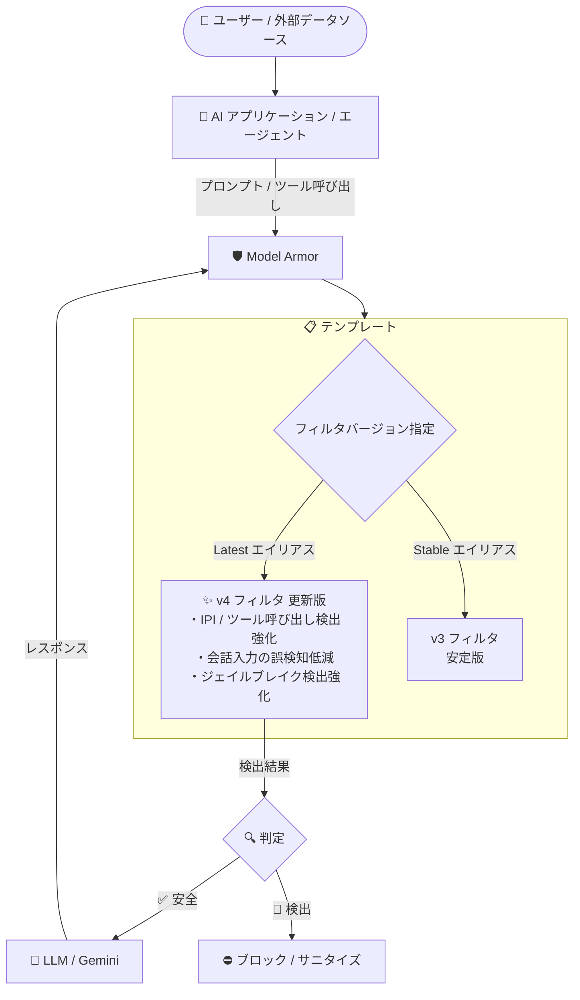

# Model Armor: フィルタバージョン v4 (Latest エイリアス) のプロンプトインジェクション / ジェイルブレイク検出強化

**リリース日**: 2026-11-12

**サービス**: Model Armor

**機能**: フィルタバージョン v4 のプロンプトインジェクション / ジェイルブレイク検出フィルタ更新

**ステータス**: リリース済み (Latest エイリアス配下の v4 に適用)

📊 [このアップデートのインフォグラフィックを見る](https://takech9203.github.io/google-cloud-news-summary/20261112-model-armor-filter-v4-prompt-injection.html)

## 概要

Model Armor のフィルタバージョン v4 (Latest エイリアス配下) に、更新されたプロンプトインジェクション / ジェイルブレイク検出フィルタが含まれるようになりました。今回の更新では、間接プロンプトインジェクション (IPI: Indirect Prompt Injection) やツール呼び出しに対する検出率 (recall) の向上、会話形式の入力に対する検出率向上と誤検知 (false positive) 率の低減、そしてジェイルブレイク攻撃に対する検出率の向上が実現されています。

Model Armor は、LLM のプロンプトとレスポンスに対してコンテンツの安全性・セキュリティ制御を適用し、機密データ漏洩、プロンプトインジェクション、有害コンテンツなどのリスクを軽減する Google Cloud のサービスです。フィルタバージョン機能により、テンプレート単位でバージョン番号 (v3、v4 など) またはエイリアス (Latest、Stable) を指定でき、本番環境の安定性と最新の脅威検出モデルへのアクセスを両立できます。

特に、エージェント型 AI アプリケーションの普及に伴い増加している「ツール呼び出しを悪用した間接プロンプトインジェクション」への検出強化は、AI エージェントやマルチターン会話を扱うアプリケーションを運用する組織にとって重要な改善です。Latest エイリアスを使用しているテンプレートでは、追加の設定変更なしで今回の改善が自動的に適用されます。

**アップデート前の課題**

- 外部データ (メール、ドキュメント、Web ページなど) に埋め込まれた悪意ある指示による間接プロンプトインジェクション (IPI) や、エージェントのツール呼び出しを標的とした攻撃は、直接的なプロンプト攻撃に比べて検出が難しかった
- マルチターンの会話形式の入力では、正当な対話が誤ってブロックされる誤検知と、攻撃の見逃しの両方が課題だった
- 巧妙化するジェイルブレイク攻撃 (モデルの安全制御を回避する試み) に対して、検出率のさらなる向上が求められていた

**アップデート後の改善**

- 間接プロンプトインジェクション (IPI) およびツール呼び出しに対する検出率 (recall) が向上し、エージェント型ワークロードの保護が強化された
- 会話形式の入力に対して、より低い誤検知率でより高い検出率を実現し、ユーザー体験を損なわずにセキュリティを向上できるようになった
- ジェイルブレイク攻撃に対する検出率が向上した

## アーキテクチャ図



Model Armor はテンプレートで指定されたフィルタバージョンを使用してプロンプトとレスポンスをスクリーニングします。Latest エイリアスを使用するテンプレートは、今回更新された v4 のプロンプトインジェクション / ジェイルブレイク検出フィルタを自動的に利用します。

## サービスアップデートの詳細

### 主要機能

1. **間接プロンプトインジェクション (IPI) とツール呼び出しに対する検出率向上**
   - 外部コンテンツに埋め込まれた悪意ある指示 (間接プロンプトインジェクション) に対する recall が向上
   - AI エージェントのツール呼び出し (function calling) を標的とした攻撃の検出が強化され、エージェント型アーキテクチャの保護が向上

2. **会話形式入力の検出精度向上と誤検知低減**
   - マルチターンの会話入力に対して、より高い検出率をより低い誤検知率で実現
   - チャットボットや対話型アプリケーションにおいて、正当な対話をブロックするリスクを抑えつつセキュリティを強化

3. **ジェイルブレイク攻撃への検出強化**
   - モデルの安全制御を回避しようとするジェイルブレイク攻撃に対する recall が向上

### フィルタバージョンのライフサイクル

v4 は 2026 年 9 月 18 日に Latest エイリアスのデフォルトとして提供開始され、今回 (2026 年 11 月 12 日) の更新でプロンプトインジェクション / ジェイルブレイク検出フィルタがさらに強化されました。

| バージョン | リリース日 | 主な内容 |
|------|------|------|
| v4 (今回更新) | 2026-11-12 | IPI / ツール呼び出し・会話入力・ジェイルブレイクの検出強化 |
| v4 (初回提供) | 2026-09-18 | Latest エイリアスのデフォルトに設定、v3 が Stable に昇格 |
| v3 | 2026-07-20 | Responsible AI 安全フィルタの精度向上・誤検知低減 |
| v3 (初回提供) | 2026-05-25 | 新モデルによる誤検知の大幅低減、検出強化 |

## 技術仕様

### バージョンエイリアス

| エイリアス | 説明 | 適した用途 |
|------|------|------|
| Latest | 最新のモデルと保護機能。新たな脅威への更新が頻繁 | テスト、ステージング、最新の検出モデルを優先するワークロード |
| Stable | 検証済みで変更のない検出ロジック (デフォルト) | 本番環境、フィルタ動作の一貫性が必要なワークロード |
| Legacy | 新しい Stable のリリース後 90 日間利用可能な旧 Stable バージョン | 移行期間中のワークロード (新規テンプレート作成は不可) |
| Retired | 90 日の Legacy 期間を超過し利用不可。Stable バージョンで処理される | - |

### フィルタバージョンの指定方法

- フィルタバージョンはテンプレート単位で設定する (フィルタごとに異なるバージョンは指定不可)
- バージョン未指定のテンプレートは Stable バージョンがデフォルトで適用される
- Latest / Stable エイリアスを使用するテンプレートは、エイリアスの参照先が更新されると自動的に新バージョンを使用する
- 特定のバージョン番号 (v3、v4 など) を指定すると、エイリアスが更新されても固定された動作を維持できる

```json
{
  "filterConfig": {
    "piAndJailbreakFilterSettings": {
      "filterEnforcement": "ENABLED"
    }
  },
  "templateMetadata": {
    "filterVersionSelector": {
      "alias": "FILTER_VERSION_ALIAS_LATEST"
    }
  }
}
```

## 設定方法

### 前提条件

1. Google Cloud プロジェクトで Model Armor API が有効化されていること
2. Model Armor テンプレートの作成・更新権限があること

### 手順

#### ステップ 1: Latest エイリアスを使用するテンプレートを作成

```bash
gcloud model-armor templates create TEMPLATE_ID \
  --project=PROJECT_ID \
  --location=LOCATION \
  --pi-and-jailbreak-filter-settings-enforcement=enabled \
  --filter-version-selector-alias=filter-version-alias-latest
```

Latest エイリアスを指定することで、今回更新された v4 フィルタが自動的に適用されます。

#### ステップ 2: 既存テンプレートのフィルタバージョンを更新

```bash
# エイリアスで指定する場合
gcloud model-armor templates update TEMPLATE_ID \
  --project=PROJECT_ID \
  --location=LOCATION \
  --filter-version-selector-alias=filter-version-alias-latest

# バージョン番号を固定する場合
gcloud model-armor templates update TEMPLATE_ID \
  --project=PROJECT_ID \
  --location=LOCATION \
  --filter-version-selector=v4
```

バージョン番号 (v4) を直接指定すると、エイリアスの参照先が変わっても固定された動作を維持できます。

## メリット

### ビジネス面

- **エージェント型 AI のリスク低減**: ツール呼び出しや外部データ経由の間接プロンプトインジェクションへの検出強化により、AI エージェント導入時のセキュリティリスクを低減できる
- **ユーザー体験とセキュリティの両立**: 会話入力の誤検知率低減により、正当な利用をブロックすることなく保護を強化でき、チャットアプリケーションの品質を維持できる
- **運用負荷なしの自動強化**: Latest エイリアスを使用していれば、設定変更やデプロイ作業なしで最新の検出モデルの恩恵を受けられる

### 技術面

- **IPI / ツール呼び出しへの高い recall**: RAG やエージェントが取り込む外部コンテンツに潜む攻撃ベクトルの検出率が向上
- **バージョン管理による柔軟な運用**: Latest で新しい検出能力を事前検証し、Stable 昇格後に本番適用するといった計画的なロールアウトが可能
- **マルチターン対応**: 会話コンテキストを含む入力に対する検出精度が向上し、対話型アプリケーションに適した保護を実現

## デメリット・制約事項

### 制限事項

- フィルタバージョンはテンプレート単位での設定であり、個々のフィルタごとに異なるバージョンを指定することはできない
- Latest エイリアスは標準の SLO を提供するが、バージョン間で安定性 (フィルタ動作の一貫性) が変動する可能性がある
- Legacy バージョンは新しい Stable のリリース後 90 日で Retired となり利用できなくなる (v1 / v2 は 2026 年 12 月 17 日に廃止予定)
- Google および Google Cloud MCP サーバーとの統合では、フィルタバージョンのオーバーライドはできない

### 考慮すべき点

- 本番環境でフィルタ動作の一貫性が必要な場合は、Latest ではなく Stable エイリアスまたは特定バージョンの固定を検討する
- 検出モデルの更新により判定結果が変わる可能性があるため、Latest を利用する場合は誤検知の監視体制 (モニタリングダッシュボードなど) を整備しておく
- 誤検知が発生した場合は、テンプレート固有の除外ルール (辞書・正規表現) で緩和できる

## ユースケース

### ユースケース 1: AI エージェントのツール呼び出し保護

**シナリオ**: 社内ドキュメントや外部 Web を参照しながらツール呼び出しを行う AI エージェントを運用しており、取り込んだコンテンツに埋め込まれた間接プロンプトインジェクションによる不正なツール実行を防ぎたい。

**実装例**:
```bash
gcloud model-armor templates create agent-protection \
  --project=my-project \
  --location=us-central1 \
  --pi-and-jailbreak-filter-settings-enforcement=enabled \
  --filter-version-selector-alias=filter-version-alias-latest
```

**効果**: v4 の更新されたフィルタにより、IPI とツール呼び出しを標的とした攻撃の検出率が向上し、エージェントの意図しない動作を未然に防止できる。

### ユースケース 2: カスタマーサポートチャットボットの誤検知低減

**シナリオ**: マルチターンの対話を行うカスタマーサポートチャットボットで、正当な問い合わせが誤ってブロックされる誤検知が課題となっている。

**効果**: 会話形式の入力に対して低い誤検知率で高い検出率を実現する v4 フィルタにより、ユーザー体験を損なわずにジェイルブレイクやプロンプトインジェクションからボットを保護できる。

### ユースケース 3: Latest での事前検証と Stable への計画的ロールアウト

**シナリオ**: 本番環境では Stable エイリアスを使用しつつ、ステージング環境で最新の検出能力を実トラフィックパターンに対して評価したい。

**効果**: ステージング用テンプレートに Latest エイリアスを設定することで、v4 の新しい検出動作を事前に検証でき、v4 が Stable に昇格した際の本番影響を予測可能にする。

## 料金

Model Armor はトークンベースの従量課金制です。今回のフィルタ更新による追加料金はありません。

### 料金例

| プラン | 無料枠 | 超過分 |
|--------|-----------------|-----------------|
| Model Armor (スタンドアロン / Pay-as-you-go) | 200 万トークン/月 | 100 万トークンあたり $0.10 |
| SCC Premium / Enterprise (サブスクリプション) | 30 億トークン/月 | 100 万トークンあたり $0.10 |

テキスト入力は約 4 文字で 1 トークンとして計算されます。詳細は [Model Armor の料金詳細](https://cloud.google.com/security-command-center/pricing#possible-indirect-charges-associated-with-model-armor) を参照してください。

## 利用可能リージョン

リージョンごとにサポートされるフィルタとバージョンが異なります。詳細は [リージョン別サポート機能](https://docs.cloud.google.com/model-armor/feature-availability-by-region#supported-by-region) および [バージョンリリースタイムライン](https://docs.cloud.google.com/model-armor/set-filter-version#release-timeline) を参照してください。

## 関連サービス・機能

- **Gemini Enterprise Agent Platform**: Model Armor と統合され、floor settings によりデフォルトで Stable バージョンを使用。テンプレート指定で Latest (v4) へのオーバーライドが可能
- **Agent Gateway**: ゲートウェイを通過するプロンプトとレスポンスに Model Armor のガードレールを適用可能 (GA)
- **Security Command Center**: Model Armor は SCC の一部として提供され、検出結果の可視化や組織レベルの管理と連携
- **Sensitive Data Protection**: Model Armor の機密データ検出フィルタとして統合され、個人情報などの漏洩を防止
- **テンプレート固有の除外ルール**: 辞書・正規表現ベースのルールでプロンプトインジェクション検出の誤検知を緩和 (Preview)

## 参考リンク

- 📊 [インフォグラフィック](https://takech9203.github.io/google-cloud-news-summary/20261112-model-armor-filter-v4-prompt-injection.html)
- [公式リリースノート](https://docs.cloud.google.com/release-notes#November_12_2026)
- [Model Armor フィルタバージョン履歴](https://docs.cloud.google.com/model-armor/version-history)
- [フィルタバージョンの設定](https://docs.cloud.google.com/model-armor/set-filter-version)
- [プロンプトインジェクションとジェイルブレイク検出の概要](https://docs.cloud.google.com/model-armor/overview#ma-prompt-injection)
- [料金ページ](https://cloud.google.com/security-command-center/pricing#possible-indirect-charges-associated-with-model-armor)

## まとめ

Model Armor のフィルタバージョン v4 の更新により、エージェント型 AI で特に懸念される間接プロンプトインジェクションやツール呼び出しへの攻撃、会話形式の入力、ジェイルブレイク攻撃への検出能力が強化されました。Latest エイリアスを使用しているテンプレートは自動的に恩恵を受けられるため、ステージング環境で v4 の検出動作を検証し、本番環境の Stable への昇格に備えることを推奨します。v1 / v2 を明示的に指定しているテンプレートは 2026 年 12 月 17 日の廃止前に v3 以降または Stable エイリアスへの移行が必要です。

---

**タグ**: Model Armor, セキュリティ, プロンプトインジェクション, ジェイルブレイク, AI エージェント, LLM, フィルタバージョン
