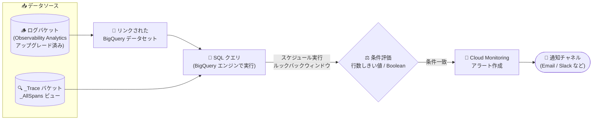

# Cloud Monitoring / Cloud Logging / Cloud Trace: Observability Analytics クエリ結果を監視する SQL ベースのアラートポリシーが GA

**リリース日**: 2026-11-12

**サービス**: Cloud Monitoring, Cloud Logging, Cloud Trace

**機能**: Observability Analytics のクエリ結果を監視する SQL ベースのアラートポリシー

**ステータス**: GA (一般提供)

📊 [このアップデートのインフォグラフィックを見る](https://takech9203.github.io/google-cloud-news-summary/20261112-observability-analytics-sql-alerting-ga.html)

## 概要

Observability Analytics の SQL クエリ結果を Cloud Monitoring で監視する「SQL ベースのアラートポリシー (SQL-based alerting policies)」が一般提供 (GA) になりました。Google Cloud コンソールまたは Cloud Monitoring API を使用して、SQL ベースのアラートポリシーを作成できます。このアップデートは Cloud Monitoring、Cloud Logging、Cloud Trace の各リリースノートで同時に発表されています。

SQL ベースのアラートポリシーは、SQL クエリとその評価条件 (condition)、および実行スケジュール (schedule) で構成されます。スケジュールで指定した間隔 (例: 60 分ごと) でクエリが実行され、ルックバックウィンドウ内に受信したデータに対して集計・分析を行い、条件を満たした場合に Cloud Monitoring がアラートを作成して通知チャネル経由で通知します。

ログデータに対しては、Observability Analytics にアップグレードしたログバケットとリンクされた BigQuery データセットを経由してログビューにクエリを実行します。トレースデータに対しては、`_Trace` という名前の Observability バケット上の `_AllSpans` ビューに SQL クエリを実行できます。複数のログエントリにまたがる集計値 (エラー率、件数など) を正確に評価したい場合に最も効果的な方式であり、個々のログエントリを評価したい場合は従来のログベースのアラートポリシーが引き続き推奨されます。

**アップデート前の課題**

- ログデータに対するアラートは、個別のログエントリをスキャンする「ログベースのアラートポリシー」か、「ログベースの指標 + 指標アラート」の 2 方式が中心で、複数のログエントリにまたがる集計分析 (例: エラー率が 25% を超えた場合) を SQL で直接評価してアラートする手段は GA として提供されていなかった
- ログベースの指標はログデータの傾向監視には有効だが、発生件数が少ないイベントの監視には適さず、また SQL の柔軟な集計・結合ロジックを条件に使えなかった
- トレースデータ (スパン) の集計分析結果に基づいてアラートを作成する標準的な方法がなかった

**アップデート後の改善**

- Observability Analytics の SQL クエリ結果 (行数しきい値または boolean 列) を条件としてアラートを作成できるようになり、GA として本番環境で利用可能になった
- Google Cloud コンソールと Cloud Monitoring API (`alertPolicies.create` の `conditionSql` / `SqlCondition`) の両方で作成・管理できるようになった
- ログだけでなくトレースデータ (`_Trace` バケットの `_AllSpans` ビュー) に対しても SQL ベースのアラートポリシーを構成できるようになった

## アーキテクチャ図



ログバケット (リンクされた BigQuery データセット経由) やトレースデータに対してスケジュールされた SQL クエリを実行し、クエリ結果が条件 (行数しきい値または boolean 列) を満たすと Cloud Monitoring がアラートを作成し、通知チャネルに通知します。

## サービスアップデートの詳細

### 主要機能

1. **SQL クエリ結果に基づくアラート条件 (GA)**
   - Observability Analytics の SQL クエリの結果テーブルを条件として評価し、アラートを作成
   - 複数のログエントリにまたがる正確な集計値 (件数、割合など) の評価に最適
   - 1 つの SQL ベースのアラートポリシーに設定できる条件は 1 つ

2. **2 種類の評価タイプ**
   - **行数しきい値 (Row count threshold)**: クエリ結果の行数がしきい値より大きい/等しい/小さい場合に条件成立 (例: severity > 200 のログが 50 件を超えたら通知)
   - **Boolean**: クエリ結果の特定の boolean 列に `true` の行が含まれる場合に条件成立 (例: ERROR の割合が 25% を超えたら `notify` 列に `true` を書き込み通知)

3. **スケジュールとルックバックウィンドウ**
   - スケジュールでクエリの実行頻度を定義 (分・時間・日単位の periodicity)
   - ルックバックウィンドウは前回評価以降に受信したデータのみを選択するフィルタ (例: スケジュール 60 分なら直近 60 分のデータを対象)

4. **コンソールと API の両方をサポート**
   - Google Cloud コンソールから作成可能
   - Cloud Monitoring API の `alertPolicies.create` メソッドで、条件タイプ `conditionSql` (`SqlCondition`) を指定してプログラマティックに作成可能

5. **トレースデータへの対応 (Cloud Trace)**
   - `_Trace` という Observability バケット上の `_AllSpans` ビューに SQL クエリを実行し、トレースデータの集計分析結果に基づいてアラートを作成可能

## 技術仕様

### 評価の仕組み

| 項目 | 詳細 |
|------|------|
| 条件タイプ | `conditionSql` (`SqlCondition`): `boolean_test` または `row_count_test` |
| スケジュール | `minutes` / `hours` / `days` のいずれかで periodicity を指定 (例: 12 時間ごとなら `hours: 12`) |
| 評価対象のログエントリ | 受信タイムスタンプがルックバックウィンドウ内、かつ生成タイムスタンプがルックバックウィンドウの前後 15 分以内 |
| クエリ実行の遅延 | データのインデックス作成を待つため、ルックバックウィンドウ終了から 5 分遅延して実行。条件成立後、アラート伝播にさらに最大 2 分 |
| クエリ実行エンジン | アラートポリシーが定義された Google Cloud プロジェクトの BigQuery エンジン (デフォルトはオンデマンドスロット、スロット予約も利用可能) |

### 制限事項

| 制限 | 内容 |
|------|------|
| 条件数 | 1 つの SQL ベースのアラートポリシーにつき条件は 1 つ |
| アナリティクスビュー | SQL ベースのアラートポリシーからアナリティクスビューへのクエリは不可 |
| クエリ実行時間 | 実行時間が 5 分を超えるとクエリは失敗 |
| 遅延 | クエリのスケジュール時刻からアラート作成まで、最大 7 分 + クエリ実行時間の遅延 |

クエリが失敗した場合 (Monitoring サービスアカウントの権限不足、実行時間超過、内部エラーなど) は、アラートポリシー ID とエラーステータスを含むログエントリが生成されるため、ログベースのアラートポリシーで失敗を検知できます。

## 設定方法

### 前提条件 (ログデータの場合)

1. ログバケットを Observability Analytics を使用するようにアップグレードしていること
2. ログバケットに対してリンクされた BigQuery データセットを作成済みであること
3. 作成者に以下の IAM ロールが付与されていること:
   - Monitoring 編集者 (`roles/monitoring.editor`)
   - SQL アラート書き込み (`roles/logging.sqlAlertWriter`)
   - ログビューア (`roles/logging.viewer`)
   - ログビュー アクセサー (`roles/logging.viewAccessor`)
   - BigQuery データ閲覧者 (`roles/bigquery.dataViewer`)
   - BigQuery ジョブユーザー (`roles/bigquery.jobUser`)
4. Monitoring サービスアカウントが存在し、プロジェクトの Monitoring サービスエージェント (`roles/monitoring.notificationServiceAgent`) と、リンクされた BigQuery データセットの BigQuery データ閲覧者 (`roles/bigquery.dataViewer`) が付与されていること
5. アラート通知を受け取る通知チャネルを構成していること (冗長性のため複数種類の通知チャネルの作成が推奨)

### 手順 (Cloud Monitoring API の場合)

#### ステップ 1: SQL 条件を含むアラートポリシーを定義

`alertPolicies.create` メソッドで、条件タイプに `conditionSql` (`SqlCondition`) を指定します。

- スケジュール: `minutes` / `hours` / `days` のいずれかに periodicity を設定
- 条件: `boolean_test` (boolean 列に `true` が含まれる場合に成立) または `row_count_test` (結果行数がしきい値を満たす場合に成立) を設定

#### ステップ 2: 通知チャネルを設定

アラートポリシーに通知チャネルのリストを設定します。条件が成立すると Cloud Monitoring がアラートを作成し、これらのチャネル経由で通知します。

コンソールの場合は、アラート詳細ページでクエリ実行履歴や結果テーブル、BigQuery のスキャン推定バイト数・スロット消費時間 (直近 7 日間のクエリに基づく) を確認でき、トラブルシューティングに活用できます。

## メリット

### ビジネス面

- **集計ベースの SLO/品質監視**: エラー率や特定条件のイベント割合など、ビジネス上意味のある集計値を直接アラート条件にでき、ノイズの少ない通知運用が可能
- **GA による本番適用**: 一般提供となったことで、本番環境の監視基盤として安心して採用できる

### 技術面

- **SQL の表現力**: ログベースの指標では難しかった複雑な集計・比率計算・複数エントリにまたがる評価を SQL で柔軟に記述できる
- **ログとトレースの統一的な監視**: ログビューに加え、`_AllSpans` ビューへのクエリによりトレースデータの集計結果も同じ仕組みで監視できる
- **API による自動化**: `SqlCondition` を使った Cloud Monitoring API 経由で、IaC やスクリプトによるアラートポリシーの一括管理が可能
- **データ複製不要**: リンクされた BigQuery データセットはログバケットへの読み取り専用ポインタのため、データを複製したり別途 BigQuery ストレージ料金を支払ったりすることなく SQL ベースのアラートを構成できる

## デメリット・制約事項

### 制限事項

- 1 ポリシーにつき条件は 1 つのみ
- アナリティクスビューに対するクエリは不可
- クエリ実行時間は 5 分以内 (超過すると失敗)
- スケジュール時刻からアラート作成まで最大 7 分 + クエリ実行時間の遅延があり、リアルタイム性が求められる検知には不向き

### 考慮すべき点

- クエリはプロジェクトの BigQuery エンジン上で実行されるため、BigQuery のオンデマンドスロット (またはスロット予約) の料金が発生する。スキャン量の大きいクエリを短い間隔で実行するとコストが増加する
- 個々のログエントリ (セキュリティイベントなど) の検知には、引き続きログベースのアラートポリシーが適している
- リンクされた BigQuery データセットへのクエリは BigQuery の権限レイヤで評価されるため、データセットへのアクセス権を持つプリンシパルはデータセット内のすべてのビューをクエリできる点に注意
- Monitoring サービスアカウントの権限が失われるとクエリが失敗するため、失敗ログを検知するログベースのアラートを併用するのが望ましい

## ユースケース

### ユースケース 1: エラーログ割合のしきい値監視

**シナリオ**: アプリケーションのログ全体に対する severity が ERROR のログの割合が 25% を超えた場合にオンコール担当者へ通知したい。

**実装例**:
```
1. ルックバックウィンドウ内のログエントリのうち ERROR の割合を計算する SQL クエリを作成
2. 割合が 25% を超えた場合に notify 列へ true を書き込むようにクエリを構成
3. 評価タイプ Boolean で notify 列を監視する条件を作成し、通知チャネルを設定
```

**効果**: 単発のエラーではなく「エラー率」という集計値で判定するため、ノイズを抑えつつサービス品質の劣化を検知できる。

### ユースケース 2: 高 severity ログの件数監視

**シナリオ**: ルックバックウィンドウ内に severity が 200 (INFO) を超えるログエントリが 50 件を超えたら通知したい。

**効果**: 評価タイプ「行数しきい値」を使い、該当ログを返すクエリの結果行数をしきい値 50 で判定するだけで、ログベースの指標を別途作成せずに件数ベースの監視を実現できる。

### ユースケース 3: トレースデータの集計分析に基づくアラート

**シナリオ**: Cloud Trace に取り込まれたスパンの集計分析結果 (特定条件のスパンの傾向など) に基づいて通知を受けたい。

**効果**: `_Trace` バケットの `_AllSpans` ビューに対する SQL クエリを条件にアラートポリシーを作成でき、トレースデータについてもログと同じ仕組みで集計ベースの監視ができる。

## 料金

SQL ベースのアラートポリシーのクエリは BigQuery エンジン上で実行され、デフォルトではオンデマンドスロットが使用されます (スロット予約の構成も可能)。料金の詳細は以下を参照してください。

- [BigQuery の料金](https://cloud.google.com/bigquery/pricing)
- [Google Cloud Observability の料金](https://cloud.google.com/products/observability/pricing) (Cloud Logging / Cloud Monitoring のセクション)

なお、コンソールのアラート詳細ページでは、直近 7 日間のクエリに基づくスキャン推定バイト数とスロット消費時間を確認できます。

## 関連サービス・機能

- **Cloud Logging (Observability Analytics)**: SQL クエリの実行基盤。ログバケットのアップグレードとリンクされた BigQuery データセットの作成が前提
- **Cloud Monitoring**: アラートポリシーの作成・評価・アラート管理と通知を担当。`alertPolicies.create` API で `SqlCondition` をサポート
- **Cloud Trace**: `_Trace` Observability バケットの `_AllSpans` ビューを介してトレースデータへの SQL ベースのアラートを提供
- **BigQuery**: リンクされたデータセットを通じてクエリを実行するエンジン。スロット予約によるコスト管理も可能
- **ログベースのアラートポリシー / ログベースの指標**: 個別ログエントリの検知やログの傾向監視に適した代替・補完手段

## 参考リンク

- 📊 [インフォグラフィック](https://takech9203.github.io/google-cloud-news-summary/20261112-observability-analytics-sql-alerting-ga.html)
- [公式リリースノート](https://docs.cloud.google.com/release-notes#November_12_2026)
- [ドキュメント: Monitor your SQL query results with an alerting policy (Logging)](https://docs.cloud.google.com/logging/docs/analyze/sql-in-alerting)
- [ドキュメント: SQL-based alerting for trace data (Trace)](https://docs.cloud.google.com/trace/docs/sql-in-alerting)
- [ドキュメント: Query a linked BigQuery dataset](https://docs.cloud.google.com/logging/docs/analyze/query-linked-dataset)
- [料金ページ (BigQuery)](https://cloud.google.com/bigquery/pricing)
- [料金ページ (Google Cloud Observability)](https://cloud.google.com/products/observability/pricing)

## まとめ

Observability Analytics の SQL クエリ結果を直接アラート条件にできる SQL ベースのアラートポリシーが GA となり、ログ・トレースの集計分析に基づく監視を本番環境で安心して利用できるようになりました。エラー率などの集計値ベースの監視を検討している場合は、ログバケットの Observability Analytics へのアップグレードとリンクされた BigQuery データセットの作成を行い、コンソールまたは Cloud Monitoring API からの導入を推奨します。BigQuery のクエリコストとアラート作成までの遅延 (最大 7 分 + 実行時間) を考慮した設計が重要です。

---

**タグ**: Cloud Monitoring, Cloud Logging, Cloud Trace, Observability Analytics, SQL, アラート, BigQuery, GA
