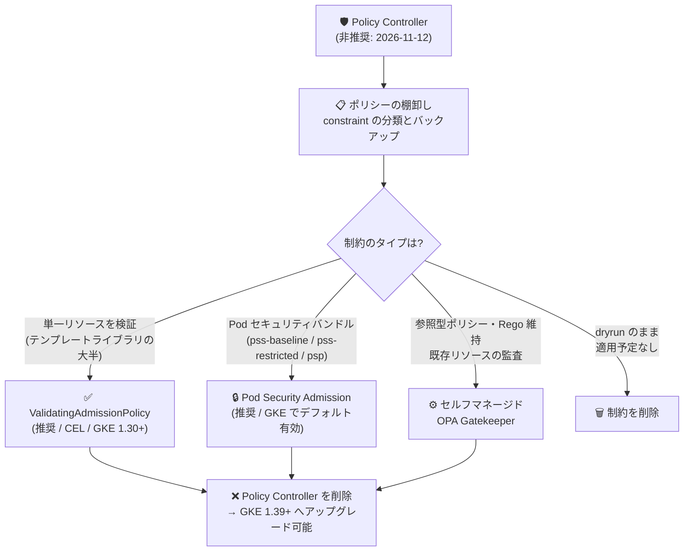

# Policy Controller: 非推奨化の発表 (2027 年 12 月 31 日にサポート終了)

**リリース日**: 2026-11-12

**サービス**: Policy Controller

**機能**: Policy Controller の非推奨化と移行パス

**ステータス**: Deprecated (非推奨)

📊 [このアップデートのインフォグラフィックを見る](https://takech9203.github.io/google-cloud-news-summary/20261112-policy-controller-deprecation.html)

## 概要

Google Cloud は 2026 年 11 月 12 日付けで **Policy Controller を非推奨 (Deprecated)** とすることを発表しました。Policy Controller は 2027 年 12 月 31 日にサポート終了 (End of Support) を迎えます。Policy Controller は Open Policy Agent (OPA) Gatekeeper をベースとしたマネージドなアドミッションコントロールサービスで、GKE Enterprise のフリート機能として Kubernetes クラスタ全体へのポリシー適用を提供してきました。

今回の発表には段階的な制限スケジュールが含まれています。2027 年 1 月 31 日以降は、Policy Controller が未有効のフリートホストプロジェクトで新規に有効化できなくなります。また、GKE は Policy Controller がインストールされたクラスタの **バージョン 1.39 以降へのアップグレードをブロック** し、GKE 1.39 以降のクラスタでは Policy Controller がサポートされません。2027 年 12 月 31 日には、テクニカルサポート、GKE 1.38 以前でのセキュリティパッチ適用、Google Cloud コンソールの Policy Controller ダッシュボードがすべて終了します。

フリート全体で Policy Controller を運用しているオペレーターやセキュリティ担当者は、アドミッションポリシーを **Kubernetes ネイティブの ValidatingAdmissionPolicy**、**Pod Security Admission**、または **セルフマネージドの OPA Gatekeeper** へ移行する必要があります。移行は実行中のワークロードには影響しません (Policy Controller はリソースの作成・更新リクエストを評価するため、削除しても実行中のワークロードは再起動・変更されません)。

**アップデート前の状況**

- Policy Controller は GKE Enterprise の一部として、テンプレートライブラリやポリシーバンドル (Pod Security バンドルなど)、監査機能を含むマネージドなポリシー適用基盤を提供していた
- インストール、アップグレード、スケーリング、モニタリングは Google Cloud が管理し、Cloud Customer Care によるサポートが提供されていた

**アップデート後の影響**

- 2027 年 1 月 31 日以降、Policy Controller 未有効のフリートホストプロジェクトでは新規有効化が不可になる
- Policy Controller がインストールされたクラスタは GKE 1.39 以降へアップグレードできない (アップグレードがブロックされる)
- 2027 年 12 月 31 日にテクニカルサポート、GKE 1.38 以前でのセキュリティパッチ、コンソールダッシュボードが終了する
- 代替として ValidatingAdmissionPolicy (推奨)、Pod Security Admission (Pod セキュリティバンドル向け推奨)、セルフマネージド OPA Gatekeeper への移行が必要

## アーキテクチャ図



Policy Controller の各制約 (constraint) をタイプごとに分類し、適切な移行先を選択するフローです。1 つのクラスタ内で複数の移行先を組み合わせることもできます。移行完了後に Policy Controller を削除することで、GKE 1.39 以降へのアップグレードが可能になります。

## サービスアップデートの詳細

### 非推奨化のスケジュール

| 日付 | イベント |
|------|---------|
| 2026 年 11 月 12 日 | Policy Controller が非推奨 (Deprecated) になる |
| 2027 年 1 月 31 日 | Policy Controller 未有効のフリートホストプロジェクトで新規有効化が不可になる |
| GKE 1.39 リリース以降 | Policy Controller がインストールされたクラスタは 1.39 以降へのアップグレードがブロックされる。GKE 1.39 以降のクラスタでは Policy Controller は非サポート |
| 2027 年 12 月 31 日 | サポート終了。テクニカルサポート、GKE 1.38 以前でのセキュリティパッチ、Google Cloud コンソールダッシュボードが終了 |

### 移行先の選択肢

1. **ValidatingAdmissionPolicy (推奨)**
   - リソースの作成・更新時に単一リソースを検証するポリシーに適する。Policy Controller テンプレートライブラリの大半のテンプレートはこの方式で動作する
   - Kubernetes に組み込みで、GKE 1.30 以降で追加費用なしに利用可能。Cloud Customer Care が GKE の一部としてサポートする
   - Rego の代わりに CEL (Common Expression Language) 式を使用し、Webhook を介さず API サーバーが直接評価する

2. **Pod Security Admission (Pod セキュリティバンドルの推奨移行先)**
   - `pss-baseline-v2022`、`pss-restricted-v2022`、`psp-v2022` バンドルの事前定義 Pod セキュリティ制御の移行先
   - Kubernetes に組み込みで、GKE ではデフォルトで有効。追加費用なしで Customer Care のサポート対象

3. **セルフマネージド OPA Gatekeeper**
   - ValidatingAdmissionPolicy で表現できないポリシー向け: クラスタ内の他リソースを参照する参照型 (referential) ポリシー、Rego を維持したいポリシー、既存リソースの監査 (audit)
   - Gatekeeper の ConstraintTemplate に CEL ルールを追加すると、Gatekeeper が API サーバー適用用の ValidatingAdmissionPolicy を生成し、監査コントローラーが既存リソースをチェックできる
   - インストール・アップグレード・運用はユーザー自身が行う。Customer Care はオープンソース Gatekeeper をサポートせず、サポートは GitHub の Gatekeeper コミュニティ経由

### 制約タイプ別の移行パス

| 制約タイプ | 移行パス |
|-----------|---------|
| 単一リソース制約 (`data.inventory` 不使用、Pod セキュリティバンドル以外) | ValidatingAdmissionPolicy |
| 適用予定のない dryrun 制約 | 制約を削除 |
| Pod セキュリティバンドル制約 | Pod Security Admission (カバーされない制御は ValidatingAdmissionPolicy) |
| 参照型制約 (`data.inventory` を読み取るテンプレート) | セルフマネージド Gatekeeper |
| Cloud Service Mesh / Istio / Google Cloud 制約 | 個別にレビュー。大半は ValidatingAdmissionPolicy で動作。`AsmAuthzPolicyDefaultDeny` と `AsmPeerAuthnMeshStrictMtls` は参照型のため Gatekeeper が必要。`K8sRequireBinAuthZ` は Binary Authorization、`K8sRequireCosNodeImage` はノードイメージ設定で代替 |

## 技術仕様

### 制約フィールドと ValidatingAdmissionPolicy のマッピング

| Constraint のフィールド | ValidatingAdmissionPolicy / Binding のフィールド |
|------------------------|------------------------------------------------|
| `spec.enforcementAction` | Binding の `validationActions` (`deny` → `["Deny"]`、`warn` → `["Warn"]`、`dryrun` → `["Audit"]`) |
| `spec.parameters` | ValidatingAdmissionPolicy の `variables`、または Binding の `paramRef` が参照するパラメータリソース |
| `spec.match.kinds` | ValidatingAdmissionPolicy の `matchConstraints.resourceRules` (kind ではなく API グループとリソース名を使用) |
| `spec.match.namespaces` / `excludedNamespaces` | Binding の `matchResources.namespaceSelector` (`kubernetes.io/metadata.name` ラベルに `In` / `NotIn`) |
| `spec.match.labelSelector` | Binding の `matchResources.objectSelector` |
| `spec.match.namespaceSelector` | Binding の `matchResources.namespaceSelector` |
| `spec.match.scope` | 各リソースルールの `scope` フィールド |

### ValidatingAdmissionPolicy との挙動の違い (注意点)

| 項目 | Policy Controller | ValidatingAdmissionPolicy |
|------|------------------|---------------------------|
| 障害時の挙動 | Webhook はフェイルオープン (無応答時はリクエストを許可) | `failurePolicy: Fail` の場合、式のエラーや CEL コスト上限超過でリクエストを拒否 |
| 欠落フィールド | Rego は欠落フィールドを違反なしとして扱う | CEL はエラーを返す。参照前に `has()` マクロで存在確認が必要 |
| 名前空間の除外 | デフォルトでシステム名前空間を除外 (`admission.gatekeeper.sh/ignore` ラベル) | デフォルト除外なし。GKE Standard では `kube-system` を含む全名前空間に適用されるため、明示的な除外が必要 (Autopilot ではマネージド名前空間を自動除外) |
| 既存リソースの監査 | audit 機能あり | 受信 API リクエストのみ評価。既存の違反リソースはレポートしない |
| 違反メッセージ | すべての違反を報告 | リクエストごとに最初に失敗した検証のみ報告 |

## 移行手順

### 前提条件

1. フリートホストプロジェクトに対する Policy Controller の管理権限と、各クラスタへの `kubectl` アクセス
2. GKE 1.39 へのアップグレード前に、ポリシー移行と Policy Controller の削除を完了させる計画 (ポリシー移行前に Policy Controller だけを削除すると、ポリシー適用のないクラスタになるため非推奨)

### 手順

#### ステップ 1: ポリシーの棚卸しとバックアップ

```bash
# フリート内で Policy Controller が稼働するクラスタを特定
gcloud container fleet policycontroller describe --project=PROJECT_ID

# 各クラスタで適用中の制約を一覧表示 (適用アクションと違反数を確認)
kubectl get constraints \
  -o custom-columns='KIND:.kind,NAME:.metadata.name,ACTION:.spec.enforcementAction,VIOLATIONS:.status.totalViolations,BUNDLE:.metadata.labels.policycontroller\.gke\.io/bundleName'

# ConstraintTemplate と制約をバックアップ
kubectl get constrainttemplates -o yaml > policy-controller-templates-backup.yaml
kubectl get constraints -o yaml > policy-controller-constraints-backup.yaml
```

テンプレートライブラリはデフォルトで全テンプレートをインストールし、ポリシーバンドルは `dryrun` で制約をインストールするため、クラスタ上のテンプレート・制約が実際に「適用しているポリシー」と一致するとは限りません。ACTION 列が空の制約はデフォルトの `deny` です。Policy Controller を削除するとすべての ConstraintTemplate・制約・ミューテーターが削除されるため、バックアップは必須です。

#### ステップ 2: 制約ごとに移行先へ変換・並行テスト

```yaml
# 例: 許可リポジトリ制約 (K8sAllowedRepos) の ValidatingAdmissionPolicy 版
# まず validationActions: ["Warn", "Audit"] で既存制約と並行稼働させて結果を比較
apiVersion: admissionregistration.k8s.io/v1
kind: ValidatingAdmissionPolicyBinding
metadata:
  name: allowed-repos
spec:
  policyName: allowed-repos
  validationActions: ["Warn", "Audit"]
  matchResources:
    namespaceSelector:
      matchExpressions:
        - key: kubernetes.io/metadata.name
          operator: NotIn
          values: ["kube-system", "gatekeeper-system"]
```

結果が一致したら `validationActions: ["Deny"]` に変更し、Policy Controller 側の制約を削除します。これにより適用のギャップなしに置き換えられます。

#### ステップ 3: Policy Controller の削除

```bash
# クラスタから Policy Controller をアンインストール
gcloud container fleet policycontroller disable \
  --memberships=MEMBERSHIP_NAME \
  --project=PROJECT_ID

# アンインストール完了を確認 (state が NOT_INSTALLED になるまで待機)
gcloud container fleet policycontroller describe \
  --memberships=MEMBERSHIP_NAME \
  --project=PROJECT_ID \
  --format="yaml(membershipStates)"

# 後から登録するクラスタへの自動インストールを防ぐ (フリートレベルのデフォルト設定を削除)
gcloud container fleet policycontroller enable \
  --no-fleet-default-member-config \
  --project=PROJECT_ID
```

アンインストール完了前にフリート機能の削除やクラスタの登録解除を行うと、Policy Controller が管理されないまま動き続けるため注意が必要です。`detach` コマンドも Policy Controller を残したまま管理を停止するため使用しないでください。

#### ステップ 4: (Gatekeeper へ移行する場合) セルフマネージド Gatekeeper のインストール

```bash
# カスタム ConstraintTemplate を移行先の Gatekeeper バージョンの gator でテスト
gator test --filename=TEMPLATE_FILE

# Policy Controller 削除後、gatekeeper-system 名前空間の消滅を確認してから Helm でインストール
kubectl get namespace gatekeeper-system
```

Policy Controller と Gatekeeper は同じ `gatekeeper-system` 名前空間、同じ CustomResourceDefinition、同じ Webhook 名を使用するため、共存できません。バックアップしたリソースを再適用する際は、`status` フィールド、`app.kubernetes.io/managed-by: anthospolicycontroller.googleapis.com` ラベル、`policycontroller.` プレフィックスのラベル・アノテーションなどを削除してから適用します。Autopilot クラスタでは、ミューテーション Webhook のワイルドカードルールが拒否されるため、`disableMutation: true` などの Helm 設定が必要です。

## メリット

### ビジネス面

- **追加費用なしの移行先**: ValidatingAdmissionPolicy と Pod Security Admission は Kubernetes / GKE 組み込み機能であり追加費用なしで利用でき、Cloud Customer Care のサポート対象 (GKE の一部として)
- **ベンダー中立なポリシー基盤**: Kubernetes 標準 API (CEL ベース) への移行により、ポリシー定義の移植性が向上する

### 技術面

- **Webhook レス化による信頼性向上**: ValidatingAdmissionPolicy は API サーバーが CEL 式を直接評価するため、Webhook のレイテンシや可用性リスクがない
- **ワークロードへの無影響**: 移行・Policy Controller の削除は実行中のワークロードを再起動・変更しない (アドミッション時のみ評価されるため)

## デメリット・制約事項

### 制限事項

- GKE は Policy Controller がインストールされたクラスタの 1.39 以降へのアップグレードをブロックする。移行完了まで GKE バージョンが 1.38 以前に固定される
- 2027 年 1 月 31 日以降、未有効のフリートホストプロジェクトでは Policy Controller を新規有効化できない
- ValidatingAdmissionPolicy は既存リソースの監査 (audit) に対応せず、参照型ポリシーを表現できない。これらにはセルフマネージド Gatekeeper が必要
- セルフマネージド Gatekeeper は Customer Care のサポート対象外で、インストール・アップグレード・スケーリング・監視をユーザーが担う。テンプレートライブラリとポリシーバンドルも含まれない

### 考慮すべき点

- ポリシー移行前に Policy Controller だけを削除しない (ポリシー適用のギャップが生じる)。重要なポリシーから先に ValidatingAdmissionPolicy へ移行し、Warn/Audit での並行稼働で結果を比較してから Deny に切り替える
- ValidatingAdmissionPolicy はデフォルトでシステム名前空間を除外しないため、`kube-system` などの除外設定を明示する必要がある (Standard クラスタ)
- CEL は欠落フィールドでエラーを返すため、`has()` マクロによる存在確認が必要。`failurePolicy: Fail` ではエラー時にリクエストが拒否される点も Policy Controller (フェイルオープン) と異なる
- CI パイプラインで `gator` や kpt による事前検証をしている場合、ValidatingAdmissionPolicy への移行後は `kubectl apply --dry-run=server` によるサーバーサイドドライランへの切り替えが必要
- Gatekeeper の新しい Rego エンジンは検証が厳格で、カスタム ConstraintTemplate が拒否される場合がある。移行前に `gator test` での検証が必要

## ユースケース

### ユースケース 1: テンプレートライブラリ中心の利用者が ValidatingAdmissionPolicy へ移行

**シナリオ**: 許可イメージリポジトリ (`K8sAllowedRepos`) やラベル必須などテンプレートライブラリの単一リソース検証ポリシーを deny で運用している組織。

**実装例**:
```yaml
apiVersion: admissionregistration.k8s.io/v1
kind: ValidatingAdmissionPolicy
metadata:
  name: allowed-repos
spec:
  failurePolicy: Fail
  matchConstraints:
    resourceRules:
      - apiGroups: [""]
        apiVersions: ["v1"]
        operations: ["CREATE", "UPDATE"]
        resources: ["pods", "pods/ephemeralcontainers"]
  variables:
    - name: repos
      expression: "['us-docker.pkg.dev/example-project/example-repo/']"
    - name: images
      expression: >-
        object.spec.containers.map(c, c.image) +
        (has(object.spec.initContainers) ? object.spec.initContainers.map(c, c.image) : []) +
        (has(object.spec.ephemeralContainers) ? object.spec.ephemeralContainers.map(c, c.image) : [])
  validations:
    - expression: >-
        variables.images.all(image, variables.repos.exists(repo, image.startsWith(repo)))
      messageExpression: >-
        'container images must come from one of these repositories: ' + variables.repos.join(', ')
      reason: Forbidden
```

**効果**: Webhook 不要・追加費用なしの Kubernetes 組み込み機能で同等のポリシーを維持しつつ、GKE 1.39 以降へのアップグレードが可能になる。

### ユースケース 2: Pod セキュリティバンドル利用者が Pod Security Admission へ移行

**シナリオ**: `pss-baseline-v2022` や `pss-restricted-v2022` バンドルで Pod のセキュリティ標準を適用している組織。

**効果**: GKE でデフォルト有効の Pod Security Admission に名前空間ラベルで同等の制御を移行でき、Customer Care のサポートを受けながら運用を継続できる。バンドルでカバーされない個別制御は ValidatingAdmissionPolicy で補完する。

### ユースケース 3: 参照型ポリシーや監査が必要な組織がセルフマネージド Gatekeeper へ移行

**シナリオ**: クラスタ内の他リソースを参照するポリシー (Ingress のホスト名重複チェックなど) や、既存リソースの違反監査を必要とする組織。

**効果**: Policy Controller は Gatekeeper ベースのため、ConstraintTemplate と制約は同じ API のまま移行できる。ConstraintTemplate に CEL ルールを追加すれば、API サーバー適用用の ValidatingAdmissionPolicy 生成と監査の両方を利用できる。

## 料金

- **ValidatingAdmissionPolicy / Pod Security Admission**: Kubernetes / GKE 組み込み機能のため追加費用なし (GKE 1.30 以降 / GKE でデフォルト有効)
- **セルフマネージド OPA Gatekeeper**: オープンソースのためライセンス費用はないが、Gatekeeper の Pod が消費するクラスタリソースと運用コストはユーザー負担
- Policy Controller 自体は GKE Enterprise の一部として提供されており、詳細は [GKE の料金ページ](https://cloud.google.com/kubernetes-engine/pricing) を参照

## 関連サービス・機能

- **GKE (Google Kubernetes Engine)**: ValidatingAdmissionPolicy (1.30+)、MutatingAdmissionPolicy (1.36+)、Pod Security Admission の提供基盤。1.39 以降では Policy Controller 非サポート
- **Binary Authorization**: `K8sRequireBinAuthZ` テンプレートの組み込み代替。コンテナイメージの署名検証ポリシーを適用
- **Config Sync / GitOps ツール (Argo CD など)**: Git リポジトリから制約をデプロイしている場合、移行時にリポジトリ内の ConstraintTemplate・制約の整理が必要
- **Cloud Audit Logs / Cloud Logging**: ValidatingAdmissionPolicy の Audit アクションによる違反レポートの確認先
- **OPA Gatekeeper (オープンソース)**: Policy Controller のベースであり、参照型ポリシー・監査・Rego 維持が必要な場合の移行先

## 参考リンク

- 📊 [インフォグラフィック](https://takech9203.github.io/google-cloud-news-summary/20261112-policy-controller-deprecation.html)
- [公式リリースノート](https://docs.cloud.google.com/release-notes#November_12_2026)
- [Migrate from Policy Controller (移行ガイド)](https://docs.cloud.google.com/kubernetes-engine/docs/deprecations/policy-controller)
- [GKE 料金ページ](https://cloud.google.com/kubernetes-engine/pricing)

## まとめ

Policy Controller の非推奨化は、GKE Enterprise でポリシー適用を運用するすべての組織に影響する重要な発表です。GKE 1.39 以降へのアップグレードがブロックされるため、実質的な移行期限はサポート終了日 (2027 年 12 月 31 日) より早く訪れます。まずは `kubectl get constraints` で適用中のポリシーを棚卸し・バックアップし、単一リソース検証は ValidatingAdmissionPolicy、Pod セキュリティバンドルは Pod Security Admission、参照型・監査が必要なポリシーはセルフマネージド Gatekeeper という方針で、Warn/Audit での並行稼働を挟みながら計画的に移行を進めることを推奨します。

---

**タグ**: #PolicyController #GKE #Deprecation #ValidatingAdmissionPolicy #PodSecurityAdmission #OPAGatekeeper #Kubernetes #Security
