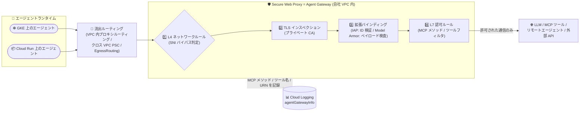

# Secure Web Proxy: Agent Gateway としてのデプロイ (Preview)

**リリース日**: 2026-11-12

**サービス**: Secure Web Proxy

**機能**: Secure Web Proxy を自己管理型 Agent Gateway としてデプロイし、AI エージェントの流出トラフィックを一元統制

**ステータス**: Preview (申請制)

📊 [このアップデートのインフォグラフィックを見る](https://takech9203.github.io/google-cloud-news-summary/20261112-secure-web-proxy-agent-gateway-preview.html)

## 概要

Secure Web Proxy (SWP) を **Agent Gateway** としてデプロイできる機能が Preview として発表されました。Google Kubernetes Engine (GKE) や Cloud Run 上で稼働する AI エージェントからのアウトバウンドトラフィックを、自社 VPC ネットワーク内の SWP インスタンスという単一のポリシー適用点 (Policy Enforcement Point) に集約し、LLM・Model Context Protocol (MCP) ツール・リモートエージェント・外部 API・一般 Web 宛先との通信を一元的に保護・統制・監視できます。

Agent Gateway には、Gemini Enterprise / Agent Runtime 上のエージェント向けに最適化された **Google 管理型** と、今回の **SWP による自己管理型** の 2 つのデプロイモデルがあります。自己管理型は、VPC ネットワーク境界・プライベート CA 証明書・プロキシルーティングを自社で完全にコントロールしたまま、Agent Registry 連携・一元的なアクセスポリシー・コンテンツガードレールといった Gemini Enterprise Agent Platform 共通のガバナンス機能を利用したい組織に向いています。従来からエグレス統制の実績がある SWP の deny-all デフォルト・TLS インスペクション・Cloud Logging 統合といった基盤の上に、エージェント特有のガバナンス (MCP メソッドフィルタリング、Model Armor によるペイロード検査、エージェントアイデンティティ検証) が追加される形です。

本レポートは SWP をエグレスガバナンスの適用点として使う観点に焦点を当てます。GKE 側のトラフィック統制全体像 (Client-to-Agent / Agent-to-Agent を含む) は [Agent Gateway for GKE (Preview) のレポート](./2026-11-12-agent-gateway-for-gke-preview.md)を、Cloud Run 側で流出トラフィックを SWP へ届ける基盤となるサイドカー機構は [Cloud Run Ambient Networking / Express Links のレポート](./2026-11-13-cloud-run-ambient-networking-express-links.md)を参照してください。

**アップデート前の課題**

- SWP のゲートウェイセキュリティポリシーは送信元 (サービスアカウント、セキュアタグ)・宛先ホスト・URL・ヘッダーなどに基づく Web トラフィック統制が中心で、MCP の `tools/list` / `tools/call` といったエージェント特有のプロトコル操作を識別してフィルタリングすることはできなかった
- エージェントのプロンプト / レスポンスに対するプロンプトインジェクション対策や機密データ漏えい検査は、エージェントのアプリケーションコード内で Model Armor API を個別に呼び出すなど、ワークロードごとに実装する必要があった
- GKE や Cloud Run 上のエージェントに Agent Platform のガバナンス (Agent Registry、一元ポリシー) を適用しつつ、VPC 境界やプライベート CA を自社管理下に置く自己管理型の選択肢がなかった
- プロキシの転送ログからは「どのエージェントが、どの MCP ツールを、どのメソッドで呼び出したか」というエージェント実行コンテキストを読み取れず、監査・インシデント調査が困難だった

**アップデート後の改善**

- `agentGateway` リソースに定義した認可ポリシーを SWP で直接適用し、MCP ツール呼び出しの制限、エージェントの外部宛先フィルタリング、Model Armor などのコンテンツサニタイズ連携を一元的に実施できるようになった
- Service Extensions の拡張バインディングにより、Model Armor (プロンプト / レスポンスの検査) や Identity-Aware Proxy (IAP、エージェント呼び出し元の暗号学的な検証) をゲートウェイにアタッチでき、エージェントコードの変更なしにガードレールを適用できるようになった
- GKE・Cloud Run など複数のランタイムにまたがるエージェントの流出トラフィックを、VPC 内プロキシルーティングまたはクロス VPC の Private Service Connect (PSC) サービスアタッチメント経由で単一のプロキシ境界に集約できるようになった
- Cloud Logging のトランザクションログに MCP メソッド・ツール名・Agent Registry 宛先の URN を含むエージェント実行メタデータ (`agentGatewayInfo`) が自動的に記録され、エージェント視点の可観測性が得られるようになった

## アーキテクチャ図



GKE / Cloud Run 上のエージェントの流出トラフィックは SWP に集約され、L4 ネットワークルール → TLS インスペクション → 拡張バインディング (IAP / Model Armor) → L7 MCP 認可ルールの順に評価されたうえで、許可された宛先にのみ転送されます。

## サービスアップデートの詳細

### 主要機能

1. **自己管理型 Agent Gateway (顧客管理インフラ)**
   - SWP ゲートウェイを自社 VPC ネットワーク内で運用し、ネットワークルーティング・IP アドレッシング・プライベート CA 証明書・TLS インスペクションを自社の完全な管理下に置ける
   - `agentGateway` リソースの `selfManaged.resourceUris` に既存の SWP ゲートウェイを関連付けるだけで、Agent Platform 共通のガバナンス (一元アクセスポリシー、Agent Registry 連携、コンテンツガードレール) を利用できる
   - Google 管理型 Agent Gateway (Gemini Enterprise / Agent Runtime 向け) と共通のガバナンスソリューションを、GKE / Cloud Run の自己ホスト型エージェントにも拡張できる

2. **2 層のポリシーアーキテクチャによる AI ポリシーの一元適用**
   - **拡張バインディング (主要なガバナンス機構)**: Service Extensions の `ExtensionBinding` リソースで Model Armor (プロンプトインジェクション・ジェイルブレイク・機密データ漏えいのディープペイロード検査) や IAP (ツール呼び出し前のクライアント / エージェント ID の暗号学的検証) をゲートウェイに直接アタッチ。カスタム / サードパーティ製プロセッサも `ProducerExtension` + PSC サービスアタッチメント経由でバインド可能
   - **認可ポリシー (きめ細かな制御と例外)**: L4 ネットワークルールで信頼済み外部モデルエンドポイントの TLS インスペクションをバイパスし、L7 HTTP ルールで MCP メソッド (`tools/list`、`tools/call`) やツール名・引数レベルの許可 / 拒否を適用
   - 注意: Agent Gateway 利用時に評価されるのは `agentGateway` リソースにアタッチしたポリシーのみで、配下の `Gateway` リソースに直接アタッチしたポリシーは無視される

3. **マルチランタイム対応の流出トラフィック集約**
   - GKE や Cloud Run など異なるランタイムでホストされるエージェントのアウトバウンドトラフィックを、単一のプロキシ境界に集約
   - 同一 VPC 内は VPC 内プロキシルーティング、別 VPC・クロスプロジェクト環境はクロス VPC の PSC サービスアタッチメントで SWP に接続
   - Cloud Run では Ambient Networking サイドカー + Direct VPC egress + `EgressRouting` リソース、GKE では ambient ネットワーキングによるサイドカーレスのリダイレクトで SWP に誘導 (詳細はそれぞれの[関連レポート (Cloud Run)](./2026-11-13-cloud-run-ambient-networking-express-links.md)・[関連レポート (GKE)](./2026-11-12-agent-gateway-for-gke-preview.md)を参照)

4. **エージェント認識型の可観測性**
   - Cloud Logging のトランザクションログに `agentGatewayInfo` としてエージェント実行メタデータを自動記録
   - 記録内容には MCP メソッド、ツール名、Agent Registry 宛先の Uniform Resource Name (URN) が含まれ、「どのエージェントがどのツールを呼んだか」を監査可能

## 技術仕様

### 認可ルールの評価順序

| 順序 | 評価レイヤー | 内容 |
|------|------------|------|
| 1 | ネットワーク (L4) 認可ルール | SNI マッチルールに該当するトラフィック (例: 信頼済み外部モデルエンドポイントへの直接通信) は TLS インターセプトをバイパス |
| 2 | TLS インターセプト | バイパスされなかったトラフィックをゲートウェイの TLS インスペクションポリシーで復号 |
| 3 | 拡張バインディングルール | IAP によるリクエストヘッダー上の呼び出し元 ID 検証、Model Armor による復号済みペイロードのプロンプト安全性・機密データ漏えい検査 |
| 4 | HTTP (L7) 認可ルール | MCP ツール制限・メソッドフィルタリングなどの HTTP レベル認可ポリシーを評価 |

### 主要リソースと役割

| リソース | 役割 |
|---------|------|
| `Gateway` (type: `SECURE_WEB_GATEWAY`) | VPC 内で動作するプロキシ本体。プロキシ専用サブネット・証明書・ServerTlsPolicy・GatewaySecurityPolicy を参照 |
| `agentGateway` | 論理的な Agent Gateway。`selfManaged.resourceUris` で SWP を参照し、`registries` で Agent Registry と連携 (任意) |
| `AuthzPolicy` | `agentGateway` をターゲットに L4 / L7 (MCP メソッド・ツール) ルールを定義 |
| `ExtensionBinding` | `agentGateway` に IAP / Model Armor / カスタムプロセッサをアタッチ。`failOpen` で障害時の挙動 (遮断 / 素通し) を制御 |
| `EgressRouting` | Cloud Run などのワークロードの流出トラフィックを SWP ゲートウェイに向けるルーティングポリシー |

### MCP ツール制限ポリシーの例

`tools/list` によるツール探索と、承認済みツール (`get_weather`、`get_location`) に対する `tools/call` のみを許可する認可ポリシーの例です。

```yaml
name: authz-policy-restrict-tools
target:
  resources:
  - "projects/PROJECT_ID/locations/LOCATION/agentGateways/AGENT_GATEWAY_NAME"
policyProfile: REQUEST_AUTHZ
httpRules:
- to:
    operations:
    - mcp:
        baseProtocolMethodsOption: MATCH_BASE_PROTOCOL_METHODS
        methods:
        - name: "tools/list"
        - name: "tools/call"
          params:
          - exact: "get_weather"
          - exact: "get_location"
  action: ALLOW
```

## 設定方法

### 前提条件

1. Preview 申請: 本機能は申請制の Preview であり、Google Cloud Agent Governance Preview のサインアップフォームからアクセスをリクエストする
2. 必要な API の有効化: `networkservices.googleapis.com`、`networksecurity.googleapis.com`、`privateca.googleapis.com`、`certificatemanager.googleapis.com`、`serviceextensions.googleapis.com`、`agentregistry.googleapis.com`、`compute.googleapis.com`
3. 必要な IAM ロール: Compute Network Admin (`roles/compute.networkAdmin`)、Network Security Admin (`roles/networksecurity.admin`)、CA Service Admin (`roles/privateca.admin`)
4. VPC ネットワークに `REGIONAL_MANAGED_PROXY` 目的のプロキシ専用サブネットを用意し、Certificate Manager にゲートウェイ用のリージョナル SSL/TLS 証明書を登録する
5. TLS インスペクション用の `TlsInspectionPolicy` (Certificate Authority Service のプライベート CA を利用) と、それを参照する `GatewaySecurityPolicy`、フロントエンド mTLS 用の `ServerTlsPolicy` を作成する

### 手順

#### ステップ 1: SWP ゲートウェイを作成する

```bash
# swp.yaml (抜粋): type: SECURE_WEB_GATEWAY、プロキシ専用サブネット、
# 証明書、serverTlsPolicy、gatewaySecurityPolicy を指定
gcloud network-services gateways import SECURE_WEB_PROXY_NAME \
  --source=swp.yaml \
  --location=REGION \
  --project=PROJECT_ID
```

明示的ルーティングモードの SWP ゲートウェイをデプロイします。作成後に `addresses` / `ports` フィールドは変更できない点に注意してください。

#### ステップ 2: SWP を agentGateway リソースに関連付ける

```bash
# agent-gateway.yaml:
#   selfManaged.resourceUris に SWP ゲートウェイを指定
#   registries に Agent Registry を指定 (任意)
gcloud beta network-services agent-gateways import AGENT_GATEWAY_NAME \
  --source=agent-gateway.yaml \
  --location=REGION \
  --project=PROJECT_ID
```

`registries` フィールドを指定すると Agent Registry による宛先・ツール解決と連携できます。

#### ステップ 3: 拡張バインディングと認可ポリシーを構成する

```bash
# Model Armor 拡張バインディング (プロンプト / レスポンスのサニタイズ)
gcloud beta service-extensions extension-bindings import ext-binding-model-armor \
  --source=ext-binding-model-armor.yaml \
  --location=REGION

# MCP ツール制限の認可ポリシー
gcloud network-security authz-policies import authz-policy-restrict-tools \
  --source=authz-policy-mcp.yaml \
  --location=LOCATION
```

IAP / Model Armor の拡張バインディングと MCP メソッド制限ポリシーは、SWP の `Gateway` リソースではなく `agentGateway` リソースをターゲットに構成します。

#### ステップ 4: エージェントランタイムの流出トラフィックを SWP に向ける

```bash
# Cloud Run の例: EgressRouting でサービスの流出トラフィックを SWP に誘導
gcloud alpha network-services egress-routings create my-run-egress-routing \
  --location=REGION \
  --project=PROJECT_ID \
  --gateway="//networkservices.googleapis.com/projects/PROJECT_ID/locations/REGION/gateways/SWP_NAME" \
  --sources="workloadUri=//run.googleapis.com/projects/PROJECT_ID/locations/REGION/services/SERVICE_NAME"
```

`workloadUri` にプロジェクトを指定すれば、プロジェクト内の全 Cloud Run サービスを単一ポリシーでルーティングすることもできます。エージェントがゲートウェイをバイパスしないよう、サブネットの egress を SWP 宛てのみに制限する VPC ファイアウォールルールの構成が推奨されています。

## メリット

### ビジネス面

- **AI ガバナンスとコンプライアンスの一元化**: エージェントの外部通信を単一の検査点に集約することで、データプライバシー要件への準拠、機密データ漏えい防止、プロンプトインジェクションなどの AI 脅威対策を組織横断で統一的に適用できる
- **主権・統制要件への適合**: ネットワーク境界・プライベート CA・ルーティングを自社管理下に置けるため、Google 管理型ゲートウェイでは満たしにくい厳格なネットワーク統制要件を持つ組織でも Agent Platform のガバナンスを採用できる
- **監査性の向上**: `agentGatewayInfo` により「どのエージェントがどの MCP ツールをいつ呼び出したか」が Cloud Logging で追跡でき、インシデント調査やコンプライアンスレポートが容易になる

### 技術面

- **アプリケーション非侵襲のガードレール**: Model Armor / IAP の適用やツール許可リストの変更がゲートウェイ側のポリシー変更だけで完結し、エージェントコードの修正・再デプロイが不要
- **deny-all からの段階的許可**: SWP のデフォルト拒否の上に、SNI バイパス・MCP メソッド・ツール引数という複数レイヤーで段階的に許可を定義でき、最小権限のエグレス統制を実現できる
- **マルチランタイム・マルチ VPC 対応**: GKE / Cloud Run / クロスプロジェクト環境のエージェントを、PSC サービスアタッチメントや Shared VPC を介して単一のプロキシ境界に集約できる

## デメリット・制約事項

### 制限事項

- 申請制の Preview であり、Pre-GA Offerings Terms が適用される (SLA なし、サポート限定)
- SWP ゲートウェイの `addresses` / `ports` は作成後に変更不可。既存ゲートウェイの `serverTlsPolicy` / `certificateUrls` の変更は `EgressRouting` を使うワークロードに自動伝播しないため、無停止で変更するには新ゲートウェイを作成して `agentGateway` と `EgressRouting` の参照を切り替える手順が必要
- SWP 共通の制限として、IPv4 のみ対応 (IPv6 非対応)、HTTP/3 非対応、デプロイはホストプロジェクトのみ (サービスプロジェクト不可)
- `agentGateway` 利用時は配下の `Gateway` リソースに直接アタッチしたポリシーが無視されるため、既存の SWP ポリシー資産をそのまま流用できない

### 考慮すべき点

- エージェントトラフィック専用の SWP ゲートウェイを用意することが推奨されている (非エージェントワークロード用プロキシとの共用は、拡張バインディングや MCP フィルタなどエージェント固有のガードレールの分離性を損なう)
- 拡張バインディングの `failOpen` 設定は重要な設計判断: `false` は拡張サービス到達不能時にトラフィックを遮断 (安全側)、`true` は未検査で素通しする
- TLS インスペクションにはプライベート CA (Certificate Authority Service) の運用と、エージェント側でのルート CA 証明書の信頼設定が必要
- 自己管理型のため、プロキシのポリシー設計・証明書ライフサイクル・サブネット設計などの運用責任は利用者側にある (ゼロメンテナンスを望む場合は Google 管理型 Agent Gateway を検討)

## ユースケース

### ユースケース 1: MCP ツールの許可リスト運用

**シナリオ**: GKE 上のカスタマーサポートエージェントが外部 MCP ツールサーバーを利用するが、セキュリティチームは承認済みツール以外の呼び出しを組織として禁止したい。

**実装例**:
```yaml
httpRules:
- to:
    operations:
    - mcp:
        baseProtocolMethodsOption: MATCH_BASE_PROTOCOL_METHODS
        methods:
        - name: "tools/list"
        - name: "tools/call"
          params:
          - exact: "search_kb"
          - exact: "create_ticket"
  action: ALLOW
```

**効果**: エージェントがプロンプトインジェクションなどで想定外のツールを呼び出そうとしても、ゲートウェイが `tools/call` の引数レベルで遮断する。許可ツールの追加はポリシー更新のみで完結し、エージェントの再デプロイは不要。

### ユースケース 2: Model Armor によるプロンプト / レスポンスの全数検査

**シナリオ**: Cloud Run 上の複数のエージェントが外部 LLM や MCP サーバーと通信しており、機密データの漏えいとプロンプトインジェクションをエージェント実装に依存せず組織レベルで防ぎたい。

**効果**: `agentGateway` に Model Armor の拡張バインディング (`failOpen: false`) をアタッチするだけで、全エージェントの復号済みリクエスト / レスポンスがゲートウェイでサニタイズされる。検査テンプレートの変更も中央で一括管理できる。

### ユースケース 3: マルチランタイム環境のエグレス監査統合

**シナリオ**: GKE と Cloud Run に分散したエージェント群の外部 API アクセスを、単一の検査点で記録・監査したい。

**効果**: 各ランタイムの流出トラフィックを VPC 内ルーティング / PSC / EgressRouting で単一の SWP に集約し、`agentGatewayInfo` 付きトランザクションログを Cloud Logging で横断分析できる。シャドー AI ツールの利用検知やインシデント時のフォレンジックが容易になる。

## 料金

Secure Web Proxy の料金は以下の 2 つの指標に基づきます。

1. SWP が処理したデータ量に対する GB 単価の課金
2. 作成・稼働中の SWP インスタンスごとの時間単価の課金

Agent Gateway 機能 (Preview) 固有の追加料金は公式情報で確認できませんでした。Model Armor や Certificate Authority Service、Cloud Logging など連携サービスの料金が別途発生する点に注意してください。最新の料金は[料金ページ](https://cloud.google.com/secure-web-proxy/pricing)を参照してください。

## 利用可能リージョン

SWP を Agent Gateway としてデプロイできるリージョンの一覧は公式ドキュメントで明示されていません。なお、関連機能である Agent Gateway on Cloud Run (Gated Preview) は `us-central1` と `europe-west1` で利用可能と記載されています。最新情報は[公式ドキュメント](https://docs.cloud.google.com/secure-web-proxy/docs/deploy-swp-as-agent-gateway)を確認してください。

## 関連サービス・機能

- **Gemini Enterprise Agent Platform / Agent Gateway**: 本機能のガバナンス基盤。Google 管理型と SWP 自己管理型の 2 つのデプロイモデルを提供し、Agent Registry・アクセスポリシー・コンテンツガードレールを共通化
- **Agent Gateway for GKE (Preview)**: GKE 上のエージェントの流入・流出・エージェント間トラフィックを統制する機能。流出 (Agent-to-Anywhere) の適用点として本機能の SWP を利用 ([関連レポート](./2026-11-12-agent-gateway-for-gke-preview.md))
- **Cloud Run Ambient Networking (Preview)**: Cloud Run のフルマネージド Envoy サイドカー。Direct VPC egress と組み合わせてエージェントの流出トラフィックを SWP へ届ける基盤 ([関連レポート](./2026-11-13-cloud-run-ambient-networking-express-links.md))
- **Model Armor**: 拡張バインディング経由で連携し、プロンプトインジェクション・ジェイルブレイク・機密データ漏えいをペイロードレベルで検査
- **Identity-Aware Proxy (IAP)**: 拡張バインディング経由でエージェント呼び出し元のアイデンティティを暗号学的に検証
- **Service Extensions**: Model Armor / IAP / カスタムプロセッサをゲートウェイにアタッチする `ExtensionBinding` を提供
- **Certificate Authority Service / Certificate Manager**: TLS インスペクション用のプライベート CA とゲートウェイ証明書の管理
- **Agent Registry**: `agentGateway` の `registries` フィールドで連携し、宛先・ツールの解決と URN ベースのログ記録を実現
- **Cloud Logging / Cloud Trace**: `agentGatewayInfo` を含むトランザクションログの記録と分散トレーシング

## 参考リンク

- 📊 [インフォグラフィック](https://takech9203.github.io/google-cloud-news-summary/20261112-secure-web-proxy-agent-gateway-preview.html)
- [公式リリースノート](https://docs.cloud.google.com/release-notes#November_12_2026)
- [Deploy Secure Web Proxy as an Agent Gateway](https://docs.cloud.google.com/secure-web-proxy/docs/deploy-swp-as-agent-gateway)
- [Secure Web Proxy overview](https://docs.cloud.google.com/secure-web-proxy/docs/overview)
- [Set up authorization policies for Secure Web Proxy](https://docs.cloud.google.com/secure-web-proxy/docs/setup-authz-policies)
- [Policies and rules overview](https://docs.cloud.google.com/secure-web-proxy/docs/policies-and-rules-overview)
- [Agent Gateway overview](https://docs.cloud.google.com/gemini-enterprise-agent-platform/govern/gateways/agent-gateway-overview)
- [料金ページ](https://cloud.google.com/secure-web-proxy/pricing)

## まとめ

Secure Web Proxy を Agent Gateway としてデプロイできるようになったことで、GKE / Cloud Run 上の AI エージェントの流出トラフィックに対し、自社 VPC 内の単一の適用点で MCP ツール制限・Model Armor によるペイロード検査・エージェント ID 検証・エージェント認識型ロギングを実現できるようになりました。エージェントの外部通信統制を「アプリケーション実装任せ」から「ネットワーク境界での組織ポリシー」へ移行できる重要なアップデートです。AI エージェントを本番運用する組織は、Preview 申請のうえ、エージェント専用 SWP ゲートウェイ + deny-all ベースの許可リスト設計を検証することを推奨します。

---

**タグ**: Secure Web Proxy, Agent Gateway, AI エージェント, MCP, Model Armor, IAP, エグレス制御, ネットワークセキュリティ, GKE, Cloud Run, Preview
