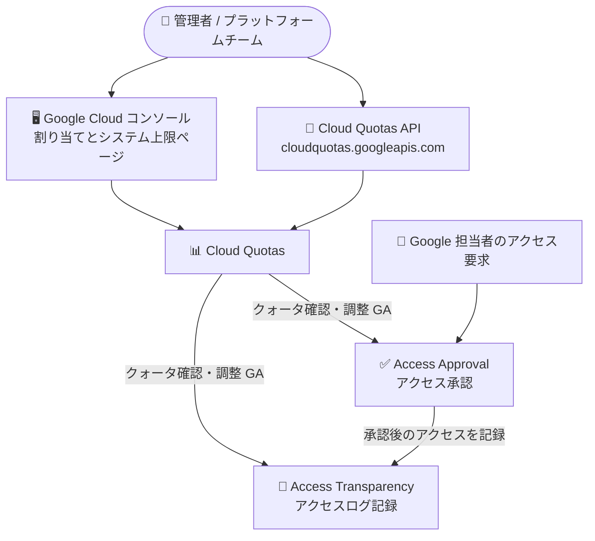

# Access Approval / Access Transparency: Cloud Quotas サポートが一般提供 (GA) に

**リリース日**: 2026-11-13

**サービス**: Access Approval, Access Transparency

**機能**: Cloud Quotas サポートの一般提供 (GA)

**ステータス**: GA (一般提供)

📊 [このアップデートのインフォグラフィックを見る](https://takech9203.github.io/google-cloud-news-summary/20261113-access-approval-transparency-cloud-quotas-ga.html)

## 概要

2026 年 11 月 13 日、Access Approval および Access Transparency における Cloud Quotas のサポートが一般提供 (GA) になりました。Cloud Quotas は、Google Cloud の各プロダクト・サービスのリソース消費を監視・制限し、クォータ値の調整リクエストや自動調整 (Quota Adjuster) を提供する仕組みです。今回の GA により、両サービスのクォータを Google Cloud コンソールの「割り当てとシステム上限 (Quotas & System Limits)」ページや Cloud Quotas API を通じて、GA 水準の安定性で確認・管理できるようになりました。

Access Transparency は Google 担当者が顧客データ (Customer Data) にアクセスした際のアクションをログとして記録するサービス、Access Approval はそのアクセスに対して顧客の明示的な承認を必須にするサービスです。いずれもコンプライアンス要件の厳しい組織 (金融、公共、医療など) で広く利用されており、ガバナンス運用の一部としてクォータの可視化・管理が標準の Cloud Quotas 体系に統合されることは、運用の一貫性向上につながります。

対象ユーザーは、Assured Workloads や Access Transparency / Access Approval を利用してデータアクセス統制を実施している組織の管理者、およびクォータ管理を Cloud Quotas API で自動化しているプラットフォームチームです。

**アップデート前の課題**

- Access Approval / Access Transparency に対する Cloud Quotas サポートは GA ではなく、本番環境での利用において GA 水準の安定性保証がなかった ([プロダクトのローンチステージ](https://cloud.google.com/products#product-launch-stages)参照)
- クォータ管理の自動化 (Infrastructure as Code やクォータ設定のプロジェクト間複製) を、GA 保証のある形でこれらのサービスに適用できなかった

**アップデート後の改善**

- 両サービスのクォータ確認・管理が Cloud Quotas (コンソールの「割り当てとシステム上限」ページ、Cloud Quotas API) で GA として利用可能になった
- 他の Google Cloud サービスと同じ標準化されたインターフェース (QuotaInfo / QuotaPreference リソース) でクォータを扱えるようになり、クォータ設定のコード化・バージョン管理・自動化に組み込みやすくなった

## アーキテクチャ図



管理者はコンソールまたは Cloud Quotas API を通じて、Access Approval / Access Transparency のクォータを他サービスと同じ標準の仕組みで確認・管理できます。

## サービスアップデートの詳細

### 主要機能

1. **コンソールでのクォータ確認**
   - 「IAM と管理 > 割り当てとシステム上限 (Quotas & System Limits)」ページで、サービス名によるフィルタリングでクォータ使用量と上限値を確認可能
   - 使用量の推移チャート表示・エクスポート、使用率によるソートに対応

2. **Cloud Quotas API による管理**
   - `QuotaInfo` リソースでクォータのメタデータ・現在値を取得
   - `QuotaPreference` リソースでクォータ調整リクエストを宣言的に送信 (構成をコードとして管理可能)
   - クォータ設定のプロジェクト間での再利用 (クローン) が可能

3. **クォータ調整の自動化**
   - 使用量がクォータ値に近づいた際に自動で調整リクエストを発行する Quota Adjuster の仕組みに統合
   - クォータ超過前のアラート設定 (Cloud Monitoring 連携) が利用可能

## 技術仕様

### Cloud Quotas の主要リソース

| 項目 | 詳細 |
|------|------|
| サービスエンドポイント | `https://cloudquotas.googleapis.com` (グローバルサービス) |
| QuotaInfo | クォータの読み取り専用情報 (メタデータ、コンテナタイプ、ディメンション、現在の上限値) |
| QuotaPreference | クォータ調整リクエストを表す宣言的リソース (作成・更新で調整を申請) |
| QuotaAdjusterSettings | プロジェクトごとの Quota Adjuster (自動クォータ調整) 設定 |

### 必要な IAM ロール

| タスク | ロール |
|--------|--------|
| クォータの閲覧 | Quota Viewer (`roles/servicemanagement.quotaViewer`) |
| クォータ調整のリクエスト | Quota Administrator (`roles/servicemanagement.quotaAdmin`) |
| Cloud Quotas API リソースへのアクセス | Cloud Quotas Admin (`roles/cloudquotas.admin`) |

## 設定方法

### 前提条件

1. Access Transparency が組織で有効化されていること (Access Approval の利用には Access Transparency の有効化が必須)
2. クォータ閲覧・管理に必要な IAM ロールが付与されていること

### 手順

#### ステップ 1: コンソールでクォータを確認する

1. Google Cloud コンソールで「IAM と管理 > 割り当てとシステム上限」ページに移動
2. フィルタで対象サービス (例: Access Approval API) を選択
3. 使用量・上限値・使用率を確認 (使用量チャートの表示も可能)

#### ステップ 2: Cloud Quotas API でクォータ情報を取得する

```bash
# QuotaInfo リソースの命名規則
# projects/PROJECT_NUMBER/locations/global/services/SERVICE_NAME/quotaInfos/QUOTA_ID

# 例: Access Approval API のクォータ情報一覧を取得
curl -H "Authorization: Bearer $(gcloud auth print-access-token)" \
  "https://cloudquotas.googleapis.com/v1/projects/PROJECT_NUMBER/locations/global/services/accessapproval.googleapis.com/quotaInfos"
```

クォータ値の変更が必要な場合は、`QuotaPreference` リソースの作成 (create) または更新 (patch) で調整をリクエストします。調整リクエストは Google Cloud の承認プロセスの対象です。

## メリット

### ビジネス面

- **ガバナンス運用の標準化**: データアクセス統制サービス (Access Approval / Access Transparency) のクォータ管理が、他の Google Cloud サービスと同じ Cloud Quotas 体系に統合され、運用プロセスを一本化できる
- **GA 水準の安定性**: 本番環境のコンプライアンス運用に、SLA や後方互換性の面で GA 相当の保証をもって組み込める

### 技術面

- **宣言的なクォータ管理**: Cloud Quotas API によりクォータ設定をコードとして扱い、バージョン管理やプロジェクト作成時の自動適用に組み込める
- **事前の可視化とアラート**: クォータ使用率をコンソールで可視化し、上限到達前にアラートや自動調整 (Quota Adjuster) で対処できる

## デメリット・制約事項

### 制限事項

- クォータの引き上げ調整は多くの場合プロジェクトレベルで行う必要がある (組織レベルの引き上げ調整をサポートするプロダクトは限定的)
- クォータ調整リクエストは自動システムまたは人手によるレビューの対象であり、承認が保証されるものではない
- システム上限 (System Limits) は固定値であり変更できない

### 考慮すべき点

- Quota Adjuster の利用には、予測に十分な使用履歴が必要
- クォータはリソースの空き状況を保証するものではない

## ユースケース

### ユースケース 1: コンプライアンス環境でのクォータ監視の標準化

**シナリオ**: 金融機関が Assured Workloads 環境で Access Approval / Access Transparency を運用しており、すべてのサービスのクォータ使用状況を単一のダッシュボードで監視したい。

**効果**: 「割り当てとシステム上限」ページと Cloud Quotas API により、データアクセス統制サービスを含む全サービスのクォータを統一的に監視でき、監査対応や容量計画が容易になる。

### ユースケース 2: 新規プロジェクト作成時のクォータ設定自動化

**シナリオ**: プラットフォームチームが、新規プロジェクト作成時に必要なクォータ設定 (Access Approval API のリクエストレートなど) を Infrastructure as Code で自動適用したい。

**実装例**:
```
QuotaPreference リソースを宣言的に定義し、
プロジェクト作成パイプラインで Cloud Quotas API (PATCH, allow_missing 有効) を呼び出して適用
```

**効果**: クォータ構成をコードとして管理でき、プロジェクト間で一貫した設定を自動的に再現できる。

## 料金

今回のアップデートに伴う料金変更のアナウンスはありません。Access Approval の料金については公式の料金ページを参照してください。

- [Access Approval の料金](https://docs.cloud.google.com/assured-workloads/access-approval/pricing)

## 関連サービス・機能

- **Cloud Quotas**: 本アップデートの中核。Google Cloud 全体のクォータの監視・制限・調整リクエスト・自動調整を提供
- **Access Transparency**: Google 担当者による顧客データアクセスのログを記録。Access Approval の前提条件
- **Access Approval**: Google 担当者のアクセスに対する顧客の明示的な承認を必須化。Access Transparency の統制を一段強化
- **Key Access Justifications**: CMEK 署名鍵を利用する場合の鍵アクセスの可視化・制御
- **Cloud Monitoring**: クォータ使用率のアラート設定・使用量チャートに利用

## 参考リンク

- 📊 [インフォグラフィック](https://takech9203.github.io/google-cloud-news-summary/20261113-access-approval-transparency-cloud-quotas-ga.html)
- [公式リリースノート](https://docs.cloud.google.com/release-notes#November_13_2026)
- [Cloud Quotas の概要](https://docs.cloud.google.com/docs/quotas/overview)
- [Cloud Quotas API の概要](https://docs.cloud.google.com/docs/quotas/api-overview)
- [クォータの表示と管理](https://docs.cloud.google.com/docs/quotas/view-manage)
- [Access Approval の概要](https://docs.cloud.google.com/assured-workloads/access-approval/docs/overview)
- [Access Transparency がサポートするサービス](https://docs.cloud.google.com/assured-workloads/access-transparency/docs/supported-services)
- [プロダクトのローンチステージ](https://cloud.google.com/products#product-launch-stages)

## まとめ

Access Approval と Access Transparency のクォータ管理が Cloud Quotas の標準体系に GA として統合され、データアクセス統制サービスの運用を他サービスと同じ仕組みで管理できるようになりました。これらのサービスを利用している組織は、「割り当てとシステム上限」ページでのクォータ確認と、Cloud Quotas API を用いたクォータ構成のコード化・自動化の導入を検討することを推奨します。

---

**タグ**: Access Approval, Access Transparency, Cloud Quotas, GA, セキュリティ, ガバナンス, コンプライアンス
