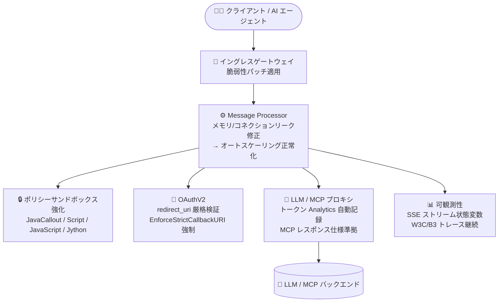

# Apigee X: 1-18-0-apigee-9 リリース (ポリシーサンドボックス強化、OAuth 2.0 redirect_uri 検証修正、LLM/MCP プロキシ改善)

**リリース日**: 2026-11-13

**サービス**: Apigee X

**機能**: 1-18-0-apigee-9 ランタイム更新 (セキュリティ修正 + バグ修正)

**ステータス**: リリース (ロールアウト中)

📊 [このアップデートのインフォグラフィックを見る](https://takech9203.github.io/google-cloud-news-summary/20261113-apigee-x-1-18-0-apigee-9.html)

## 概要

2026 年 11 月 13 日、Apigee (Apigee X) の更新版ランタイム **1-18-0-apigee-9** がリリースされました。ロールアウトは同日に開始され、すべての Google Cloud ゾーンへの完了までに 4 営業日以上かかる場合があります。ロールアウトが完了するまで、インスタンスによっては本リリースの機能や修正が利用できないことがあります。

本リリースは、**カスタムコード実行ポリシー (JavaCallout / Script / JavaScript) のサンドボックス強化**、**OAuth 2.0 の redirect_uri 検証バイパスの修正**、**Jython サンドボックスエスケープの修正**、**イングレスゲートウェイの脆弱性パッチ**といった複数の重要なセキュリティ修正を含みます。カスタムポリシーや OAuth 2.0 認可コードグラントを利用しているすべての Apigee X 組織に関係するリリースです。

また、バグ修正も広範囲にわたり、**SSE EventFlow のストリーム終了状態を示す新しいフロー変数**、**LLM プロキシの Analytics トークン使用量フィールドの自動入力 (Anthropic プロンプトキャッシュトークン対応、ストリーミング対応)**、**MCP プロキシのレスポンス形式の仕様準拠**、**Message Processor のメモリリーク / コネクションカウントリークの修正 (オートスケーリングへの影響)**、**分散トレースの W3C / B3 トレースコンテキスト継続**など、AI ゲートウェイ用途と従来の API 管理用途の両方に効く修正が含まれています。

**アップデート前の課題**

- OAuth 2.0 の非厳格なサブリソースマッチングにおいて `redirect_uri` 検証をバイパスできる問題があり、GenerateAuthorizationCode ポリシーで `<EnforceStrictCallbackURI>` が強制されていなかった
- ユーザー指定の `<JythonURL>` JAR で `org.python.core.PyReflected` クラスを定義すると、無制限の `pythonns:` 保護ドメインが付与され、Jython サンドボックスをエスケープできた
- SSE ストリームの終了理由 (正常完了 / 上流中断 / 下流中断 / タイムアウト) や送信バイト数を PostClientFlow で判別・ログ記録する手段がなかった
- LLM プロキシのトークン使用量 Analytics フィールドは LLMTokenQuota ポリシーの付与が前提で、ストリーミング (SSE) レスポンスでは `<EventFlow>` なしに記録されず、Anthropic のプロンプトキャッシュ読み書きトークンも集計されなかった
- MCP プロキシのレスポンスが非標準の `application/vnd.mcp+json` Content-Type で返され、バックエンド発の JSON-RPC エラーレスポンス (-32020、-32022、-32601 など) が Apigee の合成エンベロープで上書きされていた
- Message Processor にプロキシデプロイ / 環境リロード時のメモリリークと、管理ポート (8843 など) の HTTP サーバーのコネクションカウントリークがあり、オートスケーリング指標が水増しされてランタイムレプリカが最大数に張り付き、クラスタ CPU を使い果たす可能性があった
- 受信接続タイムアウト (120 秒) より長いストリーミングターゲットレスポンスが、プロキシエンドポイントで大きなリクエストボディをバッファした場合に切り詰められることがあった
- Envoy ext_proc パス上の Apigee 分散トレーススパンが、呼び出し元の受信 W3C / B3 トレースコンテキストを引き継がず新しいトレースを開始していた

**アップデート後の改善**

- JavaCallout / Script / JavaScript ポリシーのサンドボックスが強化され、OAuth 2.0 redirect_uri 検証バイパスと Jython サンドボックスエスケープが修正された
- 新フロー変数 `response.event.stream.state` と `response.event.stream.content.length` により、PostClientFlow の MessageLogging ステップで SSE ストリームの終了状態 (COMPLETE / UPSTREAM_ABORT / DOWNSTREAM_ABORT / TIMEOUT) と送信バイト数をログ記録できるようになった
- LLM プロキシの Analytics カノニカルトークンフィールドが、LLMTokenQuota ポリシーの有無やストリーミングの有無にかかわらず LLM プロバイダーの応答から自動入力されるようになり、Anthropic のプロンプトキャッシュ読み書きトークンも含まれるようになった
- MCP プロキシのレスポンスが仕様準拠の `application/json` Content-Type となり、バックエンド発の JSON-RPC エラーがそのままクライアントに透過されるようになった
- Message Processor のメモリリークとコネクションカウントリークが修正され、オートスケーリングの異常動作リスクが解消された
- 分散トレーススパンが受信 W3C / B3 トレースコンテキストを継続し、エンドツーエンドのトレースがつながるようになった

## アーキテクチャ図



1-18-0-apigee-9 で修正・強化された Apigee X ランタイムの主要コンポーネントを示しています。セキュリティ修正 (サンドボックス、OAuth、イングレス) と、LLM/MCP プロキシや可観測性の改善が同一リリースに含まれます。

## サービスアップデートの詳細

### 主要機能

1. **セキュリティ修正**

   | Bug ID | 内容 |
   |--------|------|
   | 579640924 | JavaCallout、Script、JavaScript ポリシーのサンドボックスを強化 |
   | 579642864 | OAuth 2.0 の非厳格なサブリソースマッチングにおける `redirect_uri` 検証バイパスを修正し、GenerateAuthorizationCode ポリシーで `<EnforceStrictCallbackURI>` を強制 |
   | 579642568 | ユーザー指定の `<JythonURL>` JAR が `org.python.core.PyReflected` クラスを定義すると無制限の `pythonns:` 保護ドメインを受け取る Jython サンドボックスエスケープを修正 |
   | 582347995, 577964152 | イングレスゲートウェイをアップグレードし、脆弱性をパッチ |
   | N/A | Apigee インフラストラクチャのセキュリティ修正 |

2. **SSE / LLM / MCP プロキシ関連の修正**
   - **582789138**: SSE EventFlow レスポンスに `response.event.stream.state` と `response.event.stream.content.length` フロー変数を追加。PostClientFlow で読み取り可能で、MessageLogging ステップが COMPLETE / UPSTREAM_ABORT / DOWNSTREAM_ABORT / TIMEOUT の終了種別と送信バイト数をログ記録できる。`response.event.processed.count` と組み合わせてストリームごとのイベント数も取得可能
   - **571610415**: LLM プロキシが Analytics フィールド `ai_llm_canonical_cached_prompt_token_count`、`ai_llm_canonical_response_token_count` (thinking トークン含む)、`ai_llm_canonical_thinking_token_count`、`ai_llm_canonical_model_name`、`ai_llm_canonical_model_provider` を、LLMTokenQuota ポリシーの有無にかかわらず LLM プロバイダーの応答から入力するようになった。`ai_llm_canonical_prompt_token_count` には Anthropic のプロンプトキャッシュ読み取り / 書き込みトークンが含まれるようになった
   - **571610415**: ストリーミング (SSE) レスポンスでも、プロキシバンドルに `<EventFlow>` がなくてもトークン使用量の Analytics 列 (プロンプト / レスポンストークン数、モデル、プロバイダー) が記録されるようになった
   - **581734420**: MCP プロキシのレスポンス形式を修正。Content-Type が非標準の `application/vnd.mcp+json` から仕様準拠の `application/json` になり、バックエンド発の JSON-RPC エラーレスポンス (例: -32020 HeaderMismatch、-32022 UnsupportedProtocolVersion、-32601 Method not found) が Apigee の合成エンベロープで上書きされずそのまま透過される。非 MCP (LLM) プロキシの挙動変更はなし
   - **583643203**: SanitizeUserPrompt / SanitizeModelResponse ポリシーが `MA-Client-Correlation-Id` ヘッダーを Model Armor に転送するようになった
   - **544820285**: LLM/MCP フォーマッターが生成するゲートウェイレスポンスに `X-Content-Type-Options: nosniff` ヘッダーが付与されるようになった
   - **568062600**: Semantic Governance のトレースが、スキップしたリクエストを含め各リクエストの LLM ファミリーとモデルを記録するようになった

3. **安定性・可観測性・WS-Security の修正**
   - **579213551**: プロキシデプロイと環境リロード時の Message Processor メモリリークを修正。コンパイル済み OASValidation 仕様がコンテンツハッシュで共有され、置き換えられた / 失敗した環境ロードのリソースが解放されるようになった
   - **583672651**: 管理ポート (例: 8843) のランタイム HTTP サーバーにおけるコネクションカウントリークを修正。オートスケーリング指標が水増しされてランタイムレプリカが最大数に張り付き、クラスタ CPU を使い果たす問題が解消
   - **576448578**: プロキシエンドポイントが大きなリクエストボディをバッファした場合に、受信接続タイムアウト (120 秒) を超えるストリーミングターゲットレスポンスが切り詰められる問題を修正
   - **572000222**: Envoy ext_proc パス上の Apigee 分散トレーススパンが、新しいトレースを開始せず呼び出し元の受信 W3C または B3 トレースコンテキストを継続するようになった
   - **582791025**: WS-Security 署名で SignatureConfirmation 値が重複・失敗しなくなり、署名付き確認とその他の署名要素が検証できるようになった
   - **582790275**: `max_lifetime` を使った WS-Security 署名検証がすべてのドキュメントを拒否する問題を修正
   - **582790249**: メッセージのない例外で失敗したポリシーの Execution エントリがデバッグトレースから欠落する問題を修正
   - **582790971**: 別のデバッグセッションやマスキングエラーが介在した場合に、デバッグセッションでマスクされていないペイロード、クエリパラメータ、ヘッダー、フロー変数が表示される問題を修正
   - **582790557**: Management API のパスが登録済みベースパスとパスセグメント単位でのみマッチするようになった (例: `/optimizer` が `/o` リソースにルーティングされない)
   - **N/A**: インフラストラクチャとライブラリの更新

## 技術仕様

### OAuth 2.0 redirect_uri 検証の背景

OAuthV2 ポリシーの認可コードグラントでは、デベロッパーアプリに登録された Callback URL とリクエストの `redirect_uri` の一致検証が行われます。公式ドキュメントによると、デフォルトは前方一致 (forward match) であり、完全一致を強制するには組織プロパティ `features.isStrictOAuthUriValidation = true` の設定が必要です。本リリースでは、非厳格なサブリソースマッチング時に検証をバイパスできる問題が修正され、GenerateAuthorizationCode ポリシーで `<EnforceStrictCallbackURI>` が強制されるようになりました。

### 新しい SSE ストリームフロー変数

| フロー変数 | 内容 |
|-----------|------|
| `response.event.stream.state` | ストリームの終了状態: `COMPLETE` / `UPSTREAM_ABORT` / `DOWNSTREAM_ABORT` / `TIMEOUT` |
| `response.event.stream.content.length` | クライアントへ送信されたバイト数 |
| `response.event.processed.count` (既存) | ストリームごとの処理済みイベント数 (上記と組み合わせて使用) |

これらは PostClientFlow で読み取り可能で、MessageLogging ポリシーによるストリーム終了ログの記録に使用できます。

### LLM Analytics カノニカルフィールド

| Analytics フィールド | 内容 |
|---------------------|------|
| `ai_llm_canonical_prompt_token_count` | プロンプトトークン数 (Anthropic プロンプトキャッシュ読み取り / 書き込みトークンを含むようになった) |
| `ai_llm_canonical_cached_prompt_token_count` | キャッシュされたプロンプトトークン数 |
| `ai_llm_canonical_response_token_count` | レスポンストークン数 (thinking トークン含む) |
| `ai_llm_canonical_thinking_token_count` | thinking (推論) トークン数 |
| `ai_llm_canonical_model_name` | モデル名 |
| `ai_llm_canonical_model_provider` | モデルプロバイダー |

LLMTokenQuota ポリシーの付与や `<EventFlow>` の有無にかかわらず、バッファリング / ストリーミング (SSE) 両方のレスポンスで LLM プロバイダーの応答から自動入力されます。

### PostClientFlow での SSE 終了状態ロギング例

```xml
<MessageLogging name="ML-sse-stream-state">
  <CloudLogging>
    <LogName>projects/{organization.name}/logs/sse-stream-log</LogName>
    <Message contentType="application/json">
      {"state":"{response.event.stream.state}",
       "bytes":"{response.event.stream.content.length}",
       "events":"{response.event.processed.count}"}
    </Message>
  </CloudLogging>
</MessageLogging>
```

```xml
<!-- PostClientFlow に配置 -->
<PostClientFlow name="PostClientFlow">
  <Response>
    <Step>
      <Name>ML-sse-stream-state</Name>
    </Step>
  </Response>
</PostClientFlow>
```

## 設定方法

### 前提条件

1. Apigee X (SaaS 版) を利用していること。本リリースは Google によって自動的にロールアウトされ、ユーザー側のアップグレード操作は不要
2. ロールアウトは 2026 年 11 月 13 日に開始され、全ゾーンへの完了まで 4 営業日以上かかる場合がある

### 手順

#### ステップ 1: インスタンスのランタイムバージョン確認

```bash
# Apigee インスタンスの情報を確認
curl -s -H "Authorization: Bearer $(gcloud auth print-access-token)" \
  "https://apigee.googleapis.com/v1/organizations/{ORG}/instances"
```

`runtimeVersion` が `1-18-0-apigee-9` になっていれば、本リリースの修正が適用されています。メンテナンスウィンドウを設定している場合は、ウィンドウに従って更新されます。

#### ステップ 2: 新しい SSE フロー変数の活用 (任意)

ロールアウト完了後、SSE プロキシの PostClientFlow に MessageLogging ステップを追加し、`response.event.stream.state` / `response.event.stream.content.length` を使用してストリーム終了状態のロギングを構成できます (上記「技術仕様」の例を参照)。

#### ステップ 3: LLM トークン Analytics の確認 (任意)

LLM プロキシを運用している場合、Apigee Analytics (カスタムレポートなど) で `ai_llm_canonical_*` フィールドが LLMTokenQuota ポリシーなし / ストリーミングレスポンスでも記録されることを確認し、トークン使用量レポートやコスト配賦の仕組みを簡素化できます。

## メリット

### ビジネス面

- **セキュリティリスクの低減**: OAuth 2.0 の redirect_uri 検証バイパスは認可コードの不正な窃取につながり得る脆弱性であり、サンドボックスエスケープはカスタムコードによる権限昇格のリスクとなる。これらが自動ロールアウトで修正され、ユーザー側の作業なしにセキュリティ態勢が向上する
- **AI コストの可視化**: LLM トークン使用量 (Anthropic プロンプトキャッシュ含む) が追加のポリシー設定なしで Analytics に記録されるため、AI API のコスト管理・チャージバックの精度が向上する
- **安定した運用コスト**: オートスケーリング指標の水増しによるレプリカの最大張り付き (クラスタ CPU の浪費) が解消される

### 技術面

- **SSE ストリームの運用可観測性**: ストリームの終了理由と送信バイト数を PostClientFlow でログに残せるため、LLM ストリーミング API の切断調査や SLO 監視が容易になる
- **MCP エコシステムとの互換性向上**: MCP レスポンスの Content-Type が仕様準拠の `application/json` となり、バックエンドの JSON-RPC エラーが透過されるため、MCP クライアントとの相互運用性が向上する
- **エンドツーエンドの分散トレーシング**: Envoy ext_proc パスのスパンが受信 W3C / B3 トレースコンテキストを継続するため、呼び出し元からバックエンドまでのトレースが分断されない
- **デバッグの信頼性向上**: デバッグトレースの欠落やマスキング漏れが修正され、トラブルシューティング時のデータ保護と情報の完全性が向上する

## デメリット・制約事項

### 制限事項

- ロールアウト完了まで 4 営業日以上かかる場合があり、完了まで本リリースの機能・修正が利用できないインスタンスがある
- 本リリースは Apigee X (SaaS 版) 向けであり、Apigee hybrid には別のリリース (hybrid 用リリースノート) が適用される

### 考慮すべき点

- **MCP プロキシの挙動変更**: Content-Type が `application/vnd.mcp+json` から `application/json` に変わり、バックエンド発の JSON-RPC エラーが透過されるようになる。MCP クライアント側で旧 Content-Type や Apigee の合成エラーエンベロープに依存した処理がある場合は影響を確認すること (非 MCP プロキシへの影響はなし)
- **OAuth 検証の厳格化**: `<EnforceStrictCallbackURI>` の強制により、これまで非厳格なサブリソースマッチングで通過していた `redirect_uri` が拒否される可能性がある。認可コードフローを利用するアプリの Callback URL 登録を確認すること
- **Management API のパスマッチング変更**: パスセグメント単位の完全一致になるため、前方一致に依存した API 呼び出し (例: `/optimizer` が `/o` にマッチすることを前提とした呼び出し) があれば修正が必要
- **カスタムコードポリシー**: サンドボックス強化により、JavaCallout / Script / JavaScript / Jython でサンドボックスの境界に依存した (本来許可されない) 操作を行っていたカスタムコードは動作しなくなる可能性がある

## ユースケース

### ユースケース 1: LLM ストリーミング API の切断監視

**シナリオ**: Apigee X を LLM の AI ゲートウェイとして使用し、SSE ストリーミングでレスポンスを配信している。クライアントから「応答が途中で切れる」という報告があるが、タイムアウトなのか上流 / 下流の中断なのか判別できない。

**実装例**:
```xml
<PostClientFlow name="PostClientFlow">
  <Response>
    <Step>
      <Name>ML-sse-stream-state</Name>
      <Condition>response.event.stream.state != "COMPLETE"</Condition>
    </Step>
  </Response>
</PostClientFlow>
```

**効果**: `response.event.stream.state` により TIMEOUT / UPSTREAM_ABORT / DOWNSTREAM_ABORT を区別してログに記録でき、切断の原因切り分け (バックエンド起因かクライアント起因か) が迅速になる。

### ユースケース 2: ポリシー設定なしの LLM トークンコスト集計

**シナリオ**: 複数チームが Apigee X 経由で Gemini / Anthropic などの LLM API を利用しており、チームごとのトークン消費量を集計してコストを配賦したい。これまでは LLMTokenQuota ポリシーの付与が必要で、ストリーミングレスポンスでは集計できないプロキシがあった。

**効果**: LLMTokenQuota ポリシーや `<EventFlow>` の有無にかかわらず、ストリーミングを含むすべての LLM プロキシで `ai_llm_canonical_*` フィールドが自動記録されるため、Analytics のカスタムレポートだけでチーム / アプリ単位のトークン消費 (Anthropic のプロンプトキャッシュ読み書きトークン含む) を正確に集計できる。

### ユースケース 3: MCP サーバーの標準準拠ゲートウェイ

**シナリオ**: Apigee X を MCP (Model Context Protocol) サーバーのゲートウェイとして公開しており、サードパーティの MCP クライアントから「Content-Type が標準でない」「エラーの詳細が得られない」という互換性問題が報告されていた。

**効果**: レスポンスが仕様準拠の `application/json` となり、バックエンドの JSON-RPC エラー (-32020、-32022、-32601 など) がそのまま透過されるため、標準的な MCP クライアントがエラーを正しく解釈でき、相互運用性が向上する。

## 料金

本リリースは Apigee X ランタイムの更新であり、追加料金は発生しません。Apigee の料金体系 (サブスクリプションまたは従量課金) は変更ありません。

詳細は [Apigee 料金ページ](https://cloud.google.com/apigee/pricing) を参照してください。

## 利用可能リージョン

本リリースはすべての Google Cloud ゾーンの Apigee X インスタンスに順次ロールアウトされます。ロールアウトは 2026 年 11 月 13 日に開始され、完了までに 4 営業日以上かかる場合があります。

## 関連サービス・機能

- **Apigee hybrid**: 同系統の修正 (Model Armor 連携、SSE、CVE 対応など) が hybrid 向けパッチリリース (例: v1.16.14) として別途提供される
- **Model Armor**: SanitizeUserPrompt / SanitizeModelResponse ポリシーのバックエンド。本リリースで `MA-Client-Correlation-Id` ヘッダーの転送に対応し、Model Armor 側のログと Apigee 側のリクエストの相関付けが可能になった
- **Cloud Trace / 分散トレーシング**: Envoy ext_proc パスのスパンが W3C Trace Context / B3 を継続するようになり、OpenTelemetry ベースのエンドツーエンドトレーシングと整合する
- **Apigee Analytics**: LLM トークン使用量のカノニカルフィールドが自動記録され、カスタムレポートでの AI コスト分析に活用できる
- **Cloud Logging / MessageLogging ポリシー**: 新しい SSE ストリーム状態変数と組み合わせて、ストリーム終了ログを Cloud Logging に記録できる

## 参考リンク

- 📊 [インフォグラフィック](https://takech9203.github.io/google-cloud-news-summary/20261113-apigee-x-1-18-0-apigee-9.html)
- [公式リリースノート](https://docs.cloud.google.com/release-notes#November_13_2026)
- [Apigee リリースノート](https://docs.cloud.google.com/apigee/docs/release/release-notes)
- [OAuthV2 ポリシー リファレンス](https://docs.cloud.google.com/apigee/docs/api-platform/reference/policies/oauthv2-policy)
- [Server-Sent Events (EventFlow) ドキュメント](https://docs.cloud.google.com/apigee/docs/api-platform/develop/server-sent-events)
- [LLM トークンポリシーの利用](https://docs.cloud.google.com/apigee/docs/api-platform/tutorials/using-ai-token-policies)
- [Apigee メンテナンスの概要](https://docs.cloud.google.com/apigee/docs/api-platform/system-administration/maintenance)
- [Apigee 料金ページ](https://cloud.google.com/apigee/pricing)

## まとめ

Apigee 1-18-0-apigee-9 は、OAuth 2.0 redirect_uri 検証バイパスやポリシーサンドボックスエスケープといった重要なセキュリティ修正と、LLM/MCP プロキシの可観測性・標準準拠を大きく改善するランタイム更新です。SaaS 版のため自動でロールアウトされますが、MCP レスポンスの Content-Type 変更、OAuth 検証の厳格化、Management API のパスマッチング変更など挙動変更を伴う修正があるため、該当機能を利用している場合はクライアントや呼び出し側への影響を事前に確認することを推奨します。

---

**タグ**: #ApigeeX #APIManagement #セキュリティ修正 #OAuth2 #サンドボックス #LLM #MCP #SSE #Analytics #分散トレーシング
