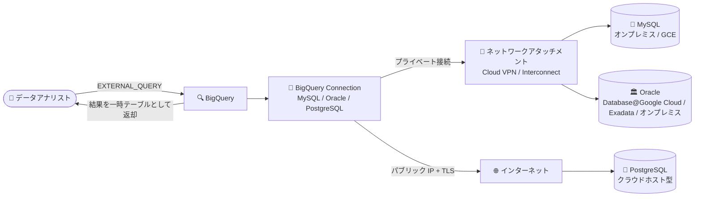

# BigQuery: MySQL / Oracle / PostgreSQL への接続と連携クエリ (Preview)

**リリース日**: 2026-11-13

**サービス**: BigQuery

**機能**: MySQL、Oracle、PostgreSQL への接続 (Connection) と連携クエリ (Federated Queries)

**ステータス**: Preview

📊 [このアップデートのインフォグラフィックを見る](https://takech9203.github.io/google-cloud-news-summary/20261113-bigquery-federated-queries-mysql-oracle-postgresql.html)

## 概要

BigQuery から MySQL、Oracle、PostgreSQL データベースへの接続 (Connection) を作成し、`EXTERNAL_QUERY` 関数による連携クエリ (Federated Queries) を実行できるようになりました。本機能は Preview として提供されます。

これまで BigQuery の連携クエリは Cloud SQL、AlloyDB、Spanner といった Google Cloud のマネージドデータベースが主な対象でしたが、今回のアップデートにより、オンプレミスや Compute Engine 上のセルフマネージドインスタンス、他クラウドでホストされたデータベースなど、Google Cloud マネージドサービス以外の MySQL / Oracle / PostgreSQL に対しても、データを移動せずに BigQuery から直接クエリを実行できます。Oracle については Oracle Database@Google Cloud や Oracle Exadata Database Service もサポート対象です。

オンプレミスや他クラウドの業務データベースと BigQuery 上の分析データを ETL なしで結合したいデータエンジニア、データアナリストに有用なアップデートです。

**アップデート前の課題**

- 連携クエリの対象は Cloud SQL、AlloyDB、Spanner などに限られ、オンプレミスや他クラウド、セルフマネージドの MySQL / Oracle / PostgreSQL のデータを BigQuery で分析するには、BigQuery Data Transfer Service や ETL パイプラインでデータを BigQuery に取り込む必要があった
- Oracle Database のデータを BigQuery から直接クエリする手段がなく、データの複製・同期の仕組みを別途構築・運用する必要があった
- データ取り込みのバッチ間隔に依存するため、ソースデータベースの最新データをリアルタイムに参照することが難しかった

**アップデート後の改善**

- BigQuery の接続リソースを作成するだけで、`EXTERNAL_QUERY` 関数により MySQL / Oracle / PostgreSQL のデータをその場でクエリし、BigQuery のテーブルと結合できるようになった
- オンプレミス (Cloud VPN / Cloud Interconnect 経由)、Compute Engine 上のセルフマネージドインスタンス、パブリック IP やネットワークアタッチメント経由で到達可能なクラウドホスト型インスタンスなど、幅広いデプロイ環境に対応した
- TLS モードの選択 (CA・ホスト名検証など)、カスタム CA 証明書、CMEK による認証情報の保護、Private Service Connect ネットワークアタッチメントによるプライベート接続など、エンタープライズ向けのセキュリティ構成が可能になった

## アーキテクチャ図



BigQuery が接続リソースを介して外部の MySQL / Oracle / PostgreSQL にクエリを送信し、結果を GoogleSQL のデータ型に変換して一時テーブルとして返すデータフローです。経路はネットワークアタッチメント経由のプライベート接続と、パブリック IP + TLS の 2 方式から選択できます。

## サービスアップデートの詳細

### 主要機能

1. **MySQL / Oracle / PostgreSQL への接続リソース作成**
   - Google Cloud コンソールまたは `bq mk --connection` コマンド (`--connector_configuration` フラグ) で接続を作成
   - ホスト:ポート、データベース名、ユーザー名・パスワードを指定。認証情報はデフォルトで Google 管理の暗号鍵、オプションで CMEK (Cloud KMS) により保護
   - 接続のリージョンはクエリを実行する BigQuery リージョンと一致させる必要がある

2. **`EXTERNAL_QUERY` 関数による連携クエリ**
   - 外部データベースの SQL 方言でクエリを記述し、結果を GoogleSQL のデータ型に変換した一時テーブルとして取得
   - BigQuery 上のテーブルと外部データベースのライブデータを JOIN 可能
   - `INFORMATION_SCHEMA` (MySQL / PostgreSQL) や Oracle のデータディクショナリビュー (`all_tables`、`all_tab_columns`) を通じたスキーマ確認にも対応

3. **柔軟なネットワーク接続とセキュリティ構成**
   - プライベート接続: BigQuery 接続と同一リージョンのネットワークアタッチメントを経由 (Cloud VPN / Cloud Interconnect でオンプレミスにも到達可能)
   - パブリック接続: Google の IP アドレスレンジをデータベース側のファイアウォールで許可
   - TLS モード: `ENCRYPT_VERIFY_CA_AND_HOST` (推奨)、`ENCRYPT_VERIFY_CA`、`ENCRYPT_VERIFY_NONE`、`DISABLE` から選択。カスタム CA の PEM 証明書も指定可能

## 技術仕様

### サポートされる環境とバージョン

| データベース | サポートバージョン | サポートされるデプロイ環境 |
|------|------|------|
| MySQL | 8.4 LTS、8.0 | オンプレミス (Cloud VPN / Interconnect 経由)、Compute Engine 上のセルフマネージド、パブリック IP / ネットワークアタッチメントで到達可能なクラウドホスト型 |
| PostgreSQL | 16 (推奨)、15 | MySQL と同様 |
| Oracle | 23.x (23ai)、21.x、19.x (19c) | Oracle Database@Google Cloud、Oracle Exadata Database Service、オンプレミス (Cloud VPN / Interconnect / パブリック IP 経由) |

### 必要な IAM ロール

| 操作 | 必要なロール |
|------|------|
| 接続の作成 | BigQuery Connection Admin (`roles/bigquery.connectionAdmin`) |
| ネットワークアタッチメントの構成 | Compute Admin (`roles/compute.admin`) |
| 連携クエリの実行 | BigQuery Connection User (`roles/bigquery.connectionUser`) |

### データ型マッピング (Oracle の例)

| Oracle データ型 | BigQuery データ型 |
|------|------|
| `NUMBER(p, s)` (p ≤ 38、s ≤ 9) | `NUMERIC` |
| `NUMBER(p, s)` (s > 9 または p > 38) | `BIGNUMERIC` |
| `NUMBER` (制約なし) | `STRING` (精度保持のため) |
| `FLOAT` / `BINARY_FLOAT` / `BINARY_DOUBLE` | `FLOAT64` |
| `CHAR` / `VARCHAR2` / `CLOB` など | `STRING` |
| `RAW` / `BLOB` / `LONG RAW` | `BYTES` |
| `DATE` / `TIMESTAMP` | `DATETIME` |
| `TIMESTAMP WITH TIME ZONE` | `TIMESTAMP` |
| `JSON` / `VECTOR` / `XMLTYPE` | `STRING` |

MySQL / PostgreSQL のマッピングは各ドキュメントの Data type mapping セクションを参照してください。

## 設定方法

### 前提条件

1. BigQuery Connection API を有効化する (ネットワークアタッチメントを使う場合は Compute Engine API も有効化)
2. 対象データベースに SELECT 権限を持つ専用のデータベースユーザーを作成する
3. ネットワーク接続を構成する (プライベート接続の場合は BigQuery 接続と同一リージョンにネットワークアタッチメントを作成、パブリック接続の場合は Google の IP レンジをファイアウォールで許可)

### 手順

#### ステップ 1: 接続の作成 (MySQL の例)

```bash
bq mk --connection \
  --location=us-central1 \
  --project_id=PROJECT_ID \
  --connector_configuration '{
    "connector_id": "mysql",
    "endpoint": { "host_port": "10.10.0.2:3306" },
    "asset": { "database": "DATABASE" },
    "authentication": {
      "username_password": {
        "username": "USERNAME",
        "password": { "plaintext": "PASSWORD" }
      }
    },
    "tls": { "mode": "ENCRYPT_VERIFY_CA_AND_HOST" },
    "network": {
      "private_service_connect": {
        "network_attachment": "projects/PROJECT_ID/regions/NA_REGION/networkAttachments/ATTACHMENT_NAME"
      }
    }
  }' \
  CONNECTION_ID
```

パブリック IP で接続する場合は `network` オブジェクトを省略します。コンソールの場合は「データを追加」→ データソースで MySQL を選択し、「BigQuery Federation」ソリューションカードから作成します。

#### ステップ 2: 連携クエリの実行 (Oracle の例)

```sql
SELECT
  bq_cust.customer_id,
  bq_cust.customer_name,
  oracle_orders.order_id,
  oracle_orders.order_status,
  oracle_orders.order_total
FROM mydataset.customers AS bq_cust
JOIN EXTERNAL_QUERY(
  'projects/my-project/locations/us-central1/connections/oracle_prod_conn',
  '''SELECT customer_id, order_id, order_status, order_total
     FROM orders
     WHERE order_date >= SYSDATE - 1''') AS oracle_orders
ON bq_cust.customer_id = oracle_orders.customer_id;
```

BigQuery 上の顧客テーブルと Oracle 上のライブな注文データを直接 JOIN する例です。

## メリット

### ビジネス面

- **ETL パイプラインの削減**: データを BigQuery にコピーせずその場で分析できるため、データ複製パイプラインの構築・運用コストを削減できる
- **最新データへのアクセス**: バッチ取り込みの待ち時間なしに、業務データベースのライブデータを BigQuery の分析に組み込める
- **マルチクラウド・ハイブリッド対応**: オンプレミスや他クラウドにあるデータベースも、Cloud VPN / Cloud Interconnect やパブリック IP 経由で BigQuery の分析対象にできる

### 技術面

- **GoogleSQL との統合**: `EXTERNAL_QUERY` の結果は GoogleSQL のデータ型に変換されるため、BigQuery のテーブルとシームレスに JOIN・加工できる
- **セキュアな接続**: TLS モードの選択、カスタム CA、CMEK、Private Service Connect ネットワークアタッチメントによるプライベート接続に対応
- **クエリの追跡**: 連携クエリにはプロジェクト ID と BigQuery ジョブ ID を含むコメントが付与され、データベース側のログで BigQuery 起点のクエリを識別できる

## デメリット・制約事項

### 制限事項

- Preview 機能であり、Pre-GA Offerings Terms が適用される (サポートは bq-3p-federation-support@google.com 宛)
- `EXTERNAL_QUERY` による読み取り専用クエリのみ実行可能 (DDL / DML は非サポート)。外部テーブルや外部データセットとしてのマッピングも不可
- SQL プッシュダウン (フィルタ・列プルーニングの自動的な押し下げ) は AlloyDB / Cloud SQL / Spanner のみ対象で、MySQL / Oracle / PostgreSQL 連携クエリでは適用されない。転送量を抑えるには `EXTERNAL_QUERY` 内の SQL で述語と列射影を明示的に指定する必要がある
- DNS ピアリングは非サポート。IP アドレスまたは VPC 内で解決可能なホスト名で接続する
- 認証はデータベースのユーザー名・パスワードのみ (Oracle の Kerberos、RADIUS、OCI IAM などは非サポート)
- Oracle ではユーザー定義型、`SDO_GEOMETRY`、コレクション型、`BFILE` などの複合型・独自型は非サポート
- 1 つの連携クエリで使用できる接続は最大 10 個。クエリ処理ロケーションと外部データソースのリージョンが異なるクロスリージョンクエリはプロジェクトあたり 1 日 1 TB まで

### 考慮すべき点

- 連携クエリのレイテンシは、データベースに直接クエリする場合や BigQuery ストレージへのクエリより大きくなる可能性がある
- 非アクティブな接続はハイバネートされることがあり、一定時間後の最初のクエリはコネクタ初期化のため 1 分以上かかる場合がある
- クエリの実行ロケーションは接続リソースのリージョンと一致させる必要があり、ネットワークアタッチメントも BigQuery 接続と同一リージョンに配置する必要がある
- 本番データベースへの分析クエリによる負荷を避けるため、リードレプリカへの接続を検討する
- VPC Service Controls で Compute Engine API の使用が制限されているプロジェクトでは、ネットワークアタッチメントを使う連携クエリが失敗する場合があるため、適切な ingress / egress ルールの構成が必要

## ユースケース

### ユースケース 1: オンプレミス Oracle の業務データと BigQuery のリアルタイム結合分析

**シナリオ**: 基幹システムの注文データがオンプレミスの Oracle Database (19c) にあり、顧客マスタや行動ログは BigQuery にある。日次バッチの取り込みを待たずに最新の注文状況を分析したい。

**実装例**:
```sql
SELECT c.segment, o.order_status, SUM(o.order_total) AS total
FROM mydataset.customers AS c
JOIN EXTERNAL_QUERY(
  'projects/my-project/locations/us-central1/connections/oracle_prod_conn',
  'SELECT customer_id, order_status, order_total FROM orders WHERE order_date >= SYSDATE - 1'
) AS o ON c.customer_id = o.customer_id
GROUP BY c.segment, o.order_status;
```

**効果**: Cloud Interconnect とネットワークアタッチメント経由で Oracle に直接クエリでき、ETL の構築なしに直近データの分析が可能になる。

### ユースケース 2: 他クラウドでホストされた PostgreSQL のデータ統合

**シナリオ**: 他クラウド上にホストされた PostgreSQL 16 に SaaS アプリケーションのデータがあり、BigQuery でのクロスソース分析に取り込みたいが、常時同期パイプラインは運用したくない。

**効果**: パブリック IP + TLS (CA・ホスト名検証) で安全に接続し、必要なときだけ `EXTERNAL_QUERY` で最新データを取得できる。データ複製が不要になり運用負荷を削減できる。

## 料金

連携クエリ自体に対する BigQuery の追加料金はありません。コストは次の 3 要素で構成されます。

- 外部データベース側でのクエリ実行コンピュートコスト (データベースの提供元・ホスティング環境に依存)
- クエリ結果を外部データベースから BigQuery へ転送する帯域コスト (ホスティングプロバイダの Egress 課金)
- BigQuery 側でのクエリ実行コンピュートコスト (通常の BigQuery 料金)

帯域コストを抑えるため、`EXTERNAL_QUERY` 内の SQL で不要な列・行を除外することが推奨されています。接続経路に Google Cloud のネットワークコンポーネントを使う場合は、VPC、Cloud VPN、Cloud NAT、Cloud Interconnect の料金が別途適用される場合があります。

詳細: [BigQuery の料金](https://cloud.google.com/bigquery/pricing)

## 利用可能リージョン

MySQL / Oracle / PostgreSQL への連携クエリは、接続リソースを作成できるすべての BigQuery リージョンでサポートされます。クエリの実行ロケーションは接続リソースのリージョンと一致している必要があり、ネットワークアタッチメントを使う場合はアタッチメントと BigQuery 接続を同一リージョンに配置する必要があります。

## 関連サービス・機能

- **Cloud SQL / AlloyDB / Spanner 連携クエリ**: 従来からサポートされている Google Cloud マネージドデータベースへの連携クエリ。Cloud SQL / AlloyDB / Spanner では SQL プッシュダウンも適用される
- **BigQuery Data Transfer Service (MySQL / Oracle / PostgreSQL 転送)**: データを BigQuery に取り込んで分析する場合の選択肢。反復的な大規模分析ではストレージへの取り込みが有利な場合がある
- **Cloud VPN / Cloud Interconnect**: オンプレミスのデータベースへプライベートに到達するためのネットワーク接続
- **VPC ネットワークアタッチメント (Private Service Connect)**: パブリックインターネットを経由しないプライベート接続経路を提供
- **Cloud KMS (CMEK)**: 接続に保存するデータベース認証情報を顧客管理の暗号鍵で保護
- **Cloud Logging**: クエリに付与される BigQuery ジョブ ID 入りコメントにより、データベース側ログで連携クエリを追跡可能

## 参考リンク

- 📊 [インフォグラフィック](https://takech9203.github.io/google-cloud-news-summary/20261113-bigquery-federated-queries-mysql-oracle-postgresql.html)
- [公式リリースノート](https://docs.cloud.google.com/release-notes#November_13_2026)
- [Connect to MySQL](https://docs.cloud.google.com/bigquery/docs/connect-to-mysql)
- [Connect to Oracle](https://docs.cloud.google.com/bigquery/docs/connect-to-oracle)
- [Connect to PostgreSQL](https://docs.cloud.google.com/bigquery/docs/connect-to-postgresql)
- [MySQL federated queries](https://docs.cloud.google.com/bigquery/docs/mysql-federated-queries)
- [Oracle federated queries](https://docs.cloud.google.com/bigquery/docs/oracle-federated-queries)
- [PostgreSQL federated queries](https://docs.cloud.google.com/bigquery/docs/postgresql-federated-queries)
- [Introduction to federated queries](https://docs.cloud.google.com/bigquery/docs/federated-queries-intro)
- [料金ページ](https://cloud.google.com/bigquery/pricing)

## まとめ

BigQuery の連携クエリが Google Cloud マネージドデータベース以外の MySQL、Oracle、PostgreSQL に拡大し、オンプレミスや他クラウドのデータを ETL なしで直接分析できるようになりました。SQL プッシュダウンが適用されないため `EXTERNAL_QUERY` 内でのフィルタ・列指定が性能とコストの鍵になります。ハイブリッド環境のデータ統合を検討しているチームは、Preview の制約を確認のうえリードレプリカへの接続から試すことを推奨します。

---

**タグ**: BigQuery, Federated Queries, MySQL, Oracle, PostgreSQL, EXTERNAL_QUERY, Preview, ハイブリッドクラウド, データ統合
