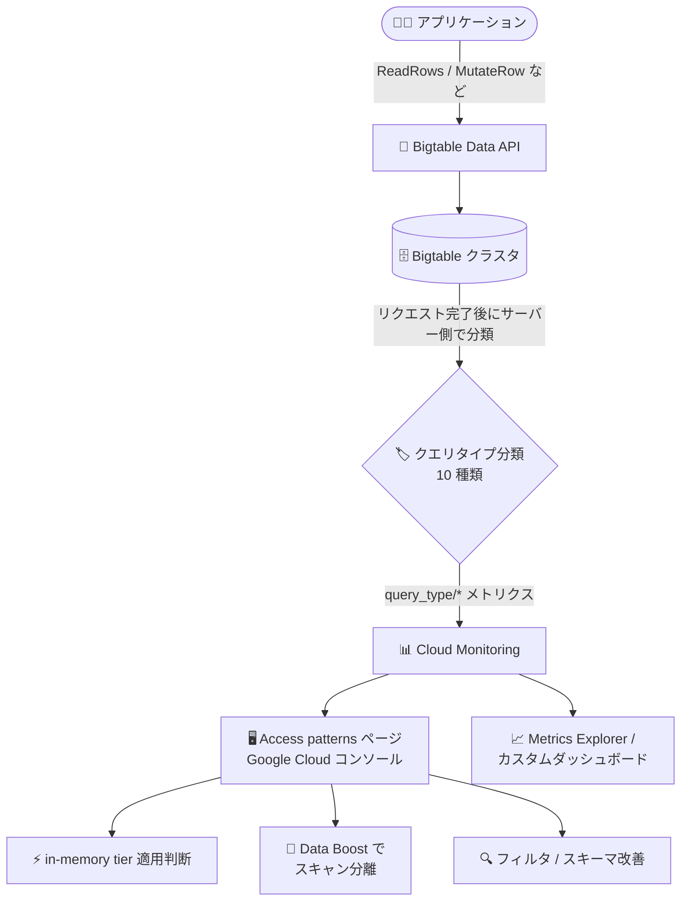

# Bigtable: アクセスパターン分析 (Access patterns ページ) GA

**リリース日**: 2026-11-13

**サービス**: Bigtable

**機能**: アクセスパターン分析 (Access patterns ページ)

**ステータス**: GA (一般提供)

📊 [このアップデートのインフォグラフィックを見る](https://takech9203.github.io/google-cloud-news-summary/20261113-bigtable-access-patterns-analysis-ga.html)

## 概要

Google Cloud コンソールで Bigtable インスタンスおよびクラスタの読み取り/書き込みアクセスパターンを可視化・分析できる「Access patterns」ページが一般提供 (GA) になりました。リクエスト量 (QPS)、レイテンシ、帯域幅、行スキャンに関するメトリクスを、クエリタイプ別の内訳で確認できます。

Bigtable は受信したデータリクエストをサーバー側で自動的に 10 種類のクエリタイプ (ポイントリード、ショートスキャン、リバーススキャン、スパースリード、バルクリードなど) に分類し、Cloud Monitoring のメトリクスとして記録します。Access patterns ページはこれらをクラスタ、テーブル、アプリプロファイルのレベルで「クエリ中心」に可視化します。System insights ページがリソース使用率の全体像を、Key Visualizer が行キー範囲ごとのトラフィック分布を示すのに対し、Access patterns ページはワークロードをクエリタイプ別に分解する点が特徴です。

Bigtable を運用するデータベース管理者や SRE、アプリケーション開発者にとって、非効率なクエリパターンの検出、レイテンシのトラブルシューティング、in-memory tier や Data Boost といった機能の適用対象ワークロードの特定に役立ちます。コンソールに加え、Cloud Monitoring API 経由でメトリクスをプログラムから取得することも可能です。

**アップデート前の課題**

- System insights ではクラスタ全体のリソース使用率、Key Visualizer では行キー範囲ごとのトラフィック分布は確認できたものの、ワークロードを「クエリタイプ別」に分解して分析する専用の可視化手段がなかった
- フィルタや未回収セルによって返却行数よりはるかに多くの行をスキャンする「スパースリード」のような非効率な読み取りパターンを、コンソール上で直接特定することが難しかった
- どのテーブルやアプリプロファイルが in-memory tier や Data Boost の適用に向いているかを判断するためのデータが得にくかった

**アップデート後の改善**

- クラスタ、テーブル、アプリプロファイルのレベルで、QPS 分布・QPS・レイテンシ (p50/p95/p99)・スキャン行数・返却行数・セル数・送信バイト数をクエリタイプ別に可視化できるようになった
- Scanned rows と Returned rows、Cells seen と Sent cells の比較により、非効率なフィルタやガベージコレクション待ちセルに起因する読み取り効率の低下をコンソールで特定できるようになった
- ポイントリードが多いワークロード (in-memory tier 候補) や大規模スキャン/バッチ読み取りワークロード (Data Boost 候補) をデータに基づいて特定できるようになった
- `bigtable.googleapis.com/query_type/*` メトリクスとして Cloud Monitoring API、Metrics Explorer、カスタムダッシュボードからも利用できる

## アーキテクチャ図



Bigtable が Data API リクエストをサーバー側でクエリタイプに自動分類して Cloud Monitoring に記録し、コンソールの Access patterns ページでクエリタイプ別に可視化・分析して最適化アクションにつなげる流れを示しています。

## サービスアップデートの詳細

### 主要機能

1. **クエリタイプ別のワークロード可視化**
   - Bigtable が受信リクエストを自動的に 10 種類のクエリタイプに分類し、クラスタごとの読み取り/書き込み/読み取り-書き込みクエリタイプの割合とレートを表示
   - Group by オプションでテーブル別またはアプリプロファイル別に内訳を表示可能

2. **非効率なクエリパターンの検出とレイテンシ分析**
   - 選択的なフィルタやガベージコレクション待ちセルにより、返却量を大幅に上回る行/セルをスキャンする「スパースリード」を特定
   - フォワードスキャンより非効率な「リバーススキャン」をモニタリング
   - サーバー側レイテンシのパーセンタイル (p99/p95/p50) をスキャン行数・返却行数・セル数と並べて比較し、レイテンシスパイクの原因となるアクセスパターンを特定

3. **機能適用対象ワークロードの特定**
   - ポイントリードが多いテーブルやアプリプロファイルを特定し、Enterprise Plus エディションの in-memory tier の適用候補を発見
   - 大規模スキャンやバッチ読み取りワークロードを特定し、Data Boost サーバーレスコンピュートでサービングトラフィックから分離

4. **Cloud Monitoring API によるプログラマティックアクセス**
   - `bigtable.googleapis.com/query_type/*` メトリクス (モニタリング対象リソース: `bigtable_table`) を Monitoring API、Metrics Explorer、カスタムダッシュボードから利用可能
   - リソースラベル: `project_id`、`instance`、`cluster`、`table` / メトリクスラベル: `query_type`、`app_profile`、`method`

## 技術仕様

### Access patterns ページのチャートとメトリクス

| メトリクス | 説明 |
|------|------|
| QPS distribution | 選択した期間全体で集計した、クエリタイプ別のリクエスト割合と平均 QPS |
| Latency | クエリタイプ別のサーバー側レイテンシの推移 (p99 がデフォルト。p95、p50 に切り替え可能) |
| QPS | クエリタイプ別の毎秒リクエスト数の推移 |
| Returned rows | フィルタ適用後にクライアントへ返却された行数/秒 |
| Scanned rows | フィルタ適用前に Bigtable が読み取った行数/秒 (Returned rows との比較で非効率なフィルタを特定) |
| Modified rows | 書き込みおよび読み取り-書き込みリクエストで変更された行数/秒 |
| Cells seen | フィルタ適用前に検査されたセル数/秒 (フィルタ除外分やガベージコレクション待ちセルを含む) |
| Sent cells | フィルタ適用後にクライアントへ返却されたセル数/秒 |
| Sent bytes | 返却されたエンコード済み行データのバイト数/秒 |

すべてのチャートはクラスタ、テーブル、アプリプロファイルの各レベルで利用できます。

### 10 種類のクエリタイプ

| クエリタイプ | メトリクスラベル | 分類基準 (概要) |
|------|------|------|
| ポイントリード | `QUERY_TYPE_POINT_READ` | フィルタなしまたはシンプルフィルタの単一行キーのフォワード読み取りで、セル数・レスポンスサイズが小さい単一行の上限内 |
| ショートスキャン | `QUERY_TYPE_SHORT_SCAN` | 単一の連続行範囲のフォワードスキャンで、行数・セル数・バイト数が小さい上限内 |
| リバースショートスキャン | `QUERY_TYPE_REVERSE_SHORT_SCAN` | ショートスキャンと同じ上限内のリバーススキャン |
| リバーススキャン | `QUERY_TYPE_REVERSE_SCAN` | リバースショートスキャンに該当しないすべてのリバース読み取り |
| スパースリード | `QUERY_TYPE_SPARSE_READ` | フィルタ除外や未回収セルにより、返却量を大幅に上回る行/セルをスキャンするフォワード読み取り |
| バルクリード | `QUERY_TYPE_BULK_READ` | 複数行キー指定や大きな単一行の読み取りで、ポイントリードの上限を超えスパースリードに該当しないもの |
| その他の読み取り | `QUERY_TYPE_OTHER_READ` | 大規模範囲スキャン、複数範囲スキャン、複雑なフィルタを使う読み取りなど、上記に該当しない ReadRows |
| ポイントライト | `QUERY_TYPE_POINT_WRITE` | 単一行の MutateRow または小規模な MutateRows バッチ |
| その他の書き込み | `QUERY_TYPE_OTHER_WRITE` | ポイントライトの上限を超える大規模なバッチ書き込みなど |
| 読み取り-書き込み | `QUERY_TYPE_READ_WRITE` | 条件付き書き込み (CheckAndMutateRow) やアトミックな増分/追記 (ReadModifyWriteRow) |

分類はクライアントライブラリのメソッド名ではなく、リクエストパラメータ (行キー/範囲、`reversed`、フィルタ) と実行統計 (スキャン/返却した行数・セル数・バイト数) に基づき、リクエスト完了後にサーバー側で行われます。読み取りはポイントリード → ショートスキャン/リバースショートスキャン → リバーススキャン → スパースリード → バルクリード → その他の読み取りの順で評価され、最初に一致したパターンが割り当てられます。

### 必要な IAM ロール

| 目的 | ロール |
|------|------|
| Bigtable リソースの表示 | Bigtable Viewer (`roles/bigtable.viewer`) または Bigtable Reader (`roles/bigtable.reader`) |
| Monitoring 時系列データの表示 | Monitoring Viewer (`roles/monitoring.viewer`) |

必要な権限: `bigtable.instances.get`、`bigtable.clusters.list`、`bigtable.appProfiles.list`、`bigtable.tables.list`、`monitoring.timeSeries.list`

## 設定方法

### 前提条件

1. プロジェクトに対して Bigtable Viewer (または Bigtable Reader) と Monitoring Viewer の IAM ロールが付与されていること
2. 分析対象の Bigtable インスタンスが存在すること

### 手順

#### ステップ 1: Access patterns ページを開く (インスタンスレベル)

1. Google Cloud コンソールで Bigtable インスタンスの一覧を開く
2. メトリクスを表示するインスタンスをクリックする
3. ナビゲーションペインの **Observability** の下にある **Access patterns** をクリックする
4. **Cluster** リストで分析対象のクラスタを選択する (デフォルトでは最初のクラスタが選択される)

クラスタレベルで表示する場合は、インスタンスの概要ページでクラスタ ID をクリックし、ナビゲーションペインの **Access patterns** をクリックします。

#### ステップ 2: 内訳の切り替えと期間の調整

1. **Group by** リストで内訳方法を選択する
   - **None**: アクセスパターン (クエリタイプ) のみで内訳表示 (デフォルト)
   - **App profile**: アプリプロファイル ID とアクセスパターンで内訳表示
   - **Table**: テーブル ID とアクセスパターンで内訳表示
2. 必要に応じて時間範囲セレクタで期間の変更や自動更新の切り替えを行う

## メリット

### ビジネス面

- **運用コストの最適化**: スキャン過多な非効率クエリの特定・改善により、ノード CPU の無駄遣いを削減し、必要ノード数の抑制につなげられる
- **データドリブンな機能採用判断**: in-memory tier や Data Boost の採用を、実測のアクセスパターンデータに基づいて判断できる

### 技術面

- **クエリ中心の可観測性**: System insights (リソース使用率)、Key Visualizer (行キー分布) に加え、クエリタイプ別の分析軸が追加され、Bigtable の可観測性が向上
- **レイテンシトラブルシューティングの効率化**: レイテンシパーセンタイルとスキャン/返却メトリクスを突き合わせ、レイテンシスパイクの原因となるアクセスパターンを素早く特定可能
- **自動化・連携が容易**: 標準の Cloud Monitoring メトリクスとして提供されるため、既存のダッシュボードやアラートに組み込める

## デメリット・制約事項

### 制限事項

- GoogleSQL for Bigtable のクエリはアクセスパターンとして分類されず、行・セル・バイトのアクセスパターンメトリクスに含まれない。QPS distribution、QPS、Latency チャートでは SQL クエリやその他の未分類リクエストは `QUERY_TYPE_UNKNOWN` として表示される

### 考慮すべき点

- 分類はメソッド名ではなくリクエストパラメータと実行統計に基づくため、単一行読み取りでも複雑なフィルタや大量セルのスキャンがあるとスパースリード/バルクリード/その他の読み取りに分類されることがある
- ポイントリード、ショートスキャン、リバースショートスキャン、バルクリードに分類されるには「シンプルフィルタ」(フィルタなし、`column_range_filter`、`timestamp_range_filter`、`cells_per_column_limit_filter` など) の使用が条件。`value_regex_filter`、`row_key_regex_filter`、`interleave`、`condition` などは複雑なフィルタとして扱われる

## ユースケース

### ユースケース 1: in-memory tier の適用候補の特定

**シナリオ**: 読み取りレイテンシの厳しい目標を持つサービングワークロードで、QPS distribution、QPS、Latency チャートに `QUERY_TYPE_POINT_READ` の高いリクエスト量が表示されている。

**実装例**:
```
1. Access patterns ページで Group by を「Table」または「App profile」に設定
2. ポイントリードの多いテーブル/アプリプロファイルを特定
3. Enterprise Plus エディションの in-memory tier を有効化
```

**効果**: 低レイテンシが求められるポイントリード中心のワークロードを特定し、in-memory tier の恩恵を最も受けるテーブルに絞って適用できる。

### ユースケース 2: Data Boost による大規模スキャンの分離

**シナリオ**: レイテンシセンシティブなサービングトラフィックと同一クラスタ上で、`QUERY_TYPE_BULK_READ` や `QUERY_TYPE_OTHER_READ` の高いボリュームや周期的なスパイクが観測される。

**実装例**:
```
1. Group by を「App profile」に設定し、スキャンの発生元を特定
2. バッチ/レポーティング/分析用の読み取りを専用アプリプロファイルに分離
3. そのアプリプロファイルで Data Boost サーバーレスコンピュートを使用するよう構成
```

**効果**: 大規模スキャンがサービングノードの CPU リソースを奪わなくなり、サービングトラフィックのレイテンシを安定化できる。

### ユースケース 3: フィルタオーバーヘッドの削減とガベージコレクション調整

**シナリオ**: `QUERY_TYPE_SPARSE_READ` の割合が高い、または Scanned rows が Returned rows を、Cells seen が Sent cells を大幅に上回っている。

**実装例**:
```
1. 値フィルタや正規表現フィルタに頼らず、行キー範囲やプレフィックスを絞り込む
2. 最新のセルバージョンのみ必要な場合は cells_per_column_limit_filter を追加
3. 期限切れセルが蓄積しないようガベージコレクションポリシーを見直す
```

**効果**: クライアントに返却されないデータのスキャンを削減し、読み取り効率とレイテンシを改善できる。

## 料金

リリースノートおよびドキュメントに本機能固有の追加料金に関する記載はありません。アクセスパターンメトリクスは Cloud Monitoring のメトリクスとして提供されます。最新の料金は以下の公式ページを参照してください。

- [Bigtable の料金](https://cloud.google.com/bigtable/pricing)
- [Cloud Monitoring の料金](https://cloud.google.com/stackdriver/pricing)

## 関連サービス・機能

- **Cloud Monitoring**: アクセスパターンメトリクス (`bigtable.googleapis.com/query_type/*`) の基盤。Metrics Explorer やカスタムダッシュボード、API 経由での利用が可能
- **System insights**: クラスタ全体のリソース使用率 (CPU、ノード数、スループットなど) を表示する既存のモニタリングページ。Access patterns ページと補完関係
- **Key Visualizer**: 行キー範囲ごとのトラフィック分布を可視化し、ホットスポット検出に利用。クエリタイプ別分析と組み合わせて使用
- **in-memory tier (Enterprise Plus)**: ポイントリード中心のワークロードの低レイテンシ化。Access patterns ページで適用候補を特定可能
- **Data Boost**: 大規模スキャン/バッチ読み取りをサービングノードから分離するサーバーレスコンピュート。適用対象ワークロードの特定に活用
- **クエリ統計 (query stats)**: 個々の読み取りリクエストにおける rows seen / rows returned の比率を確認でき、Access patterns ページと併用して効率を評価

## 参考リンク

- 📊 [インフォグラフィック](https://takech9203.github.io/google-cloud-news-summary/20261113-bigtable-access-patterns-analysis-ga.html)
- [公式リリースノート](https://docs.cloud.google.com/release-notes#November_13_2026)
- [ドキュメント: Analyze access patterns](https://docs.cloud.google.com/bigtable/docs/access-patterns)
- [ドキュメント: Monitor instance performance (System insights)](https://docs.cloud.google.com/bigtable/docs/monitoring-instance)
- [ドキュメント: Key Visualizer overview](https://docs.cloud.google.com/bigtable/docs/keyvis-overview)
- [ドキュメント: Troubleshoot latency](https://docs.cloud.google.com/bigtable/docs/latency)
- [料金ページ](https://cloud.google.com/bigtable/pricing)

## まとめ

Bigtable のワークロードをクエリタイプ別に分析できる Access patterns ページが GA となり、System insights、Key Visualizer と並ぶ第三の可観測性ツールとして追加コストの記載なく利用できるようになりました。Bigtable を運用しているチームは、まず Access patterns ページでスパースリードやリバーススキャンの有無を確認し、非効率なフィルタ/スキーマの改善や、in-memory tier・Data Boost の適用判断に活用することを推奨します。

---

**タグ**: Bigtable, Cloud Monitoring, 可観測性, アクセスパターン, パフォーマンス, GA
