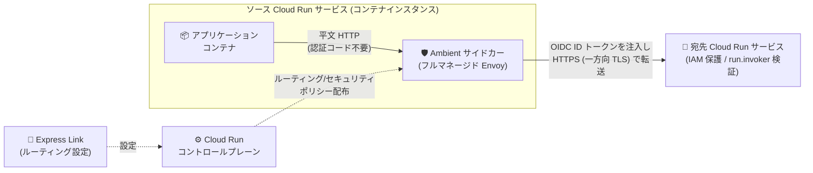

# Cloud Run: Ambient Networking と Express Links (Preview)

**リリース日**: 2026-11-13

**サービス**: Cloud Run

**機能**: Ambient Networking / Express Links

**ステータス**: Preview

📊 [このアップデートのインフォグラフィックを見る](https://takech9203.github.io/google-cloud-news-summary/20261113-cloud-run-ambient-networking-express-links.html)

## 概要

Cloud Run に **Ambient Networking** と **Express Links** の 2 つの関連機能が Preview として発表されました。Ambient Networking は、Cloud Run の各コンテナインスタンス内にフルマネージドな Envoy サイドカーコンテナを配置し、ワークロードのトラフィック管理・セキュリティ・可観測性を簡素化する機能です。サイドカーはインスタンスのネットワークトラフィックをインターセプトし、Cloud Run が配布するルーティングポリシーとセキュリティポリシーを適用します。サイドカーのデプロイ・設定・管理はすべて Google Cloud が行い、ユーザーがサービスメッシュのリソースを定義する必要はありません。

Express Links は、この Ambient Networking を基盤とする最初の主要機能の 1 つで、同一プロジェクト・同一リージョン内のソース Cloud Run サービスと宛先 Cloud Run サービスを、**アプリケーションに認証コードを書くことなく、サービスメッシュを構成することもなく**接続できます。ソースアプリケーションが平文 HTTP でリクエストを送信すると、Ambient サイドカーが自動的に OIDC ID トークンを取得して Authorization ヘッダーに注入し、HTTPS (一方向 TLS) で宛先サービスに転送します。

対象ユーザーは、Cloud Run 上でマイクロサービス間通信を構築している開発者や、カスタムプロキシ・サービスメッシュの運用負荷を削減したいプラットフォームチームです。Ambient Networking は Agent Gateway on Cloud Run の基盤にもなっており、今後の高度なネットワーキング機能の土台となる位置づけです。

**アップデート前の課題**

- IAM で保護された Cloud Run サービスを別の Cloud Run サービスから呼び出すには、アプリケーション内にメタデータサーバーや認証ライブラリから OIDC ID トークンを取得して `Authorization: Bearer` ヘッダーに付与するコードを書く必要があった
- 認証コードを書かない代替手段として Cloud Service Mesh を使う場合、VPC ネットワーク、バックエンドサービス、ルーティングルール、Cloud DNS レコードなどのリソースを構成する必要があった
- 高度なトラフィック管理・セキュリティ・可観測性を実現するには、カスタムプロキシを自前で構築・保守するか、サービスメッシュの概念を学習して設定する必要があった
- 宛先サービスの URL をアプリケーションにハードコードすると、宛先変更時にソースアプリケーションの修正・再デプロイが必要だった

**アップデート後の改善**

- フルマネージドな Envoy サイドカーが各コンテナインスタンスで自動的に動作し、プロキシの構築・保守の運用負荷が不要になった
- Express Link を作成するだけで、ソースサービスから平文 HTTP で宛先サービスを呼び出せるようになり、サイドカーが OIDC ID トークンの取得・注入と HTTPS 暗号化を自動で行うため、認証コードをアプリケーションから排除できるようになった
- `--matches-hostname` フラグでカスタムホスト名 (例: `http://my-backend`) を構成でき、宛先が変わっても Express Link の再作成のみで対応でき、ソースアプリケーションの修正・再デプロイが不要になった
- サービスメッシュの概念が抽象化され、VPC ネットワーク、ネットワークエンドポイントグループ、バックエンドサービスなどのプロビジョニングなしでポイントツーポイントのサービス間呼び出しが可能になった

## アーキテクチャ図



Ambient サイドカーがアプリケーションコンテナからのアウトバウンドリクエストをインターセプトし、Express Link の設定に基づいて OIDC ID トークンを自動注入したうえで宛先サービスに HTTPS で転送します。

## サービスアップデートの詳細

### 主要機能

1. **Ambient Networking (フルマネージド Envoy サイドカー)**
   - Cloud Run リソースの各コンテナインスタンス内で、アプリケーションコンテナと並行してフルマネージドな Envoy サイドカーが動作する
   - サイドカーはインスタンスのネットワークトラフィックをインターセプトし、Cloud Run が配布するルーティング・セキュリティポリシーを適用する
   - 有効化しただけではトラフィックは変更されずそのまま通過するため、既存の HTTP / TCP トラフィックはそのまま動作する (オプトイン型の基盤機能)
   - サイドカーのデプロイ・設定・アクセスはすべて Google Cloud が管理し、サービスメッシュリソースの定義は不要

2. **Ambient Networking のスコープ (global / regional)**
   - **Regional (デフォルト)**: サイドカーをリージョナルなルーティングプレーンに接続し、ポリシーをサービスと同一リージョン内に限定。データレジデンシー (DRZ) 要件 (保存時・使用時・転送時) をサポート
   - **Global**: サイドカーをグローバルなルーティングプレーンに接続し、任意のリージョンの宛先へのルーティングを許可
   - Agent Gateway on Cloud Run は regional スコープ、Express Links は global スコープが必要

3. **Express Links (認証コード不要のサービス間接続)**
   - 同一プロジェクト・同一リージョン内のソース/宛先 Cloud Run サービスを接続するルーティングリソース (`gcloud beta network-services express-links` で管理)
   - サイドカーが宛先サービスの決定論的 URL (deterministic URL) 宛ての平文 HTTP リクエストをインターセプトし、ソースサービスのサービスアカウントの OIDC ID トークンを Authorization ヘッダーに注入して HTTPS で転送
   - `--matches-hostname` フラグでカスタムホスト名を構成でき、宛先 URL をアプリケーションから抽象化できる
   - 宛先サービス側では通常どおり IAM (Cloud Run Invoker ロール) で呼び出し元の権限を検証

4. **ネットワーク接続性との関係**
   - Express Link はリクエストのインターセプトと認証情報注入を構成するもので、サービス間の基盤ネットワーク経路を置き換えるものではない
   - 宛先の Ingress が「すべて」の場合は VPC や Egress 設定は不要
   - 宛先の Ingress が「内部」または「内部と Cloud Load Balancing」の場合は、Direct VPC Egress または (Private Google Access を有効にした) サーバーレス VPC アクセスコネクタ経由でのルーティングが必要

## 技術仕様

### Ambient Networking のスコープと機能の対応

| 機能 | Global スコープ | Regional スコープ (デフォルト) |
|------|----------------|------------------------------|
| Agent Gateway on Cloud Run | 非サポート | サポート |
| Express Links | サポート | 非サポート |

### Express Links を使わない場合との比較

| ステップ | Express Link なし | Express Link あり |
|---------|------------------|------------------|
| 1. 宛先サービスのデプロイ | IAM 認証必須 (`--no-allow-unauthenticated`) でデプロイ | 同じ |
| 2. Invoker 権限の付与 | ソースのサービスアカウントに `roles/run.invoker` を付与 | 同じ |
| 3. アウトバウンドリクエストの構成 | OIDC ID トークンを取得し `Authorization: Bearer` ヘッダーに付与するコードを実装 | 認証コードなしで平文 `http://` リクエストを送信 |
| 4. ソースサービスのデプロイ | 通常どおりデプロイ | Ambient Networking を有効にしてデプロイし、Express Link を作成 |

### 必要な API とロール

| 項目 | 詳細 |
|------|------|
| 必要な API | Cloud Run API、Network Services API、Traffic Director API |
| 構成に必要なロール | Cloud Run Developer (`roles/run.developer`)、Service Account User (`roles/iam.serviceAccountUser`) |
| Express Link リソース管理 | Network Services Admin (`roles/networkservices.admin`) |
| サービス ID に必要なロール | Traffic Director Client (`roles/trafficdirector.client`)、Cloud Trace Agent (`roles/cloudtrace.agent`) |
| リソース要件 | CPU 制限を 1 vCPU、メモリ制限を 1 GiB 引き上げる (サイドカーがインスタンスの CPU / メモリを共有するため) |

サービス ID に必要なロールが不足していても Cloud Run リソースのデプロイ自体は成功しますが、Ambient Networking に依存する機能は動作しません (必要なロールがないとデプロイ自体が失敗する Cloud Service Mesh とは挙動が異なります)。

### YAML での設定 (アノテーション)

```yaml
spec:
  template:
    metadata:
      annotations:
        run.googleapis.com/ambient-networking: 'true'
        run.googleapis.com/ambient-scope: global  # または regional
```

## 設定方法

### 前提条件

1. Cloud Run、Network Services、Traffic Director の各 API を有効化する
2. ソースサービスの CPU 制限を 1 vCPU、メモリ制限を 1 GiB 引き上げる
3. サービス ID に `roles/trafficdirector.client` と `roles/cloudtrace.agent` を付与する
4. (Express Links の場合) ソース/宛先の Cloud Run サービスが同一プロジェクト・同一リージョンに存在すること

### 手順

#### ステップ 1: Ambient Networking を有効化する

```bash
# 新規サービスの場合
gcloud beta run deploy SERVICE \
  --image=IMAGE_URL \
  --ambient-networking \
  --ambient-scope=global \
  --region=REGION

# 既存サービスの場合
gcloud beta run services update SERVICE \
  --ambient-networking \
  --ambient-scope=global \
  --region=REGION
```

Express Links を使う場合、ソースサービスには `global` スコープが必要です。無効化するには `--no-ambient-networking` フラグを使用します。

#### ステップ 2: Express Link を作成する

```bash
gcloud beta network-services express-links create EXPRESS_LINK_NAME \
  --location=global \
  --source-services=//run.googleapis.com/projects/PROJECT_ID/locations/REGION/services/SOURCE_SERVICE \
  --destination-services=//run.googleapis.com/projects/PROJECT_ID/locations/REGION/services/DESTINATION_SERVICE
```

コマンド完了後、ルーティング設定が実行中のソースサービスインスタンスに伝播するまで最大 2 分かかります。カスタムホスト名を使う場合は `--matches-hostname="HOSTNAME"` を指定します (指定すると決定論的 URL の代わりにそのホスト名のみがインターセプト対象になります)。

#### ステップ 3: 宛先サービスに Invoker 権限を付与する

```bash
gcloud run services add-iam-policy-binding DESTINATION_SERVICE \
  --member="serviceAccount:SOURCE_SA@PROJECT_ID.iam.gserviceaccount.com" \
  --role="roles/run.invoker" \
  --region=REGION
```

データプレーンでの認証を機能させるために必須の手順です。

#### ステップ 4: 動作確認

```bash
# Express Link の基本設定を確認
gcloud beta network-services express-links describe EXPRESS_LINK_NAME \
  --location=global

# フルステータス (connectionStatus、cloudRunSourceInfo) を確認
gcloud beta network-services express-links describe 'EXPRESS_LINK_NAME?view=EXPRESS_LINK_VIEW_FULL#' \
  --location=global
```

## メリット

### ビジネス面

- **開発速度の向上**: 認証処理のボイラープレートコードが不要になり、開発者はビジネスロジックに集中できる
- **運用負荷の削減**: カスタムプロキシやサービスメッシュの構築・保守が不要になり、プラットフォーム運用コストを削減できる
- **アプリケーションのポータビリティ**: 認証・ルーティングをインフラ側にオフロードすることで、アプリケーションコードが Google Cloud 固有の実装に依存しなくなる

### 技術面

- **フルマネージドなデータプレーン**: Envoy サイドカーのデプロイ・パッチ・運用はすべて Google Cloud が管理
- **自動的なセキュリティ**: OIDC ID トークンの取得・注入と HTTPS (一方向 TLS) 暗号化をサイドカーが自動で実施し、IAM による呼び出し元検証と組み合わせられる
- **宛先 URL の抽象化**: カスタムホスト名により論理アドレスでの呼び出しが可能になり、宛先変更時はExpress Link の再作成のみで済む
- **既存トラフィックへの非侵襲性**: Ambient Networking を有効化しただけではトラフィックは変更されず、機能ごとにオプトインできる

## デメリット・制約事項

### 制限事項 (Ambient Networking)

- UDP トラフィックは非サポート (HTTP と TCP のみ)
- インバウンドリクエストはエンドツーエンドの HTTP/2 に非対応
- 第 1 世代実行環境は非サポート (未指定の場合は第 2 世代が使用される)
- コンテナインスタンスの起動に時間がかかるようになる
- Regional スコープは `*.googleapis.com` を Private Google Access の IP に解決する VPC ネットワークに非対応
- サイドカーがインスタンスの CPU / メモリを共有するため、リソース制限の引き上げ (CPU +1 vCPU、メモリ +1 GiB) が必要

### 制限事項 (Express Links)

- ソース/宛先は Cloud Run サービスのみ (ジョブ、ワーカープール、インスタンスは非サポート)
- クロスプロジェクト・クロスリージョン構成は非サポート
- ソースサービスには global スコープの Ambient Networking が必須 (regional スコープでは Express Link の作成は成功するがトラフィックはルーティングされない)
- 既存の Express Link のソース/宛先/カスタムホスト名はインプレース更新不可 (削除して再作成が必要。`update` コマンドで更新できるのは説明のみ)
- 宛先サービスはデフォルトの `run.app` URL が有効である必要がある
- 非決定論的 URL 宛てのリクエストはインターセプトされず 403 Forbidden になる
- リクエストに既に `Authorization` ヘッダーが含まれる場合はトークンを注入せずそのまま転送。`X-Serverless-Authorization` ヘッダーへの自動注入は非サポート
- Identity-Aware Proxy (IAP) で保護された宛先サービスへの転送は不可
- Agent Identity + mTLS バウンドトークン構成のソースサービス、および Agent Gateway + Secure Web Proxy 経由のアウトバウンド構成は非サポート (Agent Gateway は regional スコープを要求するため Express Links と併用不可)
- 1 つの Express Link につき宛先は 1 サービス、プロジェクトあたり最大 5,000 個まで

### 考慮すべき点

- Preview 機能のため Pre-GA Offerings Terms が適用され、サポートが限定される可能性がある。本番環境への適用は慎重に判断する
- 宛先サービスを削除しても Express Link は古い構成を保持し続けるため、宛先変更時は Express Link の削除・再作成を忘れないようにする
- 宛先の Ingress が「内部」の場合は、従来どおり Direct VPC Egress またはサーバーレス VPC アクセスコネクタによる経路の確保が別途必要

## ユースケース

### ユースケース 1: マイクロサービス間認証のオフロード

**シナリオ**: Cloud Run 上のフロントエンド API サービスから、IAM で保護されたバックエンドサービスを呼び出す。従来はアプリケーション内で ID トークンの取得・付与コードを言語ごとに実装していた。

**実装例**:
```bash
# ソースサービスで Ambient Networking (global) を有効化
gcloud beta run services update frontend --ambient-networking --ambient-scope=global --region=us-central1

# Express Link を作成
gcloud beta network-services express-links create frontend-to-backend \
  --location=global \
  --source-services=//run.googleapis.com/projects/my-project/locations/us-central1/services/frontend \
  --destination-services=//run.googleapis.com/projects/my-project/locations/us-central1/services/backend

# アプリケーションからは平文 HTTP で呼び出すだけ
# http://backend-<project-number>.us-central1.run.app
```

**効果**: 認証コードをアプリケーションから排除し、言語ごとの認証ライブラリ実装・トークンキャッシュ管理が不要になる。

### ユースケース 2: カスタムホスト名による宛先の抽象化

**シナリオ**: ソースアプリケーションが `http://my-backend` という論理アドレスで宛先を呼び出し、宛先サービスの実体を環境ごと・移行時に切り替えたい。

**効果**: `--matches-hostname="my-backend"` を指定した Express Link の削除・再作成だけで宛先を変更でき、ソースアプリケーションの修正や再デプロイが不要になる。

### ユースケース 3: サービスメッシュなしのポイントツーポイント接続

**シナリオ**: 少数の Cloud Run サービス間の認証付き通信のために Cloud Service Mesh を導入すると、VPC ネットワーク、NEG、バックエンドサービス、Cloud DNS レコードの構成が過剰になる。

**効果**: メッシュ関連リソースのプロビジョニングなしで、自動的な認証情報注入付きのサービス間接続を実現できる。

## 料金

Ambient Networking のサイドカー使用には Cloud Run の料金が適用されますが、**Preview 期間中は Ambient 機能に対する課金は適用されません** (Billing for ambient features isn't enforced during Preview)。

なお、サイドカーはコンテナインスタンスの CPU / メモリを共有するため、有効化の前提として CPU 制限 +1 vCPU、メモリ制限 +1 GiB の引き上げが必要であり、その分のリソース料金には影響する点に留意してください。詳細は [Cloud Run 料金ページ](https://cloud.google.com/run/pricing) を参照してください。

## 関連サービス・機能

- **Agent Gateway on Cloud Run**: Ambient Networking (regional スコープ) を基盤に、エージェントのトラフィックを組織が一元管理するアクセス・セキュリティポリシーで統制する機能
- **Cloud Service Mesh**: 従来のサービスメッシュによるサービス間接続の選択肢。Express Links は VPC・バックエンドサービス等の構成なしでこれを代替するシンプルな手段を提供
- **Traffic Director**: Ambient Networking の利用に API の有効化とサービス ID への `roles/trafficdirector.client` 付与が必要
- **Cloud Trace**: サービス ID に `roles/cloudtrace.agent` が必要で、リクエストのトレースと連携
- **IAM (Cloud Run Invoker)**: Express Links 利用時も宛先サービスでの呼び出し元検証は従来どおり `roles/run.invoker` で行う
- **Direct VPC Egress / サーバーレス VPC アクセス**: 宛先の Ingress が「内部」の場合に必要となるネットワーク経路

## 参考リンク

- 📊 [インフォグラフィック](https://takech9203.github.io/google-cloud-news-summary/20261113-cloud-run-ambient-networking-express-links.html)
- [公式リリースノート](https://docs.cloud.google.com/release-notes#November_13_2026)
- [ドキュメント: Configure ambient networking](https://docs.cloud.google.com/run/docs/configuring/ambient-networking)
- [ドキュメント: Configure express links](https://docs.cloud.google.com/run/docs/configuring/express-links)
- [ドキュメント: サービス間認証](https://docs.cloud.google.com/run/docs/authenticating/service-to-service)
- [料金ページ](https://cloud.google.com/run/pricing)

## まとめ

Ambient Networking は Cloud Run にフルマネージドな Envoy サイドカーによるデータプレーンをもたらし、Express Links はその最初の実用機能として、認証コードもサービスメッシュも不要な Cloud Run サービス間接続を実現します。Cloud Run でマイクロサービス構成を運用しているチームは、Preview 段階の制約 (同一プロジェクト・同一リージョン、リソース制限の引き上げなど) を確認したうえで、開発環境での検証を始めることをおすすめします。

---

**タグ**: #CloudRun #AmbientNetworking #ExpressLinks #Envoy #ServiceMesh #サービス間認証 #Preview
