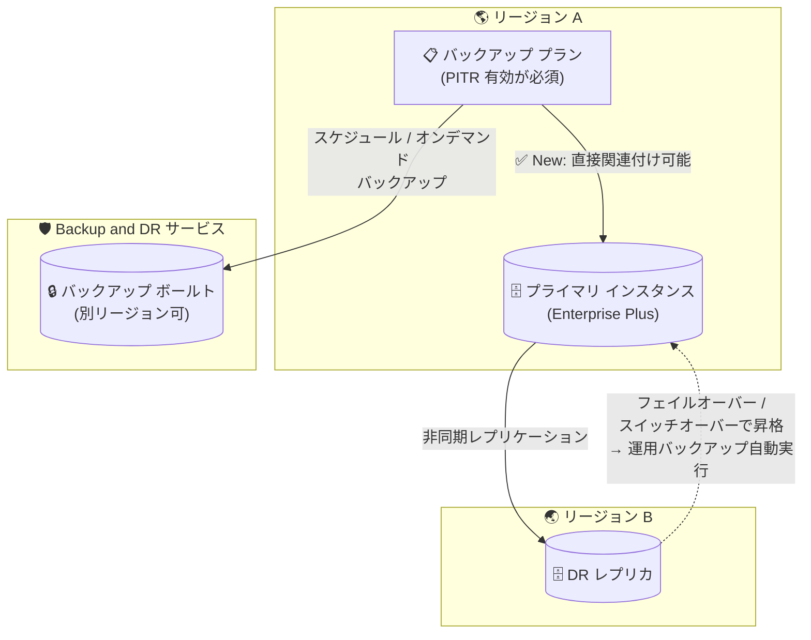

# Cloud SQL: 拡張バックアップが DR レプリカ付きインスタンスをサポート

**リリース日**: 2026-11-13

**サービス**: Cloud SQL for MySQL / Cloud SQL for PostgreSQL / Cloud SQL for SQL Server

**機能**: 拡張バックアップ (Enhanced Backups) の災害復旧 (DR) レプリカ付きインスタンス対応

**ステータス**: 一般提供 (GA)

📊 [このアップデートのインフォグラフィックを見る](https://takech9203.github.io/google-cloud-news-summary/20261113-cloud-sql-enhanced-backups-dr-replica.html)

## 概要

Cloud SQL の拡張バックアップ (Enhanced Backups) が、災害復旧 (DR) レプリカを持つインスタンスをサポートしました。Backup and DR サービスのバックアップ プランを、指定済み DR レプリカを持つプライマリ インスタンスに直接関連付けられるようになります。MySQL、PostgreSQL、SQL Server の 3 エディションすべてが対象です。

拡張バックアップは、Cloud SQL のバックアップを Backup and DR サービスのバックアップ ボールトに保存する機能で、最長 10 年のカスタム保持期間や改ざん防止 (ボールトによる保護) を提供します。今回のアップデートにより、クロスリージョン DR 構成 (Advanced DR) と拡張バックアップを組み合わせた、より堅牢なデータ保護アーキテクチャを構築できるようになりました。

さらに、フェイルオーバーやスイッチオーバーでロールが入れ替わった際のバックアップ プランの挙動も整理されており、昇格したインスタンスでは運用バックアップ (operational backup) が自動実行され、降格したインスタンスではプラン関連付けが自動的に一時停止状態に遷移します。

**アップデート前の課題**

- 拡張バックアップのバックアップ プランは、DR レプリカが指定されたプライマリ インスタンスには関連付けられず、Advanced DR と拡張バックアップを併用できなかった
- クロスリージョン DR を構成するインスタンスでは、バックアップ ボールトによる長期保持・保護の恩恵を受けられなかった

**アップデート後の改善**

- DR レプリカを持つプライマリ インスタンスに、Backup and DR のバックアップ プランを直接関連付けられるようになった
- フェイルオーバー / スイッチオーバー / 昇格操作でレプリカが新プライマリに昇格すると、Cloud SQL が Backup and DR の運用バックアップを自動トリガーし、PITR ログのアップロードとスケジュール バックアップが継続される
- プライマリがレプリカに降格した場合、バックアップ プランの関連付けは自動的に一時停止状態となり、レプリカでのバックアップ失敗エラーを回避。元のロールに戻すと自動的に保護が再開される

## アーキテクチャ図



DR レプリカを持つプライマリ インスタンスにバックアップ プランを直接関連付け、バックアップをボールトへ保存する構成です。ロール交代時にはバックアップ保護が自動的に新プライマリへ追従します。

## サービスアップデートの詳細

### 主要機能

1. **DR レプリカ付きプライマリへのバックアップ プラン関連付け**
   - 指定済み DR レプリカを持つプライマリ インスタンスに、Backup and DR のバックアップ プランを直接関連付け可能
   - 関連付けるバックアップ プランは、ポイントインタイム リカバリ (PITR) が有効 (`log_retention_days > 0`) である必要がある

2. **フェイルオーバー時のバックアップ保護の自動追従**
   - 昇格した新プライマリ: アクティブなバックアップ状態に遷移し、Backup and DR の運用バックアップ (operational backup) を自動トリガー。PITR ログのアップロードとスケジュール バックアップが継続される
   - 降格した旧プライマリ: プラン関連付けが一時停止状態に自動遷移。スケジュール バックアップはスキップ、オンデマンド バックアップはブロックされ、バックアップ管理料金も停止 (既存バックアップのストレージ料金は継続)
   - フェイルバック: 元のプライマリをスイッチオーバーで戻すと、バックアップ プランが自動的に再開

3. **昇格後のプラン関連付け**
   - DR レプリカをプライマリに昇格 (promote / switchover / replica failover) した後、新プライマリにバックアップ プランを関連付けることも可能
   - 昇格時の運用バックアップが失敗した場合は、Cloud SQL が代わりに標準 (ネイティブ) バックアップを作成

## 技術仕様

### 要件と制約

| 項目 | 詳細 |
|------|------|
| 対象エンジン | Cloud SQL for MySQL / PostgreSQL / SQL Server |
| DR レプリカ (Advanced DR) の要件 | プライマリ・DR レプリカともに Cloud SQL Enterprise Plus エディション、別リージョンの直接リードレプリカ |
| バックアップ プランの要件 | DR レプリカ付きプライマリに関連付ける場合、PITR 有効 (`log_retention_days > 0`) が必須 |
| バックアップ プランのリージョン | Cloud SQL インスタンスと同一リージョンであること |
| バックアップ ボールトのリージョン | インスタンスと同一・別リージョン・互換マルチリージョンのいずれも可 |
| レプリカへの直接関連付け | 不可。プライマリに関連付けるか、レプリカ昇格後に関連付ける |
| ボールトの最小強制保持期間 | 10 年 (3,653 日) 以下のボールトを選択可能 |
| オンデマンド バックアップの最大保持期間 | 最長 10 年 (3,653 日) |

## 設定方法

### 前提条件

1. Backup and DR サービスでバックアップ ボールトを作成済みであること
2. インスタンスと同一リージョンにバックアップ プランを作成済みであること (DR レプリカ付きの場合は PITR 有効のプラン)
3. Advanced DR を使用する場合、プライマリと DR レプリカが Enterprise Plus エディションであること

### 手順

#### ステップ 1: バックアップ プランの特定

Backup and DR コンソールで、使用するバックアップ プラン名 (`projects/PROJECT_ID/backupPlans/BACKUP_PLAN_NAME` 形式) を確認します。

#### ステップ 2: バックアップ プランをインスタンスに関連付け

```bash
gcloud backup-dr backup-plan-associations create BACKUP_PLAN_ASSOCIATION_NAME \
    --project=PROJECT_ID \
    --resource=INSTANCE_ID \
    --backup-plan=BACKUP_PLAN_NAME \
    --resource-type=sqladmin.googleapis.com/Instance \
    --location=REGION_ID
```

バックアップ プランを関連付けると、インスタンスの既存のバックアップ / 復元設定はバックアップ プランの設定で上書きされる点に注意してください。

## メリット

### ビジネス面

- **DR と長期保持の両立**: クロスリージョン DR 構成を維持したまま、バックアップ ボールトによる最長 10 年の保持とコンプライアンス要件への対応が可能
- **ランサムウェア対策の強化**: バックアップがボールトに隔離保存されるため、ミッションクリティカルな DR 構成データベースでもバックアップの改ざん・削除リスクを低減

### 技術面

- **ロール交代時の自動追従**: フェイルオーバー / スイッチオーバー時にバックアップ保護が新プライマリへ自動的に移行し、手動での再設定が不要
- **無駄なエラーと課金の抑止**: 降格インスタンスではスケジュール バックアップが自動スキップされ、バックアップ管理料金も一時停止される

## デメリット・制約事項

### 制限事項

- バックアップ プランをレプリカ インスタンスに直接関連付けることはできない (プライマリへの関連付け、または昇格後の関連付けのみ)
- バックアップ プランはインスタンスと同一リージョンに存在する必要がある
- CMEK を使用するインスタンスでは、インスタンスのリージョンが利用不可の間、クロスリージョン バックアップからの復元ができない

### 考慮すべき点

- DR レプリカ付きプライマリに関連付けるバックアップ プランは PITR 有効 (`log_retention_days > 0`) である必要がある
- プラン関連付け時に既存のバックアップ / 復元設定が上書きされる
- 降格インスタンスのプラン一時停止中も、ボールト内の既存バックアップのストレージ料金は発生し続ける
- 昇格時の運用バックアップが失敗した場合は標準 (ネイティブ) バックアップにフォールバックするため、ボールト保護の有無をモニタリングで確認するとよい

## ユースケース

### ユースケース 1: 金融系ワークロードのクロスリージョン DR + 長期保持

**シナリオ**: 規制要件によりバックアップの長期保持 (数年単位) と改ざん防止が求められる基幹データベースを、リージョン障害に備えて Advanced DR (DR レプリカ) で構成している。

**実装例**:
```bash
# PITR 有効のバックアップ プランを DR レプリカ付きプライマリに関連付け
gcloud backup-dr backup-plan-associations create finance-db-bpa \
    --project=my-project \
    --resource=finance-db-primary \
    --backup-plan=projects/my-project/backupPlans/finance-db-plan \
    --resource-type=sqladmin.googleapis.com/Instance \
    --location=asia-northeast1
```

**効果**: リージョン障害への即時フェイルオーバー能力と、ボールトによる長期・保護されたバックアップを 1 つの構成で両立できる。

### ユースケース 2: DR 訓練 (スイッチオーバー テスト) 時のバックアップ運用の無停止化

**シナリオ**: 定期的な DR 訓練としてスイッチオーバーを実施するが、従来はロール交代に伴うバックアップ設定の整合性を手動で確認・調整する必要があった。

**効果**: スイッチオーバーで昇格した側が自動的にアクティブなバックアップ状態となり、降格した側は自動で一時停止するため、訓練のたびにバックアップ構成を手動で組み替える運用負荷がなくなる。

## 料金

拡張バックアップの料金は、バックアップ ボールトに保存されたバックアップの合計サイズに基づいて Backup and DR サービス側で計算されます。バックアップ ボールトがインスタンスと別リージョンにある場合は、リージョン間データ転送料金も追加で発生します。

詳細は [Backup and DR の料金ページ](https://cloud.google.com/backup-disaster-recovery/pricing) を参照してください。

## 関連サービス・機能

- **Backup and DR Service**: バックアップ ボールトとバックアップ プランを提供する基盤サービス。拡張バックアップの保存先・スケジュール定義を担う
- **Cloud SQL Advanced DR (DR レプリカ)**: Enterprise Plus エディションのクロスリージョン DR 機能。レプリカ フェイルオーバーとゼロデータロスのスイッチオーバーを提供し、今回のアップデートで拡張バックアップと併用可能になった
- **ポイントインタイム リカバリ (PITR)**: DR レプリカ付きプライマリに関連付けるバックアップ プランで有効化が必須。トランザクション ログは Cloud Storage に保存される

## 参考リンク

- 📊 [インフォグラフィック](https://takech9203.github.io/google-cloud-news-summary/20261113-cloud-sql-enhanced-backups-dr-replica.html)
- [公式リリースノート](https://docs.cloud.google.com/release-notes#November_13_2026)
- [バックアップ オプションの選択 (DR レプリカと拡張バックアップ)](https://docs.cloud.google.com/sql/docs/mysql/backup-recovery/backup-options#eb-dr-replicas)
- [拡張バックアップの管理](https://docs.cloud.google.com/sql/docs/mysql/backup-recovery/manage-enhanced-backups)
- [Advanced DR の使用](https://docs.cloud.google.com/sql/docs/mysql/use-advanced-disaster-recovery)
- [Backup and DR 料金ページ](https://cloud.google.com/backup-disaster-recovery/pricing)

## まとめ

クロスリージョン DR (Advanced DR) と拡張バックアップが併用可能になり、Cloud SQL のミッションクリティカルなワークロードで「リージョン障害対策」と「バックアップの長期保持・保護」を単一構成で実現できるようになりました。DR レプリカを運用中で標準バックアップを使用している場合は、PITR 有効のバックアップ プランを作成し、プライマリ インスタンスへの関連付けを検討してください。関連付け時に既存のバックアップ設定が上書きされる点には注意が必要です。

---

**タグ**: Cloud SQL, MySQL, PostgreSQL, SQL Server, Backup and DR, 拡張バックアップ, 災害復旧, DR レプリカ, バックアップボールト
