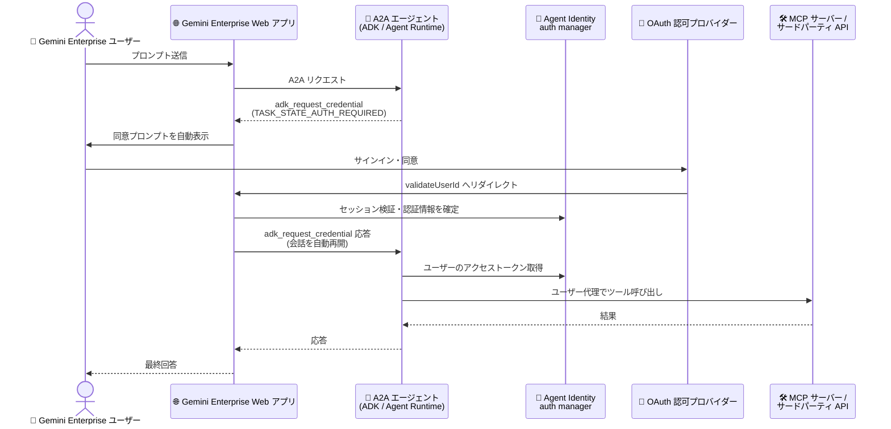

# Gemini Enterprise: A2A エージェント向け Agent Identity auth manager による 3-legged OAuth (3LO) 認証が GA

**リリース日**: 2026-11-13

**サービス**: Gemini Enterprise

**機能**: Agent Identity auth manager を使用した A2A エージェントの 3-legged OAuth (3LO) 認証

**ステータス**: 一般提供 (GA)

📊 [このアップデートのインフォグラフィックを見る](https://takech9203.github.io/google-cloud-news-summary/20261113-gemini-enterprise-a2a-3lo-oauth-ga.html)

## 概要

Gemini Enterprise において、Agent2Agent (A2A) エージェント向けの Agent Identity auth manager を使用した 3-legged OAuth (3LO) 認証のサポートが一般提供 (GA) になりました。この統合により、Agent Development Kit (ADK) で構築し Agent Runtime にデプロイした A2A エージェントが、サインイン中の Gemini Enterprise ユーザーの代理として、ダウンストリームの Model Context Protocol (MCP) サーバー、Google Cloud サービス、サードパーティ API に認証できるようになります。

最大のポイントは、Gemini Enterprise がクライアントサイドの 3LO ワークフロー全体を自動管理することです。エージェント内のツールがユーザー同意を必要とすると (`adk_request_credential` ツールインタラプト / `TASK_STATE_AUTH_REQUIRED`)、Gemini Enterprise の Web アプリが自動的にユーザーへ同意を促し、認可プロバイダーからのコールバックを検証エンドポイント (`https://vertexaisearch.cloud.google.com/validateUserId`) で検証し、Agent Identity auth manager で認証情報を確定した後、A2A 会話を自動的に再開します。開発者は同意 UI やコールバック処理のためのカスタムクライアントアプリケーションを実装する必要がありません。

対象ユーザーは、Gemini Enterprise 上でカスタム A2A エージェントを提供するエージェント開発者や、Jira・GitHub・Salesforce などの外部システムとユーザー権限で安全に連携するエンタープライズエージェントを構築するプラットフォームチームです。

**アップデート前の課題**

- A2A エージェントがユーザー代理でダウンストリームのツール (MCP サーバーやサードパーティ API) にアクセスするには、同意プロンプトの表示、OAuth コールバックの受信・検証、会話再開といったクライアントサイドの 3LO フローを処理するカスタム UI アプリケーションを独自に実装する必要があった
- OAuth トークンの取得・保存・リフレッシュを扱うカスタムバックエンドコードや独自のトークンストレージが必要だった
- ユーザー委任の認証フローをエージェントごとに個別実装すると、トークン管理やガバナンス (アクセスの可視化・取り消し) が分散し、セキュリティリスクが高まっていた

**アップデート後の改善**

- Gemini Enterprise が同意プロンプト、検証エンドポイント (`validateUserId`)、会話再開までを自動処理するため、カスタムのクライアントサイド UI アプリケーションの実装が不要になった
- Agent Identity auth manager が OAuth トークンを Google 管理のクレデンシャル保管庫 (credential vault) に保存し、ADK がツール呼び出し時にトークンを自動取得・注入するため、独自のトークン管理コードが不要になった
- エージェントの SPIFFE ID に基づく IAM 制御により、エンドユーザーのアクセスイベントがエージェント単位で追跡可能になり、アクセスの可視化と取り消しによるガバナンスが向上した
- GA となったことで、本番環境のエンタープライズエージェントで安心して利用できるようになった

## アーキテクチャ図



ツールがユーザー同意を必要とすると、Gemini Enterprise が同意プロンプトの表示・コールバック検証・会話再開を自動管理し、エージェントは Agent Identity auth manager からユーザー委任トークンを取得してツールを呼び出します。

## サービスアップデートの詳細

### 主要機能

1. **同意プロンプトの自動表示 (Consent prompt)**
   - A2A エージェントが `adk_request_credential` ツールインタラプト (`TASK_STATE_AUTH_REQUIRED`) を返すと、Gemini Enterprise Web アプリが自動的にユーザーへサインインを促し、認可プロバイダーの認可 URI を開く
   - 開発者はエージェント側で認可フロー開始の UI を実装する必要がない

2. **ユーザー検証とトークン保存 (User validation and token storage)**
   - ユーザーが同意すると、認可プロバイダーは Gemini Enterprise の検証エンドポイント `https://vertexaisearch.cloud.google.com/validateUserId` にリダイレクトする
   - Gemini Enterprise がセッション状態を検証し、Agent Identity auth manager で認証情報を確定する
   - OAuth トークンは Google 管理のクレデンシャル保管庫に安全に保存される

3. **会話の自動再開 (Conversation resumption)**
   - Gemini Enterprise が完了した `adk_request_credential` 応答を A2A エージェントに送り返す
   - エージェントは auth provider からユーザーのアクセストークンを取得し、中断していたツール呼び出しを実行して会話を継続する

4. **多様なダウンストリーム接続先への対応**
   - MCP サーバー (`McpToolset` + `GcpAuthProviderScheme`、または Agent Registry の `AgentRegistry.get_mcp_toolset`)
   - Google Cloud サービス (例: BigQuery MCP サーバー)
   - サードパーティ API (`AuthenticatedFunctionTool` による REST API 呼び出し。Jira、GitHub、GitLab、Dropbox、Microsoft、Salesforce、ServiceNow などの 3LO 対応サービス)

## 技術仕様

### 主要コンポーネントとエンドポイント

| 項目 | 詳細 |
|------|------|
| 対象エージェント | ADK で構築し `A2aAgent` でラップして Agent Runtime にデプロイした A2A エージェント |
| 必要な API | Agent Identity API (`agentidentity.googleapis.com`) |
| 検証エンドポイント (continue URI) | `https://vertexaisearch.cloud.google.com/validateUserId` |
| auth provider のコールバック redirect URI | `https://agentidentitycredentials.googleapis.com/v1/projects/PROJECT_ID/locations/LOCATION/authProviders/AUTH_PROVIDER_NAME/oauthcallback` |
| Gemini Enterprise の redirect URI (OAuth クライアント共用時) | `https://vertexaisearch.cloud.google.com/oauth-redirect` |
| ツールインタラプト | `adk_request_credential` → A2A タスク状態 `TASK_STATE_AUTH_REQUIRED` |
| デプロイ設定 | `identity_type=types.IdentityType.AGENT_IDENTITY` (Vertex AI Python SDK、v1beta1 API) |

### 必要なパッケージバージョン

| パッケージ | バージョン要件 |
|------|------|
| `a2a-sdk[http-server]` | `>=1.0.0` |
| `google-cloud-aiplatform[agent_engines,adk]` | `>=1.156.0` |
| `google-adk[a2a,agent-identity,mcp]` | `>2.7.1` |

### 必要な IAM ロール

| 用途 | ロール |
|------|------|
| auth provider の作成 | Agent Identity 管理者 (`roles/agentidentity.admin`) または Agent Identity 編集者 (`roles/agentidentity.editor`) |
| auth provider の使用 (デプロイ済みエージェントの SPIFFE プリンシパルに付与) | Agent Identity ユーザー (`roles/agentidentity.user`)、Service Usage ユーザー (`roles/serviceusage.serviceUsageConsumer`) |

### エージェントコードの要件

- `continue_uri` を `https://vertexaisearch.cloud.google.com/validateUserId` に設定する (`GcpAuthProviderScheme` または `AgentRegistry.get_mcp_toolset` で指定。auth provider のデフォルト continue URI として設定した場合は不要)
- `CredentialManager.register_auth_provider(GcpAuthProvider())` を、モジュールのトップレベルだけでなく、デプロイされたコンテナのワーカープロセスで `Runner` を構築する関数内で呼び出す
- 組み込みの `A2aAgentExecutor` を使用する (`adk_request_credential` インタラプトを `TASK_STATE_AUTH_REQUIRED` A2A タスク状態に変換するために必須。`event.is_final_response()` のみをチェックするカスタム `AgentExecutor` は不可)
- `agent_card.supported_interfaces` にデフォルトの 1.0 に加えて A2A プロトコルバージョン 0.3 (`PROTOCOL_VERSION_0_3`、`TransportProtocol.HTTP_JSON`) の `AgentInterface` を追加する

## 設定方法

### 前提条件

1. Agent Identity API (`agentidentity.googleapis.com`) が有効化されていること
2. ADK で構築した A2A エージェントを Agent Runtime にデプロイできること
3. auth provider の作成・使用に必要な IAM ロールが付与されていること

### 手順

#### ステップ 1: 3-legged OAuth auth provider のセットアップ

[Authenticate using 3-legged OAuth with auth manager](https://docs.cloud.google.com/iam/docs/auth-with-3lo-v2) の手順に従い、OAuth クライアントアプリケーションを構成して 3LO auth provider を作成します。Gemini Enterprise 用には以下を設定します。

- OAuth クライアントの Authorized redirect URIs に auth provider のコールバック URI を追加:
  `https://agentidentitycredentials.googleapis.com/v1/projects/PROJECT_ID/locations/LOCATION/authProviders/AUTH_PROVIDER_NAME/oauthcallback`
- Continue URI を Gemini Enterprise の検証エンドポイントに設定:
  `https://vertexaisearch.cloud.google.com/validateUserId`

#### ステップ 2: A2A エージェントコードの構成

```python
from google.adk.a2a.executor.a2a_agent_executor import A2aAgentExecutor
from google.adk.agents import LlmAgent
from google.adk.auth.credential_manager import CredentialManager
from google.adk.integrations.agent_identity import GcpAuthProvider, GcpAuthProviderScheme
from google.adk.runners import Runner
from google.adk.tools.mcp_tool.mcp_session_manager import StreamableHTTPConnectionParams
from google.adk.tools.mcp_tool.mcp_toolset import McpToolset
from vertexai.agent_engines.templates.a2a import A2aAgent, create_agent_card

# Gemini Enterprise のユーザー検証用リダイレクト URI
CONTINUE_URI = "https://vertexaisearch.cloud.google.com/validateUserId"

auth_scheme = GcpAuthProviderScheme(
    name="projects/PROJECT_ID/locations/LOCATION/authProviders/AUTH_PROVIDER_NAME",
    scopes=["OAUTH_SCOPE"],
    continue_uri=CONTINUE_URI,
)

mcp_tools = McpToolset(
    connection_params=StreamableHTTPConnectionParams(url="https://YOUR_MCP_SERVER_URL"),
    auth_scheme=auth_scheme,
)

adk_agent = LlmAgent(
    model="gemini-2.5-flash",
    name="AGENT_NAME",
    instruction="AGENT_INSTRUCTIONS",
    tools=[mcp_tools],
)

def build_runner() -> Runner:
    # デプロイ先ワーカープロセス内で GcpAuthProvider を登録する
    CredentialManager.register_auth_provider(GcpAuthProvider())
    return Runner(app_name=adk_agent.name, agent=adk_agent, ...)

a2a_agent = A2aAgent(
    agent_card=agent_card,  # A2A v0.3 インターフェースを追加した AgentCard
    agent_executor_builder=lambda: A2aAgentExecutor(runner=build_runner),
)
```

#### ステップ 3: Agent Identity を有効にしてデプロイし、アクセスを付与

```python
import vertexai
from vertexai import types

client = vertexai.Client(
    project="PROJECT_ID", location="LOCATION",
    http_options=dict(api_version="v1beta1"),
)

remote_a2a_agent = client.agent_engines.create(
    agent=a2a_agent,
    config={
        "display_name": "AGENT_DISPLAY_NAME",
        "identity_type": types.IdentityType.AGENT_IDENTITY,
        "requirements": [
            "a2a-sdk[http-server]>=1.0.0",
            "google-cloud-aiplatform[agent_engines,adk]>=1.156.0",
            "google-adk[a2a,agent-identity,mcp]>2.7.1",
        ],
    },
)
```

デプロイ後、デプロイ済みエージェントの SPIFFE プリンシパルに auth provider への `roles/agentidentity.user` ロールを付与します。

```bash
gcloud agent-identity auth-providers add-iam-policy-binding AUTH_PROVIDER_NAME \
  --project="PROJECT_ID" \
  --location="LOCATION" \
  --role="roles/agentidentity.user" \
  --member="principal://agents.global.org-ORGANIZATION_ID.system.id.goog/resources/aiplatform/projects/PROJECT_NUMBER/locations/LOCATION/reasoningEngines/ENGINE_ID"
```

最後に、デプロイ済み A2A エージェントを Gemini Enterprise に登録します。Agent Runtime にホストされているため、Gemini Enterprise 側に `https://www.googleapis.com/auth/cloud-platform` スコープの OAuth 2.0 認可リソースを構成します。

## メリット

### ビジネス面

- **開発コストの削減**: 同意 UI・コールバック処理・トークン管理のカスタム実装が不要になり、エンタープライズエージェントの開発期間を短縮できる
- **ガバナンスの強化**: エンドユーザーのアクセスイベントがエージェントの SPIFFE ID に紐付けられ、アクセスの可視化と取り消しが可能。ユーザー委任権限の統制が容易になる
- **GA による本番適用**: Pre-GA 条項の制約なく、SLA を前提とした本番ワークロードで利用できる

### 技術面

- **セキュアなトークン管理**: OAuth トークンは Google 管理のクレデンシャル保管庫に保存され、ハードコードされたシークレットや独自データベースでの保管が不要になる
- **ADK ネイティブ統合**: ADK がツール実行をインターセプトし、auth manager から取得した認証ヘッダーをツール呼び出しや MCP サーバー呼び出しに自動注入する
- **IAM・PAB・VPC Service Controls との統合**: Agent Identity は IAM 許可/拒否ポリシー、Principal Access Boundary、VPC Service Controls と統合されており、エージェント単位の厳密なアクセス制御が可能
- **シームレスな会話体験**: 認証が必要になっても会話が自動的に再開されるため、ユーザーは同意後に操作をやり直す必要がない

## デメリット・制約事項

### 制限事項

- 対象は ADK で構築し `A2aAgent` でラップして Agent Runtime にデプロイした A2A エージェント。他のホスティング形態 (例: Cloud Run 上のコンテナで `Authorization` ヘッダーを直接受け取る方式) は別の認可構成を使用する
- 組み込みの `A2aAgentExecutor` の使用が必須 (カスタム `AgentExecutor` では `adk_request_credential` インタラプトが `TASK_STATE_AUTH_REQUIRED` に変換されない)
- AgentCard に A2A プロトコルバージョン 0.3 インターフェースの追加が必要
- GitHub と Microsoft の 3LO 連携は単一スコープのみサポート (複数スコープのリクエストは不可)
- Vertex AI Python SDK でのデプロイは v1beta1 API (`http_options=dict(api_version="v1beta1")`) が必要

### 考慮すべき点

- `CredentialManager.register_auth_provider(GcpAuthProvider())` をモジュールトップレベルのみで呼び出すと、デプロイ後に `No auth provider registered for custom auth scheme 'gcpAuthProviderScheme'` エラーが発生する。必ず Runner を構築する関数内 (または `set_up()`) で登録する
- 同じ OAuth クライアントを Gemini Enterprise のエージェント認可リソースと共用する場合、redirect URI に `https://vertexaisearch.cloud.google.com/oauth-redirect` も追加する必要がある
- ServiceNow はアプリケーションレベルで許可スコープを構成するため、エージェントが必要とするスコープが構成に含まれていないと認証ループが発生する可能性がある
- auth provider とエージェントのリージョン整合性、および Agent Identity のサポートリージョンを事前に確認する

## ユースケース

### ユースケース 1: BigQuery MCP サーバーへのユーザー権限でのアクセス

**シナリオ**: 社内データ分析エージェントが、質問したユーザー自身の BigQuery 権限でデータセットをクエリする。エージェント自体に広い権限を与えず、ユーザーごとのアクセス制御 (行レベル・データセットレベル) をそのまま活かしたい。

**実装例**:
```python
auth_scheme = GcpAuthProviderScheme(
    name=f"projects/{project_id}/locations/LOCATION/authProviders/bq-auth-provider",
    scopes=["https://www.googleapis.com/auth/bigquery"],
    continue_uri="https://vertexaisearch.cloud.google.com/validateUserId",
)
bigquery_mcp_tools = McpToolset(
    connection_params=StreamableHTTPConnectionParams(
        url="https://bigquery.googleapis.com/mcp"
    ),
    auth_scheme=auth_scheme,
)
```

**効果**: 初回アクセス時のみ Gemini Enterprise が同意を求め、以降はユーザーの権限で安全にクエリを実行。監査ログもユーザーとエージェント双方に紐付く。

### ユースケース 2: Jira / GitHub などサードパーティ SaaS との連携エージェント

**シナリオ**: 開発支援エージェントが、ユーザーの Jira アカウントでチケットを作成したり、GitHub リポジトリの情報を参照したりする。

**効果**: auth manager の 3LO auth provider が各 SaaS との OAuth フローとトークン保管を肩代わりし、Gemini Enterprise が同意 UI を自動提供。エージェント開発者は `AuthenticatedFunctionTool` でトークンを受け取って API を呼ぶだけでよい。

### ユースケース 3: Agent Registry 経由の MCP サーバー利用

**シナリオ**: プラットフォームチームが Agent Registry に MCP サーバーとアウトバウンド auth provider のバインディングを登録し、各エージェント開発者は `AgentRegistry.get_mcp_toolset` で統一的にツールを取得する。

**効果**: 認証設定が Registry 側に集約され、エージェントごとの設定の重複や設定ミスを削減できる。

## 料金

このアップデート自体に伴う追加料金の発表はありません。Gemini Enterprise はエディション (Standard / Plus) ごとのシートベース課金で、Agent Runtime へのエージェントのデプロイには Gemini Enterprise Agent Platform の料金が適用されます。詳細は公式料金ページを参照してください。

- [Gemini Enterprise の料金](https://cloud.google.com/gemini-enterprise/pricing)

## 利用可能リージョン

Agent Identity auth manager は南北アメリカ、ヨーロッパ、アジア太平洋の各リージョンで利用できます。サポート対象リージョンの一覧は [Agent Identity locations](https://docs.cloud.google.com/iam/docs/agent-identity-locations) を参照してください。

## 関連サービス・機能

- **Agent Identity / Agent Identity auth manager**: SPIFFE 標準に基づくエージェントの暗号学的 ID と、API キー・OAuth クレデンシャル・ユーザー委任トークンを管理する中央集権的なクレデンシャル保管庫。本アップデートの中核
- **Agent Development Kit (ADK)**: エージェント構築フレームワーク。`McpToolset`、`AuthenticatedFunctionTool`、`GcpAuthProviderScheme` により auth manager とネイティブ統合
- **Agent Runtime (Gemini Enterprise Agent Platform)**: A2A エージェントのマネージドホスティング環境。`identity_type=AGENT_IDENTITY` 設定で Agent Identity を有効化してデプロイする
- **Agent Registry / Agent Gateway**: エージェントやツールのカタログ化とアクセスポリシーの適用。Agent Identity と組み合わせてエージェントの統制を実現
- **IAM / Principal Access Boundary / VPC Service Controls**: Agent Identity と統合されたポリシー制御。エージェントのアクセス範囲の制限や境界保護に使用
- **Cloud Audit Logs**: エージェントが自身として動作する場合とユーザー代理で動作する場合の両方で監査ログを提供

## 参考リンク

- 📊 [インフォグラフィック](https://takech9203.github.io/google-cloud-news-summary/20261113-gemini-enterprise-a2a-3lo-oauth-ga.html)
- [公式リリースノート](https://docs.cloud.google.com/release-notes#November_13_2026)
- [Configure 3-legged OAuth with Agent Identity auth manager for A2A agents](https://docs.cloud.google.com/gemini/enterprise/docs/register-and-manage-an-a2a-agent#auth-manager)
- [Authenticate using 3-legged OAuth with auth manager](https://docs.cloud.google.com/iam/docs/auth-with-3lo-v2)
- [Agent Identity overview](https://docs.cloud.google.com/iam/docs/agent-identity-overview)
- [Agent Identity auth manager overview](https://docs.cloud.google.com/iam/docs/auth-manager-overview)
- [Gemini Enterprise の料金](https://cloud.google.com/gemini-enterprise/pricing)

## まとめ

A2A エージェントのユーザー委任認証 (3LO) が Gemini Enterprise にネイティブ統合され GA となったことで、同意 UI・コールバック検証・会話再開をすべて Gemini Enterprise 側に任せ、エージェント開発者はツールのビジネスロジックに集中できるようになりました。ユーザー権限での MCP サーバーやサードパーティ API アクセスを本番導入する際の標準パターンとなるため、カスタム OAuth 実装を持つ既存エージェントは Agent Identity auth manager への移行を検討することを推奨します。まずは BigQuery MCP サーバーなど Google Cloud サービスとの連携から試すのが近道です。

---

**タグ**: Gemini Enterprise, Agent Identity, 3-legged OAuth, A2A, ADK, Agent Runtime, MCP, 認証, GA
