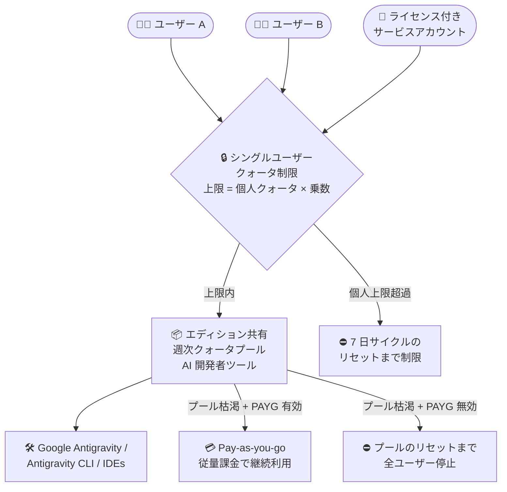

# Gemini Enterprise: AI 開発者ツールへのシングルユーザークォータ制限 (GA)

**リリース日**: 2026-11-13

**サービス**: Gemini Enterprise

**機能**: AI 開発者ツール (Google Antigravity など) に対するシングルユーザークォータ制限

**ステータス**: GA (一般提供)

📊 [このアップデートのインフォグラフィックを見る](https://takech9203.github.io/google-cloud-news-summary/20261113-gemini-enterprise-single-user-quota-limits-ga.html)

## 概要

Gemini Enterprise のシングルユーザークォータ制限 (Limit any single-user's quota) が、Google Antigravity を含む AI 開発者ツールにも適用されるようになり、一般提供 (GA) となりました。対象は Gemini Enterprise Standard エディションと Gemini Enterprise Plus エディションです (Standard Emerging Market エディションの AI 開発者ツールは対象外)。

シングルユーザークォータ制限は、エディション単位で共有されるサブスクリプションクォータプールを、特定の 1 ユーザーが使い切ってしまうことを防ぐための管理機能です。管理者が「乗数 (Multiplier)」を設定すると、「ユーザーあたりクォータ × 乗数」が各ユーザーの上限になります。AI 開発者ツールの場合、この乗数は週次クォータに対して適用され、各ユーザーが最初にプロンプトを送信した時点から始まる 7 日間サイクルごとにリセットされます。

組織内で Antigravity などの AI コーディングツールの利用が急速に拡大する中、少数のヘビーユーザーによるクォータの独占を防ぎ、チーム全体で公平にクォータを利用できるようにしたい管理者にとって重要なアップデートです。

**アップデート前の課題**

- 以前は、シングルユーザークォータ制限の乗数は AI 開発者ツール (Google Antigravity を含む) には適用されず、公式ドキュメントにもその旨が明記されていた
- AI 開発者ツールの週次クォータはエディション内の全ユーザーで共有されるプールであるため、一部のヘビーユーザーがプールを使い切り、他のユーザーが利用できなくなるリスクがあった
- Assistant クエリや画像生成などの他機能では個人単位の上限を設定できる一方、AI 開発者ツールだけは個人単位で制御できないという非対称性があった

**アップデート後の改善**

- シングルユーザークォータ制限の乗数が AI 開発者ツール (Google Antigravity、Antigravity for IDEs、Antigravity CLI など) にも適用されるようになった
- AI 開発者ツールでは乗数が週次クォータに適用され、各ユーザーの 7 日間サイクルごとにリセットされる (プール全体のリセットタイミングとは異なる場合がある)
- 他の機能 (Assistant クエリ、画像・動画生成、Deep Research など) と統一された 1 つの乗数設定で、AI 開発者ツールを含む全プール機能の個人上限を管理できるようになった

## アーキテクチャ図



管理者が設定した乗数に基づき、各ユーザーの AI 開発者ツール利用が週次の個人上限でチェックされ、上限内の利用がエディション共有プールから消費される流れを示しています。プール枯渇時の挙動は Pay-as-you-go 設定の有無によって分岐します。

## サービスアップデートの詳細

### 主要機能

1. **AI 開発者ツールへの乗数適用 (GA)**
   - シングルユーザークォータ制限の乗数が、Google Antigravity を含む AI 開発者ツールにも適用される
   - 対象エディション: Gemini Enterprise Standard、Gemini Enterprise Plus (Standard Emerging Market エディションの AI 開発者ツールは対象外)
   - 乗数は 1 以上の整数で、未指定の場合のデフォルトは 10

2. **週次クォータへの適用とユーザーごとの 7 日サイクルリセット**
   - AI 開発者ツールの乗数は週次クォータに対して適用される
   - 各ユーザーの上限は、そのユーザーのサイクル開始 (最初のプロンプト送信) から 7 日後にリセットされ、プール全体のリセットタイミングとは異なる場合がある
   - 例: 水曜 14 時 (太平洋時間) に最初のプロンプトを送った場合、翌週の水曜 14 時にリセット

3. **利用カウントのルール**
   - Antigravity アプリ、Antigravity CLI、Antigravity for IDEs の利用はすべて同一ユーザーの上限に合算される
   - ユーザーの代理として動作するエージェントの利用は、そのエージェントの所有者の上限にカウントされる
   - ライセンスが割り当てられたサービスアカウントは、独自のシングルユーザークォータ制限を持つ

4. **機能横断で統一された乗数**
   - 乗数は同一エディション・ロケーション内のプール対象機能 (Assistant クエリ、ノーコードエージェント作成ツール、動画生成、画像生成、Deep Research、AI 開発者ツール) に一律に適用される
   - クォータ制限は機能ごとに独立して追跡・適用され、ある機能で上限に達しても他の機能は引き続き利用できる

## 技術仕様

### シングルユーザークォータ制限の仕様

| 項目 | 詳細 |
|------|------|
| 対象エディション | Gemini Enterprise Standard、Plus、Standard Emerging Market (ただし AI 開発者ツールは Standard Emerging Market 対象外) |
| 設定単位 | エディションおよびロケーションごと (個別ユーザー単位のカスタマイズは不可) |
| 乗数 | 1 以上の整数、デフォルト 10 |
| 個人上限の計算 | エディションのユーザーあたりクォータ × 乗数 |
| AI 開発者ツールの適用対象 | 週次クォータ (他の機能は日次クォータ) |
| AI 開発者ツールのリセット | 各ユーザーの 7 日サイクルごと (最初のプロンプト送信時刻を起点) |
| その他機能のリセット | 毎日午前 0 時 (太平洋時間) |
| Pay-as-you-go との関係 | 制限はサブスクリプションクォータプールのみに適用され、クォータ超過後の Pay-as-you-go 利用は制限しない |

### 動作例 (AI 開発者ツールの週次クォータ)

プロジェクトとロケーションに Gemini Enterprise Standard の 100 ライセンスがあり、各ライセンスが週あたり X のAI 開発者ツールクォータを含む場合、共有週次プールは 100X になります。乗数を 5 に設定すると、各ユーザーは週あたり最大 5X まで消費できます。個人の利用は共有プールからも消費されるため、プールが先に枯渇した場合はその時点で利用が停止されます。

## 設定方法

### 前提条件

1. Gemini Enterprise Standard、Plus、または Standard Emerging Market のいずれかのアクティブなサブスクリプションがあること
2. Gemini Enterprise 管理者 (`roles/discoveryengine.agentspaceAdmin`) であること
3. 使用状況の表示には `monitoring.timeSeries.list` と `serviceconsumermanagement.quota.get` の IAM 権限が必要

### 手順

#### ステップ 1: Usage & spend ページを開く

Google Cloud コンソールで **Gemini Enterprise > Usage & spend** ページに移動し、**Usage** タブを選択します。ライセンスまたはサブスクリプションのロケーションを選択し、複数のエディションがある場合は **Choose another tier** リストから対象エディションを選択します。

#### ステップ 2: シングルユーザークォータ制限を設定する

**Feature usage > Limit any single-user's quota** セクションで以下のいずれかを実行します。

- **有効化**: **Status** の **Enabled** トグルをオンにし、**Multiplier** フィールドに 1 以上の整数を入力 (デフォルト 10)
- **更新**: **Multiplier** フィールドに新しい整数を入力
- **無効化**: **Enabled** トグルをオフにして **Disabled** にする

最後に **Save changes** をクリックします。

## メリット

### ビジネス面

- **公平なリソース配分**: 少数のヘビーユーザーが Antigravity などの AI 開発者ツールの共有週次クォータを独占することを防ぎ、チーム全体で公平に利用できる
- **コストの予見性向上**: 個人単位の上限により、想定外のクォータ枯渇や Pay-as-you-go 課金への早期移行を抑制しやすくなる

### 技術面

- **統一された管理モデル**: Assistant クエリや画像生成などと同じ 1 つの乗数設定で AI 開発者ツールも管理でき、運用がシンプル
- **機能ごとの独立した制御**: ある機能で個人上限に達しても他の機能は利用可能で、開発者の作業全体が止まらない
- **サービスアカウント・エージェントにも対応**: エージェント経由の利用は所有者にカウントされ、ライセンス付きサービスアカウントは独自の上限を持つため、自動化ワークロードも統制できる

## デメリット・制約事項

### 制限事項

- Gemini Enterprise Standard Emerging Market エディションでは、AI 開発者ツールへのシングルユーザークォータ制限は適用されない
- 乗数はエディション・ロケーション単位の一律設定で、個別ユーザーごとのカスタマイズはできない
- 乗数は対象のプール機能すべてに一律適用され、AI 開発者ツールだけ別の乗数を設定することはできない

### 考慮すべき点

- シングルユーザークォータ制限はサブスクリプションクォータプールのみに適用され、Pay-as-you-go 利用 (クォータ超過後の従量課金) は制限しない。プール枯渇後に Pay-as-you-go が有効な場合、個人上限に達していたユーザーも従量課金で利用を継続できるため、支出制限 (monthly spend limit) の設定を併せて検討する
- AI 開発者ツールの個人上限はユーザーごとの 7 日サイクルでリセットされるため、プール全体のリセットタイミングとずれる場合がある
- 個人上限内であっても、エディションの共有プールが先に枯渇した場合はその時点で利用が停止される

## ユースケース

### ユースケース 1: 開発チームでの Antigravity クォータの公平な配分

**シナリオ**: 100 ライセンスの Gemini Enterprise Standard を利用する開発組織で、一部のヘビーユーザーが Antigravity の週次クォータプールを早期に消費し、他の開発者が週の後半に利用できなくなっている。

**実装例**:
```
Google Cloud コンソール > Gemini Enterprise > Usage & spend > Usage
  1. ロケーションと Standard エディションを選択
  2. Limit any single-user's quota を Enabled に設定
  3. Multiplier に 5 を入力して Save changes
→ 各ユーザーの AI 開発者ツール利用は「ユーザーあたり週次クォータ × 5」が上限となる
```

**効果**: 1 ユーザーの利用が週あたり個人クォータの 5 倍までに制限され、残りのプールを他の開発者が利用できる。

### ユースケース 2: エージェント・サービスアカウントを含む自動化利用の統制

**シナリオ**: CI/CD やエージェントによる自動化で AI 開発者ツールを利用しており、自動化ワークロードが人間の開発者のクォータを圧迫することを防ぎたい。

**効果**: エージェントの利用は所有者の個人上限にカウントされ、ライセンス付きサービスアカウントは独自の上限を持つため、自動化による過剰消費を個人単位で抑制できる。

## 料金

シングルユーザークォータ制限の設定自体に追加料金はかかりません。管理対象となる AI 開発者ツールのクォータは、エディションのサブスクリプションに含まれるクレジットとして提供されます。

| エディション | AI 開発者ツールのクォータ |
|--------------|---------------------------|
| Gemini Enterprise Standard | ユーザーあたり月額 $10 相当のクレジット (Antigravity、Antigravity for IDEs、Android Studio) |
| Gemini Enterprise Plus | ユーザーあたり月額 $15 相当のクレジット (同上) |

月次のユーザーあたりクォータは、実際には「月額 ÷ 4 × ライセンス数」で計算された週次の共有プールとしてローリング 7 日間ベースで適用されます。未使用分は翌週に繰り越されません。プール枯渇後の Pay-as-you-go 利用は [Agent Platform の料金](https://cloud.google.com/gemini-enterprise-agent-platform/generative-ai/pricing#cost-of-building-and-deploying-ai-models-in-agent-platform)に基づいて課金されます。

## 関連サービス・機能

- **Google Antigravity / Antigravity for IDEs / Antigravity CLI**: 本アップデートの主な対象となる AI 開発者ツール。3 つの形態の利用はすべて同一ユーザーの上限に合算される
- **Pay-as-you-go usage above quota**: クォータ枯渇後の従量課金利用の仕組み。シングルユーザークォータ制限の対象外であり、支出制限との併用が推奨される
- **Cloud Monitoring (IAM 権限)**: 使用状況ダッシュボードの表示には `monitoring.timeSeries.list` 権限が必要
- **Gemini Enterprise Usage & spend ダッシュボード**: クォータ使用量の確認とシングルユーザークォータ制限の設定を行う管理画面

## 参考リンク

- 📊 [インフォグラフィック](https://takech9203.github.io/google-cloud-news-summary/20261113-gemini-enterprise-single-user-quota-limits-ga.html)
- [公式リリースノート](https://docs.cloud.google.com/release-notes#November_13_2026)
- [ドキュメント: Single-user quota limits](https://docs.cloud.google.com/gemini/enterprise/docs/quotas-and-pay-as-you-go-usage#single-user-quota-limits)
- [ドキュメント: Configure a single-user quota limit](https://docs.cloud.google.com/gemini/enterprise/docs/feature-usage#configure-single-user-quota-limit)
- [料金ページ: Agent Platform pricing](https://cloud.google.com/gemini-enterprise-agent-platform/generative-ai/pricing)

## まとめ

Gemini Enterprise のシングルユーザークォータ制限が Google Antigravity を含む AI 開発者ツールにも適用可能になり、GA となりました。AI コーディングツールの週次共有クォータを個人単位で統制できるため、組織での公平な利用とコスト管理の両面で有効です。Standard / Plus エディションの管理者は、Usage & spend ページで現在の利用状況を確認し、ヘビーユーザーによる偏りがある場合は乗数の設定を検討することを推奨します。

---

**タグ**: #GeminiEnterprise #GoogleAntigravity #Quota #AIDeveloperTools #GA #Governance
