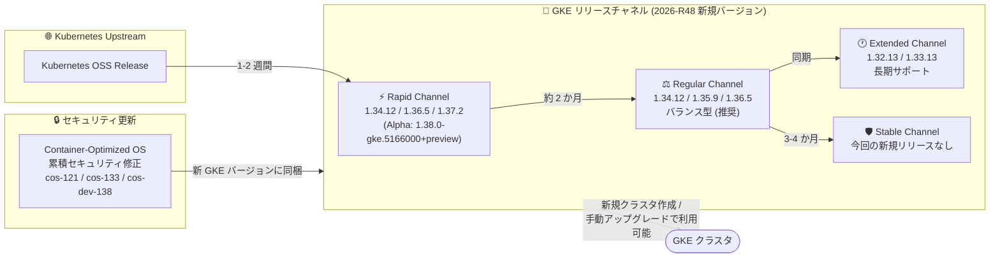

# Google Kubernetes Engine: 2026-R48 リリースチャネル バージョンアップデートとセキュリティ更新

**リリース日**: 2026-11-13

**サービス**: Google Kubernetes Engine

**機能**: 2026-R48 Version Updates & Security Updates across Release Channels

**ステータス**: GA (Generally Available)

📊 [このアップデートのインフォグラフィックを見る](https://takech9203.github.io/google-cloud-news-summary/20261113-gke-version-updates-2026-r48.html)

## 概要

Google Kubernetes Engine (GKE) において、2026-R48 バージョンアップデートが実施された。Rapid、Regular、Extended、No channel の各チャネルに新しいパッチバージョンが追加され、新規クラスタの作成、および既存クラスタのコントロールプレーン・ノードの手動アップグレードに利用可能になった。Stable チャネルでは今回新しいリリースはない。

Rapid チャネルでは 1.34.12-gke.1776000、1.36.5-gke.2370000、1.37.2-gke.1325000 の 3 つのパッチバージョンが追加された。また、GKE Alpha クラスタ向けの Alpha バージョンが 1.38.0-gke.5166000+preview に更新され、旧 Alpha バージョン 1.38.0-gke.3229000+preview は利用できなくなった。Regular チャネルには 1.34.12-gke.1539000、1.35.9-gke.1505000、1.36.5-gke.1982000 が、Extended チャネルには 1.32.13-gke.3070000、1.33.13-gke.2398000 が追加された。

セキュリティ面では、更新された Container-Optimized OS (COS) イメージを使用する新しい GKE バージョンが含まれる。これらのイメージは累積的であり、前回の GKE リリース以降にリリースされたすべての COS バージョンのセキュリティ修正を取り込んでいる。新しいパッチバージョンは自動アップグレードターゲットに設定される少なくとも 1 週間前に利用可能になるため、手動アップグレードや accelerated patch auto-upgrades を使用することで、セキュリティ修正をいち早く適用できる。

**アップデート前の課題**

- 前回リリース (2026-R47) 以降に Container-Optimized OS で修正された脆弱性が、既存の GKE バージョンには反映されていなかった
- 各チャネルの既存パッチバージョンには、最新のバグフィックスやセキュリティ修正が含まれていなかった
- Rapid チャネルの旧 Alpha バージョン (1.38.0-gke.3229000+preview) は、1.38 系の最新の修正を含んでいなかった

**アップデート後の改善**

- Rapid、Regular、Extended、No channel の各チャネルに最新のセキュリティ修正を含む新しいパッチバージョンが追加され、新規クラスタ作成と手動アップグレードで利用可能になった
- 更新された Container-Optimized OS イメージ (cos-121-18867-652-29、cos-133-19999-44-193、cos-dev-138-20162-0-0) により、前回リリース以降の累積的なセキュリティ修正が適用される
- Alpha バージョンが 1.38.0-gke.5166000+preview に更新され、次期マイナーバージョン 1.38 の最新ビルドを GKE Alpha クラスタで検証できるようになった

## アーキテクチャ図



この図は、Kubernetes のアップストリームリリースから GKE の各リリースチャネルへのバージョン伝搬フローと、2026-R48 で追加された新規バージョンに更新済み Container-Optimized OS イメージのセキュリティ修正が同梱され、クラスタへ提供される流れを示している。

## サービスアップデートの詳細

### 主要機能

1. **Rapid チャネルの新規バージョン**
   - 新規利用可能バージョン: 1.34.12-gke.1776000、1.36.5-gke.2370000、1.37.2-gke.1325000
   - Alpha バージョン 1.38.0-gke.5166000+preview が GKE Alpha クラスタ向けに提供開始
   - 旧 Alpha バージョン 1.38.0-gke.3229000+preview は利用不可に

2. **Regular チャネルの新規バージョン**
   - 新規利用可能バージョン: 1.34.12-gke.1539000、1.35.9-gke.1505000、1.36.5-gke.1982000
   - 一般的な本番ワークロード向けの推奨チャネルで、最新のセキュリティ修正を含むパッチが選択可能に

3. **Stable チャネル**
   - 今回の 2026-R48 では新しいリリースなし

4. **Extended チャネルの新規バージョン**
   - 新規利用可能バージョン: 1.32.13-gke.3070000、1.33.13-gke.2398000
   - 長期サポートが必要な環境向けに 1.32 系・1.33 系の最新セキュリティパッチを継続提供

5. **No channel (非推奨) の新規バージョン**
   - 新規利用可能バージョン: 1.34.12-gke.1776000、1.36.5-gke.2370000、1.37.2-gke.1325000
   - 新規ノードバージョン: 1.32.13-gke.3070000、1.33.13-gke.2398000、1.34.12-gke.1776000、1.36.5-gke.2370000、1.37.2-gke.1325000
   - No channel 構成自体は非推奨であり、2027 年 6 月 14 日に削除予定。リリースチャネルへの移行が推奨される

6. **セキュリティ更新 (Container-Optimized OS)**
   - 更新された Container-Optimized OS イメージを使用する新しい GKE バージョンを含む
   - イメージは累積的で、前回の GKE リリース以降にリリースされたすべての COS バージョンのセキュリティ修正を取り込む
   - 解決された個別の脆弱性は各 COS イメージの Security release notes で確認可能

## 技術仕様

### チャネル別の新規利用可能バージョン一覧 (2026-R48)

| チャネル | 新規利用可能バージョン | 推奨用途 |
|---------|------------------------|---------|
| Rapid | 1.34.12-gke.1776000、1.36.5-gke.2370000、1.37.2-gke.1325000 (Alpha: 1.38.0-gke.5166000+preview) | 本番前検証、新機能の早期評価 |
| Regular | 1.34.12-gke.1539000、1.35.9-gke.1505000、1.36.5-gke.1982000 | 一般的な本番ワークロード (推奨) |
| Stable | 新規リリースなし | 高安定性が求められる本番環境 |
| Extended | 1.32.13-gke.3070000、1.33.13-gke.2398000 | 長期サポートが必要な環境 |
| No channel (非推奨) | 1.34.12-gke.1776000、1.36.5-gke.2370000、1.37.2-gke.1325000 (ノード: 1.32.13-gke.3070000、1.33.13-gke.2398000 ほか) | 非推奨 (2027-06-14 削除予定) |

これらのバージョンは、新規 GKE クラスタの作成、および既存クラスタのコントロールプレーンとノードの手動アップグレードに利用できる。新しいパッチバージョンは、該当チャネルで自動アップグレードターゲットに設定される少なくとも 1 週間前に利用可能になる。

### セキュリティ更新: Container-Optimized OS イメージ

| GKE バージョン | Container-Optimized OS バージョン |
|---------------|----------------------------------|
| 1.32.13-gke.3070000 | cos-121-18867-652-29 |
| 1.33.13-gke.2398000 | cos-121-18867-652-29 |
| 1.37.2-gke.1325000 | cos-133-19999-44-193 |
| 1.38.0-gke.5166000+preview | cos-dev-138-20162-0-0 |

各イメージで解決された脆弱性の詳細は、それぞれの Container-Optimized OS の Security release notes を参照のこと。

### リリースチャネルの特性比較

| 特性 | Rapid | Regular | Extended | Stable |
|------|-------|---------|----------|--------|
| 新マイナーバージョン提供時期 | OSS GA から 1-2 週間 | Rapid から約 2 か月後 | Regular と同期 | Regular から 3-4 か月後 |
| GKE SLA 対象 | 対象外 | 対象 | 対象 | 対象 |
| 推奨環境 | 開発/検証 | 本番 (推奨) | 長期安定本番 | 高安定性本番 |
| マイナーバージョン保持期間 | 標準 | 標準 | 最長 | 標準 |

## 設定方法

### 前提条件

1. Google Cloud プロジェクトで GKE API が有効化されていること
2. gcloud CLI がインストールされ、認証が完了していること
3. Kubernetes Engine Cluster Admin 以上の IAM 権限を持つこと

### 手順

#### ステップ 1: 現在のクラスタバージョンとチャネルを確認

```bash
gcloud container clusters list \
    --project PROJECT_ID \
    --format="table(name,location,currentMasterVersion,releaseChannel.channel)"
```

現在のクラスタが使用しているバージョンとリリースチャネルを確認する。

#### ステップ 2: 利用可能なバージョンを確認

```bash
gcloud container get-server-config \
    --location LOCATION \
    --format="yaml(channels)"
```

リリースチャネルごとのデフォルトバージョンと利用可能バージョンの一覧を表示する。ロールアウトは複数日かけて全ゾーンに展開されるため、リリースノート公開時点では一部のゾーンで新バージョンが未提供の場合がある。

#### ステップ 3: 手動でバージョンをアップグレードする場合

```bash
# コントロールプレーンのアップグレード
gcloud container clusters upgrade CLUSTER_NAME \
    --location LOCATION \
    --master \
    --cluster-version VERSION

# ノードプールのアップグレード
gcloud container clusters upgrade CLUSTER_NAME \
    --location LOCATION \
    --node-pool NODE_POOL_NAME \
    --cluster-version VERSION
```

手動アップグレードを行う場合は、コントロールプレーンを先にアップグレードし、その後ノードプールをアップグレードする。

#### ステップ 4: セキュリティパッチを早期適用したい場合 (accelerated patch auto-upgrades)

```bash
gcloud container clusters update CLUSTER_NAME \
    --location LOCATION \
    --patch-update accelerated
```

パッチバージョンが自動アップグレードターゲットに設定される前に、利用可能になった時点で自動アップグレードを受け取れる。セキュリティパッチを可能な限り早く適用したい場合に有効。

## メリット

### ビジネス面

- **セキュリティリスクの低減**: 累積的な Container-Optimized OS のセキュリティ修正を含む新バージョンが提供され、既知の脆弱性に対するリスクが迅速に低減される
- **運用負荷の軽減**: リリースチャネルに登録されたクラスタは、新バージョンが自動アップグレードターゲットに設定された後、メンテナンスポリシーに従って自動的にアップグレードされるため、手動でのバージョン管理作業を最小化できる
- **計画的なパッチ適用**: 新パッチバージョンは自動アップグレードターゲット化の少なくとも 1 週間前に利用可能になるため、検証環境での先行確認や計画的な適用スケジュールの策定が可能

### 技術面

- **Kubernetes 1.38 の最新ビルドで検証可能**: Rapid チャネルの Alpha バージョンが 1.38.0-gke.5166000+preview に更新され、次期マイナーバージョンの最新の修正を含むビルドを GKE Alpha クラスタで検証できる
- **幅広いマイナーバージョンへのパッチ提供**: 1.32 系から 1.37 系まで複数のマイナーバージョンに最新パッチが追加され、Extended チャネルを含む長期サポート環境でもセキュリティ修正を受け取れる
- **パッチバージョンの早期利用**: 手動アップグレードや accelerated patch auto-upgrades により、自動アップグレードを待たずにセキュリティ修正を先行適用できる

## デメリット・制約事項

### 制限事項

- Rapid チャネルのバージョンは GKE SLA の対象外であり、本番環境での使用は推奨されない
- Alpha バージョン 1.38.0-gke.5166000+preview は GKE Alpha クラスタ専用であり、通常のクラスタでは使用できない。旧 Alpha バージョン 1.38.0-gke.3229000+preview は利用できなくなった
- ロールアウトはリリースノート公開時点で進行中であり、全 Google Cloud ゾーンへの展開完了まで複数日かかる場合がある
- Stable チャネルには今回新しいリリースがないため、Stable チャネルのクラスタでは新バージョンの選択肢は変わらない

### 考慮すべき点

- No channel (リリースチャネル未登録) 構成は非推奨であり、2027 年 6 月 14 日に削除される予定。該当クラスタはリリースチャネルへの移行計画を策定すること
- 今回追加されたパッチバージョンは、今後自動アップグレードターゲットに設定される見込みのため、メンテナンスウィンドウとメンテナンス除外の設定を確認し、ビジネスクリティカルな時間帯での自動アップグレードを回避すること
- セキュリティ修正の内容は GKE のリリースノートには個別に記載されず、各 Container-Optimized OS イメージの Security release notes で確認する必要がある

## ユースケース

### ユースケース 1: セキュリティパッチの迅速な適用

**シナリオ**: セキュリティ要件が厳しい環境で、Container-Optimized OS のセキュリティ修正を含む新バージョン (例: Regular チャネルの 1.36.5-gke.1982000) を、自動アップグレードターゲットになる前に適用したい場合。

**実装例**:
```bash
# 方法 1: 手動アップグレードで即時適用
gcloud container clusters upgrade prod-cluster \
    --location us-central1 \
    --master \
    --cluster-version 1.36.5-gke.1982000

# 方法 2: accelerated patch auto-upgrades を有効化
gcloud container clusters update prod-cluster \
    --location us-central1 \
    --patch-update accelerated
```

**効果**: パッチバージョンが利用可能になった時点でアップグレードでき、COS イメージの累積的なセキュリティ修正を通常の自動アップグレードスケジュールより早く適用できる。

### ユースケース 2: Kubernetes 1.38 最新 Alpha ビルドの先行検証

**シナリオ**: プラットフォームチームが次期 Kubernetes 1.38 の新機能や API 変更を事前に検証したい場合。Rapid チャネルの GKE Alpha クラスタで最新の Alpha バージョンを使用する。

**実装例**:
```bash
# Alpha クラスタを 1.38.0 preview で作成
gcloud container clusters create alpha-test-cluster \
    --location us-central1 \
    --enable-kubernetes-alpha \
    --release-channel rapid \
    --cluster-version 1.38.0-gke.5166000+preview
```

**効果**: GKE で 1.38 系が一般提供される前に、アルファ機能ゲートを含む次期バージョンの最新ビルドの挙動を検証でき、マイナーバージョンアップグレードに向けた準備期間を確保できる。

### ユースケース 3: Extended チャネルによる長期バージョン保持とパッチ適用の両立

**シナリオ**: 規制要件によりマイナーバージョンアップグレードに社内監査プロセスが必要な環境で、1.32 系・1.33 系を長期維持しつつ、最新のセキュリティパッチ (1.32.13-gke.3070000、1.33.13-gke.2398000) は適用したい場合。

**効果**: Extended チャネルのマイナーバージョン長期サポートを活用して監査プロセスに十分な時間を確保しながら、cos-121-18867-652-29 の累積セキュリティ修正を含むパッチレベルの更新を適用し、クラスタの安全性を維持できる。

## 料金

GKE のリリースチャネルおよびバージョンアップデートに関する追加料金は発生しない。バージョンアップデートとセキュリティ更新は GKE サービスの標準機能として提供される。

### GKE クラスタ管理費用

| モード | クラスタ管理料金 |
|--------|-----------------|
| GKE Standard | $0.10/クラスタ/時間 |
| GKE Autopilot | クラスタ管理料金 $0.10/クラスタ/時間 + Pod リソースに対する課金 |
| GKE Enterprise | Enterprise ライセンス料金に含まれる |

最新の料金は [GKE 料金ページ](https://cloud.google.com/kubernetes-engine/pricing) を参照のこと。

## 利用可能リージョン

GKE のリリースチャネルバージョンアップデートは、GKE が利用可能なすべてのリージョンおよびゾーンに適用される。ただし、ロールアウトはリリースノート公開時点で進行中であり、全ゾーンへの展開完了まで複数日かかる場合がある。

## 関連サービス・機能

- **GKE リリースチャネル**: クラスタのバージョン管理ポリシーを定義する機能。Rapid、Regular、Extended、Stable の 4 つのチャネルから選択可能
- **Container-Optimized OS**: GKE ノードのデフォルト OS イメージ。Google が管理するセキュリティ強化済みの OS で、今回のセキュリティ更新の対象
- **GKE メンテナンスウィンドウと除外**: 自動アップグレードの実行時間帯を制御する機能。ビジネスクリティカルな時間帯を避けてアップグレードをスケジュール可能
- **GKE クラスタ通知**: バージョンの更新やアップグレードイベントに関する通知を Pub/Sub 経由で受信できる機能
- **GKE Alpha クラスタ**: Kubernetes のアルファ機能ゲートと Alpha API を有効化した検証用クラスタ。Rapid チャネルの Alpha パッチバージョンを利用可能

## 参考リンク

- 📊 [インフォグラフィック](https://takech9203.github.io/google-cloud-news-summary/20261113-gke-version-updates-2026-r48.html)
- [公式リリースノート (Google Cloud)](https://docs.cloud.google.com/release-notes#November_13_2026)
- [GKE リリースノート (November 13, 2026)](https://cloud.google.com/kubernetes-engine/docs/release-notes#November_13_2026)
- [GKE リリースチャネルの概要](https://docs.cloud.google.com/kubernetes-engine/docs/concepts/release-channels)
- [GKE リリーススケジュール](https://docs.cloud.google.com/kubernetes-engine/docs/release-schedule)
- [GKE クラスタのアップグレード](https://docs.cloud.google.com/kubernetes-engine/docs/how-to/upgrading-a-cluster)
- [メンテナンスウィンドウと除外の設定](https://docs.cloud.google.com/kubernetes-engine/docs/concepts/maintenance-windows-and-exclusions)
- [Container-Optimized OS リリースノート](https://cloud.google.com/container-optimized-os/docs/release-notes)
- [GKE 料金ページ](https://cloud.google.com/kubernetes-engine/pricing)

## まとめ

2026-R48 バージョンアップデートにより、GKE の Rapid、Regular、Extended、No channel の各チャネルに、累積的な Container-Optimized OS セキュリティ修正を含む新しいパッチバージョンが追加された (Stable チャネルは今回新規リリースなし)。Rapid チャネルでは Alpha バージョンが 1.38.0-gke.5166000+preview に更新され、次期マイナーバージョンの最新ビルドでの検証が可能になった。これらのバージョンは今後自動アップグレードターゲットに設定される見込みのため、セキュリティ要件の厳しい環境では手動アップグレードや accelerated patch auto-upgrades による先行適用を検討し、あわせてメンテナンスウィンドウの設定を確認することを推奨する。また、No channel 構成のクラスタは 2027 年 6 月の削除に向けてリリースチャネルへの移行を計画すべきである。

---

**タグ**: #GoogleKubernetesEngine #GKE #ReleaseChannels #VersionUpdate #SecurityUpdate #Kubernetes #ContainerOptimizedOS #AutoUpgrade #Rapid #Regular #Extended #Stable #ClusterManagement
