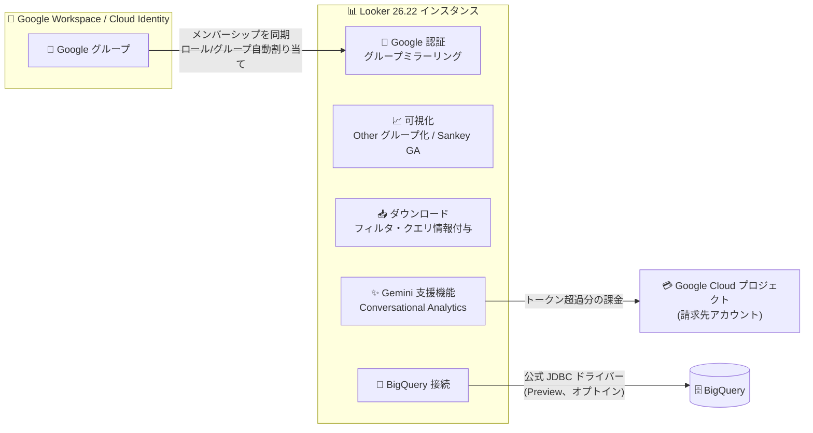

# Looker: 26.22 機能アップデートまとめ (Google グループミラーリング、Sankey チャート GA、公式 BigQuery JDBC ドライバーなど)

**リリース日**: 2026-11-13

**サービス**: Looker

**機能**: Looker 26.22 の機能アップデート群 (Google グループミラーリング、Gemini 支援機能の課金開始、可視化の「Other」グループ化、ダウンロードへのフィルタ・クエリ情報付与、公式 BigQuery JDBC ドライバー、PDF ダウンロード動作変更、Sankey チャート GA)

**ステータス**: 一般提供 (GA) / 一部プレビュー (公式 BigQuery JDBC ドライバー)

📊 [このアップデートのインフォグラフィックを見る](https://takech9203.github.io/google-cloud-news-summary/20261113-looker-26-22-feature-updates.html)

## 概要

2026 年 11 月 13 日、Looker 26.22 サイクルに関する複数のアップデートが発表されました。発表によると、2026 年 11 月 9 日以降、Looker 26.22 を実行する Looker (オリジナル) および Looker (Google Cloud コア) インスタンスでは、以下の機能が自動的に有効化されます。

今回のアップデートは、(1) **管理・認証**: Looker (オリジナル) での Google グループミラーリング対応、Gemini 支援機能 (Conversational Analytics など) の超過利用分に対する課金開始、(2) **可視化・レポーティング**: 表示上限を超える行/ピボット列を「Other」カテゴリへ集約する機能、ダウンロードファイルへのフィルタ・クエリ情報の付与、PDF ダウンロードの動作変更、Sankey チャートの GA、(3) **データベース接続**: Google 公式 BigQuery JDBC ドライバーのオプトイン (プレビュー) という 3 つの領域にまたがります。

Looker 管理者はグループ管理の自動化や課金プロジェクトの設定準備、BI 開発者・利用者は新しい可視化オプションとダウンロードオプションの活用を検討してください。なお、同日に発表された Looker (オリジナル) の 2 要素認証 (2FA) デフォルト有効化 (Breaking Change) は別レポートで扱います。

**アップデート前の課題**

- Google グループのミラーリング機能は SAML 認証などでは利用できたものの、Looker (オリジナル) の Google 認証ではグループメンバーシップに基づくロール・グループの自動割り当てができず、Looker 側で手動のユーザー・グループ管理が必要だった
- Gemini 支援機能 (Conversational Analytics など) の利用に対する課金の仕組みが整備されておらず、課金開始に向けた請求先プロジェクトの関連付けが必要になった
- `Limit Displayed Rows` などで表示行数を制限すると、上限外の行は単に非表示となり、「上位 N + その他」という形で全体を把握できる表現ができなかった
- Look や Explore、ダッシュボードタイルをダウンロードした際、適用されていたフィルタ条件やクエリ実行情報がファイルに含まれず、ダウンロード後のファイルだけでは「どのような条件のデータか」を確認できなかった
- Looker の BigQuery 接続は Looker 独自のレガシードライバーを使用しており、Google が公式にビルド・サポートするドライバーは選択できなかった
- Sankey チャートはこれまで一般提供 (GA) ではなかった

**アップデート後の改善**

- Looker (オリジナル) が **Google グループミラーリング**に対応し、Google グループのメンバーシップに基づいて Looker のロールとグループを自動割り当てできるようになった。更新された Google Authentication 管理ページでは高度なロール管理 (Advanced Role Management) と Looker API によるプログラマティックな構成も可能になった
- Gemini 支援機能のインスタンストークン割り当てを超過した利用分への課金が開始されるため、管理者は **Gemini in Looker 管理ページ**から有効な請求先アカウントを持つ Google Cloud プロジェクトをインスタンスに関連付けて準備できるようになった
- 可視化で **「Group remaining rows into 'Other'」/「Group remaining pivots into 'Other'」** を選択すると、上位 N 行 (またはピボット列) と集約された「Other」カテゴリを並べて表示できるようになった。ラベルのカスタマイズや、一部チャートタイプではカスタムカラーの指定も可能
- ダウンロード時に **PNG はフィルタバナー、Excel はクエリメタデータ・フィルタシート**を含められるようになり、タブ付きダッシュボードの PDF ではフィルタの表示位置 (先頭に一括 / 各タブのヘッダー下) を選択できるようになった
- BigQuery 接続で **Google 公式 BigQuery JDBC ドライバー (プレビュー)** にオプトインできるようになった。将来のリリースでレガシードライバーを置き換える予定
- **Sankey チャートが一般提供 (GA)** となり、カスタマージャーニーやナビゲーションフローなどの多段階パスの分析に利用できるようになった

## アーキテクチャ図



Looker 26.22 では、Google グループとの認証連携、公式 BigQuery JDBC ドライバーによる接続、Gemini 支援機能の課金プロジェクト関連付けなど、Looker インスタンスを取り巻く複数の統合ポイントが強化されます。

## サービスアップデートの詳細

### 主要機能

1. **Google グループミラーリング (Looker オリジナル)**
   - Google グループのメンバーシップに基づき、Looker のロールとグループを自動割り当て
   - Google グループのメンバーシップ変更は、ミラーリングされた Looker グループに自動的に伝播され、各ユーザーの次回ログイン時に検証される
   - Advanced Role Management により、ミラーリングされたグループ・ユーザーの管理を Google グループ構成と厳密に一致させるか、Looker 内での追加管理 (組み込みグループへの追加や直接のロール割り当て) を許可するかを制御可能
   - ミラーリングを無効化すると、ユーザーのいないミラーグループは即時削除され、ユーザーが残るグループは「孤立 (orphaned)」としてマークされ 31 日間ログインがなければ削除される
   - Looker API によるプログラマティックな構成にも対応

2. **Gemini 支援機能の超過利用分への課金開始 (Change)**
   - Gemini 支援機能は Conversational Analytics をはじめとする、Gemini を利用する GA 済みのエージェント機能群。プレビュー段階の機能は課金対象外
   - 使用量は**データトークン** (入力: 質問、会話履歴、LookML スキーマメタデータなど / 出力: 自然言語応答、生成された SQL/LookML クエリ、可視化仕様など) で計測される
   - インスタンスに含まれる月間データトークン割り当てを超過した利用分が課金対象
   - Looker (オリジナル) では管理者が Gemini in Looker 管理ページから請求先プロジェクトを指定する必要がある。Looker (Google Cloud コア) ではプロビジョニング時にリンクされたプロジェクトと請求先アカウントが使用される
   - 公式ドキュメントでは課金開始日は 2027 年 2 月 1 日と記載されている

3. **可視化の「Other」カテゴリへのグループ化**
   - `Limit Displayed Rows` / `Limit Displayed Pivot Columns` 使用時に、上限外の行/ピボット列を単一の「Other」カテゴリへ集約して表示
   - カテゴリラベルをカスタマイズ可能。円グラフや単一シリーズの縦棒・横棒・散布図ではカスタムカラーも指定可能
   - 行グループ化の対応: テーブル、横棒、縦棒、折れ線、面、散布図、円、ドーナツマルチプル
   - ピボットグループ化の対応: テーブル、横棒、縦棒、折れ線、面、散布図

4. **ダウンロードへのフィルタ・クエリ情報の付与**
   - PNG (可視化画像): 「Include filter context」を選択すると、アクティブなフィルタとその値を示すヘッダーバナーを画像上部に表示
   - Excel: 「Add query metadata sheet」を選択すると、クエリ実行時間・タイムゾーンなどの「Metadata」シートと、適用フィルタの「Filters」シートを追加
   - ダッシュボード編集者は、タイルダウンロードの Excel メタデータオプションのデフォルトをダッシュボード設定で指定可能
   - タブ付きダッシュボードの PDF ダウンロードでは、全ダッシュボードフィルタを PDF の先頭に表示するか、各タブのアクティブフィルタを各タブのヘッダー下に表示するかを選択可能

5. **公式 Google BigQuery JDBC ドライバーへのオプトイン (Preview)**
   - Google がビルド・サポートする公式ドライバーで、将来のリリースで現行の Looker レガシードライバーを置き換える予定
   - 既存の接続は、管理者がオプトインしない限り現行ドライバーを継続使用。いつでも以前のドライバーバージョンに戻すことが可能
   - プレビュー期間中に問題が発生した場合は cloud-looker-dialects@google.com に報告

6. **PDF ダウンロード/配信の動作変更 (Change)**
   - ダッシュボードの PDF ダウンロードまたは PDF 配信の設定時に「Expand tables to show all rows」を選択すると、「Fit Page to Dashboard」オプションが選択不可になり、用紙サイズが A4 に設定され、改ページがデフォルトで有効になる

7. **Sankey チャートの一般提供 (GA)**
   - カテゴリ、ステージ、状態間のデータのフローと分布を可視化。接続パスの幅がメジャー値に対応
   - カスタマージャーニー、Web サイトのナビゲーションフロー、システム間のリソース配分など、多段階パスの分析に有用
   - **Path 型** (2 つ以上のディメンション + 1 メジャー) と **Edge list 型** (2 ディメンション + 1 メジャー) の 2 種類のデータタイプに対応し、クエリに基づき自動適用
   - クロスフィルタリング (Link crossfilter by: Both / Source / Target)、カスタムツールチップ、カラーコレクションなどのスタイルオプションに対応

## 技術仕様

### 「Other」グループ化の対応チャートと制約

| 項目 | 詳細 |
|------|------|
| 行グループ化の対応チャート | テーブル、横棒、縦棒、折れ線、面、散布図、円、ドーナツマルチプル |
| ピボットグループ化の対応チャート | テーブル、横棒、縦棒、折れ線、面、散布図 |
| ラベル | カスタマイズ可能 (デフォルト: Other) |
| カスタムカラー | 円グラフおよび単一シリーズの縦棒・横棒・散布図で指定可能。マルチシリーズチャートでは既存のシリーズカラーを使用。テーブルチャートは行の色指定非対応 |
| クロスフィルタリング | 「Other」カテゴリでは非対応 (選択しても他タイルはフィルタされない) |
| 非加算メジャー | 個別カウント (distinct count) やパーセンタイルなどの非加算メジャーを含むクエリでは利用不可 |
| 表示位置 | 「Other」行はソート順に関係なく常に最終行に表示 |
| ピボット併用 | 非テーブルチャートでは、行グループ化とピボット列グループ化の同時有効化は不可 (いずれか一方のみ) |

### ダウンロード形式別のフィルタ・クエリ情報オプション

| 形式 | オプション | 内容 |
|------|-----------|------|
| PNG (可視化画像) | Include filter context | アクティブなフィルタと値を示すバナーを画像上部に表示 (デフォルト: オフ) |
| Excel (2007 以降) | Add query metadata sheet | 「Metadata」(クエリ実行時間、タイムゾーンなど) と「Filters」(適用フィルタと値) の 2 シートを追加 (デフォルト: オフ、ダッシュボード設定でタイルダウンロードのデフォルト指定可) |
| PDF (タブ付きダッシュボード) | フィルタ表示位置 | 全フィルタを PDF 先頭に表示するか、各タブのアクティブフィルタをタブヘッダー下に表示するかを選択 |

### Sankey チャートの要件と制限

| 項目 | 詳細 |
|------|------|
| インスタンス要件 | Looker (オリジナル) / Looker (Google Cloud コア) 26.20 以降 |
| 必要な権限 | `explore` 権限 (User ロールなど) と対象 LookML モデルへのアクセス |
| データタイプ | Path (2 ディメンション以上 + 1 メジャー)、Edge list (2 ディメンション + 1 メジャー) |
| 最大行数 | 500 行 (超過分は切り捨て、またはレンダリング問題の可能性) |
| Edge list 型の制約 | 前方向のパスのみ対応 (A > B > A のような循環パスはレンダリング不可) |

## 設定方法

### 公式 BigQuery JDBC ドライバー (Preview) へのオプトイン

1. **Admin > Database > Connections** で Connections 管理ページを開く
2. 対象の BigQuery 接続の **Edit** ボタンをクリック
3. 接続の **Use latest stable driver** トグルをオフにする
4. **Driver Version** ドロップダウンメニューから **BigQuery Official [Preview]** ドライバーオプションのいずれかを選択
5. **Test** で接続を確認し、**Update Connection** を選択

### Gemini 支援機能の請求先プロジェクトの指定 (Looker オリジナル)

1. Admin パネルの **Platform** セクションで **Gemini in Looker** ページを開く
2. **Add project** を選択
3. 「Select a Google Cloud project」パネルで、有効な請求先アカウントにリンクされた Google Cloud プロジェクトの**プロジェクト番号**を入力
4. パネルに表示されるサービスアカウント名を控える
5. Google Cloud コンソールで該当プロジェクトを開き、そのサービスアカウントに **Viewer** IAM ロールを付与
6. Looker のページに戻り、**Validate and link** を選択

### Google グループミラーリングの注意点

- Advanced Role Management のすべてのオプションを有効にすると、Looker 管理者はミラーグループのメンバーシップを直接変更できなくなり、ロールは Google グループ経由でのみ割り当て可能になる
- より制限の強い設定を有効にすると、Looker 内で直接構成されていたグループメンバーシップや割り当て済みロールが、ユーザーの次回サインイン時に失われる点に注意

## メリット

### ビジネス面

- **ID 管理の一元化**: Google グループを唯一の情報源として Looker のグループ・ロールを管理でき、入退社や異動に伴う権限変更の運用負荷とヒューマンエラーを削減できる
- **ガバナンスとトレーサビリティの向上**: ダウンロードファイルにフィルタ条件とクエリメタデータが含まれるため、共有されたレポートが「いつ、どの条件で」取得されたデータかを受け手が確認でき、監査やレビューが容易になる
- **分析表現力の向上**: Sankey チャートの GA と「Other」グループ化により、カスタマージャーニー分析や上位 N + その他のパレート的な可視化を標準機能で実現できる

### 技術面

- **Google 公式サポートのドライバー**: BigQuery 接続を Google がビルド・サポートする公式 JDBC ドライバーへ段階的に移行でき、将来の強制移行前にプレビューで検証できる
- **API によるガバナンス自動化**: Google 認証設定が Looker API でプログラマティックに構成可能となり、IaC 的な管理や複数インスタンスへの一括適用がしやすくなる
- **コストの可視化と管理**: Gemini 支援機能の利用がデータトークンで計測され、請求先プロジェクトに紐づくため、Cloud Billing 側でコストを追跡できる

## デメリット・制約事項

### 制限事項

- 「Other」カテゴリはクロスフィルタリング非対応で、非加算メジャー (個別カウント、パーセンタイルなど) を含むクエリでは利用できない。非テーブルチャートでは行とピボット列のグループ化を同時に有効化できない
- Sankey チャートは最大 500 行までで、Edge list 型は循環パス (A > B > A) をレンダリングできない
- 公式 BigQuery JDBC ドライバーはプレビュー段階であり、Pre-GA 提供条件が適用される
- PNG フィルタバナーと Excel メタデータシートは PNG / Excel 形式のみで利用可能 (CSV、JSON などは対象外)

### 考慮すべき点

- **自動有効化**: これらの機能は Looker 26.22 を実行するインスタンスで 2026 年 11 月 9 日以降自動的に有効化されるため、管理者は事前に動作変更 (特に PDF ダウンロードの挙動変更) の影響を確認しておくべき
- **Gemini 課金の準備**: Conversational Analytics などの Gemini 支援機能を利用している Looker (オリジナル) インスタンスでは、課金開始前に請求先プロジェクトの関連付けを済ませないと、ユーザーへの影響 (利用の中断) が生じる可能性がある。Looker (Google Cloud コア) ではプロビジョニング時のプロジェクトが使用され変更不可
- **グループミラーリングの切り替え影響**: Advanced Role Management の制限的な設定を有効化すると、Looker 内で直接付与していたロールやグループメンバーシップが次回ログイン時に失われる
- **PDF 配信への影響**: 既存の PDF 配信スケジュールで「Expand tables to show all rows」を使用している場合、用紙サイズが A4・改ページ有効に変わるため、出力レイアウトの確認が必要
- **JDBC ドライバーの検証**: 公式ドライバーは将来レガシードライバーを置き換えるため、早めにプレビューで既存の LookML・ダッシュボードとの互換性を検証しておくことが望ましい

## ユースケース

### ユースケース 1: Google グループによる Looker 権限管理の自動化

**シナリオ**: Google Workspace でチームごとの Google グループ (例: `sales-analytics@example.com`) を運用している企業が、Looker (オリジナル) のユーザー権限管理を手動で行っており、異動時の権限変更漏れが課題になっている。

**実装例**:
```
1. Admin > Authentication > Google で Mirror Google Groups を有効化
2. Google グループ ID と Looker グループ名、割り当てるロールをマッピング
3. 必要に応じて Advanced Role Management で Looker 内での直接のロール付与を制限
4. 以降、Google グループのメンバー変更が次回ログイン時に Looker へ自動反映される
```

**効果**: 権限管理を Google グループに一元化し、手動運用によるミスと管理工数を削減できる。

### ユースケース 2: Sankey チャートによるカスタマージャーニー分析

**シナリオ**: E コマースサイトで「流入元 → 訪問ページ → 購読状態」というユーザー行動のフローを可視化し、離脱ポイントを特定したい。

**実装例**:
```
Explore で以下のフィールドを選択し、可視化タイプに Sankey を指定 (Path 型):
- Source (ディメンション): 流入元
- Page (ディメンション): 次に訪問したページ
- Status (ディメンション): 購読有無
- Count of Users (メジャー): 各ジャーニーを完了したユーザー数
```

**効果**: 多段階パスの流量と分布が一目で把握でき、クロスフィルタリングと組み合わせてダッシュボード上でドリルダウン分析ができる。

### ユースケース 3: 監査要件を満たすレポート配布

**シナリオ**: 経営レポートを Excel でダウンロードして配布する際、「どのフィルタ条件で、いつ実行されたデータか」を明示する必要がある。

**効果**: 「Add query metadata sheet」を有効にすることで、Metadata シート (実行時間・タイムゾーン) と Filters シート (適用フィルタ) が自動付与され、配布後のファイル単体でデータの前提条件を確認できる。ダッシュボード設定でデフォルト有効にすれば、利用者の設定忘れも防げる。

## 料金

今回のアップデートの大半は Looker の既存ライセンスの範囲で利用できますが、**Gemini 支援機能 (Conversational Analytics など) については、インスタンスに含まれる月間データトークン割り当てを超過した利用分への課金が開始されます** (公式ドキュメントでは 2027 年 2 月 1 日開始と記載)。

- 使用量は**データトークン** (入力トークン + 出力トークン) で計測される
- プレビュー段階の Gemini 支援機能は課金対象外
- 課金は Google Cloud プロジェクトの請求先アカウントに紐づく。Looker (オリジナル) は管理者による請求先プロジェクトの指定が必要、Looker (Google Cloud コア) はプロビジョニング時のプロジェクトを使用

詳細なレートは [Looker の料金ページ](https://docs.cloud.google.com/looker/pricing#conversational-analytics)を参照してください。

## 関連サービス・機能

- **Google Workspace / Cloud Identity (Google グループ)**: Google グループミラーリングの情報源。グループメンバーシップが Looker のグループ・ロールに同期される
- **BigQuery**: 公式 Google BigQuery JDBC ドライバー (Preview) による接続先。ドライバーは Google がビルド・サポートし、将来レガシードライバーを置き換える
- **Gemini for Google Cloud**: Conversational Analytics などの Gemini 支援機能の基盤。LookML セマンティックレイヤーにグラウンディングされた自然言語分析を提供
- **Cloud Billing**: Gemini 支援機能の超過利用分の課金先。請求先アカウントにリンクされた Google Cloud プロジェクトをインスタンスに関連付ける
- **Looker API**: Google 認証 (グループミラーリング含む) のプログラマティックな構成に対応

## 参考リンク

- 📊 [インフォグラフィック](https://takech9203.github.io/google-cloud-news-summary/20261113-looker-26-22-feature-updates.html)
- [公式リリースノート](https://docs.cloud.google.com/release-notes#November_13_2026)
- [Google 認証とグループミラーリング](https://docs.cloud.google.com/looker/docs/admin-panel-authentication-google#mirroring)
- [Gemini in Looker 管理ページ (請求先プロジェクトの指定)](https://docs.cloud.google.com/looker/docs/admin-panel-platform-gil#designate-billing-project)
- [Gemini 支援機能の課金の概要](https://docs.cloud.google.com/looker/docs/gemini-looker-billing-overview)
- [Limit Displayed Rows と「Other」グループ化](https://docs.cloud.google.com/looker/docs/table-options#limit_displayed_rows)
- [ダウンロードのフィルタ・クエリメタデータ](https://docs.cloud.google.com/looker/docs/downloading#filter_and_query_metadata)
- [BigQuery 接続と公式 JDBC ドライバー](https://docs.cloud.google.com/looker/docs/db-config-google-bigquery#official-jdbc-driver)
- [Sankey チャートのオプション](https://docs.cloud.google.com/looker/docs/sankey-options)
- [料金ページ](https://docs.cloud.google.com/looker/pricing#conversational-analytics)

## まとめ

Looker 26.22 では、Google グループミラーリングによる権限管理の自動化、Sankey チャートの GA や「Other」グループ化などの可視化強化、公式 BigQuery JDBC ドライバーのプレビューといった幅広い改善が、2026 年 11 月 9 日以降自動的に有効化されます。Looker 管理者はまず PDF ダウンロードの動作変更の影響確認と、Gemini 支援機能を利用している場合の請求先プロジェクトの関連付けを優先的に実施してください。あわせて、公式 BigQuery JDBC ドライバーは将来レガシードライバーを置き換えるため、早期のプレビュー検証を推奨します。

---

**タグ**: Looker, BI, 可視化, Google グループ, 認証, Gemini, Conversational Analytics, BigQuery, JDBC, Sankey, ダッシュボード, GA, Preview
