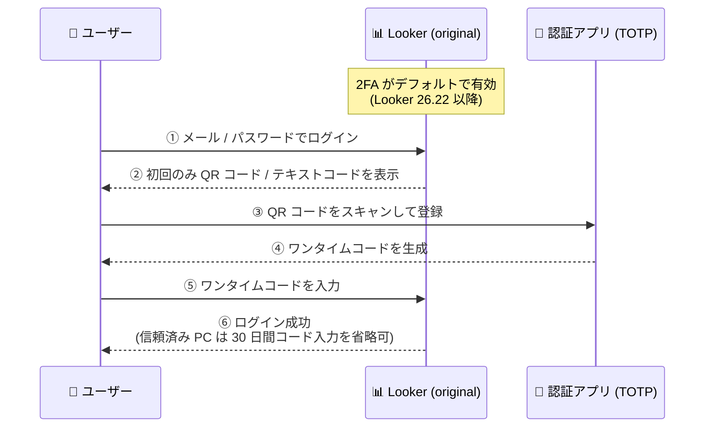

# Looker: メール/パスワード認証を使用する Looker (original) インスタンスで 2 要素認証 (2FA) がデフォルトで有効化

**リリース日**: 2026-11-13

**サービス**: Looker

**機能**: 2 要素認証 (2FA) のデフォルト有効化

**ステータス**: Breaking change (破壊的変更)

📊 [このアップデートのインフォグラフィックを見る](https://takech9203.github.io/google-cloud-news-summary/20261113-looker-2fa-enabled-by-default.html)

## 概要

メール/パスワード認証を使用するすべての新規および既存の Looker (original) インスタンスにおいて、事前のオプトアウト期間中にオプトアウトしなかった場合、2 要素認証 (2FA) がデフォルトで有効になりました。公式ドキュメントによると、この変更は Looker 26.22 以降で適用されます。

Looker の 2FA は、Looker 経由でアクセス可能なデータを保護するための追加のセキュリティレイヤーです。2FA が有効な場合、ログインするすべてのユーザーは、モバイルデバイスの認証アプリ (Google Authenticator または互換性のあるサードパーティ製 TOTP アプリ) で生成されるワンタイムコードによる認証が必要になります。一部のユーザーのみに 2FA を適用するオプションはなく、インスタンス単位で適用されます。

管理者は引き続き **Admin > Authentication > Two-Factor** パネルから 2FA の管理・無効化を完全にコントロールできます。ただし、デフォルトの挙動が「無効」から「有効」に変わる破壊的変更であるため、メール/パスワード認証を利用している Looker (original) の管理者はユーザーへの影響を確認する必要があります。

**アップデート前の課題**

- 以前は 2FA はデフォルトで無効であり、管理者が明示的に有効化しない限り、メール/パスワードのみでログインが可能だった
- パスワードのみの認証では、認証情報の漏洩やフィッシングによる不正アクセスのリスクが高かった
- セキュリティ強化は各インスタンス管理者の設定作業に依存していた

**アップデート後の改善**

- オプトアウトしなかったすべての対象インスタンスで 2FA が自動的に有効になり、追加の設定なしでログインセキュリティが強化された
- すべてのユーザーのログインに TOTP ワンタイムコードが要求され、パスワード漏洩時の不正アクセスリスクが低減された
- 管理者は従来どおり Admin > Authentication > Two-Factor パネルで 2FA を管理・無効化できるため、運用上の柔軟性は維持されている

## アーキテクチャ図

2FA 有効化後のログインフローです。メール/パスワードによる認証の後に、認証アプリで生成した TOTP ワンタイムコードの入力が必須になります。

## サービスアップデートの詳細

### 主要機能

1. **2FA のデフォルト有効化**
   - メール/パスワード認証を使用するすべての新規・既存の Looker (original) インスタンスが対象
   - 事前のオプトアウト期間中にオプトアウトしたインスタンスは対象外
   - 公式ドキュメントによると Looker 26.22 以降で適用

2. **TOTP ベースのワンタイムコード認証**
   - Google Authenticator (iPhone / Android) または互換性のあるサードパーティ製 TOTP 認証アプリを使用
   - 初回ログイン時に QR コードのスキャン、または手動テキストコードの入力でデバイスを登録
   - 以降のログインではユーザー名・パスワードの送信後に認証キーの入力が必要

3. **信頼済みコンピュータ (This is a trusted computer) オプション**
   - 有効にすると、ログインブラウザが 30 日間認証され、その間はユーザー名とパスワードのみでログイン可能
   - 30 日ごとに認証アプリによるブラウザの再認証が必要

4. **管理者によるフルコントロールの維持**
   - **Admin > Authentication > Two-Factor** パネルから 2FA の管理・無効化が可能
   - ユーザーのデバイス変更時は、Admin の Users ページから該当ユーザーの Two-Factor Secret をリセットできる

## 技術仕様

### 適用範囲と制約

| 項目 | 詳細 |
|------|------|
| 対象 | メール/パスワード認証を使用する Looker (original) インスタンス (新規・既存とも) |
| 対象外 | 事前オプトアウト期間中にオプトアウトしたインスタンス |
| Looker (Google Cloud core) | 対象外 (Google Cloud IAM または外部 IdP による多要素認証を使用) |
| Looker API | 影響なし |
| 外部認証 (LDAP / SAML / Google OAuth / OpenID Connect) | 影響なし (ただし、これらと併用する代替ログイン認証情報には 2FA が適用される) |
| 部分適用 | 不可 (一部ユーザーのみへの 2FA 適用はできない) |
| 管理画面 | Admin > Authentication > Two-Factor |

### 時刻同期要件

| 項目 | 詳細 |
|------|------|
| 要件 | TOTP は時刻ベースのトークンのため、Looker サーバーとモバイルデバイス間の時刻同期が必要 |
| 許容時刻ずれ (time-drift) | 管理者が Admin パネルで設定可能 (デフォルト: 90 秒) |
| 顧客ホスト型デプロイ | サーバーで NTP の稼働・設定を確認 (AWS 上の場合は Network ACL で NTP の許可が必要な場合あり) |
| モバイルデバイス | ネットワークとの自動時刻同期を設定 |

## 設定方法

### 前提条件

1. Looker (original) インスタンスの Admin ロール (または Authentication ページへのアクセス権限) を持っていること
2. 各ユーザーが Google Authenticator または互換性のあるサードパーティ製 TOTP 認証アプリをモバイルデバイスにインストールしていること

### 手順

#### ステップ 1: 2FA 設定の確認・管理 (管理者)

1. Looker の **Admin > Authentication > Two-Factor** パネルを開く
2. 2FA の有効/無効の状態を確認し、必要に応じて設定を変更する (無効化も可能)

**注意**: 2FA を有効化すると、ログイン中のすべてのユーザーはログアウトされ、2FA を使用して再ログインする必要があります。

#### ステップ 2: ユーザーの初回セットアップ

1. ユーザーがメール/パスワードでログインすると、QR コードと手動テキストコードが画面に表示される
2. 認証アプリで QR コードをスキャンするか、テキストコードを手動入力して登録する
3. 以降のログインでは、ユーザー名・パスワードの送信後に認証アプリで生成したコードを入力する

#### ステップ 3: ユーザーの 2FA リセット (デバイス変更時など)

1. **Admin > Users** ページで対象ユーザーの行の **Edit** をクリックする
2. **Two-Factor Secret** セクションで **Reset** をクリックすると、次回ログイン時に QR コードの再スキャンが求められる

## メリット

### ビジネス面

- **セキュリティポスチャの底上げ**: 管理者の設定作業に依存せず、対象インスタンス全体でログインセキュリティが標準で強化される
- **コンプライアンス対応の容易化**: 多要素認証の義務化を求めるセキュリティ基準・監査要件への対応がデフォルトで満たしやすくなる

### 技術面

- **不正アクセスリスクの低減**: パスワードが漏洩しても、TOTP ワンタイムコードがなければログインできない
- **運用の柔軟性維持**: 信頼済みコンピュータオプション (30 日間) によりユーザーの利便性を確保しつつ、管理者は必要に応じて 2FA を無効化できる

## デメリット・制約事項

### 制限事項

- 一部のユーザーのみに 2FA を適用することはできない (インスタンス全体に適用)
- Looker (Google Cloud core) には適用されない (Google Cloud IAM または外部 IdP の多要素認証を使用)
- LDAP / SAML / Google OAuth / OpenID Connect 経由の認証には影響しないが、これらと併用する代替ログイン認証情報には 2FA が適用される

### 考慮すべき点

- **破壊的変更**: オプトアウトしていない既存インスタンスでは、全ユーザーのログインフローが変わる。ユーザーへの事前周知と認証アプリの準備が必要
- 2FA が有効化されると、ログイン中のユーザーは全員ログアウトされ、2FA での再ログインが必要になる
- TOTP は時刻ベースのため、サーバーとモバイルデバイスの時刻同期が必須 (許容ずれのデフォルトは 90 秒)
- ユーザーがデバイスを変更した場合、管理者による Two-Factor Secret のリセット作業が発生する

## ユースケース

### ユースケース 1: 既存インスタンスでの影響確認とユーザー周知

**シナリオ**: メール/パスワード認証を使用している Looker (original) インスタンスの管理者が、2FA デフォルト有効化の影響を確認し、組織内に周知する。

**対応例**:
1. Admin > Authentication > Two-Factor パネルで現在の 2FA 状態を確認
2. ユーザーに認証アプリ (Google Authenticator など) のインストールと初回ログイン時の QR コード登録手順を案内
3. デバイス変更時のリセット手順をヘルプデスク運用に組み込む

**効果**: ログイン不能によるビジネス影響を防ぎつつ、セキュリティ強化の恩恵を受けられる。

### ユースケース 2: 組織のポリシーに合わせた認証方式の見直し

**シナリオ**: 2FA のデフォルト有効化を機に、メール/パスワード認証から SAML や OpenID Connect などの外部 IdP 認証への移行を検討する。

**効果**: 外部 IdP 側で統一的な多要素認証・条件付きアクセスを適用でき、Looker を含む組織全体の認証ガバナンスを一元化できる。

## 関連サービス・機能

- **Looker (Google Cloud core)**: 本変更の対象外。Google Cloud IAM または外部 IdP による多要素認証を使用する
- **Looker API**: 2FA の影響を受けない
- **LDAP / SAML / Google OAuth / OpenID Connect 認証**: 外部システム経由の認証は影響を受けないが、併用する代替ログイン認証情報には 2FA が適用される
- **Google Authenticator**: TOTP ワンタイムコードの生成に使用する認証アプリ (互換性のあるサードパーティ製アプリも利用可)

## 参考リンク

- 📊 [インフォグラフィック](https://takech9203.github.io/google-cloud-news-summary/20261113-looker-2fa-enabled-by-default.html)
- [公式リリースノート](https://docs.cloud.google.com/release-notes#November_13_2026)
- [ドキュメント: Two-Factor Authentication](https://docs.cloud.google.com/looker/docs/admin-panel-authentication-two-factor)

## まとめ

メール/パスワード認証を使用する Looker (original) インスタンスで 2FA がデフォルト有効となる破壊的変更です。オプトアウトしていないインスタンスの管理者は、Admin > Authentication > Two-Factor パネルで設定状態を確認し、ユーザーへの認証アプリ導入の周知とデバイス変更時のリセット運用の整備を早急に行うことを推奨します。

---

**タグ**: Looker, 2FA, 二要素認証, セキュリティ, 認証, Breaking Change, TOTP
