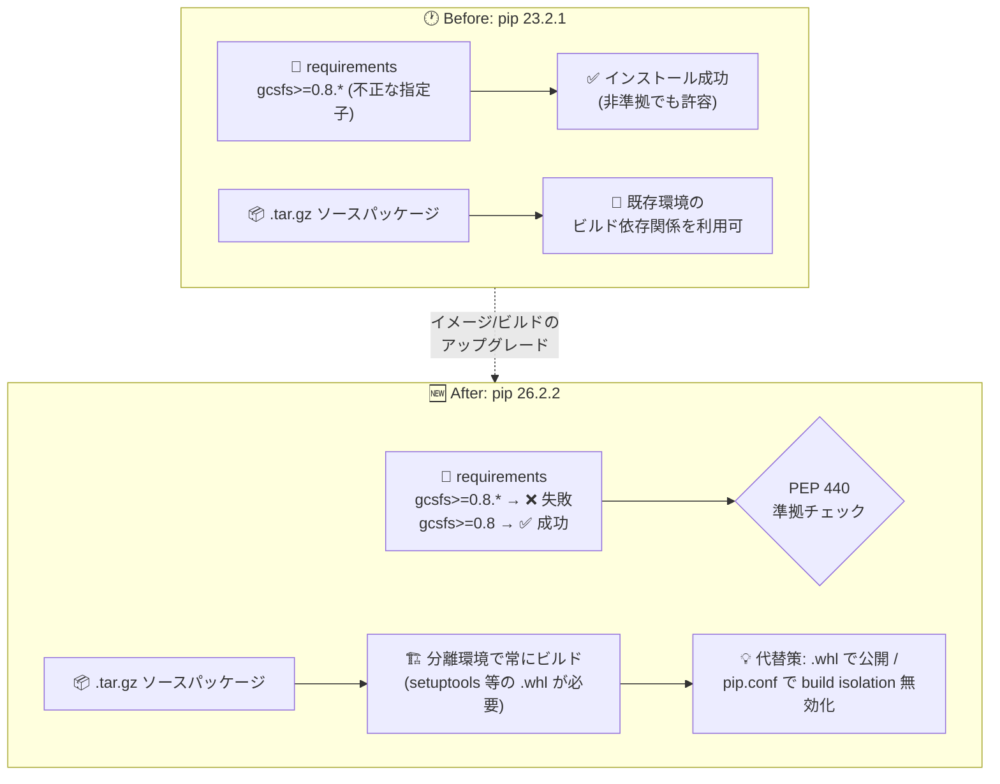

# Managed Service for Apache Airflow: pip パッケージを 23.2.1 から 26.2.2 にアップグレード (破壊的変更)

**リリース日**: 2026-11-13

**サービス**: Managed Service for Apache Airflow (Cloud Composer / Managed Airflow)

**機能**: pip 26.2.2 へのアップグレードに伴うカスタム PyPI パッケージインストール動作の変更

**ステータス**: Breaking change (破壊的変更)

📊 [このアップデートのインフォグラフィックを見る](https://takech9203.github.io/google-cloud-news-summary/20261113-managed-airflow-pip-26-upgrade.html)

## 概要

Managed Service for Apache Airflow (旧 Cloud Composer) において、環境イメージに含まれる `pip` パッケージがバージョン 23.2.1 から 26.2.2 にアップグレードされました。対象は Airflow 3.3.1、3.2.2、2.11.1 で、Managed Airflow (Gen 3) のビルド `composer-3-airflow-3.3.1-build.8`、`composer-3-airflow-3.2.2-build.12`、`composer-3-airflow-2.11.1-build.25` 以降、および Managed Airflow (Gen 2) のイメージ `composer-2.18.0-airflow-2.11.1` 以降に適用されます。

このアップグレードにはセキュリティ修正が含まれる一方、カスタム PyPI パッケージのインストール動作が変わる破壊的変更です。具体的には、(1) PEP 440 準拠のバージョン指定子の強制、(2) ソースパッケージ (`.tar.gz`) の分離環境 (isolated environment) でのビルドの常時適用、(3) レガシー `pkg_resources` に依存した古いソースパッケージのビルド失敗の可能性、の 3 点が影響します。カスタム PyPI パッケージを利用しているすべての環境管理者は、対象ビルドへのアップグレード前に互換性を確認する必要があります。

なお、環境のアップグレード中に PyPI パッケージのインストールが失敗した場合、環境は現行バージョンとパッケージのまま稼働を継続します。

**アップデート前の課題**

- pip 23.2.1 では PEP 440 に厳密には準拠しない `gcsfs>=0.8.*` のような不正なバージョン指定子 (`.*` ワイルドカードと `>=` の組み合わせ) が許容されており、そのままインストールが通っていた
- ソースパッケージ (`.tar.gz`) のビルドで分離環境が常時強制されておらず、ビルド依存関係が環境に既存であれば動作するケースがあった
- 旧バージョンの pip にはその後修正されたセキュリティ脆弱性が残っていた

**アップデート後の改善**

- pip 26.2.2 のセキュリティ修正が取り込まれ、パッケージインストール基盤の安全性が向上した
- PEP 440 準拠が強制され、`.*` ワイルドカードは `==` と `!=` でのみ使用可能になった (例: `gcsfs>=0.8.*` ではなく `gcsfs>=0.8` と記述する)
- ソースパッケージは常に分離環境でビルドされるようになり、ビルドの再現性が向上した

## アーキテクチャ図



pip 26.2.2 へのアップグレード前後でのカスタム PyPI パッケージインストール動作の変化を示しています。バージョン指定子の検証が厳格化され、ソースパッケージのビルドは常に分離環境で実行されます。

## サービスアップデートの詳細

### 主要機能 (変更点)

1. **PEP 440 バージョン指定子の強制**
   - pip 26.2.2 は [PEP 440](https://peps.python.org/pep-0440/#version-specifiers) への準拠を強制する
   - `.*` ワイルドカードは `==` と `!=` との組み合わせでのみサポートされる
   - 例: `gcsfs>=0.8.*` は不正な指定子となるため、`gcsfs>=0.8` を使用する

2. **ソースパッケージの分離ビルド (Isolated source builds)**
   - ソースパッケージ (`.tar.gz`) は常に分離環境でビルドされる
   - プライベートリポジトリが唯一のパッケージインデックスである場合、`setuptools` および `pyproject.toml` の `[build-system] requires` に記載されたその他のビルド依存関係のプリコンパイル済み wheel (`.whl`) をリポジトリに含めておく必要がある
   - 代替策として、パッケージを `.whl` 形式で公開する
   - 一時的な回避策として、`pip.conf` の `[global]` セクションに `no-build-isolation = false` を追加してビルド分離を無効化できる (ビルド依存関係が環境に既にインストールされている場合のみ有効)

3. **レガシー `pkg_resources` ビルドの非互換**
   - レガシー `pkg_resources` モジュールに依存する古いソースパッケージはビルドに失敗する可能性がある
   - プリコンパイル済み `.whl` を提供する新しいパッケージバージョンを使用するか、自社のプライベートパッケージは `.whl` としてビルドする、またはビルドスクリプトを `pkg_resources` を使わないように更新する

4. **セキュリティ修正**
   - pip 26.2.2 にはセキュリティ修正が含まれる

## 技術仕様

### 対象バージョン

| 項目 | 詳細 |
|------|------|
| pip バージョン | 23.2.1 → 26.2.2 |
| 対象 Airflow バージョン | 3.3.1、3.2.2、2.11.1 |
| Managed Airflow (Gen 3) | `composer-3-airflow-3.3.1-build.8`、`composer-3-airflow-3.2.2-build.12`、`composer-3-airflow-2.11.1-build.25` 以降 |
| Managed Airflow (Gen 2) | `composer-2.18.0-airflow-2.11.1` 以降 |
| 失敗時の挙動 | アップグレード中の PyPI パッケージインストール失敗時は、環境は現行バージョン・現行パッケージのまま稼働継続 |

### 回避策の設定例 (pip.conf)

ビルド分離を一時的に無効化する場合、環境バケットの `/config/pip/` フォルダに配置する `pip.conf` に以下を追加します (ビルド依存関係が環境に既存の場合のみ有効)。

```ini
[global]
no-build-isolation = false
```

## 対応手順 (アップグレード前の確認)

### 前提条件

1. 環境更新操作をトリガーできるロール、および環境のサービスアカウントに更新操作に十分な権限があること
2. カスタム PyPI パッケージの一覧を把握していること

### 手順

#### ステップ 1: カスタム PyPI パッケージとバージョン指定子の確認

```bash
gcloud composer environments describe ENVIRONMENT_NAME \
  --location LOCATION \
  --format="value(config.softwareConfig.pypiPackages)"
```

カスタムパッケージの一覧を取得し、`>=0.8.*` のような PEP 440 に準拠しない指定子 (`.*` を `==` / `!=` 以外と組み合わせているもの) がないか確認します。

#### ステップ 2: 不正な指定子の修正

```bash
gcloud composer environments update ENVIRONMENT_NAME \
  --location LOCATION \
  --update-pypi-package "gcsfs>=0.8"
```

`gcsfs>=0.8.*` のような指定子を `gcsfs>=0.8` のような準拠形式に修正します。

#### ステップ 3: プライベートリポジトリとソースパッケージの確認

- プライベートリポジトリを唯一のインデックスとして使用している場合、`setuptools` などのビルド依存関係の `.whl` がリポジトリに含まれているか確認する
- 自社パッケージはできるだけ `.whl` 形式で公開する
- `pkg_resources` に依存する古いソースパッケージは、新しいバージョンへの更新またはビルドスクリプトの修正を行う

#### ステップ 4: 環境のアップグレード

互換性を確認した上で、対象ビルド以降へのアップグレードを実施します。インストールに失敗しても環境は現行構成で稼働を続けるため、失敗時はログを確認して指定子やパッケージを修正の上で再実行します。

## メリット

### ビジネス面

- **セキュリティリスクの低減**: pip のセキュリティ修正が適用され、依存関係インストール経路の脆弱性リスクが減少する
- **安全なアップグレード設計**: パッケージインストール失敗時も環境が現行構成で稼働を継続するため、ワークロード停止リスクが抑えられている

### 技術面

- **標準準拠の徹底**: PEP 440 準拠の強制により、バージョン指定の曖昧さが排除され、将来の pip バージョンとの互換性が確保される
- **ビルドの再現性向上**: 分離環境での常時ビルドにより、環境内の既存パッケージに依存しない再現性の高いビルドが保証される

## デメリット・制約事項

### 制限事項

- `.*` ワイルドカードは `==` と `!=` でのみ使用可能 (例: `>=0.8.*` は不可)
- プライベートリポジトリのみを使用する構成では、ビルド依存関係 (`setuptools` 等) のプリコンパイル済み `.whl` の用意が必要
- `pkg_resources` に依存するレガシーソースパッケージはビルドに失敗する可能性がある

### 考慮すべき点

- `no-build-isolation = false` による回避策はあくまで一時的なものであり、ビルド依存関係が環境に既にインストールされている場合にのみ機能する
- 対象ビルド以降へアップグレードする前に、カスタム PyPI パッケージの互換性確認を必ず実施する
- 破壊的変更のため、CI/CD で環境を再作成・更新しているチームは requirements 定義の棚卸しが必要

## ユースケース

### ユースケース 1: 不正なバージョン指定子を使っている環境のアップグレード準備

**シナリオ**: `requirements.txt` に `gcsfs>=0.8.*` のような指定子が含まれる環境を `composer-3-airflow-2.11.1-build.25` 以降にアップグレードしたい。

**実装例**:
```text
# Before (pip 26.2.2 では不正)
gcsfs>=0.8.*

# After (PEP 440 準拠)
gcsfs>=0.8
```

**効果**: アップグレード時の PyPI パッケージインストール失敗を未然に防ぎ、スムーズに新ビルドへ移行できる。

### ユースケース 2: プライベート PyPI リポジトリのみを使用する環境

**シナリオ**: VPC Service Controls 配下で、プライベートリポジトリを唯一のパッケージインデックスとして `.tar.gz` のソースパッケージを配布している。

**効果**: `setuptools` などのビルド依存関係の `.whl` をリポジトリに追加するか、自社パッケージを `.whl` 形式で公開することで、分離ビルド環境下でもインストールが成功する。移行期間中は `pip.conf` の `no-build-isolation = false` を一時的な回避策として使用できる。

## 関連サービス・機能

- **Artifact Registry**: PyPI パッケージの更新時に Managed Airflow が Docker イメージを生成・格納する。またプライベート Python リポジトリとして利用でき、`.whl` パッケージの配布先となる
- **Cloud Build**: カスタム PyPI パッケージをインストールしたイメージのビルドに使用される (デフォルト Cloud Build サービスアカウント、未設定時は環境のサービスアカウント)
- **VPC Service Controls**: 境界内の環境でプライベート PyPI リポジトリを使用する場合、追加の権限設定と接続構成が必要

## 参考リンク

- 📊 [インフォグラフィック](https://takech9203.github.io/google-cloud-news-summary/20261113-managed-airflow-pip-26-upgrade.html)
- [公式リリースノート (2026-11-13)](https://docs.cloud.google.com/release-notes#November_13_2026)
- [PEP 440 - Version Specifiers](https://peps.python.org/pep-0440/#version-specifiers)
- [Python 依存関係のインストール (Managed Airflow ドキュメント)](https://docs.cloud.google.com/composer/docs/composer-2/install-python-dependencies)
- [Managed Airflow のバージョニング概要](https://docs.cloud.google.com/composer/docs/composer-versioning-overview)

## まとめ

Managed Airflow の pip が 26.2.2 に更新され、セキュリティが強化される一方、PEP 440 準拠の強制・分離ビルドの常時適用・レガシー `pkg_resources` ビルドの非互換という破壊的変更が発生します。対象ビルドへアップグレードする前に、カスタム PyPI パッケージのバージョン指定子を棚卸しし、プライベートリポジトリにはビルド依存関係の `.whl` を用意するか、パッケージを `.whl` 形式へ移行することを推奨します。

---

**タグ**: #ManagedAirflow #CloudComposer #ApacheAirflow #pip #PEP440 #BreakingChange #PyPI
