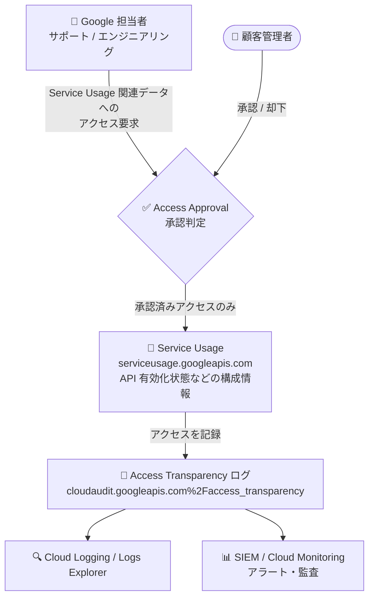

# Access Approval / Access Transparency: Service Usage サポートが一般提供 (GA) に

**リリース日**: 2026-11-14

**サービス**: Access Approval, Access Transparency

**機能**: Service Usage サポートの一般提供 (GA)

**ステータス**: GA (一般提供)

📊 [このアップデートのインフォグラフィックを見る](https://takech9203.github.io/google-cloud-news-summary/20261114-access-approval-transparency-service-usage-ga.html)

## 概要

2026 年 11 月 14 日、Access Approval および Access Transparency における Service Usage のサポートが一般提供 (GA) になりました。Service Usage は、Google Cloud プロジェクトで各種 API・サービスの有効化/無効化や利用状況の確認を行うための基盤サービス (`serviceusage.googleapis.com`) です。今回の GA により、Google 担当者が Service Usage に関連する顧客データにアクセスした際に Access Transparency ログが GA 水準で記録され、Access Approval を有効化している組織では、そのアクセスに対して顧客の明示的な事前承認を GA 水準で要求できるようになりました。

Access Transparency は Google 担当者 (サポート・エンジニアリング担当など) が顧客データにアクセスした際のアクション、理由 (サポートケース番号など)、担当者の所在地などをログとして記録するサービスです。Access Approval はその一段上の統制として、Google 担当者のアクセスに顧客の明示的な承認を必須とします。Service Usage は「どのプロジェクトでどの API が有効化されているか」というクラウド環境の構成情報を扱う基盤サービスであり、今回の GA によりデータアクセス統制の対象範囲が GA 保証付きでこの基盤レイヤーにも広がったことになります。

対象ユーザーは、金融・公共・医療などコンプライアンス要件の厳しい業界で Assured Workloads や Access Transparency / Access Approval を利用してデータアクセス統制を実施している組織の管理者・セキュリティチームです。

**アップデート前の課題**

- Service Usage に対する Access Approval / Access Transparency のサポートは GA ではなく、本番環境のコンプライアンス運用において GA 水準の安定性・後方互換性の保証がなかった ([プロダクトのローンチステージ](https://cloud.google.com/products#product-launch-stages)参照)
- API の有効化状態などプロジェクト構成の基盤レイヤーに対する Google 担当者のアクセスを、GA 保証のある形で可視化・承認制御の対象にできなかった

**アップデート後の改善**

- Service Usage が Access Approval の[サポート対象サービス](https://docs.cloud.google.com/assured-workloads/access-approval/docs/supported-services)として GA になり、Google 担当者によるアクセスに対する承認リクエストを GA 水準で運用できるようになった
- Service Usage が Access Transparency の[サポート対象サービス](https://docs.cloud.google.com/assured-workloads/access-transparency/docs/supported-services)として GA になり、Google 担当者のアクセスログ記録を GA 水準 (SLA・後方互換性の保証対象) で利用できるようになった
- 監査証跡の対象サービスが拡大し、SIEM 連携やコンプライアンスレポートに Service Usage へのアクセスを含められるようになった

## アーキテクチャ図



Google 担当者による Service Usage 関連データへのアクセスは、Access Approval による顧客承認を経てから実行され、その内容は Access Transparency ログとして記録されます。ログは Cloud Logging で閲覧でき、SIEM や Cloud Monitoring と連携して監視できます。

## サービスアップデートの詳細

### 主要機能

1. **Access Approval での Service Usage サポート (GA)**
   - Google 担当者が Service Usage に関連する顧客データへアクセスする前に、顧客の明示的な承認を必須化できる
   - 承認リクエストはコンソール、メール、Pub/Sub、Access Approval API で受信・処理可能
   - 緊急アクセスの厳格な基準を満たすイベントは自動承認 (auto approved) ステータスでログに記録され、ロギングは中断されない

2. **Access Transparency での Service Usage サポート (GA)**
   - Google 担当者によるアクセスのアクション・対象リソース・時刻・理由 (ジャスティフィケーション)・担当者の所在地などがログに記録される
   - ログは `cloudaudit.googleapis.com%2Faccess_transparency` として Cloud Logging に出力され、Cloud Audit Logs と並べて確認できる
   - SIEM ツールとの統合により、Google 担当者のアクセス監査を自動化できる

3. **アクセス理由 (ジャスティフィケーション) の記録**
   - `CUSTOMER_INITIATED_SUPPORT` (顧客起点のサポート、ケース番号付き)、`GOOGLE_INITIATED_SERVICE` (システム管理・トラブルシューティング)、`GOOGLE_INITIATED_REVIEW` (セキュリティ・コンプライアンスレビュー) などの理由コードで分類される
   - Access Approval が有効な場合、ログの `accessApprovals` フィールドに承認リクエストのリソース名が記録され、承認とアクセスを突合できる

## 技術仕様

### 対象サービスと記録される情報

| 項目 | 詳細 |
|------|------|
| 対象サービス | Service Usage (`serviceusage.googleapis.com`): プロジェクトの API・サービスの有効化/無効化、利用状況の管理 |
| Access Transparency ログ名 | `projects/PROJECT_ID/logs/cloudaudit.googleapis.com%2Faccess_transparency` |
| ログの主なフィールド | `accesses:methodName` (アクセス種別)、`accesses:resourceName` (対象リソース)、`reason:type` / `reason:detail` (理由)、`principalOfficeCountry` 等 (担当者の所在地)、`permissionDetails` (権限種別)、`accessApprovals` (関連する承認リクエスト) |
| 権限種別 (permissionType) | `ADMIN_READ` / `ADMIN_WRITE` (構成・ログへのアクセス)、`DATA_READ` / `DATA_WRITE` (顧客データを含みうるアクセス) |

### ログ閲覧に必要な権限

| タスク | ロール |
|--------|--------|
| Access Transparency ログの閲覧 | Private Logs Viewer (`roles/logging.privateLogViewer`) |
| Access Approval リクエストの承認 | Access Approval Approver (`roles/accessapproval.approver`) |

## 設定方法

### 前提条件

1. Access Transparency が組織で有効化されていること (Access Approval の利用には Access Transparency の有効化が必須)
2. 対象プロジェクト・フォルダ・組織で Access Approval を有効化していること (承認制御を利用する場合)
3. ログ閲覧者に Private Logs Viewer ロールが付与されていること

### 手順

#### ステップ 1: Access Transparency ログを確認する

```bash
# Logs Explorer で以下のフィルタを使用
logName="projects/PROJECT_ID/logs/cloudaudit.googleapis.com%2Faccess_transparency"
```

Service Usage に対するアクセスは、ログエントリの `product` フィールドや `accesses:resourceName` で識別できます。

#### ステップ 2: ログベースの指標とアラートを設定する (任意)

1. Cloud Logging で Access Transparency ログを対象とするログベースの指標を作成
2. Cloud Monitoring でアラートポリシーを設定し、一定期間内のアクセス数がしきい値を超えた場合に通知

#### ステップ 3: Access Approval の対象サービスを確認する

Google Cloud コンソールの Access Approval 設定ページで、承認対象のサービス一覧に Service Usage が含まれることを確認します。すべてのサポート対象サービスを対象とする設定 (All supported services) で運用している場合、追加の設定は不要です。

## メリット

### ビジネス面

- **コンプライアンス範囲の拡大**: API 有効化状態などの基盤構成レイヤーへの Google 担当者のアクセスまで監査証跡・承認制御の対象に含まれ、監査対応やデータ主権要件への説明責任を果たしやすくなる
- **GA 水準の保証**: 本番環境のコンプライアンス運用に、後方互換性や SLA の面で GA 相当の保証をもって組み込める

### 技術面

- **統一されたログ体系**: Service Usage へのアクセスログも他サービスと同じ Access Transparency ログ形式で出力されるため、既存の SIEM 連携・アラート設定をそのまま適用できる
- **承認とログの突合**: `accessApprovals` フィールドにより、Access Approval での承認と実際のアクセスをログ上で紐付けて検証できる

## デメリット・制約事項

### 制限事項

- Access Approval には[除外事項](https://docs.cloud.google.com/assured-workloads/access-approval/docs/overview)があり、すべてのアクセスが承認対象になるわけではない (緊急アクセスは自動承認としてログに記録される)
- Access Transparency の有効化には対象のサポートレベル (Enhanced サポート以上など) の要件がある

### 考慮すべき点

- Access Approval を有効化すると、Google サポートによる問題解決に顧客の承認待ち時間が加わるため、承認フローの運用体制 (承認者のアサイン、通知先の設定) を整備する必要がある
- 承認リクエストの見落としを防ぐため、メールや Pub/Sub による通知設定を推奨

## ユースケース

### ユースケース 1: 規制業界での監査証跡の網羅性向上

**シナリオ**: 金融機関が Assured Workloads 環境を運用しており、Google 担当者によるアクセスの監査証跡を、ワークロードのデータだけでなくプロジェクト構成 (API 有効化状態) のレイヤーまで網羅したい。

**効果**: Service Usage へのアクセスが GA 水準で Access Transparency ログに記録されるため、監査人への説明やコンプライアンスレポートにおいて、基盤構成レイヤーを含むアクセス証跡を提示できる。

### ユースケース 2: SIEM によるアクセス監視の自動化

**シナリオ**: セキュリティチームが Access Transparency ログを SIEM に取り込み、Google 担当者によるアクセスを理由コード別に監視している。Service Usage へのアクセスも同じパイプラインで監視対象に加えたい。

**実装例**:
```
logName="projects/PROJECT_ID/logs/cloudaudit.googleapis.com%2Faccess_transparency"
jsonPayload.reason.type="GOOGLE_INITIATED_SERVICE"
```

**効果**: 既存のログシンク・SIEM 連携をそのまま利用して Service Usage へのアクセスを監視でき、異常なアクセスパターンの検知やアラート発報を自動化できる。

## 料金

今回のアップデートに伴う料金変更のアナウンスはありません。Access Approval の料金については公式の料金ページを参照してください。

- [Access Approval の料金](https://docs.cloud.google.com/assured-workloads/access-approval/pricing)

## 関連サービス・機能

- **Service Usage**: 本アップデートの対象。プロジェクトの API・サービスの有効化/無効化と利用状況の管理を提供する基盤サービス
- **Access Transparency**: Google 担当者による顧客データアクセスのログを記録。Access Approval の前提条件
- **Access Approval**: Google 担当者のアクセスに対する顧客の明示的な承認を必須化。Access Transparency の統制を一段強化
- **Assured Workloads**: データレジデンシーやソブリンコントロールを提供。Access Transparency / Access Approval と組み合わせて利用されることが多い
- **Cloud Logging / Cloud Monitoring**: Access Transparency ログの閲覧、ログベース指標とアラートポリシーの設定に利用
- **Key Access Justifications**: 外部管理の暗号鍵を利用する場合の鍵アクセスの可視化・制御

## 参考リンク

- 📊 [インフォグラフィック](https://takech9203.github.io/google-cloud-news-summary/20261114-access-approval-transparency-service-usage-ga.html)
- [公式リリースノート](https://docs.cloud.google.com/release-notes#November_14_2026)
- [Access Approval がサポートするサービス](https://docs.cloud.google.com/assured-workloads/access-approval/docs/supported-services)
- [Access Transparency がサポートするサービス](https://docs.cloud.google.com/assured-workloads/access-transparency/docs/supported-services)
- [Access Transparency ログの理解と利用](https://docs.cloud.google.com/assured-workloads/access-transparency/docs/reading-logs)
- [Service Usage: サービスの有効化と無効化](https://docs.cloud.google.com/service-usage/docs/enable-disable)
- [プロダクトのローンチステージ](https://cloud.google.com/products#product-launch-stages)

## まとめ

Access Approval と Access Transparency のサポート対象に Service Usage が GA として加わり、API 有効化状態などのプロジェクト基盤構成レイヤーへの Google 担当者のアクセスも、GA 水準でログ記録・承認制御の対象にできるようになりました。これらのサービスでデータアクセス統制を運用している組織は、サポート対象サービス一覧の更新を確認し、SIEM 連携や監査レポートの対象範囲に Service Usage を含めることを推奨します。

---

**タグ**: Access Approval, Access Transparency, Service Usage, GA, セキュリティ, ガバナンス, コンプライアンス
