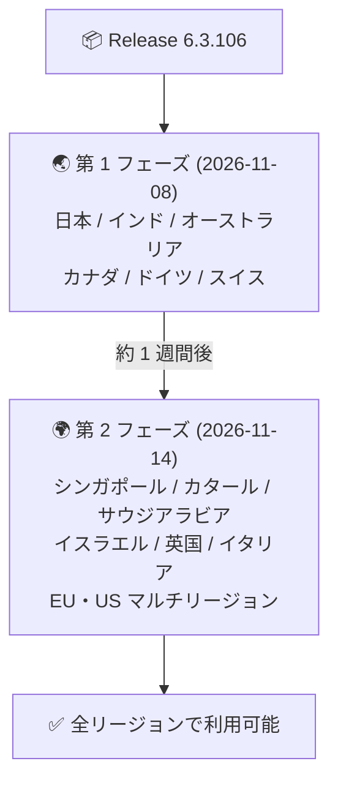

# Google SecOps SOAR: Release 6.3.106 が全リージョンで利用可能に

**リリース日**: 2026-11-14

**サービス**: Google SecOps SOAR

**機能**: Release 6.3.106 全リージョン展開

**ステータス**: Announcement (一般提供)

📊 [このアップデートのインフォグラフィックを見る](https://takech9203.github.io/google-cloud-news-summary/20261114-google-secops-soar-release-6-3-106.html)

## 概要

Google SecOps SOAR の Release 6.3.106 が、すべてのリージョンで利用可能になりました。本リリースは 2026 年 11 月 8 日に第 1 フェーズのリージョン (日本、インド、オーストラリア、カナダ、ドイツ、スイス) へのロールアウトが開始されており、今回の発表により第 2 フェーズのリージョン (シンガポール、カタール、サウジアラビア、イスラエル、英国、イタリア、EU マルチリージョン、US マルチリージョン) を含む全リージョンへの展開が完了しました。

Release 6.3.106 には、Case Wall 上の個々のアクティビティにカスタムタグを付与できる「Case activity tagging」機能が含まれています。この機能により、コメント、タスク、アクションなどを分類し、調査やチームに関連するエントリのみを表示するフィルタリングが可能になります。

**アップデート前の課題**

- Release 6.3.106 は第 1 フェーズのリージョンでのみ利用可能で、第 2 フェーズのリージョン (US / EU マルチリージョンなど) のユーザーは新機能を利用できなかった
- Case Wall のアクティビティ (コメント、タスク、アクション) を個別に分類・フィルタリングする手段がなく、長いタイムラインから調査に関連するエントリを探す必要があった

**アップデート後の改善**

- 全リージョンで Release 6.3.106 が利用可能になり、すべてのユーザーが同一バージョンの機能を利用できるようになった
- Case Wall の個々のアクティビティ、コメント、タスク、アクションにカスタムタグを付与し、タグでタイムラインをフィルタリングできるようになった

## アーキテクチャ図

Google SecOps SOAR の段階的リリースプロセスを示した図です。リリースは毎週日曜日のメンテナンスウィンドウ (13:00〜17:00 GMT+2) に第 1 フェーズのリージョンへ展開され、約 1 週間後に残りのリージョンへ展開されます。

## サービスアップデートの詳細

### 主要機能

1. **Release 6.3.106 の全リージョン展開**
   - 2026 年 11 月 8 日に第 1 フェーズのリージョンでロールアウトを開始
   - 2026 年 11 月 14 日に全リージョンで利用可能になった

2. **Case activity tagging (本リリースに含まれる機能)**
   - Case Wall 上の個々のアクティビティ、コメント、タスク、アクションにカスタムタグを付与可能
   - タグによる Case Wall ビューのフィルタリングに対応し、調査やチームに関連するエントリのみを表示できる
   - 詳細: [Add a tag to a Case Wall activity](https://docs.cloud.google.com/chronicle/docs/soar/investigate/working-with-cases/define-tags-in-cases-admin#add-activity-tag)

## 技術仕様

### 段階的リリースの対象リージョン

| フェーズ | リージョン | 展開タイミング |
|------|------|------|
| 第 1 フェーズ | 日本、インド、オーストラリア、カナダ、ドイツ、スイス | 毎週日曜のメンテナンスウィンドウ (13:00〜17:00 GMT+2) |
| 第 2 フェーズ | シンガポール、カタール、サウジアラビア、イスラエル、英国 (ロンドン)、イタリア、EU (マルチリージョン)、US (マルチリージョン) | 第 1 フェーズの約 1 週間後 |

割り当てられているリージョンが不明な場合は、Google SecOps の担当者に問い合わせてください。

## 考慮すべき点

- SOAR のリリースはユーザー側の操作なしで自動的に適用されるため、個別のアップグレード作業は不要
- リージョンによって新リリースの適用タイミングが最大 1 週間程度異なるため、マルチリージョンで運用している組織では一時的にバージョン差が生じる点に留意する

## 利用可能リージョン

全リージョンで利用可能です (第 1 フェーズ・第 2 フェーズの両方に展開済み)。

## 関連サービス・機能

- **Google SecOps (SIEM)**: SOAR コンポーネントは Google SecOps プラットフォームの一部としても提供され、本リリースはスタンドアロンの SOAR と SecOps 内の SOAR コンポーネントの両方に適用される
- **Google SecOps SOAR ステータスダッシュボード**: [status.cloud.google.com/security](https://status.cloud.google.com/security/) で SOAR のサービスステータスを確認できる

## 参考リンク

- 📊 [インフォグラフィック](https://takech9203.github.io/google-cloud-news-summary/20261114-google-secops-soar-release-6-3-106.html)
- [公式リリースノート](https://docs.cloud.google.com/release-notes#November_14_2026)
- [Google SecOps SOAR リリースノート (2026-11-08: Release 6.3.106)](https://docs.cloud.google.com/chronicle/docs/soar/release-notes#November_08_2026)
- [Google SecOps SOAR の段階的リリースプラン](https://docs.cloud.google.com/chronicle/docs/soar/overview-and-introduction/soar-gradual-release)
- [Case Wall アクティビティへのタグ付与](https://docs.cloud.google.com/chronicle/docs/soar/investigate/working-with-cases/define-tags-in-cases-admin#add-activity-tag)

## まとめ

Google SecOps SOAR Release 6.3.106 の全リージョン展開が完了し、Case Wall のアクティビティタグ機能がすべてのユーザーに提供されました。Case Wall のタイムラインが長くなりがちな SOC チームは、アクティビティタグを活用した調査エントリの分類・フィルタリングの運用ルール策定を検討するとよいでしょう。

---

**タグ**: #GoogleSecOps #SOAR #セキュリティ #リリース #CaseManagement
