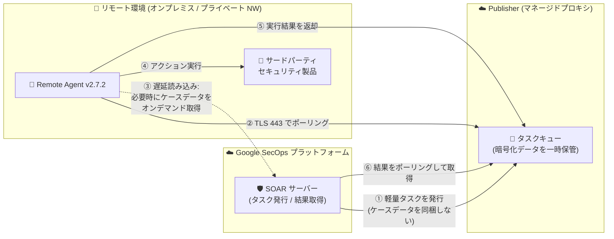

# Google SecOps / Google SecOps SOAR: Publisher Agent 2.7.2 リリースと SOAR 6.3.107 ロールアウト開始

**リリース日**: 2026-11-15

**サービス**: Google SecOps / Google SecOps SOAR

**機能**: Publisher Agent Version 2.7.2 (アラート遅延読み込み対応・各種修正) / SOAR Release 6.3.107

**ステータス**: GA (Publisher Agent 2.7.2) / 段階的ロールアウト中 (SOAR 6.3.107)

📊 [このアップデートのインフォグラフィックを見る](https://takech9203.github.io/google-cloud-news-summary/20261115-google-secops-publisher-agent-2-7-2.html)

## 概要

Google SecOps のリモートエージェント基盤である **Publisher Agent Version 2.7.2** がリリースされました。Publisher は、クラウド上の Google SecOps インスタンスとオンプレミスやプライベートネットワークに配置されたリモートエージェントを仲介するマネージドプロキシサーバーであり、リモートサイトでのアクション実行・プレイブック実行・アラート取得を支える中核コンポーネントです。

本リリースの目玉は、**リモートアクションにおけるアラート遅延読み込み (Alert Lazy Loading) への対応**です。アラート遅延読み込みが有効な場合、リモートアクションタスクはケースデータをタスクペイロードに同梱せず、必要時にサーバーからオンデマンドで読み込むようになり、タスクペイロードサイズが削減されます。これに加えて、相互依存する複数の依存ファイルを持つインテグレーションのインストール失敗の修正、リモートエージェント削除時のディレクトリ権限の修正、Publisher の耐障害性向上とセキュリティ脆弱性対応が含まれます。

また同日、**Google SecOps SOAR Release 6.3.107** が第 1 フェーズのリージョンへの段階的ロールアウトを開始しました。このリリースには内部修正および顧客報告のバグ修正が含まれます。リモートエージェントを運用する MSSP (Managed Security Service Provider) やエンタープライズ SOC のチームにとって、エージェント基盤の信頼性とセキュリティが向上するアップデートです。

**アップデート前の課題**

- リモートアクションタスクはケースデータ全体をタスクペイロードに含めて Publisher 経由で転送しており、大きなケースではペイロードサイズが肥大化していた
- 相互依存する複数の依存ファイルを持つインテグレーションをインストールする際、すべてのパッケージのインストール完了前に処理が失敗することがあった
- リモートエージェント削除時に実行される自己削除 (self-destruction) スクリプトで、ディレクトリ権限に起因する問題があった

**アップデート後の改善**

- アラート遅延読み込みが有効な場合、リモートアクションタスクがケースデータをサーバーからオンデマンドで読み込むようになり、タスクペイロードサイズが削減された
- 相互依存する依存ファイルを持つインテグレーションのインストールが正常に完了するようになった
- リモートエージェント削除時の自己削除スクリプトのディレクトリ権限が修正された
- Publisher の耐障害性 (レジリエンス) が向上し、セキュリティ脆弱性が修正された

## アーキテクチャ図

Publisher Agent 2.7.2 では、アラート遅延読み込みが有効な場合にリモートアクションタスクへケースデータを同梱せず (①)、エージェントが必要なタイミングでサーバーからオンデマンドに取得する (③) ことで、Publisher を経由するタスクペイロードのサイズが削減されます。通信はすべてエージェント側から開始されるアウトバウンドの TLS (ポート 443) 接続です。

## サービスアップデートの詳細

### 主要機能 (Publisher Agent 2.7.2)

1. **リモートアクションのアラート遅延読み込み (Alert Lazy Loading)**
   - アラート遅延読み込みが有効な場合、リモートアクションタスクはケースデータをサーバーからオンデマンドで読み込む
   - ケースデータをタスクに同梱しないため、Publisher を経由するタスクペイロードサイズが削減される
   - マーケットプレイスの Siemplify インテグレーション Version 114.0 (2026 年 10 月 21 日リリース) でも、`Run Remote` アクションにおいてプラットフォーム側で遅延読み込みが有効な場合にケースデータをリモートエージェントタスクへ添付しない対応が行われており、今回の Publisher Agent 側の対応と合わせて機能する

2. **インテグレーション依存関係インストールの修正**
   - 相互依存する複数の依存ファイルを持つインテグレーションのインストールにおいて、すべてのパッケージのインストール完了前に失敗する問題を修正

3. **リモートエージェント削除の修正**
   - リモートエージェント削除時に実行される自己削除スクリプトのディレクトリ権限を修正

4. **Publisher の安定性・セキュリティ更新**
   - Publisher の耐障害性を改善
   - セキュリティ脆弱性に対応

### SOAR Release 6.3.107

- 第 1 フェーズのリージョンへの段階的ロールアウトを開始 (対象リージョンは [SOAR gradual release](https://cloud.google.com/chronicle/docs/soar/overview-and-introduction/soar-gradual-release) を参照)
- 内部修正および顧客報告のバグ修正を含む

## 技術仕様

### リモートエージェントアーキテクチャの構成要素

| コンポーネント | 役割 | 通信 |
|------|------|------|
| Google SecOps | タスクを発行し、最終結果を取得する。リモートエージェントと直接通信しない | Publisher と TLS (ポート 443) で通信 |
| Publisher | Google SecOps が管理するセキュアな中継サービス。暗号化された実行データ・メタデータ・スクリプト/依存関係を一時保管 | ポート 443 で Google SecOps とリモートエージェントの双方と通信 |
| Remote Agent | リモート環境にデプロイされ、サードパーティ製品に対してアクション実行・アラート取得を行う | Publisher へアウトバウンド TLS (ポート 443) で通信 |

### セキュリティモデル (参考)

- すべての通信はエージェントまたは SecOps サーバー側から開始される一方向通信で、インバウンドポートの開放は不要
- ジョブごとに一意の対称鍵を生成するハイブリッド暗号化方式を採用し、Publisher は暗号化済みデータのみを扱う (暗号鍵へのアクセスなし)
- Publisher は許可リストに登録されたエージェントのみと通信し、各エージェントは一意のアプリケーションキーで認証される
- Publisher 上のデータは既定で 3 日後に自動削除される

### デプロイ要件 (参考)

| 項目 | 基本構成 | スケールアップ構成 |
|------|------|------|
| CPU | 4 コア | 8 コア |
| RAM | 8 GB | 16 GB |
| ストレージ | 100 GB | 100 GB |

- コンテナデプロイ (Podman 推奨 / Docker) に対応。バージョン 2.5.0.4 以降のコンテナイメージは Debian 12 ベース
- ファイアウォールでは Google SecOps インスタンス、Publisher、認証エンドポイント (oauth2.googleapis.com など) への TCP 443 アウトバウンド通信を許可する必要がある

## メリット

### ビジネス面

- **MSSP / 分散環境の運用効率向上**: 複数のリモートサイトを運用する MSSP やエンタープライズ SOC において、エージェント経由のタスク転送が軽量化され、大規模ケースでのリモートアクション実行が効率化される
- **セキュリティリスクの低減**: Publisher のセキュリティ脆弱性対応により、クラウドとリモート環境を仲介する中核コンポーネントのリスクが低減される

### 技術面

- **タスクペイロードの削減**: アラート遅延読み込みにより、ケースデータをタスクに同梱せず必要時のみ取得するため、Publisher を経由する転送データ量が削減される
- **インストールの信頼性向上**: 相互依存する依存ファイルを持つインテグレーションでも、インストールが確実に完了するようになった
- **ライフサイクル管理の改善**: エージェント削除時の自己削除スクリプトの権限問題が解消され、クリーンなエージェント削除が可能になった

## デメリット・制約事項

### 考慮すべき点

- アラート遅延読み込みは「有効化されている場合」に動作する機能であり、ケースデータのオンデマンド取得にはエージェントからサーバーへの接続性が引き続き必要
- SOAR Release 6.3.107 は段階的ロールアウトのため、リージョンによって適用時期が異なる (対象リージョンとスケジュールは公式ページを確認)
- 新バージョンのエージェントへの更新にあたっては、各環境のエージェント運用ポリシー (コンテナイメージの更新手順など) に従う必要がある

## ユースケース

### ユースケース 1: 大規模ケースに対するリモートアクションの効率化

**シナリオ**: 多数のアラート・イベントを含む大規模ケースのプレイブックから、オンプレミスのファイアウォールやディレクトリサービスに対するリモートアクションを実行する。

**効果**: アラート遅延読み込みにより、ケースデータ全体をタスクに同梱せずに済むため、Publisher を経由するタスクペイロードが小さくなり、タスク配信が軽量化される。

### ユースケース 2: 依存関係が複雑なインテグレーションのリモート展開

**シナリオ**: 相互依存する複数の依存パッケージを持つインテグレーションを、リモートエージェント上で実行するために展開する。

**効果**: 依存関係インストールの修正により、すべてのパッケージのインストールが完了する前に失敗する問題が解消され、確実にインテグレーションを展開できる。

## 利用可能リージョン

- Publisher Agent 2.7.2: リリース済み (エージェント更新として提供)
- SOAR Release 6.3.107: 第 1 フェーズのリージョンから段階的にロールアウト中。対象リージョンは [SOAR gradual release](https://cloud.google.com/chronicle/docs/soar/overview-and-introduction/soar-gradual-release) を参照

## 関連サービス・機能

- **Google SecOps SOAR プレイブック**: リモートエージェント経由で実行されるアクションはプレイブックから呼び出され、ケース管理と連動する
- **リモートコネクタ**: リモートサイトからアラートやセキュリティデータを取得する機能で、同じ Publisher / エージェント基盤上で動作する
- **Siemplify インテグレーション (Marketplace)**: Version 114.0 で `Run Remote` アクションのレイジーケースローディング対応が追加されており、今回の Publisher Agent 側の対応と連動する
- **Workload Identity Federation**: リモートエージェントの Google Cloud 認証に利用可能

## 参考リンク

- 📊 [インフォグラフィック](https://takech9203.github.io/google-cloud-news-summary/20261115-google-secops-publisher-agent-2-7-2.html)
- [公式リリースノート](https://docs.cloud.google.com/release-notes#November_15_2026)
- [Remote agents overview](https://docs.cloud.google.com/chronicle/docs/soar/working-with-remote-agents/what-is-a-remote-agent)
- [Remote Agent のデータフローとプロトコル](https://docs.cloud.google.com/chronicle/docs/soar/working-with-remote-agents/data-flows-and-protocols)
- [Remote Agent security](https://docs.cloud.google.com/chronicle/docs/soar/working-with-remote-agents/remote-agent-security)
- [Remote Agent デプロイ要件](https://docs.cloud.google.com/chronicle/docs/soar/working-with-remote-agents/requirements-and-prerequisites)
- [SOAR gradual release (段階的ロールアウト対象リージョン)](https://cloud.google.com/chronicle/docs/soar/overview-and-introduction/soar-gradual-release)

## まとめ

Publisher Agent 2.7.2 は、アラート遅延読み込みによるリモートアクションタスクの軽量化と、インテグレーション依存関係・エージェント削除に関する修正、セキュリティ更新を含む信頼性重視のリリースです。リモートエージェントを運用する MSSP やエンタープライズ SOC は、エージェントの更新を計画するとともに、SOAR Release 6.3.107 のロールアウトスケジュールを公式ページで確認することを推奨します。

---

**タグ**: Google SecOps, Google SecOps SOAR, Publisher Agent, Remote Agent, セキュリティ, SOC, MSSP, アップデート
