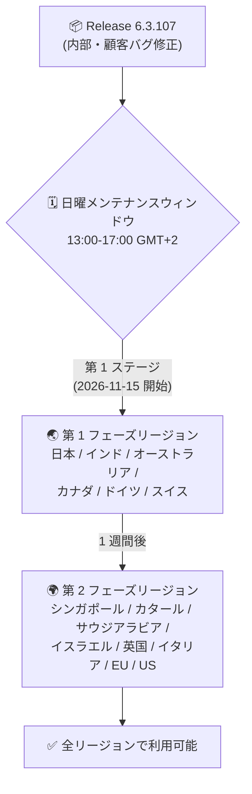

# Google SecOps SOAR: Release 6.3.107 の段階的ロールアウト開始

**リリース日**: 2026-11-15

**サービス**: Google SecOps SOAR

**機能**: Release 6.3.107 (内部修正および顧客報告のバグ修正)

**ステータス**: 段階的ロールアウト中 (第 1 フェーズリージョン)

📊 [このアップデートのインフォグラフィックを見る](https://takech9203.github.io/google-cloud-news-summary/20261115-google-secops-soar-release-6-3-107.html)

## 概要

Google SecOps SOAR の **Release 6.3.107** が、第 1 フェーズのリージョンへの段階的ロールアウトを開始しました。本リリースは新機能を含まないメンテナンスリリースで、**内部修正および顧客報告のバグ修正**が含まれます。

Google SecOps SOAR のリリースは、通常 2 段階の段階的ロールアウト (gradual release) で各リージョンに展開されます。更新は毎週日曜日のメンテナンスウィンドウ (13:00〜17:00 GMT+2) に実施され、第 2 ステージのリージョンは第 1 ステージの 1 週間後にアップグレードされます。直近では Release 6.3.106 (2026 年 11 月 8 日に第 1 フェーズ開始) が 11 月 14 日に全リージョンで利用可能になっており、6.3.107 も同様のサイクルで展開される見込みです。

なお同日 (2026 年 11 月 15 日) には、リモートエージェント基盤の **Publisher Agent Version 2.7.2** もリリースされています。詳細は関連レポート「[Google SecOps: Publisher Agent 2.7.2 リリース](./2026-11-15-google-secops-publisher-agent-2-7-2.md)」を参照してください。

## アーキテクチャ図

Google SecOps SOAR の標準的な 2 段階ロールアウトの流れです。Release 6.3.107 は第 1 フェーズのリージョンから展開が始まり、第 2 フェーズのリージョンは通常その 1 週間後に更新されます。

## サービスアップデートの詳細

### 主要内容

1. **内部修正および顧客報告のバグ修正**
   - Release 6.3.107 には内部修正と顧客から報告されたバグの修正が含まれる
   - 新機能の追加はアナウンスされていない

2. **段階的ロールアウト (第 1 フェーズ)**
   - 2026 年 11 月 15 日より第 1 フェーズのリージョンへ展開開始
   - 対象リージョンは [Release plan for Google SecOps (SOAR gradual release)](https://docs.cloud.google.com/chronicle/docs/soar/overview-and-introduction/soar-gradual-release) に記載

## 技術仕様

### 段階的ロールアウトの対象リージョン

| ステージ | 対象リージョン | 更新タイミング |
|------|------|------|
| 第 1 ステージ | 日本、インド、オーストラリア、カナダ、ドイツ、スイス | 毎週日曜のメンテナンスウィンドウ (13:00〜17:00 GMT+2) |
| 第 2 ステージ | シンガポール、カタール、サウジアラビア、イスラエル、英国 (ロンドン)、イタリア、EU (マルチリージョン)、US (マルチリージョン) | 第 1 ステージの 1 週間後 |

自身の環境が割り当てられているリージョンが不明な場合は、Google SecOps の担当者に確認してください。

## デメリット・制約事項

### 考慮すべき点

- 段階的ロールアウトのため、リージョンによって 6.3.107 の適用タイミングが異なる (第 2 フェーズのリージョンは通常 1 週間後)
- 修正されたバグの個別の内容は公開されていないため、特定の問題の修正有無はサポート経由で確認が必要
- 更新はメンテナンスウィンドウ内に実施されるため、運用チームはこの時間帯を把握しておくとよい

## 利用可能リージョン

2026 年 11 月 15 日より第 1 フェーズのリージョン (日本、インド、オーストラリア、カナダ、ドイツ、スイス) へロールアウト中。第 2 フェーズのリージョンは通常その 1 週間後に更新されます。詳細は [Release plan for Google SecOps](https://docs.cloud.google.com/chronicle/docs/soar/overview-and-introduction/soar-gradual-release) を参照してください。

## 関連サービス・機能

- **Publisher Agent Version 2.7.2**: 同日リリースされたリモートエージェント基盤の更新。詳細は[関連レポート](./2026-11-15-google-secops-publisher-agent-2-7-2.md)を参照
- **Google SecOps SOAR リリースノート**: 各リリースの内容と GA 化のアナウンスが掲載される
- **Google SecOps (SIEM + SOAR)**: SOAR コンポーネントを統合プラットフォームとして利用する場合も、本リリースプランが適用される

## 参考リンク

- 📊 [インフォグラフィック](https://takech9203.github.io/google-cloud-news-summary/20261115-google-secops-soar-release-6-3-107.html)
- [公式リリースノート](https://docs.cloud.google.com/release-notes#November_15_2026)
- [Google SecOps SOAR リリースノート](https://docs.cloud.google.com/chronicle/docs/soar/release-notes)
- [Release plan for Google SecOps (段階的ロールアウト対象リージョン)](https://docs.cloud.google.com/chronicle/docs/soar/overview-and-introduction/soar-gradual-release)

## まとめ

Release 6.3.107 は内部修正と顧客報告のバグ修正を含むメンテナンスリリースで、第 1 フェーズのリージョンからロールアウトが始まりました。第 2 フェーズのリージョンの利用者は、通常 1 週間後の適用を見込んでスケジュールを把握しておくことを推奨します。同日リリースの Publisher Agent 2.7.2 を利用している場合は、あわせて関連レポートを確認してください。

---

**タグ**: Google SecOps, Google SecOps SOAR, リリース, バグ修正, 段階的ロールアウト, セキュリティ, SOC
