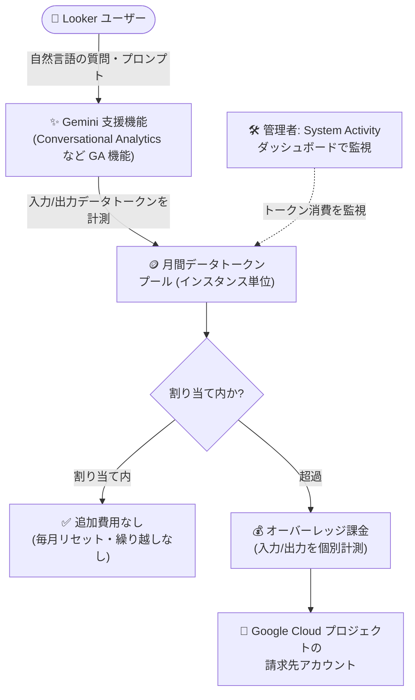

# Looker: Gemini 支援機能の課金開始 (2027 年 2 月 1 日から)

**リリース日**: 2026-11-15

**サービス**: Looker

**機能**: Gemini 支援機能のトークン超過分課金の開始アナウンス

**ステータス**: Announcement (課金変更)

📊 [このアップデートのインフォグラフィックを見る](https://takech9203.github.io/google-cloud-news-summary/20261115-looker-gemini-features-billing.html)

## 概要

2027 年 2 月 1 日より、Looker の Gemini 支援機能 (Gemini-assisted features) の使用量がインスタンスに含まれる月間トークン割り当てを超過した場合、超過分に対する課金が開始されることが発表されました。Gemini 支援機能とは、Conversational Analytics をはじめとする、Gemini を利用した一般提供 (GA) 済みのエージェント型機能群を指します。Preview 段階の機能 (例: LookML 生成アシスタント) は課金対象外です。

使用量は「データトークン」(LLM が処理するテキストとデータの基本単位) で計測され、入力トークンと出力トークンが個別にカウントされます。各 Looker インスタンスには月間のプール型トークン割り当てが含まれており、割り当て内の利用は追加費用なしで継続できます。割り当てを超過した場合でも機能は中断されず、超過分がオーバーレッジとして課金される仕組みです。

課金は Google Cloud プロジェクトの請求先アカウントに紐付けられます。Looker (Google Cloud core) インスタンスはプロビジョニング時にリンクされたプロジェクトが自動的に使用されますが、Looker (original) インスタンスでは管理者が課金用の Google Cloud プロジェクトを事前にリンクする必要があります。Conversational Analytics などを利用中の組織は、2027 年 2 月の課金開始までに請求先の設定と利用量の把握を進めておくことが推奨されます。

**アップデート前の課題**

このアナウンス以前は、Gemini 支援機能の利用に明確な従量課金モデルが適用されていませんでした。

- Conversational Analytics などの Gemini 支援機能の利用に対する課金開始時期とモデルが確定しておらず、予算計画が立てにくかった
- Looker (original) インスタンスでは、Gemini 機能の課金先となる Google Cloud プロジェクトのリンクが必須ではなかった
- トークン消費量を意識した利用管理の仕組みが本格的に求められていなかった

**アップデート後の改善**

- 課金開始日 (2027 年 2 月 1 日)、課金対象 (GA 済み Gemini 支援機能のトークン超過分)、計測単位 (データトークン) が明確になり、コスト計画が可能になった
- 月間トークン割り当てはインスタンス単位でプールされ、ユーザーライセンス数・種別に応じて動的にスケールすることが明示された
- 割り当て超過後も機能は中断されず、超過分のみがオーバーレッジ課金されるため、利用の継続性が担保される
- Conversational Analytics System Activity ダッシュボードで、課金開始前からトークン消費量をモニタリングして影響を見積もれる

## アーキテクチャ図



Gemini 支援機能の利用はデータトークンとして計測され、インスタンス単位の月間プール割り当てを超えた分のみが、リンクされた Google Cloud プロジェクトの請求先アカウントに課金されます。

## サービスアップデートの詳細

### 主要機能

1. **課金対象となる Gemini 支援機能**
   - Conversational Analytics (Explore へのチャット、ダッシュボードデータエージェント、カスタム Explore データエージェント、埋め込みエージェント、Looker API 経由のリクエストを含む) が主要な課金対象
   - その他の GA 済み Gemini 利用機能 (Visualization Assistant、Looker 式の生成支援、Advanced Analytics、Explore サマリー生成、スターター質問生成、セマンティック検索など) も対象
   - Preview 段階の機能 (例: LookML 生成) は課金対象外

2. **データトークンによる使用量計測**
   - 入力データトークン: ユーザーの自然言語の質問・プロンプト、会話履歴とコンテキスト、リクエストの解釈に使われる LookML モデルスキーマのメタデータ (ビュー、ディメンション、メジャーの定義など)、エージェント指示などの関連コンテキスト
   - 出力データトークン: 自然言語の回答・要約・提案、データ取得のために生成される API 呼び出しや SQL / LookML クエリ、モデルの推論・オーケストレーションステップ、ビジュアライゼーションとチャートの仕様

3. **月間トークン割り当てとオーバーレッジ**
   - プール型割り当て: 月間トークンはインスタンス単位でプールされ、全アクティブユーザーで共有 (ユーザー個別の上限なし)
   - ライセンス連動: 割り当て量はアクティブユーザーライセンスの数と種別 (標準内部ユーザー / 埋め込みユーザーなど) と、Looker エディションのベースライン割り当てに応じて動的にスケール
   - 毎月リセット: 割り当ては請求サイクルの開始時にリセットされ、翌月への繰り越しなし
   - 超過時も中断なし: 割り当て超過後もユーザーは機能を使い続けられ、超過分のみが入力・出力別にオーバーレッジ課金される

4. **請求先プロジェクトの紐付け**
   - Looker (Google Cloud core): プロビジョニング時にリンクされた Google Cloud プロジェクトと請求先アカウントが使用される (変更不可)
   - Looker (original): 管理者が Admin パネルから課金用 Google Cloud プロジェクトをリンクする必要がある (課金開始前の設定を推奨)

## 技術仕様

### 課金モデルの概要

| 項目 | 詳細 |
|------|------|
| 課金開始日 | 2027 年 2 月 1 日 |
| 課金対象 | GA 済み Gemini 支援機能のトークン使用量のうち、月間割り当ての超過分 |
| 課金対象外 | Preview 段階の Gemini 支援機能 |
| 計測単位 | データトークン (入力 / 出力を個別計測) |
| 割り当ての単位 | インスタンス単位のプール (全アクティブユーザーで共有) |
| 割り当て量の決定要素 | アクティブユーザーライセンスの数・種別 + エディションのベースライン割り当て |
| 割り当てのリセット | 毎月の請求サイクル開始時 (繰り越しなし) |
| 請求先 | リンクされた Google Cloud プロジェクトの請求先アカウント |

### 利用状況のモニタリング

管理者は Conversational Analytics System Activity ダッシュボードの Token usage タブで以下を確認できます。

| 指標 | 内容 |
|------|------|
| Total Estimated Input/Output Tokens | 入力・出力データトークンの推定合計 |
| Daily Estimated Token Usage | 日次のトークン使用量の推移 |
| Daily Token Utilization | 月間割り当てに対する日次の消費率 |
| Top Agents / Users / Conversations by Token Usage | トークン消費の多いエージェント・ユーザー・会話 |

- Created Date、Agent ID、Conversation Surface、User ID、Conversation ID でフィルタ可能
- 会話サーフェスのタグ付けは Looker 26.14 で有効化後の使用分から適用 (過去分への遡及なし)
- トークン使用量データの同期には約 6 時間のレイテンシあり

## 設定方法

### 前提条件

1. Looker (original) インスタンスの場合: 有効な請求先アカウントにリンクされた Google Cloud プロジェクトが必要 (Looker Core はプロビジョニング時のプロジェクトが自動使用されるため設定不要)
2. 対象プロジェクトで IAM ロールを付与できる権限、および Looker の Admin 権限

### 手順 (Looker (original) インスタンスでの請求先プロジェクトの指定)

#### ステップ 1: 請求先プロジェクトの追加

1. Looker の Admin パネルで **Platform** セクションの **Gemini in Looker** ページに移動
2. **Add project** を選択
3. **Google Cloud Project Number** フィールドに課金先としたい Google Cloud プロジェクトのプロジェクト番号を入力 (有効な請求先アカウントにリンクされていることを確認)
4. パネルに表示されるサービスアカウント名を控える

#### ステップ 2: IAM ロールの付与と検証

1. Google Cloud コンソールで対象プロジェクトを開き、控えたサービスアカウントに **Viewer** IAM ロールを付与
2. Looker の Gemini in Looker ページに戻り、**Validate and link** を選択して設定を完了

#### ステップ 3: トークン使用量の事前モニタリング

Admin パネルの System Activity で Conversational Analytics ダッシュボードを開き、Token usage タブで現在の入力・出力トークン消費量と月間割り当てに対する利用率を確認し、課金開始後のコスト影響を見積もる。

## メリット

### ビジネス面

- **コストの予見性向上**: 課金開始日・計測単位・割り当てモデルが明確になり、2027 年度の予算計画に Gemini 支援機能のコストを織り込める
- **利用の継続性**: 割り当て超過時も機能が停止しないため、業務利用 (特に埋め込み分析やセルフサービス BI) を中断させずにスケールできる
- **ライセンス連動のスケール**: ユーザーライセンス数に応じて割り当てが拡大するため、利用者が増えても割り当てが比例的に増える

### 技術面

- **入力・出力の個別計測**: トークン種別ごとに計測されるため、プロンプト設計やエージェント構成によるコスト最適化の余地がある
- **モニタリング基盤の提供**: System Activity ダッシュボードでエージェント別・ユーザー別・会話別の消費を可視化でき、課金開始前からトレンド分析と容量予測が可能
- **請求の一元化**: Google Cloud プロジェクトの請求先アカウントに統合されるため、他の Google Cloud サービスと合わせたコスト管理 (予算アラートなど) ができる

## デメリット・制約事項

### 制限事項

- Looker (Google Cloud core) インスタンスでは、リンクされた Google Cloud プロジェクトを変更できない
- 月間トークン割り当ては翌月に繰り越されない
- トークン使用量データの System Activity への反映には約 6 時間のレイテンシがある
- 会話サーフェス別のトークンタグ付けは Looker 26.14 で機能有効化後の使用分からで、過去分には遡及されない

### 考慮すべき点

- Looker (original) インスタンスでは、課金開始 (2027 年 2 月 1 日) までに請求先プロジェクトのリンクを完了しておかないと、ユーザーの利用に支障が出る可能性がある
- 埋め込み (Conversational Analytics Embed) や Looker API 経由の利用もトークン消費の対象となるため、顧客向け埋め込み分析を提供している場合は利用量の見積もりが特に重要
- 具体的なユーザー種別ごとの月間トークン割り当て量、ベースライン割り当て、オーバーレッジ単価は Looker 料金ページで確認する必要がある
- 現在 Preview の機能 (LookML 生成など) は無償だが、GA 昇格後は課金対象になり得る

## ユースケース

### ユースケース 1: 課金開始前のコスト影響評価

**シナリオ**: Conversational Analytics を全社展開している企業が、2027 年 2 月の課金開始に向けてコスト影響を見積もりたい。

**実装例**:
```
1. Admin パネル → System Activity → Conversational Analytics ダッシュボード → Token usage タブ
2. Daily Token Utilization で月間割り当てに対する消費率のトレンドを確認
3. Top Agents / Top Users by Token Usage で消費の偏りを特定
4. 超過が見込まれる場合、Looker 料金ページのオーバーレッジ単価で月額コストを試算
```

**効果**: 課金開始前に超過リスクを定量的に把握し、予算確保やエージェント設計の見直し (コンテキスト量の削減など) を計画的に実施できる。

### ユースケース 2: Looker (original) インスタンスの請求先整備

**シナリオ**: セルフホスト型の Looker (original) を運用しており、Gemini 支援機能を有効化している。課金開始時のユーザー影響を避けたい。

**効果**: Admin パネルの Gemini in Looker ページから課金用 Google Cloud プロジェクトを事前にリンクしておくことで、課金開始後もユーザーが中断なく Conversational Analytics などを利用できる。

## 料金

課金は 2027 年 2 月 1 日から有効になります。インスタンスに含まれる月間データトークン割り当て (ユーザーライセンス数・種別とエディションのベースラインに応じてスケール) の範囲内は追加費用なしで、超過分のみが入力トークン・出力トークン別にオーバーレッジとして課金されます。

ユーザー種別ごとの月間トークン割り当て量、インスタンスのベースライン割り当て、オーバーレッジ単価の詳細は、[Looker 料金ページ (Conversational Analytics セクション)](https://cloud.google.com/looker/pricing#conversational-analytics) を参照してください。

## 関連サービス・機能

- **Conversational Analytics**: 課金対象の中核となる機能。自然言語で Looker のデータに質問し、チャートやデータテーブルを取得できる。Explore チャット、ダッシュボードエージェント、埋め込み、API など全インターフェースがトークン消費の対象
- **Gemini Enterprise**: Looker のデータエージェントを Gemini Enterprise に公開した場合の利用もトークン消費としてカウントされる
- **Cloud Billing**: 課金は Google Cloud プロジェクトの請求先アカウントに紐付くため、予算・アラート設定によるコスト管理と組み合わせられる
- **Looker System Activity**: Conversational Analytics ダッシュボードの Token usage タブで、入力・出力トークンの消費量と割り当て利用率をモニタリングできる

## 参考リンク

- 📊 [インフォグラフィック](https://takech9203.github.io/google-cloud-news-summary/20261115-looker-gemini-features-billing.html)
- [公式リリースノート](https://docs.cloud.google.com/release-notes#November_15_2026)
- [Manage billing for Gemini-assisted features in Looker](https://docs.cloud.google.com/looker/docs/gemini-looker-billing-overview)
- [Gemini in Looker overview](https://docs.cloud.google.com/looker/docs/gemini-overview-looker)
- [課金用 Google Cloud プロジェクトの指定 (Admin パネル)](https://docs.cloud.google.com/looker/docs/admin-panel-platform-gil#designate-billing-project)
- [Conversational Analytics の概要](https://docs.cloud.google.com/looker/docs/conversational-analytics-overview)
- [料金ページ](https://cloud.google.com/looker/pricing#conversational-analytics)

## まとめ

2027 年 2 月 1 日から、Looker の GA 済み Gemini 支援機能はインスタンスの月間データトークン割り当てを超過した分が課金対象となります。Conversational Analytics を利用中の組織は、Looker (original) インスタンスでの請求先プロジェクトのリンクを早めに完了し、System Activity の Token usage ダッシュボードで現在の消費量を把握して、課金開始後のコスト影響を事前に見積もっておくことを推奨します。

---

**タグ**: Looker, Gemini, Conversational Analytics, 課金変更, データトークン, Announcement
