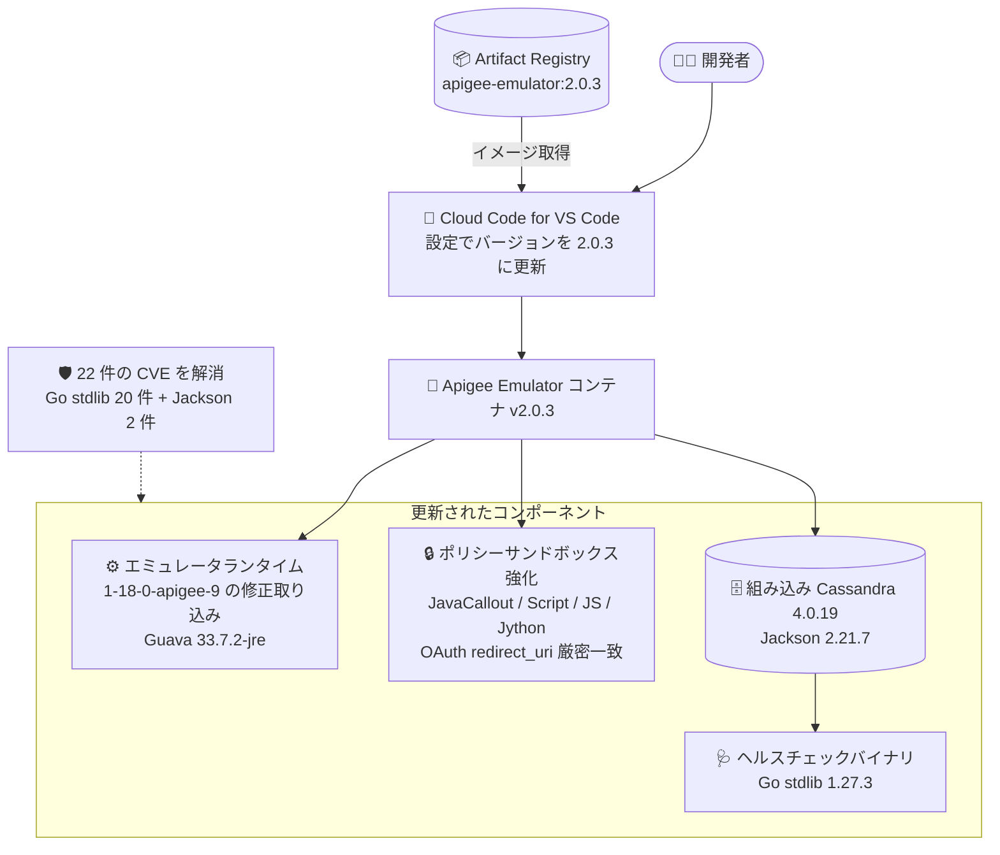

# Apigee X: Apigee Emulator v2.0.3 リリース (セキュリティ強化・ランタイム更新)

**リリース日**: 2026-11-16

**サービス**: Apigee X (Apigee Emulator)

**機能**: Apigee Emulator v2.0.3 (ベースイメージ更新・ポリシーサンドボックス強化・22 件の脆弱性対応)

**ステータス**: Announcement / Feature / Security

📊 [このアップデートのインフォグラフィックを見る](https://takech9203.github.io/google-cloud-news-summary/20261116-apigee-emulator-v2-0-3-security.html)

## 概要

2026 年 11 月 16 日、Google Cloud は Apigee Emulator バージョン 2.0.3 をリリースしました。Apigee Emulator は、Cloud Code for VS Code 拡張機能と組み合わせて API プロキシをローカル環境で開発・テストするためのローカルランタイム (Docker コンテナ) です。今回のリリースでは、最新の Apigee ランタイムベースラインに基づいてエミュレータランタイムと組み込み Apache Cassandra (4.0.19) のベースイメージが刷新され、Go 標準ライブラリと Jackson に起因する 22 件のコンテナセキュリティ脆弱性が解消されました。

機能面では、Apigee ランタイム 1-18-0-apigee-9 までの修正とポリシー拡張が取り込まれており、Server-Sent Events (SSE) の EventFlow ライフサイクルフロー変数、`<ProxyOperationMode>` による MCP プロキシ認識、LLMTokenQuota のセマンティックキャッシュヒット除外など、本番 Apigee ランタイムの最新動作をローカルで忠実に再現できるようになりました。また、JavaCallout / Script / JavaScript / Python (Jython) の各ポリシー実行サンドボックスの強化や、OAuth 2.0 の `redirect_uri` サブリソース厳密一致の強制など、セキュリティ挙動の整合性も向上しています。

エミュレータイメージは Artifact Registry で提供されており、Cloud Code for VS Code の設定でバージョンを 2.0.3 に更新することでアップグレードできます。ローカルで Apigee API プロキシを開発しているすべての開発者に適用が推奨されるアップデートです。

**アップデート前の課題**

- 組み込み Cassandra レイヤーのヘルスチェックバイナリ (Go 標準ライブラリ 1.27.0) と Jackson 2.19.2 に、既知のコンテナセキュリティ脆弱性 (CVE) が残存していた
- エミュレータのポリシー動作が最新の Apigee ランタイム (1-18-0-apigee-9) の修正を反映しておらず、SSE フロー変数や MCP プロキシ認識などの新しいランタイム挙動をローカルで検証できなかった
- JavaCallout / Script / JavaScript / Python (Jython) ポリシーのサンドボックス、および OAuth 2.0 の `redirect_uri` 検証がローカル環境では本番相当に強制されていなかった
- エミュレータ配布物にシェーディングされた auto-value JAR が含まれ、依存関係 (Guava 33.5.0-jre) も旧版だった

**アップデート後の改善**

- Go 標準ライブラリ 1.27.3 と Jackson 2.21.7 への更新により、Go 標準ライブラリ 20 件・Jackson 2 件、計 22 件のコンテナセキュリティ脆弱性が解消された
- 1-18-0-apigee-9 までのランタイム修正が取り込まれ、SSE EventFlow フロー変数 (`response.event.stream.state` / `response.event.stream.content.length`)、MCP プロキシ認識、LLMTokenQuota・SanitizeUserPrompt / SanitizeModelResponse・OASValidation の改善を含む最新のポリシー挙動をローカルで検証可能になった
- ポリシー実行サンドボックスが強化され、GenerateAuthorizationCode ポリシーでの `redirect_uri` サブリソース厳密一致と `<EnforceStrictCallbackURI>` 検証が強制されるようになり、本番とローカルのセキュリティ挙動が一致した
- Guava が 33.7.2-jre に統一され (ランタイム / ConfigUtil.jar / graphql-java)、シェーディングされた auto-value JAR が配布物から削除されてイメージが整理された

## アーキテクチャ図



Artifact Registry から取得する Apigee Emulator v2.0.3 イメージでは、ランタイム・ポリシーサンドボックス・組み込み Cassandra・ヘルスチェックバイナリの各コンポーネントが更新され、計 22 件のコンテナ脆弱性が解消されています。

## サービスアップデートの詳細

### 主要機能

1. **ベースイメージの刷新と依存関係の更新**
   - 最新の Apigee ランタイムベースラインからエミュレータランタイムと組み込み Apache Cassandra (4.0.19) のベースイメージをリフレッシュ
   - `/opt/apigee/ready` ヘルスチェックバイナリの Go 標準ライブラリを 1.27.0 → 1.27.3 に更新
   - Cassandra レイヤーの Jackson (`jackson-core` / `jackson-databind`) を 2.19.2 → 2.21.7 に更新
   - Google Guava をエミュレータランタイム、`ConfigUtil.jar`、graphql-java にわたり 33.5.0-jre → 33.7.2-jre に更新し、シェーディングされた auto-value JAR を配布物から削除

2. **ポリシー実行サンドボックスとセキュリティ検証の強化**
   - JavaCallout、Script、JavaScript、Python (Jython) の各ポリシーサンドボックスを強化
   - OAuth 2.0 の `redirect_uri` サブリソース厳密一致を強制
   - GenerateAuthorizationCode ポリシーに対する `<EnforceStrictCallbackURI>` 検証を強制

3. **Apigee ランタイム 1-18-0-apigee-9 までの修正・機能拡張の取り込み**
   - Server-Sent Events (SSE) EventFlow ライフサイクルフロー変数 (`response.event.stream.state`、`response.event.stream.content.length`)
   - `<ProxyOperationMode>` による MCP プロキシの認識
   - LLMTokenQuota ポリシーのセマンティックキャッシュヒット時のトークン課金除外
   - SanitizeUserPrompt / SanitizeModelResponse ポリシーでの `MA-Client-Correlation-Id` ヘッダー転送
   - OASValidation ポリシーのコンパイル済み仕様キャッシング

4. **22 件のコンテナセキュリティ脆弱性への対応**
   - 組み込み Go 標準ライブラリと Jackson にわたる 22 件の脆弱性を解消

## 技術仕様

### 対応された脆弱性 (22 件)

| コンポーネント | CVE / アドバイザリ |
|------|------|
| Go 標準ライブラリ (20 件) | CVE-2026-56857, CVE-2026-56866, CVE-2026-68497, CVE-2026-78659, CVE-2026-78660, CVE-2026-78663, CVE-2026-78667, CVE-2026-78669, CVE-2026-89407, CVE-2026-89425, CVE-2026-91776, CVE-2026-91777, CVE-2026-94439, CVE-2026-94440, CVE-2026-94444, CVE-2026-94447, CVE-2026-94448, CVE-2026-97030, CVE-2026-97031, CVE-2026-97032 |
| Jackson (`jackson-databind`) (2 件) | CVE-2026-19032, CVE-2026-83557 |

### コンポーネントのバージョン変更

| コンポーネント | 変更前 | 変更後 |
|------|------|------|
| Apigee Emulator | 2.0.x (旧版) | 2.0.3 |
| 組み込み Apache Cassandra | 4.0.19 (ベースイメージ旧版) | 4.0.19 (ベースイメージ刷新) |
| Go 標準ライブラリ (ヘルスチェックバイナリ) | 1.27.0 | 1.27.3 |
| Jackson (jackson-core / jackson-databind) | 2.19.2 | 2.21.7 |
| Google Guava | 33.5.0-jre | 33.7.2-jre |
| 取り込み済みランタイム修正 | - | 1-18-0-apigee-9 まで |

## 設定方法

### 前提条件

1. Visual Studio Code と Cloud Code 拡張機能がインストールされていること
2. Docker がローカル環境にインストールされ、起動していること
3. Apigee ワークスペースが作成済みであること

### 手順

#### ステップ 1: Cloud Code 設定でエミュレータバージョンを 2.0.3 に更新

```text
1. VS Code で [Manage] > [Settings] を開く
2. 「apigee emulators」で検索
3. [Add item] をクリックし、タグ値「2.0.3」を入力して [OK]
```

Artifact Registry 上のイメージタグ (例: `gcr.io/apigee-release/hybrid/apigee-emulator:2.0.3` 形式) を指定することもできます。利用可能なバージョンは Artifact Registry のコンソールで確認できます。

#### ステップ 2: エミュレータのインストールとコンテナ追加

```text
1. ワークスペースの emulators フォルダを展開
2. 追加した 2.0.3 のエミュレータにカーソルを合わせてインストール
3. コンテナを追加 (コントロールポート既定: 8080 / トラフィックポート既定: 8998)
```

インストールが完了すると「Emulator installed successfully」と表示され、コンテナのステータスが Ready になります。既存の API プロキシを再デプロイして動作確認を行ってください。

## メリット

### ビジネス面

- **セキュリティリスクの低減**: 開発者のローカル環境で動作するコンテナから 22 件の既知脆弱性が除去され、開発環境のサプライチェーンリスクが低減される
- **本番との挙動差異による手戻りの削減**: 最新ランタイム (1-18-0-apigee-9) の修正が反映されたことで、ローカルテストと本番デプロイ後の挙動差異に起因する手戻りを減らせる

### 技術面

- **本番相当のセキュリティ検証をローカルで実施可能**: `redirect_uri` 厳密一致や `<EnforceStrictCallbackURI>` 検証、強化されたポリシーサンドボックスにより、本番の Apigee と同じセキュリティ挙動を開発段階で確認できる
- **AI / ストリーミング系の新機能をローカルで検証可能**: SSE EventFlow フロー変数、MCP プロキシ認識、LLMTokenQuota や SanitizeUserPrompt / SanitizeModelResponse といった AI 関連ポリシーの最新挙動をエミュレータ上でテストできる
- **依存関係の整理**: Guava の統一とシェーディング済み auto-value JAR の削除により、配布イメージがクリーンになった

## デメリット・制約事項

### 制限事項

- アップグレードは自動では行われず、Cloud Code for VS Code の設定でバージョンを 2.0.3 に手動更新する必要がある
- Apigee Emulator の実行には Docker がローカルにインストール・起動されている必要がある

### 考慮すべき点

- `redirect_uri` サブリソース厳密一致と `<EnforceStrictCallbackURI>` 検証が強制されるため、従来は緩い一致で通過していた OAuth 2.0 系のテストケースがアップグレード後に失敗する可能性がある。既存プロキシの GenerateAuthorizationCode ポリシーの設定とテストを見直すこと
- JavaCallout / Script / JavaScript / Python (Jython) のサンドボックス強化により、従来許容されていたカスタムコードの一部操作が制限される可能性があるため、カスタムポリシーを多用しているプロキシは回帰テストを推奨

## ユースケース

### ユースケース 1: OAuth 2.0 認可コードフローの本番相当検証

**シナリオ**: GenerateAuthorizationCode ポリシーを使った OAuth 2.0 認可コードフローを実装しており、`redirect_uri` の検証挙動を本番デプロイ前にローカルで確認したい。

**実装例**:
```xml
<GenerateAuthorizationCode name="GenerateAuthCode">
  <Operation>GenerateAuthorizationCode</Operation>
  <EnforceStrictCallbackURI>true</EnforceStrictCallbackURI>
</GenerateAuthorizationCode>
```

**効果**: v2.0.3 では `redirect_uri` のサブリソース厳密一致が強制されるため、本番の Apigee ランタイムと同じ検証結果をローカルで得られ、オープンリダイレクト等の脆弱な設定をデプロイ前に検出できる。

### ユースケース 2: AI ワークロード向けプロキシ (SSE / MCP / LLM ポリシー) のローカルテスト

**シナリオ**: LLM バックエンドへの SSE ストリーミング応答や MCP プロキシ、LLMTokenQuota によるトークンクォータ管理を行う API プロキシを開発しており、最新のランタイム挙動 (セマンティックキャッシュヒット時のクォータ除外や SSE フロー変数) をローカルで検証したい。

**効果**: 1-18-0-apigee-9 までの修正が取り込まれた v2.0.3 により、`response.event.stream.state` などのフロー変数を使った EventFlow のデバッグや、キャッシュヒット時にトークン消費がカウントされないことの確認をローカルで完結できる。

## 料金

Apigee Emulator はローカルの Docker 環境で動作する開発用ランタイムであり、エミュレータ自体の利用に Google Cloud の追加料金は発生しません。Apigee 本体の料金は料金ページを参照してください。

- [Apigee 料金ページ](https://cloud.google.com/apigee/pricing)

## 利用可能リージョン

Apigee Emulator はローカル環境 (Docker) で動作するため、リージョンの概念はありません。イメージは Artifact Registry から取得します。

## 関連サービス・機能

- **Cloud Code for VS Code**: Apigee Emulator の管理 (バージョン選択・インストール・コンテナ追加) を行う拡張機能。今回のアップグレードもこの設定から実施する
- **Artifact Registry**: Apigee Emulator のコンテナイメージの配布元。利用可能なバージョンタグを確認できる
- **Apigee X / Apigee hybrid**: エミュレータが挙動を再現する本番ランタイム。ローカルで開発・テストしたプロキシはアーカイブデプロイで Apigee 環境に展開できる
- **Apigee API hub**: Cloud Code から API スペックの閲覧・編集・公開が可能で、ローカル開発ワークフローと統合される

## 参考リンク

- 📊 [インフォグラフィック](https://takech9203.github.io/google-cloud-news-summary/20261116-apigee-emulator-v2-0-3-security.html)
- [公式リリースノート](https://docs.cloud.google.com/release-notes#November_16_2026)
- [Manage the Apigee Emulator](https://docs.cloud.google.com/apigee/docs/api-platform/local-development/vscode/manage-apigee-emulator)
- [Overview of local development with Apigee](https://docs.cloud.google.com/apigee/docs/api-platform/local-development/overview)
- [Set up Apigee API Management in Cloud Code](https://docs.cloud.google.com/apigee/docs/api-platform/local-development/setup)
- [料金ページ](https://cloud.google.com/apigee/pricing)

## まとめ

Apigee Emulator v2.0.3 は、22 件のコンテナ脆弱性の解消とポリシーサンドボックス・OAuth 検証の強化を含むセキュリティ重視のリリースであり、同時に 1-18-0-apigee-9 までの最新ランタイム挙動 (SSE / MCP / LLM 関連ポリシー) をローカルで検証可能にします。Apigee のローカル開発を行っているチームは、Cloud Code for VS Code の設定を 2.0.3 に更新し、OAuth 系・カスタムコード系ポリシーの回帰テストを実施することを推奨します。

---

**タグ**: Apigee, Apigee Emulator, セキュリティ, CVE, ローカル開発, Cloud Code, OAuth 2.0, SSE, MCP, LLM
