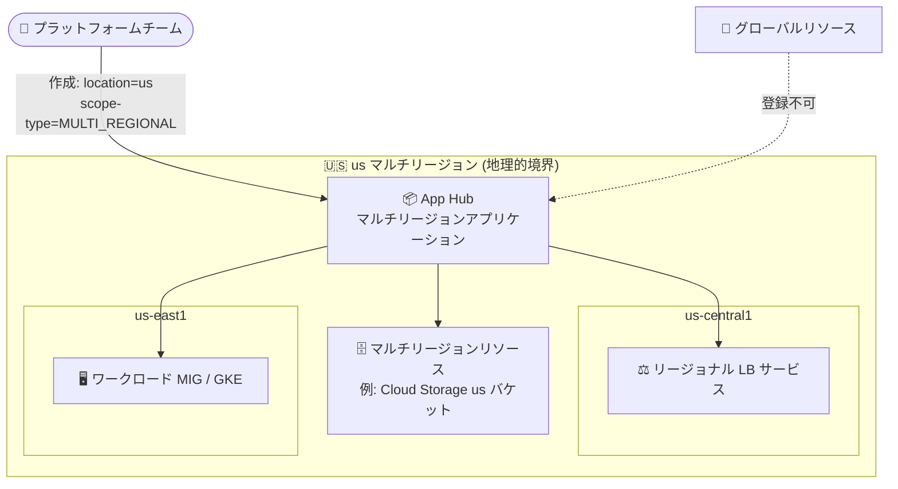

# App Hub: マルチリージョンアプリケーション (us / eu マルチリージョン) をサポート

**リリース日**: 2026-11-16

**サービス**: App Hub

**機能**: マルチリージョンアプリケーションのサポート (us / eu マルチリージョン)

**ステータス**: Feature (新機能)

📊 [このアップデートのインフォグラフィックを見る](https://takech9203.github.io/google-cloud-news-summary/20261116-app-hub-multi-regional-applications.html)

## 概要

2026 年 11 月 16 日、App Hub が `us` および `eu` マルチリージョンにおける「マルチリージョンアプリケーション」をサポートしました。App Hub はサービスとワークロードを「アプリケーション」という論理単位でグループ化し、ビジネス機能に沿ったリソース管理・可観測性を提供するサービスです。従来はロケーションとして「グローバル」と「リージョナル (単一リージョン)」の 2 種類しか選択できませんでしたが、今回のアップデートにより第 3 の選択肢として「マルチリージョナル」が追加されました。

マルチリージョンアプリケーションは、マルチリージョンリソース (例: `us` マルチリージョンの Cloud Storage バケット) と、そのマルチリージョンを構成する各リージョンのリージョナルリソース (例: `us-central1` と `us-east1` のリソース) を、単一の地理的境界内でひとつのアプリケーションとしてグループ化できます。たとえば米国内の複数リージョンにまたがる高可用性構成のアプリケーションを、グローバルアプリケーションにすることなく `us` という地理的境界の中でモデル化できます。

対象ユーザーは、米国内または EU 域内で複数リージョンにまたがるアプリケーションを運用しており、地理的境界を保ちながらアプリケーション中心の管理 (App Hub / Cloud Hub / Application Monitoring) を行いたいプラットフォームチームや SRE チームです。

**アップデート前の課題**

- App Hub のアプリケーションは「グローバル」か「リージョナル (単一リージョン)」の 2 択で、複数リージョンにまたがる構成は地理的範囲を限定できないグローバルアプリケーションとして定義するしかなかった
- リージョナルアプリケーションは同一リージョンのリソースしか登録できず、`us-central1` と `us-east1` にまたがる DR / 高可用性構成を 1 つのアプリケーションとして表現できなかった
- マルチリージョンリソース (マルチリージョンの Cloud Storage バケットなど) はグローバルアプリケーションにしか登録できなかった

**アップデート後の改善**

- `us` / `eu` マルチリージョンをロケーションとするマルチリージョンアプリケーションを作成でき、単一の地理的境界内で複数リージョンのリソースをグループ化できるようになった
- マルチリージョンリソースと、マルチリージョンを構成する各リージョンのリージョナルリソースを同一アプリケーションに登録できるようになった
- 米国内・EU 域内にリソースを限定したいという地理的な管理要件と、複数リージョンにまたがる構成のアプリケーション中心管理を両立できるようになった

## アーキテクチャ図



マルチリージョンアプリケーションは、`us` (または `eu`) マルチリージョン内のマルチリージョンリソースと構成リージョンのリージョナルリソースを単一の地理的境界内でグループ化します。グローバルリソースは登録できません。

## サービスアップデートの詳細

### 主要機能

1. **マルチリージョンアプリケーションの作成**
   - アプリケーションのロケーションとして `us` (米国) または `eu` (EU 加盟国) を指定可能
   - `gcloud apphub applications create` の `--scope-type` に新しい値 `MULTI_REGIONAL` が追加
   - 既存の `GLOBAL` / `REGIONAL` と合わせて 3 種類のスコープタイプから選択可能に

2. **マルチリージョン + リージョナルリソースの混在登録**
   - 同一マルチリージョンに属するマルチリージョンリソースを登録可能
   - そのマルチリージョンを構成する各リージョン (例: `us` なら `us-central1`、`us-east1`、`us-west1` など) のリージョナルリソースも同一アプリケーションに登録可能
   - グローバルコンポーネントは登録不可 (グローバルアプリケーションを使用する)

3. **地理的境界の維持**
   - アプリケーションメタデータは選択したマルチリージョン内に保存され、任意の Google Cloud リージョンからアクセス可能
   - 米国内・EU 域内という地理的範囲を保ったままアプリケーションをモデル化できる

## 技術仕様

### アプリケーションのロケーションタイプ比較

| 項目 | グローバル | マルチリージョナル (新規) | リージョナル |
|------|-----------|--------------------------|--------------|
| ロケーション指定 | `global` | `us` または `eu` | 単一リージョン (例: `us-central1`) |
| 登録可能なリソース | 任意のロケーションのリソース (グローバル含む) | 同一マルチリージョンのマルチリージョンリソース + 構成リージョンのリージョナルリソース | 同一リージョンのリソースのみ |
| グローバルリソースの登録 | 可能 | 不可 | 不可 |
| メタデータの保存先 | 複数リージョン | 選択したマルチリージョン内 | 指定リージョン内 |
| データレジデンシー | 非サポート | 非サポート | サポート (リージョナルエンドポイント使用時) |
| 推奨ユースケース | 世界中に分散、またはグローバルリソースを含む構成 | 米国内 / EU 域内の複数リージョンにまたがる構成 | 単一リージョン内に収まる構成 |

### サポートされるマルチリージョン

| マルチリージョン名 | 説明 |
|--------------------|------|
| `us` | 米国内のデータセンター (`us-*` リージョン) |
| `eu` | EU 加盟国内のデータセンター |

### API エンドポイント

- グローバル / マルチリージョンアプリケーション (`global`, `us`, `eu`) はグローバルエンドポイント `apphub.googleapis.com` を使用
- リージョナルエンドポイント (`apphub.LOCATION.rep.googleapis.com`) は単一リージョンリソース専用で、`/locations/us/` や `/locations/eu/` を含むリクエストは拒否される

## 設定方法

### 前提条件

1. 管理プロジェクト (management project) で App Hub がセットアップ済みであること
2. 登録対象のリソースが [App Hub サポート対象リソース](https://docs.cloud.google.com/app-hub/docs/supported-resources)であり、`us` または `eu` マルチリージョン (およびその構成リージョン) に存在すること

### 手順

#### ステップ 1: マルチリージョンアプリケーションを作成する

```bash
gcloud apphub applications create my-us-app \
  --project=MANAGEMENT_PROJECT_ID \
  --location=us \
  --scope-type=MULTI_REGIONAL \
  --display-name="My US Multi-Regional App" \
  --criticality-type=MISSION_CRITICAL \
  --environment-type=PRODUCTION
```

`--location` に `us` または `eu` を指定し、`--scope-type` に `MULTI_REGIONAL` を指定します。

#### ステップ 2: サービス / ワークロードを登録する

```bash
# 構成リージョンの検出済みサービスを一覧表示
gcloud apphub discovered-services list \
  --project=MANAGEMENT_PROJECT_ID \
  --location=us-central1

# アプリケーションにサービスを登録
gcloud apphub applications services create my-service \
  --project=MANAGEMENT_PROJECT_ID \
  --location=us \
  --application=my-us-app \
  --discovered-service=DISCOVERED_SERVICE_NAME
```

マルチリージョンの構成リージョン (例: `us-central1`、`us-east1`) にあるリソースや、同一マルチリージョンのマルチリージョンリソースを登録できます。

## メリット

### ビジネス面

- **地理的ガバナンスとの整合**: 「リソースは米国内 / EU 域内に限定する」という組織ポリシーを保ちながら、複数リージョン構成をアプリケーション単位で管理できる
- **実態に即したアプリケーションモデル**: DR やマルチリージョン高可用性構成を、過剰に広いグローバルアプリケーションや、分割された複数のリージョナルアプリケーションではなく、実際の構成に合った 1 つの単位で表現できる

### 技術面

- **マルチリージョンリソースの登録先の拡充**: 従来グローバルアプリケーション必須だったマルチリージョンリソースを、地理的境界を持つアプリケーションに登録可能
- **アプリケーション中心の可観測性**: Cloud Hub や Application Monitoring と組み合わせ、複数リージョンにまたがるアプリケーションの健全性を 1 つのアプリケーションビューで把握できる

## デメリット・制約事項

### 制限事項

- サポートされるマルチリージョンは `us` と `eu` の 2 つのみ (アジアなど他地域のマルチリージョンは対象外)
- グローバルコンポーネント (グローバル外部アプリケーションロードバランサなど) はマルチリージョンアプリケーションに登録できない
- データレジデンシーはサポートされない (データレジデンシー要件がある場合はリージョナルアプリケーション + リージョナルエンドポイントを使用)

### 考慮すべき点

- リージョナルエンドポイントは `/locations/us/` や `/locations/eu/` を含むリクエストを拒否するため、マルチリージョンアプリケーションの操作にはグローバルエンドポイント (`apphub.googleapis.com`) を使用する必要がある
- すべてのコンポーネントが単一リージョンに収まる場合は、レイテンシ・コスト・障害ドメイン整合の観点から引き続きリージョナルアプリケーションが推奨される
- 大陸をまたぐ構成やグローバルリソースを含む構成には従来どおりグローバルアプリケーションを使用する

## ユースケース

### ユースケース 1: 米国内マルチリージョン DR 構成の一元管理

**シナリオ**: `us-central1` をプライマリ、`us-east1` をセカンダリとする DR 構成のアプリケーションを運用しており、両リージョンのサービス・ワークロードを 1 つのアプリケーションとして管理したい。データは米国内に限定する組織ポリシーがある。

**実装例**:
```bash
gcloud apphub applications create dr-app \
  --location=us --scope-type=MULTI_REGIONAL \
  --display-name="DR Application (US)"
# us-central1 / us-east1 双方のリソースを同一アプリケーションに登録
```

**効果**: 米国という地理的境界を維持したまま、プライマリ / セカンダリ両リージョンのリソースを単一のアプリケーションビューで監視・管理できる。

### ユースケース 2: EU 域内でのマルチリージョンリソースを含むアプリケーション管理

**シナリオ**: EU 域内の複数リージョンにデプロイしたワークロードと、`eu` マルチリージョンの Cloud Storage バケットを組み合わせたアプリケーションを、EU 域内という枠組みで管理したい。

**効果**: 従来はグローバルアプリケーションでしか扱えなかったマルチリージョンリソースを、EU という地理的境界を持つアプリケーションに含めて管理でき、組織のガバナンス方針とアプリケーション管理の単位を一致させられる。

## 料金

App Hub 自体は追加料金なしで利用できます。今回のアップデートに伴う料金変更のアナウンスはありません。なお、管理プロジェクトで有効化する関連機能 (Application Design Center によるデプロイ、無料枠を超える Observability のテレメトリ収集など) には別途料金が発生する場合があります。

- [App Hub プロダクトページ (料金)](https://cloud.google.com/products/app-hub)

## 利用可能リージョン

マルチリージョンアプリケーションは以下のマルチリージョンで利用できます。

- `us`: 米国内のデータセンター
- `eu`: EU 加盟国内のデータセンター

リージョナル / グローバルアプリケーションを含む利用可能ロケーションの一覧は [App Hub locations](https://docs.cloud.google.com/app-hub/docs/locations) を参照してください。

## 関連サービス・機能

- **Cloud Hub**: App Hub で定義したアプリケーションを中心に、状態やコストを横断的に確認できる管理ハブ
- **Application Monitoring**: App Hub のアプリケーション単位でのダッシュボード・テレメトリの自動整理を提供
- **Application Design Center**: アプリケーションテンプレートの設計・デプロイ。デプロイしたアプリケーションは App Hub に自動登録される
- **Cloud Storage / Firestore などのマルチリージョンリソース**: `us` / `eu` マルチリージョンのリソースをマルチリージョンアプリケーションに登録可能
- **Assured Workloads**: データレジデンシー要件が厳格な場合は、リージョナルアプリケーション + リージョナルエンドポイントとの組み合わせを検討

## 参考リンク

- 📊 [インフォグラフィック](https://takech9203.github.io/google-cloud-news-summary/20261116-app-hub-multi-regional-applications.html)
- [公式リリースノート](https://docs.cloud.google.com/release-notes#November_16_2026)
- [Global, multi-regional, and regional applications](https://docs.cloud.google.com/app-hub/docs/global-regional-applications)
- [App Hub locations](https://docs.cloud.google.com/app-hub/docs/locations)
- [App Hub の概要](https://docs.cloud.google.com/app-hub/docs/overview)
- [App Hub サポート対象リソース](https://docs.cloud.google.com/app-hub/docs/supported-resources)
- [gcloud apphub applications create リファレンス](https://docs.cloud.google.com/sdk/gcloud/reference/apphub/applications/create)

## まとめ

App Hub に「マルチリージョナル」という第 3 のアプリケーションスコープが追加され、`us` / `eu` の地理的境界内で複数リージョンにまたがるリソースを 1 つのアプリケーションとしてモデル化できるようになりました。米国内や EU 域内でマルチリージョン構成を運用している組織は、グローバルアプリケーションで代用している既存の定義を見直し、地理的ガバナンスとアプリケーション管理の単位を一致させることを推奨します。

---

**タグ**: App Hub, マルチリージョン, アプリケーション管理, 可観測性, ガバナンス, us, eu
