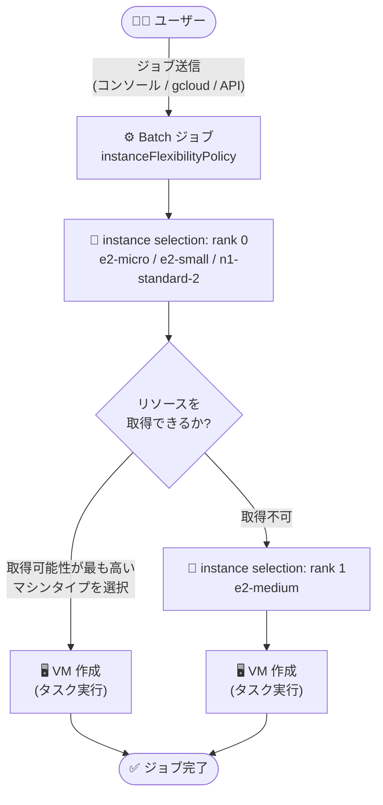

# Batch: インスタンスフレキシビリティが GA (一般提供開始)

**リリース日**: 2026-11-16

**サービス**: Batch

**機能**: インスタンスフレキシビリティ (Instance Flexibility) の一般提供開始と Google Cloud コンソール対応

**ステータス**: GA (一般提供)

📊 [このアップデートのインフォグラフィックを見る](https://takech9203.github.io/google-cloud-news-summary/20261116-batch-instance-flexibility-ga.html)

## 概要

Batch のインスタンスフレキシビリティ (instance flexibility) が一般提供 (GA) になりました。インスタンスフレキシビリティは、1 つのジョブに対して複数のマシンタイプを指定し、オプションでランク付け (優先順位付け) できる機能です。ジョブが利用できるマシンタイプの選択肢を増やすことで、「取得可能性 (obtainability)」、つまりジョブを実行するためのリソースが確保できる確率を向上させることができます。

具体的には、複数のマシンタイプを許可することでリソース可用性エラー (resource availability error) の発生確率を下げられるほか、プリエンプトされにくい Spot VM の取得を試みることも可能になります。ゲノム解析やレンダリング、機械学習の前処理など、大量の VM を必要とするバッチワークロードにおいて、リソース不足によるスケジューリング遅延やジョブ失敗のリスクを軽減できます。

あわせて、Google Cloud コンソールからインスタンスフレキシビリティを使用するジョブを作成できるようになりました。これまで JSON 設定ファイルの記述が必要だった構成を、コンソールの GUI から設定できます。

**アップデート前の課題**

- インスタンスフレキシビリティは Preview 段階であり、本番ワークロードでの利用には Pre-GA 提供条件 (限定サポート、"as is" 提供) が適用されていた
- Preview 期間中は `gcloud alpha batch jobs submit` コマンドや v1alpha API の使用が必要だった
- 単一のマシンタイプしか指定しない場合、そのマシンタイプの在庫が不足するとリソース可用性エラーが発生し、ジョブの開始が遅延または失敗していた
- Spot VM を使用するジョブでは、特定マシンタイプの需給状況によってはプリエンプションが頻発する可能性があった

**アップデート後の改善**

- GA となり、SLA を含む本番環境向けのサポートレベルでインスタンスフレキシビリティを利用できるようになった
- 複数のマシンタイプをランク付きで指定でき、リソース可用性エラーの発生確率とスケジューリング遅延を低減できるようになった
- 同一ランクに複数のマシンタイプを指定すると、Batch が取得可能性の最も高いマシンタイプを選択するため、プリエンプトされにくい Spot VM の取得や、並列処理ジョブでのインスタンス数の確保がしやすくなった
- Google Cloud コンソールからインスタンスフレキシビリティを使用するジョブを作成できるようになり、JSON を手書きせずに GUI で設定可能になった

## アーキテクチャ図



ジョブにランク付きのインスタンス選択 (instance selection) を複数定義すると、Batch は優先度の高いランクから順にリソースの取得を試み、同一ランク内に複数のマシンタイプがある場合は取得可能性が最も高いマシンタイプを選択します。

## サービスアップデートの詳細

### 主要機能

1. **複数マシンタイプの指定 (instance selections)**
   - `allocationPolicy.instanceFlexibilityPolicy.instanceSelections` フィールドで、ジョブが使用を許可するマシンタイプのリストを定義する
   - 各 instance selection は一意の名前、一意のランク、1 つ以上の一意のマシンタイプを持つ
   - 1 ジョブあたり最大 50 個の instance selection、合計 200 種類までのマシンタイプを指定できる

2. **ランクによる優先順位付け**
   - `rank` は 0 以上の整数で、値が小さいほど優先度が高い (未指定時のデフォルトは 0 = 最優先)
   - Batch は優先度の高い instance selection から順にリソース取得を試みる

3. **取得可能性 (obtainability) の向上**
   - 許可するマシンタイプの数が多いほど、取得可能性の改善効果が大きくなる
   - 同一ランクに複数のマシンタイプを指定した場合のみ、Batch は取得可能性が最も高いマシンタイプの選択を試みる (プリエンプトされにくい Spot VM の取得や、並列処理向けのインスタンス数確保に有効)
   - 同一ランクにマシンタイプが 1 つしかない場合は、リソース可用性エラーの防止のみに寄与する

4. **Google Cloud コンソール対応**
   - コンソールのジョブ作成画面からインスタンスフレキシビリティを構成できるようになった
   - なお、コンソールでのジョブ作成やインスタンステンプレートを使用するジョブでは、マシンタイプの指定自体を省略することはできない (マシンタイプ要件がないジョブでは、マシンタイプを完全に省略する方が取得可能性をさらに高められる)

## 技術仕様

### 制約事項と上限

| 項目 | 詳細 |
|------|------|
| instance selection 数 | 1 ジョブあたり最大 50 個 |
| マシンタイプ数 | 1 ジョブあたり合計最大 200 種類 (重複指定は不可、各マシンタイプは 1 つの instance selection にのみ所属可能) |
| 名前・ランク | 各 instance selection の名前とランクはジョブ内で一意である必要がある |
| プロビジョニングモデル | `FLEX_START` および `RESERVATION_BOUND` は指定不可 |
| 予約 (Reservation) | 特定の予約をターゲットにするジョブでは使用不可 (`reservation` フィールドは未定義または `NO_RESERVATION`)。自動消費される予約との併用は可能 |
| `machineType` フィールド | 併用不可。インスタンステンプレートのマシンタイプは無視される |
| ディスク・CPU プラットフォームのオーバーライド | マシンタイプごとのオーバーライドは不可。指定値 (または最優先 selection のデフォルト値) がすべてのマシンタイプに適用される |

### マシンタイプ間の互換性に関する注意

指定するすべてのプロパティが、許可するすべてのマシンタイプと互換性があることを確認する必要があります。互換性がない場合、ジョブ送信後にインスタンス作成に失敗する可能性があります。特に以下の確認が推奨されています。

- ロケーション (`allowedLocations[]` または `location`)
- タスクあたりのコンピュートリソース (`computeResource`)
- ディスクとイメージ (`volumes[]`、`disk[]`、`bootDisk`)
- ネットワーク (`network`)
- 最小 CPU プラットフォーム (`minCpuPlatform`)、プロビジョニングモデル (`provisioningModel`)、GPU (`accelerators[]`)

ブートディスクの互換性には特に注意が必要です。第 4 世代以降のマシンタイプは Persistent Disk をサポートせず、第 2 世代以前は Hyperdisk をサポートしないため、**第 4 世代以降と第 2 世代以前のマシンタイプは組み合わせられません**。第 3 世代とそれ以降を組み合わせる場合は、ブートディスクを Hyperdisk にする必要があります。

## 設定方法

### 前提条件

1. Batch の利用を開始済みであること (プロジェクトとユーザーの前提条件を完了)
2. 以下の IAM ロールが付与されていること
   - プロジェクトに対する Batch ジョブ編集者 (`roles/batch.jobsEditor`)
   - ジョブのサービスアカウント (デフォルトは Compute Engine のデフォルトサービスアカウント) に対するサービスアカウントユーザー (`roles/iam.serviceAccountUser`)

### 手順

#### ステップ 1: ジョブの JSON 設定ファイルを作成

2 つの instance selection を持つスクリプトジョブの例です。`first-choice` (rank 0) が最優先で 3 種類のマシンタイプを持ち、`second-choice` (rank 1) が次点です。

```json
{
  "taskGroups": [
    {
      "taskSpec": {
        "runnables": [
          {
            "script": {
              "text": "echo Hello World! This is task $BATCH_TASK_INDEX."
            }
          }
        ]
      },
      "taskCount": 3
    }
  ],
  "allocationPolicy": {
    "instanceFlexibilityPolicy": {
      "instanceSelections": {
        "first-choice": {
          "rank": 0,
          "machineTypes": ["e2-micro", "e2-small", "n1-standard-2"]
        },
        "second-choice": {
          "rank": 1,
          "machineTypes": ["e2-medium"]
        }
      }
    }
  }
}
```

#### ステップ 2: ジョブを送信

```bash
gcloud batch jobs submit JOB_NAME \
    --location LOCATION \
    --config JSON_CONFIGURATION_FILE
```

GA に伴い、Google Cloud コンソールのジョブ作成画面からも同等の構成でジョブを作成できます。

## メリット

### ビジネス面

- **ジョブ完了時間の安定化**: リソース可用性エラーによるスケジューリング遅延や再実行を減らし、バッチ処理のデッドライン遵守に貢献する
- **コスト削減の機会拡大**: プリエンプトされにくい Spot VM を選択的に取得できるため、Spot VM の大幅な割引を活かしつつ中断リスクを抑えられる
- **追加コストなし**: Batch サービス自体は無料であり、インスタンスフレキシビリティの利用に追加料金は発生しない

### 技術面

- **取得可能性の向上**: 許可するマシンタイプが多いほど、リソースが確保できる確率が高まる
- **宣言的なフォールバック**: ランク付けにより「第一希望が取れなければ第二希望」というフォールバック戦略をジョブ定義に組み込める
- **並列処理の高速化**: 並列実行をサポートするジョブで、より多くのインスタンスを取得できる確率が上がり、ジョブの早期完了につながる
- **GUI 対応**: コンソールから設定できるため、JSON の手書きに不慣れなユーザーでも利用しやすい

## デメリット・制約事項

### 制限事項

- `FLEX_START` / `RESERVATION_BOUND` プロビジョニングモデルとは併用できない
- 特定の予約をターゲットにする (specifically targeted reservation を消費する) ジョブでは使用できない
- ブートディスクの互換性により、第 4 世代以降と第 2 世代以前のマシンタイプは同一ジョブで組み合わせられない
- マシンタイプごとにディスクや最小 CPU プラットフォームをオーバーライドすることはできない

### 考慮すべき点

- 指定するすべてのプロパティ (ロケーション、コンピュートリソース、ディスク、ネットワーク、GPU など) が、許可するすべてのマシンタイプと互換であることを事前に検証する必要がある。非互換の場合、ジョブ送信後にインスタンス作成が失敗する可能性がある
- マシンタイプごとに料金が異なるため、許可するマシンタイプの範囲によってはジョブの実行コストが変動する。コスト上限を重視する場合は、許可するマシンタイプを料金レンジが近いものに絞るとよい
- マシンタイプ要件がないジョブでは、インスタンスフレキシビリティよりもマシンタイプ指定自体を省略する方が取得可能性をさらに高められる (ただしコンソールやインスタンステンプレート使用時は省略不可)

## ユースケース

### ユースケース 1: Spot VM を使ったフォールトトレラントな大規模並列処理

**シナリオ**: 画像変換やシミュレーションなど、中断に耐えられる大規模並列ワークロードを Spot VM で低コストに実行したい。ただし、特定マシンタイプの Spot 在庫が枯渇するとプリエンプションが頻発し、再試行コストが増える。

**実装例**:
```json
"allocationPolicy": {
  "instanceFlexibilityPolicy": {
    "instanceSelections": {
      "spot-pool": {
        "rank": 0,
        "machineTypes": ["c3-standard-8", "n2-standard-8", "n2d-standard-8"]
      }
    }
  },
  "instances": [{ "policy": { "provisioningModel": "SPOT" } }]
}
```

**効果**: 同一ランクに複数のマシンタイプを指定することで、Batch がプリエンプトされにくい Spot VM の取得を試みる。自動再試行 (automatic retries) と組み合わせることで、プリエンプション発生時も自動的に VM を再作成でき、Spot 割引を最大限に活用しつつジョブ完了率を高められる。

### ユースケース 2: リソース可用性エラーによる夜間バッチの遅延防止

**シナリオ**: 毎晩実行する ETL ジョブが、特定リージョンで特定マシンタイプの在庫不足によりリソース可用性エラーで遅延することがある。

**効果**: 第一希望のマシンタイプを rank 0、許容可能な代替マシンタイプを rank 1 として定義することで、第一希望が取得できない場合も自動的に代替マシンタイプへフォールバックし、バッチウィンドウ内での完了率を向上できる。

## 料金

Batch サービス自体の利用に追加料金はありません。ジョブの実行に使用される基盤リソース (Compute Engine VM、ディスクなど) の料金のみが課金されます。インスタンスフレキシビリティの利用自体にも追加料金はありませんが、実際に選択されたマシンタイプに応じて VM の料金が決まるため、許可するマシンタイプの構成によって実行コストは変動します。

詳細は [Batch の料金ページ](https://cloud.google.com/batch/pricing) を参照してください。

## 利用可能リージョン

Batch が利用可能なロケーションで使用できます。詳細は [Batch のロケーション一覧](https://docs.cloud.google.com/batch/docs/locations) を参照してください。

## 関連サービス・機能

- **Compute Engine (Spot VM)**: インスタンスフレキシビリティと組み合わせることで、プリエンプトされにくい Spot VM の取得を試みることができる。フォールトトレラントなワークロードで最大の割引を得られる
- **Compute Engine 予約 (Reservations)**: 自動消費される予約とインスタンスフレキシビリティを併用すると、複数の予約からの消費を試みることができる (特定の予約をターゲットにする場合は併用不可)
- **Dynamic Workload Scheduler (Flex-start VM)**: 取得可能性を高める代替手段。オンデマンド + インスタンスフレキシビリティが繰り返し失敗する場合の選択肢となる (インスタンスフレキシビリティとの直接併用は不可)
- **Managed Instance Group (MIG) のインスタンスフレキシビリティ**: Compute Engine MIG にも同様のインスタンスフレキシビリティ機能があり、Batch 版は一部のオーバーライド (ディスク、最小 CPU プラットフォーム) をサポートしない点が異なる

## 参考リンク

- 📊 [インフォグラフィック](https://takech9203.github.io/google-cloud-news-summary/20261116-batch-instance-flexibility-ga.html)
- [公式リリースノート](https://docs.cloud.google.com/release-notes#November_16_2026)
- [ドキュメント: インスタンスフレキシビリティを使用するジョブの作成と実行](https://docs.cloud.google.com/batch/docs/create-run-job-instance-flexibility)
- [ドキュメント: ジョブのリソース取得可能性の改善](https://docs.cloud.google.com/batch/docs/improve-obtainability-overview)
- [料金ページ](https://cloud.google.com/batch/pricing)

## まとめ

Batch のインスタンスフレキシビリティが GA となり、複数マシンタイプのランク付き指定によってリソース取得可能性を高める構成を、本番ワークロードで安心して利用できるようになりました。コンソール対応により導入のハードルも下がっています。リソース可用性エラーに悩まされているバッチワークロードや、Spot VM のプリエンプション頻度を下げたいワークロードでは、まず同一ランクに互換性のある複数マシンタイプを指定する構成から試すことを推奨します。

---

**タグ**: Batch, Instance Flexibility, Obtainability, Spot VM, Compute Engine, GA, HPC, バッチ処理
