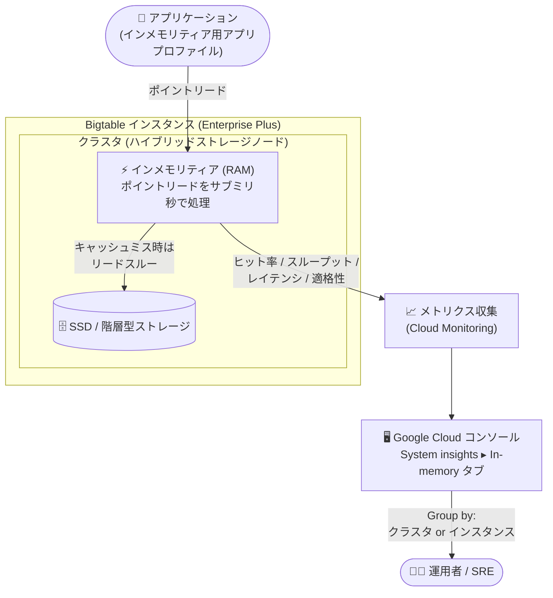

# Bigtable: インメモリティアのモニタリング機能 (Preview)

**リリース日**: 2026-11-16

**サービス**: Bigtable

**機能**: インメモリティアのパフォーマンス・容量・リクエスト適格性のモニタリング

**ステータス**: Preview

📊 [このアップデートのインフォグラフィックを見る](https://takech9203.github.io/google-cloud-news-summary/20261116-bigtable-in-memory-tier-monitoring.html)

## 概要

Bigtable のインメモリティア (in-memory tier) のパフォーマンス、容量、リクエスト適格性を Google Cloud コンソールでモニタリングできるようになりました。System insights ページに **In-memory タブ** が追加され、クラスタ単位またはインスタンス単位でグループ化したチャートを表示できます。本機能は Enterprise Plus エディションのインスタンスを対象とした Preview 機能です。

インメモリティアは、Bigtable ノードに統合されたメモリ層 (RAM) により、サブミリ秒の読み取りレイテンシと高スループットのポイントリードを実現する Enterprise Plus エディション限定の機能 (Preview) です。RDMA (Remote Direct Memory Access) を利用してレスポンスタイムを大幅に短縮し、ホットスポットを緩和します。今回のアップデートにより、このインメモリティアの利用状況 (ヒット率、スループット、レイテンシ、メモリ層を利用できなかったリクエストの理由など) をコンソール上のチャートで時系列に可視化できるようになり、キャパシティプランニングやチューニングが容易になりました。

対象ユーザーは、Enterprise Plus エディションでインメモリティアを利用 (または評価) している SRE・DBRE・インフラ運用チームです。セルフマネージドのキャッシュ (Memcached/Redis など) を Bigtable 前段に置く構成からの移行を検討しているチームにとっても、効果測定の手段として重要な機能です。

**アップデート前の課題**

- インメモリティア自体は利用できたものの、その動作状況 (ヒット率やスループット消費) をコンソール上で時系列に確認する専用のビューがなく、効果の検証が難しかった
- 読み取りリクエストがメモリ層の対象外 (ineligible) となった場合に、その理由を把握する手段が整っていなかった
- 垂直スケーリング (ノードあたり 40,000〜120,000 reads/sec) による追加課金が発生する中で、実際のリクエストユニット消費量を可視化してコストを管理することが難しかった

**アップデート後の改善**

- System insights ページの In-memory タブで、インメモリティアのパフォーマンス・容量・リクエスト適格性をチャートで確認できるようになった
- チャートを **クラスタ単位** または **インスタンス単位** でグループ化でき、マルチクラスタ構成でもクラスタごとのメモリ層の挙動を比較できるようになった
- ヒット率や「メモリ層対象外の理由別リクエスト数」などのメトリクスにより、アプリプロファイル設定やワークロードの改善ポイントを特定しやすくなった
- 過去 1 時間から最大 6 週間までの期間でパフォーマンスの推移を分析できるようになった

## アーキテクチャ図



インメモリティアを経由する読み取りリクエストのメトリクスが Cloud Monitoring に収集され、コンソールの System insights ページ (In-memory タブ) でクラスタ別またはインスタンス別のチャートとして可視化される流れを示しています。

## サービスアップデートの詳細

### 主要機能

1. **System insights ページの In-memory タブ**
   - Bigtable インスタンスの System insights ページに In-memory タブが追加され、インメモリティア専用のチャートを表示できる
   - デフォルトでは過去 1 時間のメトリクスをクラスタごとに表示し、最大過去 6 週間まで期間を変更可能
   - レイテンシチャートは 50/95/99 パーセンタイルを切り替えて表示できる

2. **クラスタ / インスタンス単位のグループ化**
   - Group by メニューで「Instance」を選択すると、インスタンス全体の合算メトリクスを表示
   - クラスタ単位の表示では、マルチクラスタ構成において各クラスタのメモリ層の挙動 (各クラスタが独立にキャッシュするデータ) を比較できる

3. **パフォーマンス・容量・リクエスト適格性のメトリクス**
   - スループット (リクエストユニット)、ヒット率、読み取りレイテンシなどのパフォーマンス・容量メトリクスを提供
   - メモリ層の対象外 (ineligible) となったリクエスト数を理由別に確認でき、ワークロードがインメモリティアを有効活用できているかを診断できる

## 技術仕様

### インメモリティアの主なメトリクス

| メトリクス | 説明 |
|------|------|
| In-memory max request units | 5 分間のウィンドウで使用された最大 reads/sec (1 read/sec = 1 KiB のポイントリード相当) |
| In-memory request unit count | メモリ層の利用を試みた読み取りリクエストの reads/sec 使用量 |
| In-memory read request count | メモリ層に到達した読み取りリクエスト数 (成功/失敗の内訳付き) |
| In-memory read latencies | メモリ層への到達を試みた読み取りリクエストのサーバー側レイテンシ分布 |
| In-memory hit ratio | メモリ層適格の読み取りリクエストのうち、メモリ層から正常に読み取れた割合 |
| In-memory ineligible reason count | メモリ層の対象外となったリクエスト数 (理由別の内訳付き) |

### インメモリティアの基礎仕様 (参考)

| 項目 | 詳細 |
|------|------|
| 対応エディション | Enterprise Plus のみ |
| ストレージ要件 | SSD ストレージが必須 |
| 対応オペレーション | 単一行のポイントリードのみ (スキャン・SQL クエリは非対応) |
| アプリプロファイル | シングルクラスタルーティングのみ対応 |
| 行サイズ上限 | 1 MiB / 行キー (超過時は永続ストレージから読み取り) |
| スループット | 基本 40,000 reads/sec/ノード、垂直スケーリングで最大 120,000 reads/sec/ノード |
| クラスタあたりノード数 | 最大 10 ノード |
| CMEK | CMEK 有効クラスタでは利用不可 |
| クライアントライブラリ | Java 2.77.0 以降 / Go 1.52.0 以降 (その他は非対応) |

## 設定方法

### 前提条件

1. Bigtable インスタンスが Enterprise Plus エディションであること
2. クラスタでインメモリティア (Preview) が有効化されていること
3. インメモリティア用のアプリプロファイル (シングルクラスタルーティング) が構成されていること

### 手順

#### ステップ 1: System insights ページを開く

1. Google Cloud コンソールで Bigtable インスタンスの一覧を開く
2. メトリクスを確認したいインスタンスをクリックする
3. ナビゲーションメニューで **System insights** をクリックする

#### ステップ 2: In-memory タブでチャートを確認する

1. **In-memory** タブをクリックし、インメモリティアのチャートを表示する
2. インスタンス全体の合算値を見る場合は、**Group by** メニューで **Instance** を選択する (デフォルトはクラスタ別表示)
3. レイテンシチャートはパーセンタイルメニューで 99th / 95th / 50th を切り替える
4. 期間を変更する場合は「1 hour」をクリックしてプリセットまたはカスタム期間を選択し、**Apply** をクリックする

## メリット

### ビジネス面

- **コストの可視化**: 垂直スケーリング (基本 40,000 reads/sec 超) はノード時間単価に乗数を適用して課金されるため、リクエストユニット消費量の可視化がコスト管理に直結する
- **投資対効果の検証**: セルフマネージドキャッシュの置き換えとしてインメモリティアを導入した際の効果 (ヒット率・レイテンシ短縮) をデータで示せる

### 技術面

- **チューニングの効率化**: ヒット率や ineligible 理由の内訳から、アプリプロファイル設定・行サイズ・アクセスパターンの改善点を特定できる
- **マルチクラスタ運用の最適化**: 各クラスタのメモリ層は独立してキャッシュ対象を決定するため、クラスタ別チャートでクラスタごとの挙動差を把握できる
- **長期トレンド分析**: 最大 6 週間の時系列チャートでキャパシティプランニングに活用できる

## デメリット・制約事項

### 制限事項

- Preview 機能であり、Pre-GA 利用規約が適用される (サポートが限定される場合がある)
- Enterprise Plus エディションのインスタンスのみが対象 (インメモリティア自体も Enterprise Plus 限定)
- インメモリティア自体にも制約がある (ポイントリードのみ、シングルクラスタルーティング、CMEK 非対応、最大 10 ノード/クラスタなど)

### 考慮すべき点

- クラスタ別表示では、クラスタに到達できなかったリクエストが `<unspecified>` クラスタ ID でタグ付けされる場合がある (通常はごく少数)
- 垂直スケーリング中はスループットのみが増加しメモリ容量は増えないため、ヒット率 (miss rate) の変化をチャートで監視することが重要
- 対応クライアントライブラリ (Java 2.77.0+ / Go 1.52.0+) 以外からのリクエストはメモリ層の対象外となる

## ユースケース

### ユースケース 1: インメモリティア導入効果の検証

**シナリオ**: サブミリ秒レイテンシが必要な広告配信システムで、セルフマネージドの Redis キャッシュを廃止して Bigtable インメモリティアに統合した。導入効果を定量的に確認したい。

**実装例**:
```
1. System insights ▸ In-memory タブを開く
2. In-memory hit ratio チャートでヒット率を確認
3. In-memory read latencies チャート (p99) でレイテンシ短縮を確認
4. 期間を 6 週間に設定し、導入前後のトレンドを比較
```

**効果**: ヒット率とレイテンシの実データに基づき、キャッシュ統合によるアーキテクチャ簡素化とコスト削減の効果を証明できる。

### ユースケース 2: ヒット率低下の原因調査

**シナリオ**: インメモリティアを有効化したが、期待したレイテンシ改善が得られていない。原因を特定したい。

**実装例**:
```
1. In-memory ineligible reason count チャートで対象外リクエストの理由を確認
   (例: 非対応アプリプロファイル経由、行サイズ 1 MiB 超過、履歴セルへのアクセスなど)
2. In-memory max request units チャートで垂直スケーリングの発生状況を確認
3. クラスタ別にグループ化し、特定クラスタに偏りがないかを確認
```

**効果**: アプリプロファイルの構成ミスやワークロード特性の問題を切り分け、インメモリティアの効果を最大化できる。

## 料金

System insights ページでのモニタリング自体に追加料金は発生しません。インメモリティアの利用については、Enterprise Plus エディションのノード SKU が適用され、垂直スケーリング (基本 40,000 reads/sec を超えるスループット) にはノードの時間単価に乗数を適用した課金が行われます。詳細は [Bigtable の料金ページ](https://cloud.google.com/bigtable/pricing) を参照してください。

## 利用可能リージョン

リージョン単位の提供状況は公式ドキュメントに明記されていません。Enterprise Plus エディションおよびインメモリティアの提供状況は [Bigtable のドキュメント](https://docs.cloud.google.com/bigtable/docs/editions-overview) を参照してください。

## 関連サービス・機能

- **Cloud Monitoring**: Bigtable のメトリクスは Cloud Monitoring API 経由でもプログラマティックに取得でき、アラートポリシーやカスタムダッシュボードを構築できる
- **Bigtable Access patterns ページ**: クエリタイプ別にワークロードを分析でき、ポイントリードが多いテーブル・アプリプロファイルを特定してインメモリティア導入の候補を選定できる
- **Key Visualizer**: 行キー単位のアクセスパターンを可視化し、ホットスポットの詳細調査に利用できる
- **Bigtable 自動スケーリング**: インメモリティアの垂直スケーリングはクラスタの自動スケーリングと統合されており、垂直スケーリングの上限到達時にノードが水平スケールされる

## 参考リンク

- 📊 [インフォグラフィック](https://takech9203.github.io/google-cloud-news-summary/20261116-bigtable-in-memory-tier-monitoring.html)
- [公式リリースノート](https://docs.cloud.google.com/release-notes#November_16_2026)
- [Monitor performance over time (モニタリングドキュメント)](https://docs.cloud.google.com/bigtable/docs/monitoring-instance)
- [In-memory tier overview](https://docs.cloud.google.com/bigtable/docs/in-memory-overview)
- [Editions overview](https://docs.cloud.google.com/bigtable/docs/editions-overview)
- [料金ページ](https://cloud.google.com/bigtable/pricing)

## まとめ

今回のアップデートにより、Enterprise Plus エディションのインメモリティア (Preview) の運用に不可欠な可視性が Google Cloud コンソールに統合されました。インメモリティアを導入済み・検討中のチームは、System insights の In-memory タブでヒット率・レイテンシ・リクエスト適格性を確認し、キャッシュ効果の検証と垂直スケーリングに伴うコストの監視を習慣化することを推奨します。

---

**タグ**: Bigtable, In-Memory Tier, Monitoring, System Insights, Enterprise Plus, Preview, Observability
