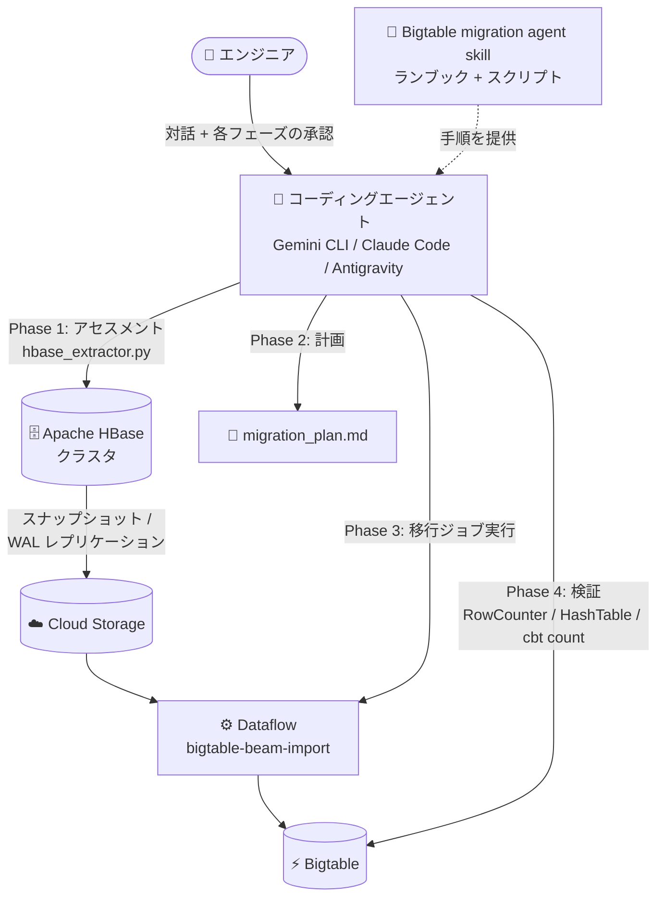

# Bigtable: HBase 移行を支援する Bigtable migration agent skill (Preview)

**リリース日**: 2026-11-16

**サービス**: Bigtable

**機能**: Bigtable migration agent skill (Apache HBase から Bigtable への移行支援エージェントスキル)

**ステータス**: Preview

📊 [このアップデートのインフォグラフィックを見る](https://takech9203.github.io/google-cloud-news-summary/20261116-bigtable-migration-agent-skill.html)

## 概要

Google Cloud は、Apache HBase から Bigtable への移行を AI コーディングエージェントで計画・実行できる「Bigtable migration agent skill」を Preview として公開しました。このスキルは GitHub の [cloud-bigtable-ecosystem](https://github.com/GoogleCloudPlatform/cloud-bigtable-ecosystem/tree/main/skills/bigtable-migration) リポジトリで提供されるオープンソースのエージェントスキル (Apache 2.0 ライセンス) で、Gemini CLI、Claude Code、Antigravity、Cursor など Agent Plugins 互換のコーディングエージェントにインストールして使用します。

スキルは、クラスタアセスメント、スキーマ・キャパシティプランニング、オフラインまたはオンラインのデータ移行、データ検証という移行の全フェーズをカバーするランブック (手順書) とスクリプトをエージェントに提供します。エージェントは `gcloud`、`cbt`、`hbase`、`gsutil` などのローカルツールを使って移行作業を進めますが、インフラ作成やデータ移動を伴うコマンドの実行前には必ず人間の承認を求める Human-in-the-loop 設計になっています。

対象ユーザーは、オンプレミスやセルフマネージドの HBase クラスタを Bigtable へ移行したいデータベース管理者・インフラエンジニアです。従来は複数のドキュメントとオープンソースツールを自力で組み合わせる必要があった移行作業を、エージェントとの対話で一貫して進められるようになります。

**アップデート前の課題**

HBase から Bigtable への移行には Google 提供のオープンソースツール群が存在していましたが、利用には高い習熟が必要でした。

- オフライン移行ガイド、HBase レプリケーションライブラリ、Schema Translation ツール、`bigtable-beam-import` など、複数のドキュメントとツールを自分で読み解いて組み合わせる必要があった
- 移行前のクラスタアセスメント (スキーマ、GC ポリシー、リージョン分割、HDFS サイズ、コプロセッサなどの棚卸し) を手作業で行う必要があった
- スキーマ変換・キャパシティプランニング・事前分割テーブル作成などの計画立案が属人的で、移行計画のドキュメント化にも手間がかかった
- 移行後のデータ検証 (行数照合、ハッシュ比較) の手順を個別に調べて実行する必要があった

**アップデート後の改善**

- コーディングエージェントにスキルをインストールするだけで、アセスメントから検証までの 4 フェーズのワークフローを対話的に実行できるようになった
- 付属の `hbase_extractor.py` スクリプトにより、スキーマ・GC ポリシー・リージョン分割・HDFS サイズ・レプリケーションピア・コプロセッサなどのクラスタ情報を JSON として自動収集できるようになった (スクリプトはローカルで実行され、クラスタ認証情報はエージェントに渡らない)
- アセスメント結果から `migration_plan.md` (コプロセッサ対応、GC ポリシー変換、インスタンスプロビジョニング、事前分割テーブル作成コマンドを含む移行計画書) を自動生成できるようになった
- オフライン移行 (ExportSnapshot + `bigtable-beam-import`) とオンライン移行 (`bigtable-hbase-replication` ライブラリ + スナップショットブートストラップ) の両方をエージェントがガイドするようになった

## アーキテクチャ図



コーディングエージェントがスキルのランブックに従い、HBase クラスタのアセスメント、移行計画の生成、Cloud Storage と Dataflow を使ったデータ移行、移行後の検証までを人間の承認を挟みながら進めます。

## サービスアップデートの詳細

### 主要機能

1. **Phase 1: クラスタアセスメント**
   - `hbase_extractor.py` による自動収集と、対話形式のガイド付きチェックリストの 2 方式に対応
   - テーブルスキーマ、GC ポリシー (TTL / VERSIONS)、リージョン分割、HDFS サイズ、レプリケーションピア、コプロセッサを `hbase_assessment_input.json` に出力
   - `--include-tables` / `--table-regex` フラグで対象テーブルを絞り込み可能
   - スクリプトはローカル実行のため、クラスタの認証情報がエージェントに渡らない設計

2. **Phase 2: スキーマ・キャパシティプランニング**
   - アセスメント JSON を解析し、移行計画書 `migration_plan.md` を生成
   - コプロセッサ・フィルタの代替策、GC ポリシーの変換、Bigtable インスタンスのプロビジョニング、事前分割 (pre-split) テーブル作成コマンドを含む

3. **Phase 3: オフライン / オンラインのデータ移行**
   - オフライン: HBase の ExportSnapshot で HFile を Cloud Storage にエクスポートし、`bigtable-beam-import` (Dataflow) でインポート。SequenceFile 経由の Dataflow テンプレートにも対応
   - オンライン: `bigtable-hbase-replication` ライブラリによる WAL ベースの非同期レプリケーション + スナップショットブートストラップで、ほぼ無停止の移行を実現

4. **Phase 4: データ検証**
   - 行数照合: HBase の `RowCounter` と Bigtable の `cbt count` を比較 (期限切れセルの GC を考慮)
   - バイトレベル検証: HBase の `HashTable` と Dataflow の `sync-table` ジョブによるチェックサム比較

5. **Human-in-the-loop 設計**
   - インフラ作成やデータ移動を伴うコマンドの実行前に、必ず人間の承認を求めるワークフロー

## 技術仕様

### スキルの構成

| 項目 | 詳細 |
|------|------|
| 配布形態 | オープンソース (Apache 2.0)、GitHub リポジトリ [cloud-bigtable-ecosystem](https://github.com/GoogleCloudPlatform/cloud-bigtable-ecosystem/tree/main/skills/bigtable-migration) |
| 対応エージェント | Antigravity、Claude Code、Gemini CLI、Cursor ほか Agent Plugins 互換クライアント |
| 対応移行パス | Apache HBase → Bigtable (Preview)。Cassandra / Aerospike → Bigtable は今後対応予定 |
| 主要ファイル | `SKILL.md`、`references/hbase/` (アセスメント・計画・移行・検証のランブック)、`scripts/hbase/` (`hbase_extractor.py`、`hbase_json_parser.py`) |
| 利用するローカルツール | `gcloud`、`cbt`、`hbase` shell、`gsutil`、(HDFS サイズ取得に `hadoop` CLI)、Python 3 |
| ステータス | Preview (Pre-GA。本番ワークロードでの利用は非推奨、動作は予告なく変更される可能性あり) |

## 設定方法

### 前提条件

1. Google Cloud SDK と `cbt` CLI がインストールされ、`gcloud auth login` および `gcloud auth application-default login` で認証済みであること
2. 移行先プロジェクトで Bigtable API、Bigtable Admin API、Dataflow API、Cloud Storage API が有効化されていること
3. (自動アセスメントを使う場合) ソースクラスタに到達できるホスト上に Python 3 と `hbase shell` (HDFS サイズ取得には `hadoop` CLI も) があること

### 手順

#### ステップ 1: スキルのインストール

使用するコーディングエージェントに応じて、以下のいずれかを実行します。

```bash
# Antigravity CLI
agy plugin install https://github.com/GoogleCloudPlatform/cloud-bigtable-ecosystem

# Claude Code
claude plugin marketplace add GoogleCloudPlatform/cloud-bigtable-ecosystem
claude plugin install bigtable@bigtable-marketplace

# Gemini CLI
gemini extensions install https://github.com/GoogleCloudPlatform/cloud-bigtable-ecosystem
```

#### ステップ 2: エージェントに移行を依頼

エージェントを起動し、HBase から Bigtable への移行を依頼すると、スキルがアセスメント → 計画 → 移行 → 検証の 4 フェーズをガイドします。自動アセスメントを使う場合は、エージェントの案内に従って `hbase_extractor.py` をソースクラスタに接続できるホストで実行し、生成された `hbase_assessment_input.json` をエージェントに渡します。

```bash
# 例: 対象テーブルを絞ってアセスメントを実行
python3 hbase_extractor.py --include-tables my_table1,my_table2
```

各フェーズでインフラ作成やデータ移動を伴うコマンドが提示された際は、内容を確認して承認します。

## メリット

### ビジネス面

- **移行プロジェクトの期間短縮**: アセスメントから検証までのワークフローが標準化され、ドキュメント調査やツール選定にかかる時間を削減できる
- **移行品質の底上げ**: 行数照合とバイトレベルのチェックサム検証が手順に組み込まれており、データ欠損リスクを体系的に低減できる
- **追加コストなし**: スキル自体はオープンソースで無料。課金されるのは移行に使用する Bigtable、Dataflow、Cloud Storage などのリソースのみ

### 技術面

- **既存の実績あるツールを統合**: Schema Translation ツール、`bigtable-beam-import`、HBase レプリケーションライブラリなど、従来から提供されてきたツール群をエージェントが適切な順序で使いこなす
- **セキュリティに配慮した設計**: アセスメントスクリプトはローカルで実行され、クラスタ認証情報がエージェントに渡らない。破壊的操作の前には必ず人間の承認が必要
- **オフライン / オンライン両対応**: ダウンタイム許容度に応じて、スナップショットベースのオフライン移行と WAL レプリケーションによるほぼ無停止のオンライン移行を選択できる

## デメリット・制約事項

### 制限事項

- Preview 段階であり、GA 前の機能として動作が予告なく変更される可能性がある。本番ワークロードでの利用はまだ推奨されない
- 現時点で利用できる移行パスは Apache HBase → Bigtable のみ (Cassandra、Aerospike は今後対応予定)
- 自動アセスメントにはソースクラスタへのネットワーク到達性と、`hbase shell` などのローカルツールの導入が必要

### 考慮すべき点

- エージェントが提示するコマンドは承認前に必ず内容を確認する必要がある (特にインスタンス作成や Dataflow ジョブ起動などコストが発生する操作)
- スキルが利用する Bigtable 側の機能にも Preview 段階のものが含まれる可能性がある
- オンライン移行は結果整合性ベースのレプリケーションであるため、カットオーバー手順 (ピアの無効化・バッファのドレイン) をランブック通りに実施することが重要

## ユースケース

### ユースケース 1: オンプレミス HBase クラスタの計画的なオフライン移行

**シナリオ**: 夜間メンテナンスウィンドウを確保できる社内分析基盤の HBase クラスタを Bigtable へ移行したい。テーブル数が多く、スキーマや TTL 設定の棚卸しが負担になっている。

**実装例**:
```text
1. gemini extensions install https://github.com/GoogleCloudPlatform/cloud-bigtable-ecosystem
2. エージェントに「HBase クラスタを Bigtable に移行したい」と依頼
3. hbase_extractor.py でアセスメント JSON を生成しエージェントに提供
4. 生成された migration_plan.md をレビューし、承認しながら
   ExportSnapshot → Cloud Storage → bigtable-beam-import を実行
5. RowCounter / HashTable + sync-table で検証
```

**効果**: 手作業で数週間かかっていたアセスメント・計画立案が自動化され、検証まで含めた一貫したプロセスで移行品質を担保できる。

### ユースケース 2: ダウンタイムを許容できないサービスのオンライン移行

**シナリオ**: 24 時間稼働のユーザー向けサービスのバックエンド HBase を、サービスを止めずに Bigtable へ移行したい。

**効果**: スキルが `bigtable-hbase-replication` ライブラリによる WAL レプリケーションとスナップショットブートストラップの手順をガイドし、ほぼ無停止でのカットオーバーを実現できる。レプリケーションピアの無効化・再有効化といった間違えやすい手順もランブックに沿って安全に進められる。

## 料金

Bigtable migration agent skill 自体はオープンソース (Apache 2.0) で無料です。課金が発生するのは移行作業で使用する以下の Google Cloud リソースです。

- **Bigtable**: 移行先インスタンスのノード、ストレージ (SSD/HDD)、ネットワーク
- **Dataflow**: インポートジョブおよび検証 (sync-table) ジョブの vCPU・メモリ・ストレージ
- **Cloud Storage**: スナップショット・HFile の一時保管

詳細は各サービスの料金ページを参照してください。

- [Bigtable の料金](https://cloud.google.com/bigtable/pricing)
- [Dataflow の料金](https://cloud.google.com/dataflow/pricing)
- [Cloud Storage の料金](https://cloud.google.com/storage/pricing)

## 利用可能リージョン

スキル自体はローカルのコーディングエージェント上で動作するためリージョンの制約はありません。移行先の Bigtable インスタンスと Dataflow ジョブは、[Bigtable が利用可能なリージョン](https://docs.cloud.google.com/bigtable/docs/locations)で実行します。

## 関連サービス・機能

- **Bigtable HBase レプリケーションライブラリ**: オンライン移行で使用される WAL ベースの非同期レプリケーション機構。スキルの Phase 3 (オンラインパス) で利用
- **Dataflow**: `bigtable-beam-import` によるデータインポートと `sync-table` によるハッシュ検証ジョブの実行基盤
- **Cloud Storage**: HBase スナップショット・ハッシュファイルのエクスポート先
- **Gemini CLI / Claude Code / Antigravity**: スキルをインストールして移行ワークフローを実行するコーディングエージェント
- **Bigtable HBase クライアント for Java**: HBase API 互換のクライアント。移行後のアプリケーション改修を最小化

## 参考リンク

- 📊 [インフォグラフィック](https://takech9203.github.io/google-cloud-news-summary/20261116-bigtable-migration-agent-skill.html)
- [公式リリースノート](https://docs.cloud.google.com/release-notes#November_16_2026)
- [Bigtable migration agent skill (GitHub)](https://github.com/GoogleCloudPlatform/cloud-bigtable-ecosystem/tree/main/skills/bigtable-migration)
- [Migrate data to Bigtable (ドキュメント)](https://docs.cloud.google.com/bigtable/docs/migrate#migrate-hbase)
- [HBase から Bigtable へのオフライン移行](https://docs.cloud.google.com/bigtable/docs/migrate-hbase-data-to-bigtable)
- [HBase から Bigtable へのレプリケーション (オンライン移行)](https://docs.cloud.google.com/bigtable/docs/hbase-replication)
- [Bigtable の料金](https://cloud.google.com/bigtable/pricing)

## まとめ

Bigtable migration agent skill は、これまで複数のツールとドキュメントを自力で組み合わせる必要があった HBase から Bigtable への移行を、コーディングエージェントとの対話で一貫して進められるようにする Preview 機能です。アセスメント・計画・移行・検証の 4 フェーズが標準化され、Human-in-the-loop 設計により安全性も確保されています。HBase から Bigtable への移行を検討しているチームは、まず開発環境のクラスタでこのスキルを試し、生成される移行計画の品質を評価することをおすすめします。

---

**タグ**: Bigtable, HBase, データ移行, AI エージェント, Gemini CLI, Claude Code, Dataflow, Preview
