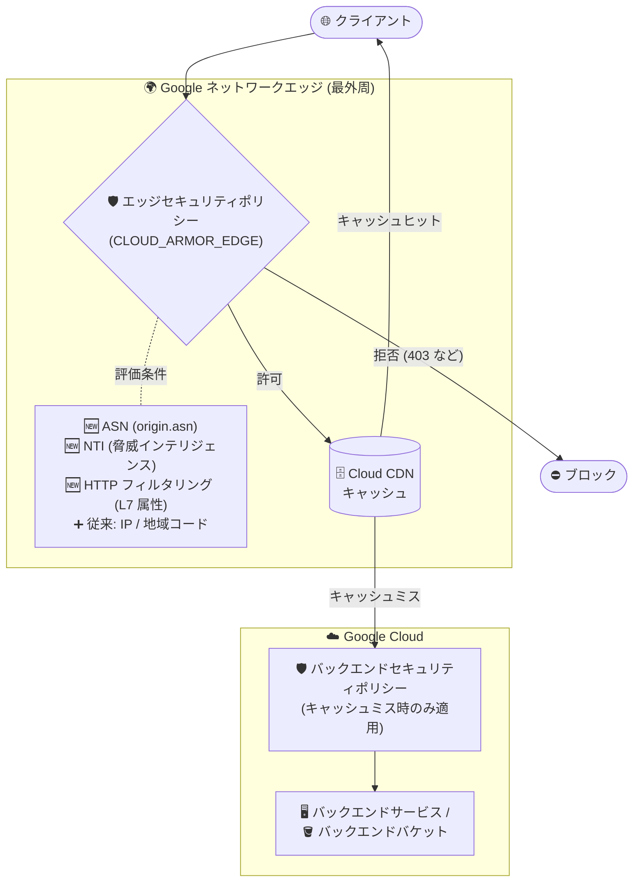

# Google Cloud Armor: エッジセキュリティポリシーが ASN・Network Threat Intelligence・HTTP フィルタリングをサポート (Preview)

**リリース日**: 2026-11-16

**サービス**: Google Cloud Armor

**機能**: Cloud CDN エッジキャッシュサービス向けグローバルスコープのエッジセキュリティポリシーにおける ASN / NTI / HTTP フィルタリング

**ステータス**: Feature (Preview)

📊 [このアップデートのインフォグラフィックを見る](https://takech9203.github.io/google-cloud-news-summary/20261116-cloud-armor-edge-security-policies-asn-nti-http.html)

## 概要

Google Cloud Armor のグローバルスコープのエッジセキュリティポリシー (タイプ: `CLOUD_ARMOR_EDGE`) において、Cloud CDN のエッジキャッシュサービスを対象に、**Autonomous System Number (ASN) ベースのフィルタリング**、**Network Threat Intelligence (NTI)**、および **HTTP フィルタリング (Layer 7 属性による条件マッチ)** が Preview として利用可能になりました。

エッジセキュリティポリシーは、Google ネットワークの最外周 (Cloud CDN キャッシュよりも上流) で適用されるセキュリティポリシーで、**キャッシュからコンテンツが配信される前に**リクエストのフィルタリングとアクセス制御を実施できます。従来、Cloud CDN 向けのエッジセキュリティポリシーでは、クライアント IP アドレスと地域 (国コード) に基づくフィルタリングが中心でしたが、今回のアップデートにより、ネットワーク事業者単位 (ASN)、Google の脅威インテリジェンスデータ、HTTP リクエストの属性 (ヘッダー、メソッド、パス、クエリ、スキーム) に基づくきめ細かい制御を、キャッシュ配信の手前で実行できるようになります。

Cloud CDN でコンテンツを配信している事業者、特に地域やネットワーク単位でのアクセス制御、悪意のある送信元 (Tor 出口ノード、既知の悪性 IP など) のブロック、User-Agent やパスベースのフィルタリングをキャッシュ層の手前で行いたいユーザーが対象です。

**アップデート前の課題**

- 以前の Cloud CDN 向けエッジセキュリティポリシーでは、フィルタリング条件が限定的で、ASN・脅威インテリジェンス・HTTP 属性 (ヘッダー、メソッド、パスなど) を使った高度なフィルタリングはバックエンドセキュリティポリシーでしか利用できなかった
- バックエンドセキュリティポリシーはキャッシュミス時 (バックエンドに到達するリクエスト) のみに適用されるため、**キャッシュヒットしたコンテンツは高度なフィルタリング条件を適用できないまま配信される**可能性があった
- 特定のネットワーク事業者 (ASN) や既知の悪性送信元からのキャッシュコンテンツへのアクセスをエッジでブロックするには、IP アドレスリストを手動で管理する必要があった

**アップデート後の改善**

- エッジセキュリティポリシーで `origin.asn` を使った ASN ベースのフィルタリングが可能になり、ネットワーク事業者単位でキャッシュコンテンツへのアクセスを許可・拒否できるようになった
- Network Threat Intelligence (NTI) により、Tor 出口ノード、既知の悪性 IP アドレス、低評価 VPN プロバイダ、匿名プロキシなどのカテゴリに基づくトラフィック制御を、キャッシュ配信前のエッジで適用できるようになった
- HTTP フィルタリング (`request.headers`、`request.method`、`request.path`、`request.query`、`request.scheme`) により、Layer 7 属性に基づくカスタムルールをエッジで評価できるようになった

## アーキテクチャ図



エッジセキュリティポリシーは Cloud CDN キャッシュの上流 (Google ネットワークの最外周) で適用され、キャッシュヒット・ミスを問わずすべてのリクエストを評価します。今回のアップデートで、ASN・NTI・HTTP 属性による評価がこのエッジ層で可能になりました。バックエンドセキュリティポリシーは、エッジポリシーを通過したキャッシュミスのリクエストに対してのみ適用されます。

## サービスアップデートの詳細

### 主要機能

1. **ASN (Autonomous System Number) フィルタリング**
   - クライアント IP アドレスに関連付けられた ASN (IP プレフィックスを管理するネットワーク事業者に基づいて決定) を使い、トラフィックを許可・拒否できる
   - カスタムルール言語の `origin.asn` 属性を使用 (例: `origin.asn == 123` で特定事業者からのリクエストにマッチ)
   - 特定のキャリア・ISP・クラウド事業者経由のアクセス制御を、IP リストの手動管理なしで実現できる

2. **Network Threat Intelligence (NTI)**
   - Google の脅威インテリジェンスデータに基づき、脅威カテゴリ単位でトラフィックを許可・ブロックできる
   - 対応カテゴリ: Tor 出口ノード、既知の悪性 IP アドレス、検索エンジン (許可リスト用)、低評価 VPN プロバイダ、匿名プロキシ、クリプトマイナー、パブリッククラウドの IP アドレス範囲
   - `evaluateThreatIntelligence` マッチ式とフィード名で指定する。利用には **Cloud Armor Enterprise** への加入が必要

3. **HTTP フィルタリング (Layer 7 属性のカスタムルール)**
   - HTTP リクエストの属性に基づくカスタム CEL ルールをエッジで評価できる
   - 利用可能な属性: `request.headers`、`request.method`、`request.path`、`request.query`、`request.scheme`
   - 例: 特定の User-Agent を含むリクエストの拒否、特定パスへのアクセス制限などをキャッシュ配信前に適用できる

### エッジセキュリティポリシーの特性

- エッジセキュリティポリシーは Cloud CDN が有効なバックエンドサービス、および Cloud Storage バックエンドバケット (グローバル外部 Application Load Balancer / クラシック Application Load Balancer 配下) に適用できる
- バックエンドセキュリティポリシーと**同時に適用可能** (2 層防御)。バックエンドバケットに適用できるのはエッジセキュリティポリシーのみ
- エッジセキュリティポリシーは Identity-Aware Proxy (IAP) よりも先に評価・適用される

## 技術仕様

### エッジセキュリティポリシーで利用可能なフィルタリング属性

| 属性 | 型 | 説明 |
|------|-----|------|
| `origin.ip` | string | クライアント IP アドレス (従来から対応) |
| `origin.region_code` | string | クライアント IP に関連付く Unicode 国コード (例: `US`)(従来から対応) |
| `origin.asn` | integer | クライアント IP アドレスに関連付く ASN (🆕 Preview) |
| `request.headers` | map | HTTP リクエストヘッダー (🆕 Preview) |
| `request.method` | string | HTTP リクエストメソッド (🆕 Preview) |
| `request.path` | string | リクエストされた HTTP URL パス (🆕 Preview) |
| `request.query` | string | HTTP URL クエリ (`name1=value&name2=value2` 形式) (🆕 Preview) |
| `request.scheme` | string | HTTP URL スキーム (`http` / `https`、小文字) (🆕 Preview) |

エッジセキュリティポリシーは上記属性のみに基づくフィルタリングをサポートします (WAF 事前構成ルール、ボット管理、レート制限などはバックエンドセキュリティポリシーの機能です)。

### ルール例 (カスタムルール言語)

```text
# 特定の ASN からのトラフィックにマッチ (拒否ルールで使用)
origin.asn == 123

# 特定 ASN 以外のすべてにマッチ (特定事業者のみ許可したい場合)
origin.asn != 123

# IP 範囲 + User-Agent ヘッダーの組み合わせ
inIpRange(origin.ip, '1.2.3.4/32') && request.headers['user-agent'].contains('WordPress')

# パスベースのフィルタリング
request.path.matches('/example_path/')
```

## 設定方法

### 前提条件

1. グローバル外部 Application Load Balancer またはクラシック Application Load Balancer で Cloud CDN を有効化していること
2. Network Threat Intelligence (NTI) を使用する場合は、Cloud Armor Enterprise に加入していること
3. セキュリティポリシーを作成・管理できる IAM 権限があること

### 手順

#### ステップ 1: エッジセキュリティポリシーを作成する

```bash
gcloud compute security-policies create my-edge-policy \
    --type CLOUD_ARMOR_EDGE \
    --description "edge policy with ASN/NTI/HTTP filtering"
```

エッジセキュリティポリシーはタイプ `CLOUD_ARMOR_EDGE` で作成します。

#### ステップ 2: ASN / HTTP フィルタリングルールを追加する

```bash
# 特定の ASN からのリクエストを拒否するルール
gcloud compute security-policies rules create 1000 \
    --security-policy my-edge-policy \
    --expression "origin.asn == 64512" \
    --action deny-403 \
    --description "block traffic from ASN 64512"

# HTTP 属性 (User-Agent) に基づくルール
gcloud compute security-policies rules create 1100 \
    --security-policy my-edge-policy \
    --expression "request.headers['user-agent'].contains('BadBot')" \
    --action deny-403 \
    --description "block requests with BadBot user-agent"
```

#### ステップ 3: Network Threat Intelligence ルールを追加する (Cloud Armor Enterprise)

```bash
# Tor 出口ノードからのトラフィックを拒否するルール
gcloud compute security-policies rules create 1200 \
    --security-policy my-edge-policy \
    --expression "evaluateThreatIntelligence('iplist-tor-exit-nodes')" \
    --action deny-403 \
    --description "block Tor exit nodes"
```

#### ステップ 4: Cloud CDN が有効なバックエンドサービス / バックエンドバケットにアタッチする

```bash
# バックエンドサービスへのアタッチ
gcloud compute backend-services update my-cdn-backend-service \
    --edge-security-policy my-edge-policy \
    --global

# バックエンドバケットへのアタッチ
gcloud compute backend-buckets update my-backend-bucket \
    --edge-security-policy my-edge-policy
```

まずは `--preview` フラグ付きでルールを作成し、ログで影響範囲を確認してから本番適用することが推奨されます。

## メリット

### ビジネス面

- **コンテンツ保護の強化**: ライセンス制約のあるコンテンツ配信において、地域だけでなくネットワーク事業者 (ASN) 単位でもアクセスを制御でき、配信ポリシーの要件に柔軟に対応できる
- **キャッシュコンテンツの不正取得対策**: Tor 出口ノードや既知の悪性 IP などからのアクセスをキャッシュ配信前にブロックでき、コンテンツスクレイピングや不正ダウンロードのリスクを低減できる
- **運用負荷の削減**: Google が維持する脅威インテリジェンスデータを利用でき、悪性 IP リストや事業者の IP レンジを手動で管理する必要がなくなる

### 技術面

- **エッジでの早期ブロック**: Google ネットワークの最外周でリクエストを拒否するため、不要なトラフィックがキャッシュやバックエンドに到達せず、リソース消費を抑えられる
- **キャッシュヒットにも適用**: バックエンドセキュリティポリシーと異なり、キャッシュヒットするリクエストにも ASN / NTI / HTTP 条件を適用できる
- **2 層防御**: エッジセキュリティポリシーとバックエンドセキュリティポリシーを同一バックエンドサービスに同時適用でき、多層防御を構成できる

## デメリット・制約事項

### 制限事項

- 本機能は **Preview** のため、SLA の対象外であり、本番環境での利用は慎重に判断する必要がある
- Network Threat Intelligence (Google Threat Intelligence) の利用には **Cloud Armor Enterprise** への加入が必要
- エッジセキュリティポリシーで利用できる属性は `origin.asn`、`origin.ip`、`origin.region_code`、`request.headers`、`request.method`、`request.path`、`request.query`、`request.scheme` に限定される (WAF 事前構成ルール、ボディフィルタリング、ボット管理などは利用不可)

### 考慮すべき点

- ASN は IP プレフィックスを管理するネットワーク事業者に基づいて決定されるため、CGNAT や大規模 ISP の ASN をブロックすると正規ユーザーも巻き込む可能性がある。まずはプレビューモード (`--preview`) で影響を確認することが望ましい
- エッジセキュリティポリシーは IAP よりも先に評価されるため、エッジでブロックされたリクエストには IAP のサインインページも表示されない
- バックエンドセキュリティポリシーはエッジポリシーを通過したキャッシュミスのリクエストにのみ適用されるという評価順序を理解した上でルールを設計する必要がある

## ユースケース

### ユースケース 1: 特定ネットワーク事業者経由のキャッシュコンテンツアクセス制御

**シナリオ**: Cloud CDN で動画・画像コンテンツを配信しており、契約上、特定のネットワーク事業者 (ISP) 経由のアクセスのみに配信を限定したい。従来は事業者の IP レンジリストを手動管理していたが、更新漏れが頻発していた。

**実装例**:
```bash
gcloud compute security-policies rules create 1000 \
    --security-policy my-edge-policy \
    --expression "origin.asn != 64500" \
    --action deny-403 \
    --description "allow only traffic from ASN 64500"
```

**効果**: IP リストの手動管理が不要になり、ネットワーク事業者単位の配信制御をエッジ (キャッシュ配信前) で確実に適用できる。

### ユースケース 2: 悪性送信元からのコンテンツスクレイピング対策

**シナリオ**: 公開コンテンツが Tor 経由や既知の悪性 IP から大量にスクレイピングされており、キャッシュヒットするためバックエンドセキュリティポリシーでは防げていなかった。

**効果**: エッジセキュリティポリシーで `evaluateThreatIntelligence('iplist-tor-exit-nodes')` や `iplist-known-malicious-ips` を使った拒否ルールを適用することで、キャッシュヒットの有無にかかわらず悪性送信元からのアクセスをエッジでブロックできる。

### ユースケース 3: ステージング環境の HTTP 属性ベースの保護

**シナリオ**: Cloud CDN を有効にしたステージング環境のバックエンドバケットに対し、特定のカスタムヘッダーを持つリクエストのみアクセスを許可したい。バックエンドバケットにはエッジセキュリティポリシーしかアタッチできない。

**効果**: HTTP フィルタリング (`request.headers`) を使ったエッジセキュリティポリシーで、バックエンドバケット配信のコンテンツにもヘッダーベースのアクセス制御を適用できる。

## 料金

Cloud Armor Standard は従量課金制 (ポリシー単位、ルール単位、リクエスト単位の課金) です。Network Threat Intelligence (Google Threat Intelligence) の利用には Cloud Armor Enterprise への加入が必要です。

| ティア | 課金方式 | 料金 (概算) |
|--------|---------|------------|
| Cloud Armor Standard | 従量課金 | ポリシー・ルール・リクエスト単位 (詳細は料金ページを参照) |
| Cloud Armor Enterprise Paygo | 従量課金 | $200/月/プロジェクト + 最初の 2 リソース以降は保護リソースあたり $200/月 |
| Cloud Armor Enterprise Annual | 12 か月コミットのサブスクリプション | $3,000/月/請求先アカウント + 最初の 100 リソース以降は保護リソースあたり $30/月 |

プレビューモードのルールにも通常のリクエスト単位の料金が適用されます。最新の料金は [Cloud Armor の料金ページ](https://cloud.google.com/armor/pricing)を参照してください。

## 利用可能リージョン

グローバルスコープのエッジセキュリティポリシーは、グローバル外部 Application Load Balancer / クラシック Application Load Balancer 配下の Cloud CDN 有効なバックエンドサービスおよびバックエンドバケットを対象に、グローバルに適用されます。詳細は[セキュリティポリシーの概要](https://docs.cloud.google.com/armor/docs/security-policy-overview)を参照してください。

## 関連サービス・機能

- **Cloud CDN**: 本アップデートの保護対象。エッジセキュリティポリシーはキャッシュからの配信前にリクエストをフィルタリングする
- **Cloud Load Balancing (グローバル外部 Application Load Balancer)**: エッジセキュリティポリシーをアタッチするバックエンドサービス / バックエンドバケットのフロントエンド
- **Cloud Armor Enterprise**: Network Threat Intelligence (Google Threat Intelligence)、Adaptive Protection、サードパーティ名前付き IP リストなどの高度な機能を提供する上位ティア
- **Media CDN**: Media CDN のエッジセキュリティポリシーでは ASN・Google Threat Intelligence・Layer 7 フィルタリングが既にサポートされており、今回 Cloud CDN 側でも同等の制御が Preview で可能になった
- **Cloud Logging / Cloud Monitoring**: セキュリティポリシーの適用結果 (ALLOW / DENY) はリクエストログに記録され、プレビューモードの効果検証にも利用できる

## 参考リンク

- 📊 [インフォグラフィック](https://takech9203.github.io/google-cloud-news-summary/20261116-cloud-armor-edge-security-policies-asn-nti-http.html)
- [公式リリースノート](https://docs.cloud.google.com/release-notes#November_16_2026)
- [Cloud Armor セキュリティポリシーの概要 (エッジセキュリティポリシー)](https://docs.cloud.google.com/armor/docs/security-policy-overview#edge-policies)
- [Cloud Armor カスタムルール言語リファレンス](https://docs.cloud.google.com/armor/docs/create-security-policy-rules)
- [Google Threat Intelligence for Cloud Armor](https://docs.cloud.google.com/armor/docs/threat-intelligence)
- [Cloud Armor と他プロダクトの統合 (Cloud CDN)](https://docs.cloud.google.com/armor/docs/integrating-cloud-armor)
- [料金ページ](https://cloud.google.com/armor/pricing)

## まとめ

Cloud CDN 向けのエッジセキュリティポリシーで ASN・Network Threat Intelligence・HTTP フィルタリングが Preview で利用可能になり、従来はバックエンドセキュリティポリシーでしか使えなかった高度なフィルタリングを、キャッシュ配信前のエッジ層で適用できるようになりました。キャッシュヒットするコンテンツへの不正アクセス対策やネットワーク事業者単位の配信制御が必要な場合は、プレビューモードで影響を検証しながら評価を始めることを推奨します。NTI の利用には Cloud Armor Enterprise が必要な点に注意してください。

---

**タグ**: Google Cloud Armor, Cloud CDN, エッジセキュリティポリシー, ASN, Network Threat Intelligence, HTTP フィルタリング, セキュリティ, Preview
