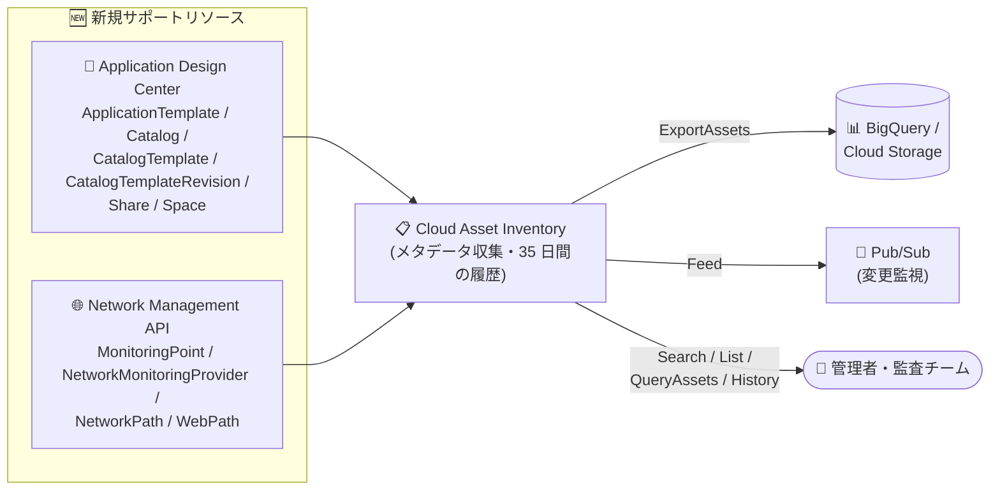

# Cloud Asset Inventory: Application Design Center と Network Management API の新リソースタイプに対応

**リリース日**: 2026-11-16

**サービス**: Cloud Asset Inventory

**機能**: 新規リソースタイプのサポート (Application Design Center / Network Management API)

**ステータス**: 一般提供 (Publicly Available)

📊 [このアップデートのインフォグラフィックを見る](https://takech9203.github.io/google-cloud-news-summary/20261116-cloud-asset-inventory-new-resource-types.html)

## 概要

Cloud Asset Inventory で、新たに 10 種類のリソースタイプが `ExportAssets`、`ListAssets`、`BatchGetAssetsHistory`、`QueryAssets`、`Feed`、`SearchAllResources`、`SearchAllIamPolicies` の各 API から利用可能になりました。対象は Application Design Center (designcenter.googleapis.com) の 6 タイプと、Network Management API (networkmanagement.googleapis.com) の 4 タイプです。

Application Design Center は、プラットフォームチームがアプリケーションテンプレートを設計し、カタログを通じて組織内の開発チームに共有・展開するためのサービスです。今回のアップデートにより、テンプレート (`ApplicationTemplate`)、カタログ (`Catalog`、`CatalogTemplate`、`CatalogTemplateRevision`)、共有設定 (`Share`)、スペース (`Space`) といったガバナンスの中核となるリソースを、組織全体の資産インベントリとして一元的に把握できるようになりました。

Network Management API 側では、サードパーティ (AppNeta) 連携によるネットワークモニタリング関連リソース (`MonitoringPoint`、`NetworkMonitoringProvider`、`NetworkPath`、`WebPath`) が対象に加わりました。組織・フォルダ・プロジェクト横断でのリソース検索、変更履歴の追跡、BigQuery へのエクスポート、Pub/Sub フィードによる変更監視など、Cloud Asset Inventory の標準機能をこれらのリソースに対しても適用できます。コンプライアンス監査や構成管理を担う Solutions Architect、SRE、セキュリティチームに有用なアップデートです。

**アップデート前の課題**

- Application Design Center のテンプレートやカタログ、スペースの構成情報は Cloud Asset Inventory の対象外であり、棚卸しには designcenter API を個別に呼び出す必要があった
- Network Management API のモニタリングポイントやネットワークパスなどのリソースを、組織横断のアセット検索やエクスポートの対象にできなかった
- これらのリソースの変更履歴を Cloud Asset Inventory の時系列データベース (過去 35 日間) で追跡できず、監査証跡の取得に手間がかかった

**アップデート後の改善**

- 新しい 10 種類のリソースタイプが Cloud Asset Inventory の export / list / monitor / search API で利用可能になり、組織・フォルダ・プロジェクト単位で一括検索・エクスポートできるようになった
- `BatchGetAssetsHistory` により、テンプレートリビジョンやモニタリング構成の変更履歴 (最大 35 日間) を取得できるようになった
- `Feed` (Pub/Sub 連携) により、カタログ共有設定やネットワークモニタリング構成の変更をほぼリアルタイムに検知できるようになった
- `SearchAllIamPolicies` により、これらのリソースに付与された IAM ポリシーを横断検索できるようになった

## アーキテクチャ図



Application Design Center と Network Management API のリソースメタデータが Cloud Asset Inventory に収集され、エクスポート・検索・変更監視の各 API から利用できるようになります。

## サービスアップデートの詳細

### 主要機能

1. **Application Design Center の 6 リソースタイプに対応**
   - `designcenter.googleapis.com/ApplicationTemplate`: プラットフォームチームが設計するアプリケーションテンプレート
   - `designcenter.googleapis.com/Catalog`: 承認済みテンプレートを共有するためのカタログ
   - `designcenter.googleapis.com/CatalogTemplate` / `CatalogTemplateRevision`: カタログに公開されたテンプレートとそのリビジョン
   - `designcenter.googleapis.com/Share`: カタログを他のスペースと共有する設定
   - `designcenter.googleapis.com/Space`: チームがテンプレートを設計・デプロイする専用領域

2. **Network Management API の 4 リソースタイプに対応**
   - `networkmanagement.googleapis.com/NetworkMonitoringProvider`: Network Insights サービス (サードパーティ連携) の有効化状態を管理するプロバイダー
   - `networkmanagement.googleapis.com/MonitoringPoint`: ネットワークやアプリケーション基盤内でプローブを送信し結果を AppNeta にレポートするエージェント
   - `networkmanagement.googleapis.com/NetworkPath`: モニタリングポイント (送信元) とターゲット宛先間のホップバイホップ経路と配信品質
   - `networkmanagement.googleapis.com/WebPath`: モニタリングポイントから評価される Web アプリケーション / URL のパフォーマンスと可用性

3. **7 つの Cloud Asset Inventory API で利用可能**
   - `ExportAssets`: BigQuery / Cloud Storage へのメタデータエクスポート
   - `ListAssets` / `QueryAssets`: アセットの一覧取得と SQL によるクエリ
   - `BatchGetAssetsHistory`: 最大 35 日間の変更履歴取得
   - `Feed`: Pub/Sub を介した変更のほぼリアルタイム監視
   - `SearchAllResources` / `SearchAllIamPolicies`: リソースと IAM ポリシーの横断検索

## 技術仕様

### 追加されたリソースタイプ一覧

| サービス | リソースタイプ |
|------|------|
| Application Design Center | `designcenter.googleapis.com/ApplicationTemplate` |
| Application Design Center | `designcenter.googleapis.com/Catalog` |
| Application Design Center | `designcenter.googleapis.com/CatalogTemplate` |
| Application Design Center | `designcenter.googleapis.com/CatalogTemplateRevision` |
| Application Design Center | `designcenter.googleapis.com/Share` |
| Application Design Center | `designcenter.googleapis.com/Space` |
| Network Management API | `networkmanagement.googleapis.com/MonitoringPoint` |
| Network Management API | `networkmanagement.googleapis.com/NetworkMonitoringProvider` |
| Network Management API | `networkmanagement.googleapis.com/NetworkPath` |
| Network Management API | `networkmanagement.googleapis.com/WebPath` |

### Cloud Asset Inventory の基本仕様

| 項目 | 詳細 |
|------|------|
| 変更履歴の保持期間 | 最大 35 日間 (35 日間変更のないアセットは最新状態を返却) |
| データ整合性 | 現在データは結果整合性、履歴データはベストエフォート |
| 検索スコープ | プロジェクト / フォルダ / 組織 |
| エクスポート先 | BigQuery、Cloud Storage |
| 変更監視 | Feed (Pub/Sub 連携) |

## 設定方法

### 前提条件

1. Cloud Asset API (`cloudasset.googleapis.com`) が有効化されていること
2. 検索・エクスポートに必要な IAM ロール (例: `roles/cloudasset.viewer`) が付与されていること

### 手順

#### ステップ 1: 新しいリソースタイプを検索する

```bash
# 組織内の Application Design Center のスペースを横断検索
gcloud asset search-all-resources \
  --scope="organizations/ORGANIZATION_ID" \
  --asset-types="designcenter.googleapis.com/Space"

# Network Management API のモニタリング関連リソースを検索
gcloud asset search-all-resources \
  --scope="organizations/ORGANIZATION_ID" \
  --asset-types="networkmanagement.googleapis.com/MonitoringPoint,networkmanagement.googleapis.com/NetworkPath"
```

組織スコープで新しいリソースタイプを指定し、横断検索を実行します。

#### ステップ 2: 変更監視用の Feed を作成する

```bash
# カタログ共有設定の変更を Pub/Sub で監視
gcloud asset feeds create catalog-share-feed \
  --organization="ORGANIZATION_ID" \
  --asset-types="designcenter.googleapis.com/Share,designcenter.googleapis.com/CatalogTemplateRevision" \
  --content-type=resource \
  --pubsub-topic="projects/PROJECT_ID/topics/TOPIC_ID"
```

対象リソースタイプの変更イベントが Pub/Sub トピックに配信され、ほぼリアルタイムに検知できます。

## メリット

### ビジネス面

- **ガバナンスの強化**: アプリケーションテンプレートやカタログ共有の全体像を組織横断で可視化でき、承認済みアーキテクチャの利用状況を統制しやすくなる
- **監査対応の効率化**: テンプレートリビジョンやモニタリング構成の変更履歴を Cloud Asset Inventory の標準機能で取得でき、監査証跡の収集コストが下がる

### 技術面

- **一元的なインベントリ管理**: サービスごとに個別 API を呼び出さずに、Cloud Asset Inventory の統一インターフェースで検索・エクスポート・監視が可能
- **既存パイプラインへの統合**: BigQuery エクスポートや Pub/Sub フィードなど、既存のアセット管理パイプラインに新リソースタイプをそのまま組み込める

## デメリット・制約事項

### 制限事項

- 変更履歴の保持期間は最大 35 日間であり、それ以前の履歴は取得できない (長期保存には BigQuery などへの定期エクスポートが必要)
- Cloud Asset Inventory は結果整合性のモデルであり、リアルタイムのクエリが必要な本番の可用性・セキュリティ制御には適さない (ライブデータは各サービスの API を直接呼び出す)

### 考慮すべき点

- 今回対象となったのは export / list / monitor / search 系の 7 API であり、analyze policy (AnalyzeIamPolicy など) への対応はリリースノートに記載されていない
- リソースタイプごとに利用可能な API や機能 (effective tags 対応など) が異なる場合があるため、詳細はアセットタイプ一覧ドキュメントで確認が必要

## ユースケース

### ユースケース 1: Application Design Center のテンプレートガバナンス監査

**シナリオ**: プラットフォームチームが組織内の複数スペースでテンプレートとカタログ共有を運用しており、どのテンプレートリビジョンがどのスペースに共有されているかを定期的に棚卸ししたい。

**実装例**:
```bash
gcloud asset search-all-resources \
  --scope="organizations/ORGANIZATION_ID" \
  --asset-types="designcenter.googleapis.com/CatalogTemplateRevision,designcenter.googleapis.com/Share" \
  --format=json
```

**効果**: designcenter API を個別に呼び出すことなく、組織全体のテンプレート共有状況を 1 回のクエリで把握でき、未承認の共有や古いリビジョンの残存を検出できる。

### ユースケース 2: ネットワークモニタリング構成の変更検知

**シナリオ**: SRE チームが AppNeta 連携によるネットワークモニタリング (モニタリングポイント、ネットワークパス、Web パス) を運用しており、構成の意図しない変更や削除を早期に検知したい。

**効果**: Feed (Pub/Sub) により構成変更をほぼリアルタイムに通知でき、`BatchGetAssetsHistory` で過去 35 日間の変更内容を遡って確認できるため、障害調査やコンプライアンスドリフト管理が容易になる。

## 料金

Cloud Asset Inventory の利用に伴う追加料金については、公式の料金ページを参照してください。なお、BigQuery や Cloud Storage へのエクスポート、Pub/Sub フィードの利用には、各エクスポート先サービスの料金 (ストレージ・クエリ・メッセージングなど) が別途発生します。

- [Cloud Asset Inventory 料金ページ](https://docs.cloud.google.com/asset-inventory/pricing)

## 利用可能リージョン

Cloud Asset Inventory はグローバルなメタデータインベントリサービスとして提供されます。個々のリソースタイプの提供リージョンは各サービスのドキュメントを参照してください。

## 関連サービス・機能

- **Application Design Center**: 今回対応したテンプレート・カタログ・スペースを提供するアプリケーション設計サービス。プラットフォームチームによるテンプレート統制と開発チームへの共有を実現する
- **Network Management API (Network Intelligence Center)**: モニタリングポイントやネットワークパスなどのサードパーティ (AppNeta) 連携モニタリングリソースを提供する
- **BigQuery**: `ExportAssets` のエクスポート先。SQL によるアセットメタデータの分析が可能
- **Pub/Sub**: `Feed` による変更イベントの配信先。変更検知の自動化に利用
- **Security Command Center**: Cloud Asset Inventory のデータを活用したセキュリティポスチャ管理を補完する

## 参考リンク

- 📊 [インフォグラフィック](https://takech9203.github.io/google-cloud-news-summary/20261116-cloud-asset-inventory-new-resource-types.html)
- [公式リリースノート](https://docs.cloud.google.com/release-notes#November_16_2026)
- [Cloud Asset Inventory サポート対象アセットタイプ](https://docs.cloud.google.com/asset-inventory/docs/asset-types)
- [Cloud Asset Inventory 概要](https://docs.cloud.google.com/asset-inventory/docs/asset-inventory-overview)
- [Application Design Center 概要](https://docs.cloud.google.com/application-design-center/docs/overview)
- [Application Design Center カタログ管理](https://docs.cloud.google.com/application-design-center/docs/manage-catalogs)
- [gcloud network-management network-monitoring-providers リファレンス](https://docs.cloud.google.com/sdk/gcloud/reference/network-management/network-monitoring-providers)
- [料金ページ](https://docs.cloud.google.com/asset-inventory/pricing)

## まとめ

Cloud Asset Inventory のカバレッジが Application Design Center と Network Management API の計 10 リソースタイプに拡大し、テンプレートガバナンスやネットワークモニタリング構成も組織横断のインベントリ・監査基盤に統合できるようになりました。これらのサービスを利用している組織は、既存のアセット検索・エクスポート・Feed の対象に新リソースタイプを追加し、棚卸しと変更監視の自動化を検討することを推奨します。

---

**タグ**: Cloud Asset Inventory, Application Design Center, Network Management API, アセット管理, ガバナンス, 監査, ネットワークモニタリング
