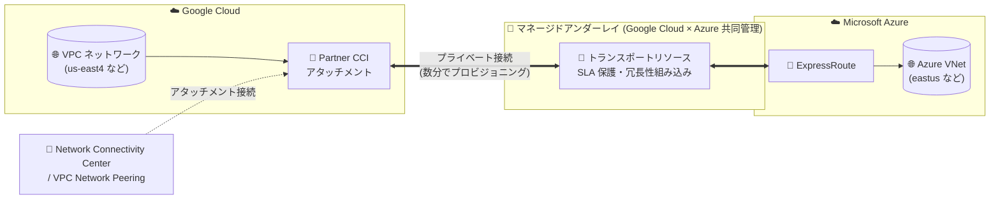

# Cloud Interconnect: Partner Cross-Cloud Interconnect for Microsoft Azure (Public Preview)

**リリース日**: 2026-11-16

**サービス**: Cloud Interconnect

**機能**: Partner Cross-Cloud Interconnect for Microsoft Azure

**ステータス**: Public Preview

📊 [このアップデートのインフォグラフィックを見る](https://takech9203.github.io/google-cloud-news-summary/20261116-cloud-interconnect-partner-cross-cloud-azure-preview.html)

## 概要

Google Cloud と Microsoft Azure 間のマネージドなマルチクラウド接続を実現する **Partner Cross-Cloud Interconnect for Microsoft Azure** がパブリックプレビューとして利用可能になりました。Partner Cross-Cloud Interconnect (マネージドクラウドパートナー向け) は、物理ポートの調達や配線を必要とせず、Google Cloud とリモートクラウド間の「リージョン間トランスポート」をオンデマンドで数分のうちにプロビジョニングできるサービスです。これまでは AWS のみがサポートされていましたが、今回のアップデートで Microsoft Azure が新たにサポート対象に加わりました。

従来の (専用型) Cross-Cloud Interconnect では、Google がユーザーに代わって物理接続を敷設するため、Google Cloud と Azure 双方でのポート発注、LOA (接続許可証) の送付、ExpressRoute Direct の構成といった多段階の手続きが必要で、プロビジョニングに 1〜4 週間を要しました。Partner Cross-Cloud Interconnect では、Google Cloud とパートナー (Azure) が事前構築・共同管理する SLA 保護されたアンダーレイを利用するため、物理プロビジョニングが不要になり、冗長性もプロダクトに組み込まれています。

分散リージョンでワークロードを運用する企業、低〜中帯域のクロスクラウド接続を必要とするチーム、ネットワーク専門知識を持たないアプリケーションオーナーなど、物理インフラを管理せずに Google Cloud ⇔ Azure 間のプライベート接続を実現したいユーザーが主な対象です。

**アップデート前の課題**

- Partner Cross-Cloud Interconnect (マネージドクラウドパートナー向け) は AWS のみ対応で、Azure とのマネージドなクロスクラウド接続は利用できなかった
- Azure との専用接続 (Cross-Cloud Interconnect) では、Google Cloud と Azure 双方でのポート発注、LOA の送付、ExpressRoute Direct / ExpressRoute 回線の構成など複雑な手順が必要で、プロビジョニングに 1〜4 週間かかっていた
- 接続単位が 10 Gbps / 100 Gbps と大きく、低帯域のユースケースには過剰だった
- プライマリ / 冗長接続の設計・構成をユーザー自身が手動で行う必要があった

**アップデート後の改善**

- Google Cloud と Azure 間のリージョン間接続を、物理プロビジョニングなしで数分でオンデマンドにセットアップできるようになった
- 冗長性がサービスレベルで組み込まれ、ユーザーによる冗長構成の設計・管理が不要になった
- クラウド間のルート交換が自動化され、リソース情報のコピー&ペーストや複雑な構成管理が不要になった
- 帯域をニーズに応じて柔軟に選択でき、オンデマンドでのサイズ変更 (拡大・縮小) が可能になった

## アーキテクチャ図

Google Cloud の VPC と Azure の VNet を、両クラウドが事前構築・共同管理する SLA 保護されたトランスポート (アンダーレイ) 経由でプライベートに接続します。物理ポートの発注や配線は不要で、冗長性はサービスに組み込まれています。

## サービスアップデートの詳細

### 主要機能

1. **Azure とのオンデマンド接続**
   - ペア構成されたロケーション (paired locations) 間で、Google Cloud と Azure のリージョン間トランスポートを数分でプロビジョニング可能
   - 接続のオーダーは双方向 (Google Cloud 側・Azure 側のどちらからでも開始可能)

2. **組み込みの冗長性と SLA 保護されたアンダーレイ**
   - Partner Cross-Cloud Interconnect の API はリソースレベルで冗長性を組み込んでおり、ユーザーが冗長構成を手動設計する必要がない
   - Google Cloud とリモート CSP がそれぞれの区間の SLA を提供しつつ、全体としては抽象化された一貫性のある信頼性体験を提供

3. **柔軟な帯域選択とオンデマンドのサイズ変更**
   - 10 Gbps / 100 Gbps 単位の専用接続と異なり、1 Gbps からの粒度の細かい事前承認済み帯域 (最大 100 Gbps) を選択可能
   - 需要に応じた帯域の拡大・縮小に対応

4. **自動化されたルート交換と接続オプション**
   - 2 つのクラウド間のルート交換が自動処理され、ネットワーク専門知識が最小限で済む
   - アタッチメントは Network Connectivity Center (NCC) または VPC Network Peering で VPC に接続可能
   - Private Service Connect (PSC) をサポート (トランスポートリソース作成時に `--psc-routing-enabled` フラグで有効化)

## 技術仕様

### 専用 Cross-Cloud Interconnect との比較 (Before/After)

| 項目 | Cross-Cloud Interconnect (専用型) | Partner Cross-Cloud Interconnect (マネージドパートナー型) |
|------|----------------------------------|----------------------------------------------------------|
| 物理プロビジョニング | 必要 (Google が物理接続を敷設) | 不要 (事前構築済みアンダーレイを利用) |
| 物理アタッチメント / ポート | 必要 (双方でポート発注・LOA 送付) | 不要 |
| 接続単位 | 10 Gbps / 100 Gbps (Azure の場合) | 1 Gbps〜100 Gbps の粒度の細かい事前承認済み帯域 |
| プロビジョニング時間 | 1〜4 週間 | 数分 |
| 接続オーダー | Google Cloud 側から開始する必要あり | 双方向 (Google Cloud / リモートパートナーのどちらからでも可) |
| 冗長性 | 手動で構成が必要 | プロダクトに組み込み |

### その他の仕様

| 項目 | 詳細 |
|------|------|
| クォータ | トランスポートリソースはプロジェクト・リージョンごとに制限 (デフォルト: 1 リージョンあたり 1 トランスポートリソース) |
| モニタリング | トランスポートリソースのトラフィックメトリクスを Cloud Monitoring で確認可能 (Preview) |
| VPC への接続 | Network Connectivity Center (NCC) または VPC Network Peering |
| Private Service Connect | サポート (`--psc-routing-enabled`) |

## 設定方法

### 前提条件

1. Google Cloud プロジェクトと VPC ネットワーク、および接続先の Azure サブスクリプションと VNet が用意されていること
2. [ペアロケーション一覧](https://docs.cloud.google.com/network-connectivity/docs/interconnect/how-to/partner-cci-for-csp/paired-locations) を確認し、Google Cloud リージョンと対応する Azure リージョンの組み合わせを選択すること
3. Public Preview のため、Pre-GA Offerings Terms が適用されることを理解しておくこと

### 手順 (概要)

#### ステップ 1: ペアロケーションの選択

利用する Google Cloud リージョンと、それにペアリングされた Azure リージョンを選択します。選択したリージョンの組み合わせでのみ接続を作成できます。

#### ステップ 2: トランスポートリソースの作成

Google Cloud 側 (または Azure 側) から接続をオーダーし、必要な帯域を指定してトランスポートリソースを作成します。物理的な作業は不要で、数分でプロビジョニングされます。Private Service Connect を利用する場合は `--psc-routing-enabled` フラグを指定します。

#### ステップ 3: VPC への接続

作成した Partner Cross-Cloud Interconnect アタッチメントを、Network Connectivity Center (NCC) または VPC Network Peering を使用して VPC ネットワークに接続します。ルート交換は自動的に処理されます。

詳細な手順は [Partner Cross-Cloud Interconnect for managed cloud partners の概要](https://docs.cloud.google.com/network-connectivity/docs/interconnect/concepts/partner-cci-for-csp-overview) を参照してください。

## メリット

### ビジネス面

- **リードタイムの劇的な短縮**: 従来 1〜4 週間かかっていた Azure とのプライベート接続のプロビジョニングが数分で完了し、マルチクラウドプロジェクトの立ち上げを加速できる
- **コスト最適化**: 10 Gbps 未満の低帯域オプションを選択でき、必要な分だけの帯域を購入することで過剰投資を回避できる
- **ベンダーロックインの回避**: Google Cloud と Azure をまたぐデータ配置・ワークロード分散・DR 戦略を、専門チームなしで実現しやすくなる

### 技術面

- **運用負荷の削減**: 冗長構成・ルート交換・物理インフラ管理が Google Cloud と Azure によって自動化され、ネットワーク専門知識が最小限で済む
- **組み込みの信頼性**: SLA 保護された共同管理アンダーレイにより、クラウドごとの SLA 定義の差異を意識する必要がない
- **柔軟なスケーリング**: 帯域のオンデマンドな拡大・縮小に対応し、ワークロードの成長に合わせた調整が可能

## デメリット・制約事項

### 制限事項

- Public Preview 段階のため、Pre-GA Offerings Terms が適用され、サポートが限定される場合がある
- 利用可能なペアロケーションは現時点で 3 組 (us-east4 ⇔ eastus、us-west2 ⇔ westus、europe-west3 ⇔ germanywestcentral) に限定される
- トランスポートリソースはデフォルトでプロジェクト・リージョンあたり 1 つに制限される (クォータ引き上げは別途申請)
- トラフィックメトリクス (Cloud Monitoring) も Preview 段階

### 考慮すべき点

- 選択した Google Cloud リージョンは対応する Azure リージョンとのみペアリングできるため、既存リソースの配置リージョンによっては利用できない場合がある
- 超大容量 (400 Gbps など) や MACsec 暗号化が必要な場合は、専用型 Cross-Cloud Interconnect の方が適している可能性がある
- 本番ワークロードへの適用は GA を待つことを推奨

## ユースケース

### ユースケース 1: Google Cloud でのデータ分析 × Azure 上の基幹システム連携

**シナリオ**: 基幹システムを Azure (eastus) で運用しつつ、BigQuery や Vertex AI での分析基盤を Google Cloud (us-east4) に構築している企業が、両クラウド間で大量のデータを安全に転送したい。

**効果**: 物理回線の調達なしで数分のうちにプライベート接続を確立でき、インターネット経由の転送に比べて安定した帯域とセキュリティを確保しながら、分析パイプラインを迅速に稼働できる。

### ユースケース 2: マルチクラウド DR / 可用性向上

**シナリオ**: europe-west3 (フランクフルト) の Google Cloud ワークロードに対し、Azure germanywestcentral をディザスタリカバリサイトとして利用したい。帯域は平常時 1〜2 Gbps 程度で十分だが、フェイルオーバー試験時には一時的に増強したい。

**効果**: 粒度の細かい帯域選択とオンデマンドのサイズ変更により、平常時のコストを抑えつつ必要時に帯域を拡大できる。冗長性が組み込まれているため、DR 接続自体の可用性設計も不要。

## 料金

Partner Cross-Cloud Interconnect for Microsoft Azure (Public Preview) の個別の料金は、本レポート作成時点で公式ドキュメント上で確認できませんでした。最新の料金は以下の公式料金ページを参照してください。

- [Cloud Interconnect の料金](https://cloud.google.com/network-connectivity/docs/interconnect/resources/pricing)

参考として、専用型 Cross-Cloud Interconnect では双方のクラウドでポートとアタッチメントの料金および Google Cloud からの下り (外向き) データ転送料金が発生します。一方、Partner Cross-Cloud Interconnect for OCI では Google Cloud のパートナーアタッチメントと OCI の仮想回線に対する課金のみで、データ転送料金は発生しない体系が採られています (Azure 版の体系は公式料金ページでの確認が必要です)。

## 利用可能リージョン

公式ドキュメントに記載されている Microsoft Azure とのペアロケーションは以下のとおりです (2026-11-18 時点)。

| Google Cloud ロケーション | Azure ロケーション |
|---------------------------|--------------------|
| us-east4 | eastus (Washington D.C.) |
| us-west2 | westus (Silicon Valley) |
| europe-west3 | germanywestcentral (Frankfurt) |

最新情報は [Choose a paired location](https://docs.cloud.google.com/network-connectivity/docs/interconnect/how-to/partner-cci-for-csp/paired-locations) を参照してください。

## 関連サービス・機能

- **Cross-Cloud Interconnect (専用型)**: ユーザー専有の物理接続 (10/100 Gbps、Azure の場合)。大容量・専有が必要な場合の選択肢で、MACsec 暗号化にも対応
- **Network Connectivity Center (NCC)**: Partner CCI アタッチメントを VPC に接続するハブ & スポーク構成を提供。サイト間データ転送にも利用可能
- **VPC Network Peering**: NCC の代替として、アタッチメントを VPC に接続する手段
- **Private Service Connect (PSC)**: Partner Cross-Cloud Interconnect 経由でマネージドサービスへのプライベートアクセスを実現
- **Azure ExpressRoute**: Azure 側の接続を担うサービス。専用型では ExpressRoute Direct / 回線の手動構成が必要だったが、パートナー型では抽象化される
- **Cloud Monitoring**: トランスポートリソースのトラフィックメトリクスを可視化 (Preview)

## 参考リンク

- 📊 [インフォグラフィック](https://takech9203.github.io/google-cloud-news-summary/20261116-cloud-interconnect-partner-cross-cloud-azure-preview.html)
- [公式リリースノート](https://docs.cloud.google.com/release-notes#November_16_2026)
- [Partner Cross-Cloud Interconnect for managed cloud partners overview](https://docs.cloud.google.com/network-connectivity/docs/interconnect/concepts/partner-cci-for-csp-overview)
- [Choose a paired location](https://docs.cloud.google.com/network-connectivity/docs/interconnect/how-to/partner-cci-for-csp/paired-locations)
- [Cross-Cloud Interconnect overview](https://docs.cloud.google.com/network-connectivity/docs/interconnect/concepts/cci-overview)
- [料金ページ](https://cloud.google.com/network-connectivity/docs/interconnect/resources/pricing)

## まとめ

Partner Cross-Cloud Interconnect の Azure 対応により、これまで数週間と複雑な手続きを要した Google Cloud ⇔ Azure 間のプライベート接続が、物理プロビジョニングなしで数分で確立できるようになりました。Azure とのマルチクラウド構成を検討している組織は、まずペアロケーション (us-east4 / us-west2 / europe-west3) が自社のリージョン要件に合致するかを確認し、Public Preview 環境で接続性とパフォーマンスを検証することを推奨します。

---

**タグ**: Cloud Interconnect, Cross-Cloud Interconnect, Partner Cross-Cloud Interconnect, Microsoft Azure, マルチクラウド, ネットワーク, Public Preview
