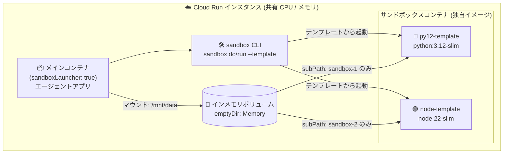

# Cloud Run: サンドボックステンプレートによる独自イメージのサンドボックス起動 (Preview)

**リリース日**: 2026-11-16

**サービス**: Cloud Run

**機能**: サンドボックステンプレート (独自コンテナイメージによるサンドボックス起動とインメモリボリュームの動的マウント)

**ステータス**: Preview

📊 [このアップデートのインフォグラフィックを見る](https://takech9203.github.io/google-cloud-news-summary/20261116-cloud-run-sandbox-templates.html)

## 概要

Cloud Run のサンドボックス機能に「サンドボックステンプレート」が Preview として追加されました。サンドボックステンプレートを構成することで、サンドボックスをメインコンテナとは別のコンテナとして、独自のコンテナイメージ (例: `python:3.12-slim`、`node:22-slim`、カスタム実行環境) から起動できるようになります。さらに、インメモリボリュームをサンドボックスに動的にマウントし、メインコンテナとサンドボックス間でファイルを共有することも可能になりました。

Cloud Run サンドボックスは、AI エージェントが生成したコードや信頼できないコードを、低レイテンシかつ分離された環境で安全に実行するための機能です。これまでサンドボックスはメインコンテナ (ホストコンテナ) のルートファイルシステムをベースとして動作していましたが、今回のアップデートにより、サンドボックス専用のランタイムやツールをメインコンテナから切り離して管理できるようになりました。本機能はサービス、ジョブ、ワーカープール、インスタンスのすべての Cloud Run リソースタイプで利用できます。

主な対象ユーザーは、AI エージェントのコード実行基盤 (Code Interpreter 型のワークロード)、マルチテナントのコード実行サービス、ブラウザ自動化などを Cloud Run 上で構築する開発者です。

**アップデート前の課題**

- サンドボックスはホストコンテナのルートファイルシステムをベースに実行されるため、サンドボックス内で使いたいランタイムやツール (例: Python、Node.js) をすべてメインコンテナのイメージに同梱する必要があり、メインコンテナのイメージが肥大化していた
- サンドボックス専用の実行環境 (特定バージョンのランタイムやライブラリ構成) をメインアプリケーションの環境と独立して管理できなかった
- サンドボックスとメインコンテナ間のファイル共有は、ホストディレクトリのバインドマウントが中心で、複数サンドボックス間でのテナントごとのファイル分離を宣言的に構成する仕組みがなかった

**アップデート後の改善**

- サンドボックステンプレートとして最大 10 個の専用コンテナイメージを宣言でき、`sandbox do --template` / `sandbox run --template` コマンドで指定イメージから新しいサンドボックスコンテナを起動できるようになった
- サンドボックス専用のランタイムやツールをメインコンテナから分離できるため、メインコンテナのイメージを軽量に保てるようになった
- インメモリボリュームをサンドボックスに動的にマウントでき、`subPath` と `--template-var` によりサンドボックスごとに分離されたサブディレクトリだけを見せることで、他のサンドボックスのファイルの閲覧・改変を防止できるようになった
- テンプレートからのサンドボックス起動はオンデマンドで行われ、新しい VM のプロビジョニングや新規インスタンスの課金は発生しない

## アーキテクチャ図



メインコンテナ内の sandbox CLI がテンプレートで宣言した独自イメージからサンドボックスコンテナをオンデマンドで起動し、共有インメモリボリュームの分離されたサブディレクトリを各サンドボックスに動的にマウントする構成です。

## サービスアップデートの詳細

### 主要機能

1. **専用コンテナイメージ (Dedicated container images)**
   - `python:3.12-slim` や `busybox:latest` などの個別のコンテナイメージをサンドボックステンプレートとして宣言できる
   - メインコンテナには不要なランタイムやツールをサンドボックス側に分離でき、メインコンテナを軽量に保てる
   - テンプレートは Cloud Run リソースごとに最大 10 個まで構成可能

2. **オンデマンドのサンドボックス起動 (On-demand instantiation)**
   - sandbox CLI (`/usr/local/gcp/bin/sandbox`) がテンプレートから新しいサンドボックスコンテナを起動する
   - 新しい VM のプロビジョニングや新規インスタンス分の課金は発生せず、メインコンテナに割り当てた CPU / メモリの範囲内で動作する
   - `--template` フラグを省略した場合は、従来どおりホストコンテナのファイルシステムをベースとしたローカルサンドボックスで実行される

3. **サンドボックスごとに分離されたファイル共有 (Isolated file sharing per sandbox)**
   - インメモリボリュームをメインコンテナと複数のサンドボックスで共有できる
   - `subPath` により各サンドボックスには分離されたサブディレクトリのみをマウントし、他のサンドボックスのファイルの閲覧・改変を防止できる
   - `subPath` に `$(VARIABLE_NAME)` プレースホルダを使い、実行時に `--template-var` フラグでサンドボックスごとに異なるサブディレクトリを動的に指定できる

4. **動的なボリュームマウント**
   - `sandbox do` / `sandbox run` の `--mount` フラグ (テンプレートモードでは `type=volume,src=<ボリューム名>,dst=<パス>[,volume-subpath=<サブパス>][,readonly]`) により、実行時にインメモリボリュームをサンドボックスへマウントできる
   - 信頼できないコードに共有する場合は `,readonly` の付与が推奨されている

## 技術仕様

### サンドボックステンプレートの仕様

| 項目 | 詳細 |
|------|------|
| ステータス | Preview (Pre-GA Offerings Terms 適用) |
| 対応リソース | Cloud Run サービス、ジョブ、ワーカープール、インスタンス |
| テンプレート数の上限 | 1 リソースあたり最大 10 個 |
| CPU / メモリ | メインコンテナの CPU / メモリ上限を共有 (テンプレートごとの個別上限は設定不可) |
| ボリュームマウント | Cloud Run リソース上のインメモリボリューム (`emptyDir: medium: Memory`) のみ参照可能 |
| 構成方法 | YAML 構成または Cloud Run Admin API (REST) |
| 起動方法 | `sandbox do --template` / `sandbox run --template` |
| rootfs の書き込み | `--template` 指定時は書き込み可能オーバーレイがデフォルトで有効 (`--write`) |
| ネットワーク | デフォルトで外向き通信はブロック (`--allow-egress` で許可可能) |
| 環境変数 | ホストコンテナから継承されず、`--env` フラグで明示的に渡す |

### Cloud Run Admin API (REST) での構成例

```json
{
  "launchStage": "BETA",
  "template": {
    "containers": [
      {
        "image": "IMAGE_URL",
        "sandboxLauncher": true,
        "volumeMounts": [
          { "name": "shared-vol", "mountPath": "/mnt/data" }
        ]
      }
    ],
    "sandboxes": {
      "templates": [
        {
          "name": "py12-template",
          "image": "python:3.12-slim",
          "volumeMounts": [
            {
              "name": "shared-vol",
              "mountPath": "/workspace",
              "subPath": "$(SANDBOX_DIR)"
            }
          ]
        }
      ]
    },
    "volumes": [
      { "name": "shared-vol", "emptyDir": { "medium": "MEMORY" } }
    ]
  }
}
```

`subPath` のプレースホルダ変数名には ASCII 文字とアンダースコアのみ使用可能で、数字とハイフンはサポートされません。また、`subPath` はディレクトリを自動作成しないため、`sandbox do` / `sandbox run` の実行前にメインコンテナ側で `mkdir -p` などにより解決後のディレクトリを作成しておく必要があります。

## 設定方法

### 前提条件

1. gcloud CLI をインストール・初期化済みであること
2. Cloud Run サービス (またはジョブ、ワーカープール、インスタンス) をデプロイ済みであること
3. IAM ロール: Cloud Run リソースに対する `roles/run.developer`、サービス ID に対する `roles/iam.serviceAccountUser`
4. メインコンテナで `sandboxLauncher: true` (gcloud では `--sandbox-launcher` フラグ) を有効化していること

### 手順

#### ステップ 1: サンドボックステンプレートとインメモリボリュームを構成する

```bash
curl -H "Authorization: Bearer $(gcloud auth print-access-token)" \
  -H "Content-Type: application/json" \
  -X PATCH \
  "https://run.googleapis.com/v2/projects/PROJECT_ID/locations/REGION/services/SERVICE?updateMask=launchStage,template.containers,template.sandboxes,template.volumes" \
  -d '{
    "launchStage": "BETA",
    "template": {
      "containers": [
        {
          "image": "IMAGE_URL",
          "sandboxLauncher": true,
          "volumeMounts": [{ "name": "shared-vol", "mountPath": "/mnt/data" }]
        }
      ],
      "sandboxes": {
        "templates": [
          {
            "name": "py12-template",
            "image": "python:3.12-slim",
            "volumeMounts": [
              { "name": "shared-vol", "mountPath": "/workspace", "subPath": "$(SANDBOX_DIR)" }
            ]
          }
        ]
      },
      "volumes": [{ "name": "shared-vol", "emptyDir": { "medium": "MEMORY" } }]
    }
  }'
```

Cloud Run Admin API の PATCH リクエストで、メインコンテナ (`sandboxLauncher: true`)、サンドボックステンプレート、インメモリボリュームをまとめて構成します。YAML 構成でも同様の設定が可能です。

#### ステップ 2: テンプレートを指定してサンドボックスを実行する

```bash
# エフェメラルなサンドボックスでコマンドを実行し、終了時に削除
sandbox do --template=py12-template -- /usr/bin/python3 -c "print('Hello from Python')"

# バックグラウンドのサンドボックスを起動して exec で実行
sandbox run my-python-sandbox --template=py12-template --detach -- /usr/bin/sleep 1h
sandbox exec my-python-sandbox -- /usr/bin/python3 -c "print('Hello from running sandbox')"
```

メインコンテナ内から sandbox CLI の `--template` フラグでテンプレート名を指定すると、テンプレートのイメージをベースにサンドボックスコンテナが起動します。

#### ステップ 3: サンドボックス専用サブディレクトリを動的にマウントする

```bash
# メインコンテナ側で共有ボリューム上にサブディレクトリを作成
mkdir -p /mnt/data/my-python-sandbox

# --template-var でプレースホルダを解決してサンドボックスを実行
sandbox do --template=py12-template \
  --template-var=SANDBOX_DIR=my-python-sandbox \
  -- /usr/bin/python3 /workspace/script.py
```

テンプレートの `subPath` に定義した `$(SANDBOX_DIR)` が実行時に解決され、該当のサブディレクトリのみがサンドボックスの `/workspace` にマウントされます。

## メリット

### ビジネス面

- **イメージ管理の効率化**: サンドボックス用ランタイムをメインアプリのビルドパイプラインから切り離せるため、イメージのビルド・デプロイ・脆弱性管理のサイクルを分離して回せる
- **追加コストなしの分離実行**: サンドボックスはメインコンテナのリソースを共有して動作し、新規インスタンスの課金や VM プロビジョニングが発生しないため、エージェント基盤のコストを抑えられる
- **マルチテナントの安全性向上**: テナントごとにファイル空間を分離した構成を宣言的に実現でき、信頼できないコード実行サービスのセキュリティリスクを低減できる

### 技術面

- **メインコンテナの軽量化**: Python や Node.js などサンドボックスでのみ必要なランタイムをテンプレート側に分離でき、メインコンテナの起動時間とアタックサーフェスを削減できる
- **実行環境の柔軟な切り替え**: 最大 10 個のテンプレートを使い分けることで、言語やツールチェーンの異なる複数の実行環境を 1 つの Cloud Run リソース上で提供できる
- **低レイテンシのオンデマンド起動**: テンプレートからのサンドボックス起動は同一インスタンス内で完結し、レイテンシに最適化されている
- **サンドボックスごとのファイル分離**: `subPath` + `--template-var` により、共有ボリューム上で各サンドボックスに専用サブディレクトリのみを見せる構成を実現できる

## デメリット・制約事項

### 制限事項

- Preview 機能であり、Pre-GA Offerings Terms が適用される (サポートが限定される場合がある)
- サンドボックステンプレートは 1 つの Cloud Run リソースにつき最大 10 個まで
- テンプレートごとに個別の CPU / メモリ上限は設定できず、メインコンテナの上限を共有する
- テンプレートのボリュームマウントは、Cloud Run リソース上のインメモリボリュームのみ参照できる
- `subPath` はディレクトリを自動作成しないため、事前にメインコンテナ側で作成が必要
- `subPath` のプレースホルダ変数名に数字とハイフンは使用できない

### 考慮すべき点

- インメモリボリュームへの書き込みはコンテナのメモリ使用量としてカウントされるため、メインコンテナのメモリ上限はアプリケーション + 同時実行サンドボックス + ボリューム使用量を見込んでサイジングする必要がある
- インメモリボリュームにはサイズ上限 (`sizeLimit`) の設定が推奨される (未設定時は全コンテナ合計メモリの半分が自動設定され、OOM クラッシュの原因になり得る)
- サンドボックスの外向きネットワークはデフォルトでブロックされる。`--allow-egress` を有効にすると VPC 内エンドポイントにも到達可能になるため、信頼できないコードでは慎重に判断する
- 信頼できないコードにボリュームを共有する場合は `readonly` マウントを検討し、シークレットを含むパスは絶対にマウントしない
- 環境変数はホストコンテナから継承されないため、必要な変数は `--env` で明示的に渡す (シークレットの受け渡しには使用しない)

## ユースケース

### ユースケース 1: AI エージェントのコード実行環境 (Code Interpreter)

**シナリオ**: LLM エージェントが生成した Python コードを安全に実行したい。エージェント本体は Node.js 製で、メインコンテナに Python ランタイムを同梱したくない。

**実装例**:
```bash
# py12-template (python:3.12-slim) を宣言しておき、
# エージェントアプリから生成コードをエフェメラルに実行
sandbox do --template=py12-template -- /usr/bin/python3 -c "GENERATED_CODE"
```

**効果**: メインコンテナは Node.js のみの軽量イメージを維持しつつ、生成コードは分離された Python 3.12 環境で実行できる。ネットワークはデフォルト遮断のため、信頼できないコードの外部通信リスクも抑制できる。

### ユースケース 2: マルチテナントのコード実行サービス

**シナリオ**: SaaS 上で複数テナントのスクリプトを同一インスタンス内で実行するが、テナント間でファイルを見せ合いたくない。

**実装例**:
```bash
mkdir -p /mnt/data/tenant-a
sandbox do --template=py12-template \
  --template-var=SANDBOX_DIR=tenant-a \
  -- /usr/bin/python3 /workspace/run.py
```

**効果**: 共有インメモリボリューム上のテナント専用サブディレクトリのみが各サンドボックスにマウントされ、他テナントのファイルの閲覧・改変を防げる。

### ユースケース 3: メインコンテナと実行環境のライフサイクル分離

**シナリオ**: データ変換ジョブで、特定バージョンのツールチェーン (例: 特定バージョンの CLI ツール群) が必要だが、ジョブ本体のイメージ更新と独立して管理したい。

**効果**: サンドボックステンプレートのイメージだけを差し替えることで、メインコンテナのビルド・再デプロイを最小限にしつつ実行環境を更新できる。

## 料金

サンドボックステンプレートからのサンドボックス起動は、新しい VM のプロビジョニングや新規インスタンス分の課金を発生させず、メインコンテナに割り当てられた CPU / メモリを共有して動作します。したがって課金は通常の Cloud Run の料金体系 (インスタンスに割り当てた CPU / メモリ / リクエスト) に従います。インメモリボリュームへの書き込みは、書き込んだコンテナのメモリ使用量としてカウントされる点に注意してください。

詳細は [Cloud Run 料金ページ](https://cloud.google.com/run/pricing) を参照してください。

## 利用可能リージョン

リージョンごとの提供状況は公式ドキュメントで明示されていないため、[Cloud Run のロケーション](https://cloud.google.com/run/docs/locations) および各構成ドキュメントを参照してください。

## 関連サービス・機能

- **Cloud Run サンドボックス (code execution)**: 本テンプレート機能の基盤。`sandbox do` / `run` / `exec` CLI によるコード実行、tar アーカイブによるファイルシステムの永続化・スナップショットなどを提供
- **Cloud Run インメモリボリューム**: `emptyDir (medium: Memory)` ボリューム。本アップデートでサンドボックスへの動的マウントに対応
- **Cloud Run マルチコンテナ (サイドカー)**: 同一インスタンス内で複数コンテナを実行する既存機能。サンドボックステンプレートは宣言済みイメージをオンデマンドで起動する点が異なる
- **Vertex AI Agent Builder / エージェント系ワークロード**: Cloud Run サンドボックスはエージェントのコード実行ツールの実行基盤として位置づけられている
- **Artifact Registry**: テンプレートに指定するカスタム実行環境イメージの保管・管理

## 参考リンク

- 📊 [インフォグラフィック](https://takech9203.github.io/google-cloud-news-summary/20261116-cloud-run-sandbox-templates.html)
- [公式リリースノート](https://docs.cloud.google.com/release-notes#November_16_2026)
- [ドキュメント: サービスのサンドボックス構成](https://docs.cloud.google.com/run/docs/configuring/services/sandboxes)
- [ドキュメント: ジョブのサンドボックス構成](https://docs.cloud.google.com/run/docs/configuring/jobs/sandboxes)
- [ドキュメント: ワーカープールのサンドボックス構成](https://docs.cloud.google.com/run/docs/configuring/workerpools/sandboxes)
- [ドキュメント: インスタンスのサンドボックス構成](https://docs.cloud.google.com/run/docs/configuring/instances/sandboxes)
- [ドキュメント: Cloud Run でのコード実行](https://docs.cloud.google.com/run/docs/code-execution)
- [ドキュメント: sandbox CLI リファレンス](https://docs.cloud.google.com/run/docs/reference/sandbox-cli)
- [ドキュメント: インメモリボリュームのマウント](https://docs.cloud.google.com/run/docs/configuring/services/in-memory-volume-mounts)
- [料金ページ](https://cloud.google.com/run/pricing)

## まとめ

サンドボックステンプレートにより、Cloud Run サンドボックスはホストコンテナのファイルシステム依存から脱却し、専用イメージによる実行環境の分離と、インメモリボリュームの動的マウントによるサンドボックスごとのファイル分離を宣言的に構成できるようになりました。AI エージェントのコード実行基盤やマルチテナントのコード実行サービスを Cloud Run で構築しているチームは、メインコンテナの軽量化とテナント分離の強化のために本機能の評価を推奨します。Preview 機能のため、本番適用時は Pre-GA の制約とメモリサイジング (共有 CPU / メモリとインメモリボリュームの消費) を十分に検証してください。

---

**タグ**: #CloudRun #Sandbox #SandboxTemplates #AIAgent #CodeExecution #InMemoryVolume #Preview #Serverless #Security
