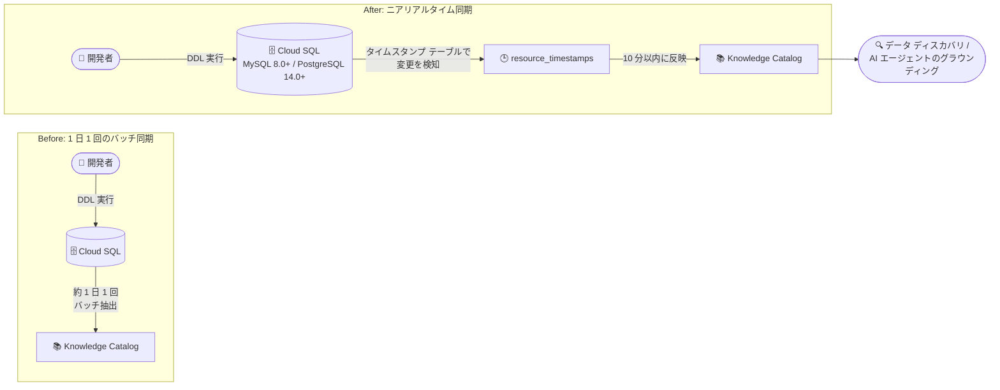

# Cloud SQL (MySQL / PostgreSQL): Knowledge Catalog へのニアリアルタイム メタデータ同期

**リリース日**: 2026-11-16

**サービス**: Cloud SQL for MySQL / Cloud SQL for PostgreSQL

**機能**: Knowledge Catalog (旧 Dataplex Universal Catalog) 統合のニアリアルタイム同期

**ステータス**: GA (一般提供)

📊 [このアップデートのインフォグラフィックを見る](https://takech9203.github.io/google-cloud-news-summary/20261116-cloud-sql-knowledge-catalog-near-real-time-sync.html)

## 概要

Cloud SQL for MySQL および Cloud SQL for PostgreSQL において、Knowledge Catalog (旧 Dataplex Universal Catalog) 統合のメタデータ同期がニアリアルタイム化されました。2026 年 4 月 18 日より前に作成された対象インスタンスで Knowledge Catalog 統合が無効になっている場合、統合を有効化すると、スキーマとメタデータの更新が従来の「1 日 1 回」ではなく「ニアリアルタイム」で Knowledge Catalog に同期されるようになります。2026 年 4 月 18 日以降に作成されたインスタンスでは、ニアリアルタイム同期がデフォルトで有効です。

本機能の対象は、新ネットワーク アーキテクチャ上で稼働する MySQL 8.0 以降、または PostgreSQL 14.0 以降のインスタンスです。既に「1 日 1 回」モードで統合が有効になっているインスタンスは、統合を一度無効化してから再有効化することで、ニアリアルタイム同期に切り替えられます。

データ ガバナンスやデータ カタログを運用するデータ プラットフォーム チームにとって、Cloud SQL 上のスキーマ変更 (DDL) が数分以内にカタログへ反映されるため、メタデータの鮮度が大幅に向上し、AI エージェントのグラウンディングやデータ ディスカバリの精度向上につながるアップデートです。

**アップデート前の課題**

- 2026 年 4 月 18 日より前に作成されたインスタンスでは、Knowledge Catalog 統合を有効化してもメタデータの更新頻度は約 1 日 1 回であり、スキーマ変更がカタログに反映されるまで最大 48 時間かかる場合があった
- カタログ上のメタデータと実際のデータベース スキーマの間に乖離が生じやすく、データ ディスカバリや AI エージェントのグラウンディングで古い情報を参照するリスクがあった
- 1 日 1 回のバッチ抽出は、共有コアなど小さいマシンタイプで 10,000 テーブル以上の大規模スキーマを持つ場合、抽出処理中に CPU を最大 40% 消費することがあった

**アップデート後の改善**

- 既存インスタンス (2026 年 4 月 18 日より前に作成) でも、統合を有効化するだけでニアリアルタイム同期が適用されるようになった
- DDL やスキーマ変更が発生すると、新しい変更は 10 分以内に Knowledge Catalog へ反映される (有効化直後の既存リソースは 24 時間以内に反映)
- ニアリアルタイム統合では抽出処理の CPU への影響が最小限に抑えられる
- 既に 1 日 1 回モードで統合済みのインスタンスも、無効化と再有効化という簡単な操作でニアリアルタイムに移行できる

## アーキテクチャ図



従来はメタデータが約 1 日 1 回のバッチで同期されていましたが、本アップデート後はインスタンス内のタイムスタンプ テーブルで変更が検知され、DDL やスキーマ変更が 10 分以内に Knowledge Catalog へ反映されます。

## サービスアップデートの詳細

### 主要機能

1. **既存インスタンスでのニアリアルタイム同期の有効化**
   - 2026 年 4 月 18 日より前に作成されたインスタンスで、バージョンとネットワーク アーキテクチャの条件を満たす場合、Knowledge Catalog 統合を有効化するとニアリアルタイム同期が適用される
   - 既に 1 日 1 回モードで統合が有効な場合は、統合を無効化してから再有効化することでニアリアルタイムに切り替え可能

2. **タイムスタンプ テーブルによる変更検知**
   - ニアリアルタイム統合のインスタンスには、アセットの作成・更新時刻を追跡するタイムスタンプ テーブルが作成される
   - MySQL では `mysql` データベース内、PostgreSQL では `cloudsqladmin` データベース内の `resource_timestamps` テーブル
   - DDL やスキーマ変更が発生すると、統合がタイムスタンプ テーブルを照会して最近変更されたアセットを特定し、最新のスキーマ更新を Knowledge Catalog にロードする
   - 統合を支えるクエリには `--Dataplex` コメントが付与されており、アクティブ クエリの確認画面で識別できる

3. **新規インスタンスでのデフォルト有効化**
   - 2026 年 4 月 18 日以降に作成されたインスタンスでは、Knowledge Catalog 統合 (ニアリアルタイム同期) がデフォルトで有効
   - 2026 年 3 月 19 日〜4 月 18 日に作成された一部のインスタンスもこのカテゴリに含まれる場合があり、インスタンスの設定で確認できる

## 技術仕様

### ニアリアルタイム同期の適用条件

| 項目 | 条件 |
|------|------|
| データベース バージョン | MySQL 8.0 以降 / PostgreSQL 14.0 以降 |
| ネットワーク アーキテクチャ | 新ネットワーク アーキテクチャ |
| 作成日が 2026-04-18 以降 | ニアリアルタイム同期がデフォルトで有効 |
| 作成日が 2026-04-18 より前 | 統合の有効化 (既に有効な場合は無効化→再有効化) でニアリアルタイムに移行 |
| 上記条件を満たさない場合 | 従来どおり 1 日 1 回のバッチ同期 (バージョンが古い、または旧ネットワーク アーキテクチャ) |

### 同期のタイミングと整合性

| 項目 | 詳細 |
|------|------|
| 新規の DDL / スキーマ変更 | 10 分以内に Knowledge Catalog に反映 |
| 有効化直後の既存リソース | 24 時間以内に反映 |
| 更新の取りこぼし時 | 結果整合性により通常 24 時間以内に反映 |
| 無効化の反映 | ニアリアルタイム統合のインスタンスでは最大 10 分 |
| CPU 使用量 | ニアリアルタイム統合では影響は最小限 (1 日 1 回モードでは大規模スキーマで最大 40% の CPU 使用の可能性) |

## 設定方法

### 前提条件

1. プロジェクトで Dataplex API が有効になっていること
2. Knowledge Catalog 上で Cloud SQL のメタデータを閲覧するには `cloudsql.schemas.view` 権限が必要 (プロジェクト レベルで付与。この権限を持つユーザーはプロジェクト内のすべての Cloud SQL インスタンスのメタデータを閲覧可能な点に注意)
3. 対象インスタンスが MySQL 8.0 以降または PostgreSQL 14.0 以降で、新ネットワーク アーキテクチャ上で稼働していること

### 手順

#### ステップ 1: 既存インスタンスで統合を有効化

```bash
gcloud sql instances patch INSTANCE_NAME \
    --enable-dataplex-integration
```

条件を満たすインスタンスでは、このコマンドだけでニアリアルタイム同期が有効になります。

#### ステップ 2: 1 日 1 回モードからニアリアルタイムへ切り替え (統合が既に有効な場合)

```bash
# 統合を一度無効化
gcloud sql instances patch INSTANCE_NAME \
    --no-enable-dataplex-integration

# 再度有効化するとニアリアルタイム同期に切り替わる
gcloud sql instances patch INSTANCE_NAME \
    --enable-dataplex-integration
```

#### ステップ 3: 統合の有効化を確認

```bash
gcloud sql instances describe INSTANCE_NAME
```

出力の `enableDataplexIntegration` が `true` になっていることを確認します。

## メリット

### ビジネス面

- **データ ガバナンスの鮮度向上**: スキーマ変更が数分以内にカタログへ反映されるため、データ カタログの情報を信頼して意思決定やデータ活用を進められる
- **AI 活用の品質向上**: Knowledge Catalog は AI エージェントのグラウンディングに利用されるコンテキスト エンジンであり、最新のスキーマ情報に基づく正確な応答が期待できる
- **運用コストの削減**: カタログ反映を待つための手動確認や、メタデータの乖離に起因するトラブルシューティングが減少する

### 技術面

- **低い CPU オーバーヘッド**: 1 日 1 回のバッチ抽出と比較して、ニアリアルタイム統合はインスタンスの CPU への影響が最小限
- **簡単な移行パス**: 既存インスタンスは `gcloud sql instances patch` による有効化 (または無効化→再有効化) のみでニアリアルタイムに移行できる
- **結果整合性の保証**: ネットワーク不安定などで更新が取りこぼされた場合でも、通常 24 時間以内に結果整合的に反映される

## デメリット・制約事項

### 制限事項

- 対象は MySQL 8.0 以降 / PostgreSQL 14.0 以降かつ新ネットワーク アーキテクチャのインスタンスのみ。条件を満たさないインスタンスは従来どおり 1 日 1 回の同期となる
- データベース名を変更した場合、ニアリアルタイムで反映されるのはデータベースの更新のみで、配下のテーブルとのマッピングは結果整合的に反映される
- 短時間に大量の DDL が実行された場合、クローン インスタンス、バックアップからの復元、メモリ不足、再起動、ネットワーク障害などの状況では更新メッセージが欠落し、結果整合 (通常 24 時間以内) となる場合がある
- 2026 年 4 月 18 日より前に作成されたインスタンスのうち、Assured Workloads への登録によりリソースへのアクセスが制限されているものは統合が無効化される

### 考慮すべき点

- 1 日 1 回モードからニアリアルタイムへ切り替えるには、統合の無効化→再有効化という明示的な操作が必要 (自動では切り替わらない)
- 有効化直後は既存リソースのカタログ反映に最大 24 時間かかるため、切り替え直後にすべてのアセットが見えるわけではない
- `cloudsql.schemas.view` 権限はプロジェクト レベルで付与されるため、メタデータの閲覧範囲に関するアクセス制御の設計を確認しておく
- 旧ネットワーク アーキテクチャのインスタンスでニアリアルタイム同期を利用したい場合は、新ネットワーク アーキテクチャへのアップグレードを検討する

## ユースケース

### ユースケース 1: 既存インスタンス群のニアリアルタイム同期への一括移行

**シナリオ**: 2026 年 4 月 18 日より前に作成した多数の Cloud SQL for PostgreSQL 14 インスタンスで、データ カタログの鮮度を上げるためにニアリアルタイム同期へ移行したい。

**実装例**:
```bash
# プロジェクト内の全インスタンスで統合を有効化
gcloud sql instances list --format="(NAME)" \
  | tail -n +2 | xargs -t -I % gcloud sql instances patch % --enable-dataplex-integration
```

**効果**: 条件を満たすインスタンスはニアリアルタイム同期となり、スキーマ変更が 10 分以内に Knowledge Catalog へ反映される。

### ユースケース 2: アジャイル開発環境でのスキーマ変更の即時カタログ反映

**シナリオ**: マイクロサービス開発チームが頻繁にテーブル追加やカラム変更を行っており、データ分析チームが Knowledge Catalog 経由で最新スキーマを検索・参照している。

**効果**: DDL 実行から 10 分以内にカタログへ反映されるため、分析チームは常に最新のスキーマ情報に基づいてデータ ディスカバリやリネージ管理を行える。カタログを参照する AI エージェントも古いスキーマによる誤回答を回避しやすくなる。

## 料金

Knowledge Catalog 統合自体に Cloud SQL 側の追加料金は明記されていませんが、Knowledge Catalog のメタデータ ストレージおよび API 利用には以下の料金が適用されます。

### 料金例 (Knowledge Catalog)

| 項目 | 料金 (USD) |
|--------|-----------------|
| メタデータ ストレージ (月平均 1 MiB まで) | 無料 |
| メタデータ ストレージ (1 MiB 超過分) | $2 / GiB / 月〜 |
| API 呼び出し (月間 100 万回まで) | 無料 |
| API 呼び出し (100 万回超過分) | $10 / 10 万回〜 |

詳細は [Knowledge Catalog の料金ページ](https://cloud.google.com/dataplex/pricing) および [Cloud SQL の料金ページ](https://cloud.google.com/sql/pricing) を参照してください。

## 関連サービス・機能

- **Knowledge Catalog (旧 Dataplex Universal Catalog)**: 本統合の同期先。データ ディスカバリ、データ リネージ、データ品質スキャン、ビジネス用語集などを提供し、AI エージェントのグラウンディングにも利用されるコンテキスト エンジン
- **AlloyDB for PostgreSQL**: 同様の Knowledge Catalog 統合を提供しており、2026 年 4 月 3 日以降に作成されたクラスタではニアリアルタイム同期 (最大 5 分) が有効
- **Cloud SQL for SQL Server**: 新ネットワーク アーキテクチャ上の全バージョンでニアリアルタイム統合に対応
- **Cloud SQL 新ネットワーク アーキテクチャ**: ニアリアルタイム同期の前提条件。旧アーキテクチャのインスタンスはアップグレードが必要

## 参考リンク

- 📊 [インフォグラフィック](https://takech9203.github.io/google-cloud-news-summary/20261116-cloud-sql-knowledge-catalog-near-real-time-sync.html)
- [公式リリースノート](https://docs.cloud.google.com/release-notes#November_16_2026)
- [ドキュメント: Cloud SQL for MySQL と Knowledge Catalog の統合](https://docs.cloud.google.com/sql/docs/mysql/dataplex-catalog-integration)
- [ドキュメント: Cloud SQL for PostgreSQL と Knowledge Catalog の統合](https://docs.cloud.google.com/sql/docs/postgres/dataplex-catalog-integration)
- [ドキュメント: 新ネットワーク アーキテクチャへのアップグレード](https://docs.cloud.google.com/sql/docs/mysql/upgrade-cloud-sql-instance-new-network-architecture)
- [料金ページ (Knowledge Catalog)](https://cloud.google.com/dataplex/pricing)

## まとめ

Cloud SQL for MySQL / PostgreSQL の Knowledge Catalog 統合がニアリアルタイム化され、既存インスタンスでも統合の有効化 (または無効化→再有効化) だけでスキーマ変更を 10 分以内にカタログへ反映できるようになりました。データ カタログの鮮度は AI エージェントのグラウンディングやデータ ガバナンスの品質に直結するため、MySQL 8.0 / PostgreSQL 14.0 以降かつ新ネットワーク アーキテクチャのインスタンスでは、ニアリアルタイム同期への切り替えを推奨します。

---

**タグ**: Cloud SQL, MySQL, PostgreSQL, Knowledge Catalog, Dataplex, メタデータ管理, データガバナンス, データカタログ
