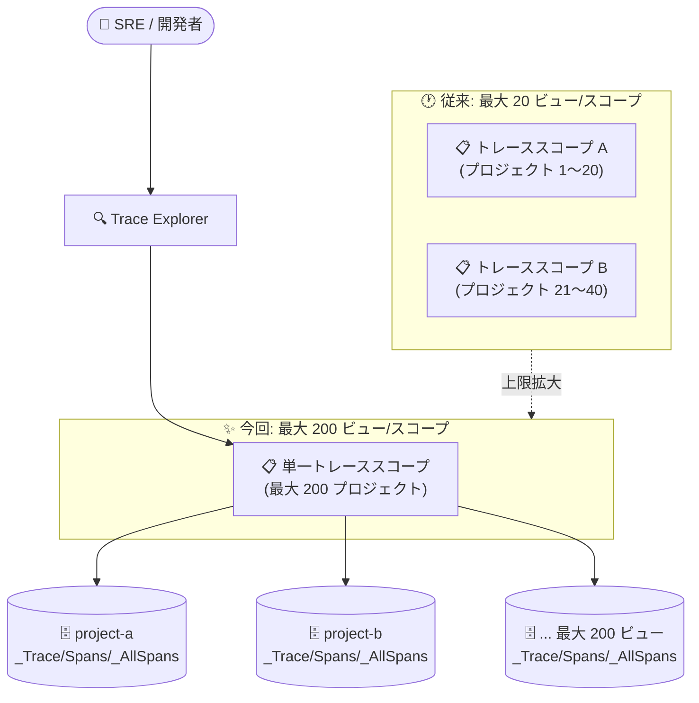

# Cloud Trace: トレーススコープあたり 200 ビューをサポート

**リリース日**: 2026-11-16

**サービス**: Cloud Trace

**機能**: トレーススコープあたりのビュー数上限が 200 に拡大

**ステータス**: 一般提供 (Feature)

📊 [このアップデートのインフォグラフィックを見る](https://takech9203.github.io/google-cloud-news-summary/20261116-cloud-trace-trace-scope-views-limit.html)

## 概要

Cloud Trace のトレーススコープが、1 スコープあたり最大 **200 ビュー** をサポートするようになりました。トレーススコープは、複数の Google Cloud プロジェクトに保存されたトレースデータを Trace Explorer から横断的に検索・分析するための、プロジェクトレベルの永続リソースです。スコープには「ビュー」のリストが含まれ、各ビューが 1 つのプロジェクトが保存するトレースデータへのアクセスを提供します。

設定インターフェース (コンソール、gcloud CLI、Terraform、REST API) ではプロジェクトを指定しますが、Google Cloud Observability はプロジェクトをそのプロジェクトのデフォルトトレースビューにマッピングします。このビューは `_AllSpans` という名前で、パス `_Trace/Spans/_AllSpans` (Observability バケット / データセット / ビュー) で表され、プロジェクトが保存するすべてのトレースデータへのアクセスを提供します。

多数のマイクロサービスやプロジェクトに分散したシステムを運用する組織にとって、1 つのトレーススコープでカバーできるプロジェクト数が大幅に増えたことで、大規模環境での分散トレーシングの横断分析がより実用的になりました。

**アップデート前の課題**

- 従来、1 つのトレーススコープに含められるビューは最大 20 個に制限されていた
- 20 を超えるプロジェクトにトレースデータが分散する大規模環境では、1 つのスコープで全体を横断検索できず、複数のトレーススコープに分割して切り替えながら調査する必要があった
- 組織全体の分散トレースを一元的に分析するワークフローが、プロジェクト数の多い環境では構築しにくかった

**アップデート後の改善**

- 1 つのトレーススコープに最大 200 ビュー (= 200 プロジェクトのデフォルトトレースビュー) を含められるようになった
- 最大 200 プロジェクトにまたがるトレースデータを、Trace Explorer 上の単一スコープ選択で横断検索・分析できるようになった
- スコープ分割の運用負荷が減り、大規模なマルチプロジェクト構成でも一元的なトレース分析が可能になった

## アーキテクチャ図



トレーススコープは各プロジェクトのデフォルトトレースビュー `_AllSpans` を束ねるリソースで、今回のアップデートにより 1 スコープで最大 200 ビューを参照できるようになりました。Trace Explorer はスコープに列挙されたビューを横断して検索し、ユーザーの IAM ロールに基づいて表示可否を判定します。

## サービスアップデートの詳細

### 主要機能

1. **トレーススコープあたり 200 ビューのサポート**
   - 従来の上限 20 ビューから 200 ビューに拡大
   - 1 スコープで最大 200 プロジェクトのトレースデータを横断検索可能
   - トレーススコープ数の上限はプロジェクトあたり 100 のまま

2. **プロジェクトからデフォルトトレースビューへの自動マッピング**
   - 設定時にはプロジェクトを指定するだけでよい
   - Google Cloud Observability が各プロジェクトをデフォルトトレースビュー `_AllSpans` (パス: `_Trace/Spans/_AllSpans`) にマッピング
   - `_AllSpans` ビューは、プロジェクトが保存するすべてのトレースデータへのアクセスを提供

3. **Trace Explorer との統合**
   - Trace Explorer のスコープセレクタで作成したスコープを選択すると、スコープ内の全ビューを横断検索
   - デフォルトトレーススコープを指定すると、Trace Explorer を開いた際に自動的にそのスコープで検索
   - ブラウザ URL にスコープ設定がエンコードされるため、設定済みビューを URL 共有可能

## 技術仕様

### トレーススコープの制限値

| 項目 | 値 |
|------|-----|
| プロジェクトあたりのトレーススコープ数の上限 | 100 |
| トレーススコープあたりのビュー数の上限 | **200** (従来は 20) |
| デフォルトトレースビュー | `_Trace/Spans/_AllSpans` |
| トレーススコープのロケーション | `global` |
| スパンの保持期間 (`_Trace` バケット) | 30 日 |

### 必要な IAM ロール・権限

トレーススコープの作成・表示、デフォルトスコープの取得・設定には以下が必要です。

| ロール | 用途 |
|--------|------|
| `roles/observability.scopesEditor` (Observability Scopes Editor) | トレーススコープの作成・表示、デフォルトスコープの取得・設定 |

含まれる主な権限: `observability.traceScopes.{create, delete, get, list, update}`、`observability.scopes.{get, update}`

なお、スコープにプロジェクトを追加しても、データの閲覧可否は各リソースに対するユーザーの IAM ロールで判定されます。閲覧権限のないプロジェクトのトレースデータは検索結果に表示されません。

## 設定方法

### 前提条件

1. トレーススコープを作成するプロジェクトで `roles/observability.scopesEditor` を付与されていること
2. gcloud CLI を使用する場合はバージョン 586.0.0 以降
3. スコープに含めるすべてのビューが、同じロケーションにトレースデータを保存していること (異なるロケーションの混在は非推奨)

### 手順

#### ステップ 1: トレーススコープの作成 (コンソール)

1. Google Cloud コンソールで「設定」ページ (サブヘッダーが Monitoring のもの) に移動
2. 対象プロジェクトを選択し、「Trace Scopes」タブで「Create trace scope」をクリック
3. 「Add projects」でプロジェクトを追加 (各プロジェクトのデフォルトトレースビューが自動追加される)
4. スコープ名と説明を入力して作成 (スコープ名はプロジェクト内で一意、後から変更不可)

#### ステップ 2: トレーススコープの一覧確認 (gcloud)

```bash
gcloud observability trace-scopes list \
    --location=global \
    --project=PROJECT_ID
```

作成済みのトレーススコープと、各スコープに含まれるプロジェクト (`resourceNames`) が一覧表示されます。Terraform でもトレーススコープの作成・変更が可能です (一覧表示は不可)。

#### ステップ 3: デフォルトトレーススコープの設定 (任意)

```bash
gcloud observability scopes update _Default \
    --trace-scope=projects/PROJECT_ID/locations/global/traceScopes/TRACE_SCOPE_NAME \
    --location=global \
    --project=PROJECT_ID
```

デフォルトに指定すると、Trace Explorer を開いた際にそのスコープが自動的に使用されます。また、Observability スコープが更新され、複数プロジェクトに保存されたログとトレースの相関にも利用されます。

## メリット

### ビジネス面

- **大規模組織での可観測性の一元化**: 最大 200 プロジェクトのトレースを単一スコープで横断分析でき、組織全体のサービス品質把握が容易になる
- **インシデント対応の迅速化**: 障害調査時にスコープを切り替える手間が減り、プロジェクト境界をまたぐリクエストの追跡が速くなる

### 技術面

- **スコープ管理の簡素化**: プロジェクト数が 20 を超える環境でもスコープを分割する必要がなくなり、スコープ設計・運用がシンプルになる
- **マイクロサービスアーキテクチャとの親和性**: プロジェクト単位でサービスを分離する設計 (サービスごと・チームごとのプロジェクト分割) でも、トレースの全体像を 1 つのビューで確認できる

## デメリット・制約事項

### 制限事項

- トレーススコープ数はプロジェクトあたり最大 100 のまま
- スコープに含まれるすべてのビューは、同じロケーションにトレースデータを保存している必要がある
- トレーススコープのロケーションは `global` のみ
- 設定インターフェースではプロジェクト単位の指定となり、マッピングされるのはデフォルトトレースビュー `_AllSpans` (プロジェクトの全トレースデータ)

### 考慮すべき点

- スコープにプロジェクトを追加しても、実際に閲覧できるデータは各リソースへの IAM ロールに依存するため、横断分析には適切な権限設計が必要
- 多数のプロジェクトを 1 スコープにまとめると検索対象データが増えるため、Trace Explorer ではフィルタや時間範囲を適切に絞り込むことが推奨される
- gcloud で操作する場合は CLI バージョン 586.0.0 以降が必要

## ユースケース

### ユースケース 1: 大規模マイクロサービス環境の横断トレース分析

**シナリオ**: 1 つのオンラインサービスを 50 以上の Google Cloud プロジェクト (チーム・サービス単位で分割) で運用しており、リクエストが複数プロジェクトをまたいで処理される。従来は 20 ビュー制限のためスコープを 3 つに分割していた。

**実装例**:
```bash
# 単一のトレーススコープに全プロジェクトを統合 (Terraform やコンソールで作成)
gcloud observability trace-scopes list --location=global --project=observability-host-project
```

**効果**: 分割していたスコープを 1 つに統合でき、Trace Explorer での障害調査時にスコープ切り替えが不要になる。エンドツーエンドのレイテンシ分析が単一ビューで完結する。

### ユースケース 2: 中央監視プロジェクトによる全社トレース集約ビュー

**シナリオ**: SRE チームが中央の監視用プロジェクトから全社 (最大 200 プロジェクト) のトレースを俯瞰したい。

**効果**: 中央プロジェクトに全社向けトレーススコープを作成してデフォルトに設定することで、Trace Explorer を開くだけで全社横断のトレース検索が可能になる。デフォルトログスコープと組み合わせれば、マルチプロジェクトのログとトレースの相関分析も行える。

## 料金

トレーススコープの作成・利用自体に追加料金は発生しません。Cloud Trace の課金はスパンの取り込み (インジェスト) に対して行われます。

### 料金例 (Cloud Trace インジェスト)

| 項目 | 料金 |
|--------|-----------------|
| トレースインジェスト | $0.20 / 100 万スパン |
| 無料枠 | 月あたり最初の 250 万スパン |

詳細は [Google Cloud Observability の料金ページ](https://cloud.google.com/products/observability/pricing) を参照してください。

## 関連サービス・機能

- **Trace Explorer**: トレーススコープを選択してマルチプロジェクトのトレースデータを検索・分析する UI。デフォルトトレーススコープが自動的に使用される
- **Google Cloud Observability スコープ (Observability scope)**: デフォルトログスコープとデフォルトトレーススコープを束ねるリソース。マルチプロジェクト環境でのログとトレースの相関に利用
- **Cloud Logging ログスコープ**: ログデータに対する同様の横断検索の仕組み。Logs Explorer で使用
- **Cloud Monitoring メトリクススコープ**: メトリクスデータに対するマルチプロジェクト参照の仕組み
- **App Hub**: App Hub 構成ではホストプロジェクトまたは管理プロジェクトを選択してトレーススコープを設定

## 参考リンク

- 📊 [インフォグラフィック](https://takech9203.github.io/google-cloud-news-summary/20261116-cloud-trace-trace-scope-views-limit.html)
- [公式リリースノート](https://docs.cloud.google.com/release-notes#November_16_2026)
- [ドキュメント: トレーススコープの作成と管理](https://docs.cloud.google.com/trace/docs/trace-scope/create-and-manage)
- [ドキュメント: Cloud Trace の割り当てと上限 (トレーススコープの上限)](https://docs.cloud.google.com/trace/docs/quotas)
- [ドキュメント: マルチプロジェクトクエリ用の Observability スコープの構成](https://docs.cloud.google.com/stackdriver/docs/observability/scopes)
- [料金ページ](https://cloud.google.com/products/observability/pricing)

## まとめ

トレーススコープあたりのビュー数上限が 20 から 200 へと 10 倍に拡大され、大規模なマルチプロジェクト環境でも単一スコープでトレースデータを横断分析できるようになりました。20 プロジェクト超の環境でスコープを分割運用しているチームは、スコープの統合とデフォルトトレーススコープの見直しを検討することを推奨します。

---

**タグ**: Cloud Trace, Observability, トレーススコープ, Trace Explorer, マルチプロジェクト, 分散トレーシング
