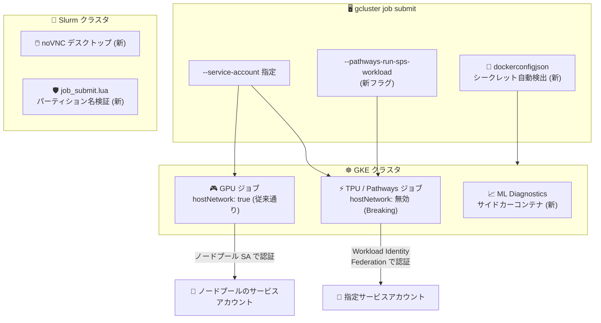

# Cluster Toolkit: v1.109.0 リリース (hostNetwork の無効化と新機能群)

**リリース日**: 2026-11-16

**サービス**: Cluster Toolkit

**機能**: v1.109.0 リリース (Breaking Change + 新機能)

**ステータス**: Breaking / Feature

📊 [このアップデートのインフォグラフィックを見る](https://takech9203.github.io/google-cloud-news-summary/20261116-cluster-toolkit-v1-109-0.html)

## 概要

Google Cloud の HPC/AI/ML クラスタ構築ツールである Cluster Toolkit の v1.109.0 がリリースされた。Cluster Toolkit は、カスタマイズ可能なブループリント (YAML) と再利用可能なモジュールを使用して、Google Cloud のベストプラクティスに沿った HPC、AI、ML クラスタを効率的にプロビジョニングするオープンソースツールである。

今回のリリースには **Breaking Change** が含まれる。`gcluster job submit` コマンドに `--service-account` フラグを渡した場合、Cloud TPU ワークロードと Pathways ワークロードで `hostNetwork` 設定が無効化されるようになった。これにより、Pod は GKE ノードプールのサービスアカウントではなく、Workload Identity Federation for GKE を使用して認証するようになる。なお、GPU ジョブは引き続き `hostNetwork: true` を使用し、ノードプールのサービスアカウントとして認証する。

機能面では、Slurm クラスタ向けのブラウザベース noVNC デスクトップ、GKE 上の A5X ベアメタルインスタンスのブループリント対応、ML Diagnostics コレクターのサイドカーコンテナ、`--pathways-run-sps-workload` フラグ、イメージプルシークレットの自動検出など、多数の機能が追加された。また、Slurm の `job_submit.lua` スクリプトにおけるパーティション名の検証が追加され、コマンドインジェクションの防止に役立つセキュリティ強化も含まれている。

**アップデート前の課題**

- `--service-account` フラグを指定した TPU/Pathways ジョブでも `hostNetwork` が有効であり、指定したサービスアカウントを Workload Identity Federation で利用する構成と整合しなかった
- Slurm クラスタでグラフィカルデスクトップ環境を利用するには、ブラウザベースの標準的な手段が用意されていなかった
- プライベートレジストリからコンテナイメージをプルする際、`--image-pull-secret` フラグでシークレットを明示的に指定する必要があった
- `batch-job-template` モジュールで Compute Engine インスタンステンプレートを使用する場合、カスタムサービスアカウントを指定できなかった
- 旧来の `schedmd-slurm-gcp-v6-nodeset-tpu` パーティションを使用するクラスタでは、`job_submit.lua` にコマンドインジェクションの脆弱性が存在した

**アップデート後の改善**

- `--service-account` 指定時の TPU/Pathways ジョブは `hostNetwork` が無効化され、Workload Identity Federation for GKE による Pod 単位の認証が行われるようになった
- 新しい remote-desktop モジュールにより、ブラウザベースの noVNC デスクトップを Slurm クラスタで利用できるようになった
- `gcluster job submit` がターゲット Namespace 内の `kubernetes.io/dockerconfigjson` シークレットを自動検出し、コンテナイメージのプルに使用するようになった
- `batch-job-template` モジュールで Compute Engine インスタンステンプレートとカスタムサービスアカウントの併用が可能になった
- `job_submit.lua` でのパーティション名検証により、コマンドインジェクションが防止されるようになった

## アーキテクチャ図



v1.109.0 では、`--service-account` 指定時の TPU/Pathways ジョブが hostNetwork 無効化により Workload Identity Federation で認証されるようになり (Breaking)、GKE・Slurm 双方に新機能が追加された。

## サービスアップデートの詳細

### Breaking Change: hostNetwork の無効化

`gcluster job submit` コマンドに `--service-account` フラグを渡すと、Cloud TPU ワークロードと Pathways ワークロードで `hostNetwork` 設定が無効化される。

- Pod は Workload Identity Federation for GKE を使用して、指定した Kubernetes サービスアカウントとして認証する
- GPU ジョブは `hostNetwork: true` を維持するため、Pod は GKE ノードプールのサービスアカウントとして認証する
- `hostNetwork` に依存したネットワーク構成 (ホストのネットワーク名前空間を前提とした通信など) を TPU/Pathways ジョブで使用している場合は影響を受けるため、アップグレード前に確認が必要

### 主要機能

1. **Slurm クラスタ向けブラウザベース noVNC デスクトップ**
   - 新しい remote-desktop モジュールにより、ブラウザから Slurm クラスタのグラフィカルデスクトップ環境にアクセス可能
   - 可視化ツールや GUI ベースのアプリケーションを HPC クラスタ上で利用するユーザーの利便性が向上

2. **GKE 上の A5X ベアメタルインスタンスのブループリント対応**
   - A5X ベアメタルインスタンスを GKE で利用するためのブループリントサポートを追加
   - 大規模 AI ワークロード向けの最新ハードウェアをブループリント経由でプロビジョニング可能

3. **ML Diagnostics コレクターのサイドカーコンテナとテレメトリポートフラグ**
   - ML Diagnostics コレクターをネイティブサイドカーコンテナとして追加
   - `gcluster job` コマンドにテレメトリポート用のフラグを追加し、ワークロードの診断性を向上

4. **`--pathways-run-sps-workload` フラグの追加**
   - `gcluster job submit` に Shared Pathways Service (SPS) ワークロードを実行するためのフラグを追加
   - あわせて `gcluster job inspect` に `--filter=pathways-sps` フィルタも追加

5. **イメージプルシークレットの自動検出**
   - `gcluster job submit` がターゲット Namespace 内の `kubernetes.io/dockerconfigjson` タイプのシークレットを自動検出し、コンテナイメージのプルに使用
   - プライベートレジストリ利用時に `--image-pull-secret` フラグでの明示的な指定が不要になるケースが増加

6. **batch-job-template モジュールでのカスタムサービスアカウント対応**
   - Compute Engine インスタンステンプレートとカスタムサービスアカウントの併用が可能に
   - Batch ジョブの最小権限構成がしやすくなった

7. **Slurm パーティション名の検証 (セキュリティ強化)**
   - `job_submit.lua` スクリプトでパーティション名を検証し、コマンドインジェクションを防止
   - 旧来の `schedmd-slurm-gcp-v6-nodeset-tpu` パーティションを使用するクラスタが影響対象 (v1.98.0 以降は Slurm 25.05 以上で影響、それより古い Toolkit は全 Slurm バージョンで影響)
   - 修正の適用には v1.109.0 へのアップグレード、`gcluster deploy` の実行、コントローラノードの再起動が必要

## 技術仕様

### `--service-account` フラグの動作 (v1.109.0 以降)

| ワークロード種別 | hostNetwork | Pod の認証方法 |
|------|------|------|
| Cloud TPU ジョブ | 無効 (Breaking Change) | Workload Identity Federation for GKE (指定したサービスアカウント) |
| Pathways ジョブ | 無効 (Breaking Change) | Workload Identity Federation for GKE (指定したサービスアカウント) |
| GPU ジョブ | `hostNetwork: true` (従来通り) | GKE ノードプールのサービスアカウント |

### 主な追加・変更フラグ

| フラグ | 説明 |
|------|------|
| `--pathways-run-sps-workload` | Shared Pathways Service ワークロードを実行 |
| `--service-account ACCOUNT` | Pod 用の Kubernetes サービスアカウント名 (TPU/Pathways では hostNetwork を無効化) |
| `--image-pull-secret SECRET` | イメージプル用シークレットのカンマ区切りリスト (dockerconfigjson シークレットは自動検出も可能に) |
| `gcluster job inspect --filter=pathways-sps` | Pathways SPS ワークロードのフィルタリング |

## 設定方法

### 前提条件

1. Cluster Toolkit v1.109.0 (`gcluster` バイナリ) の取得・ビルド
2. GKE クラスタまたは Slurm クラスタのデプロイ環境 (`gcloud`、`kubectl`、Terraform など)
3. TPU/Pathways ジョブで `--service-account` を使用する場合、Workload Identity Federation for GKE の構成

### 手順

#### ステップ 1: Cluster Toolkit を v1.109.0 に更新

```bash
git clone https://github.com/GoogleCloudPlatform/cluster-toolkit.git
cd cluster-toolkit
git checkout v1.109.0
make
```

リポジトリを v1.109.0 に更新し、`gcluster` バイナリをビルドする。

#### ステップ 2: (Slurm TPU パーティション利用時) セキュリティ修正の適用

```bash
./gcluster deploy <デプロイメントフォルダ>
# デプロイ後、Slurm コントローラノードを再起動
```

`schedmd-slurm-gcp-v6-nodeset-tpu` パーティションを使用するクラスタでは、再デプロイとコントローラノードの再起動によりコマンドインジェクション対策を適用する。

#### ステップ 3: サービスアカウントを指定したジョブの送信

```bash
./gcluster job submit \
  --cluster=CLUSTER_NAME \
  --project=PROJECT_ID \
  --location=LOCATION \
  --name=train-job \
  --image=IMAGE \
  --compute-type=v5litepod-32 \
  --command="python3 train.py" \
  --service-account=KSA_NAME
```

TPU/Pathways ジョブでは hostNetwork が無効化され、Workload Identity Federation for GKE を介して指定サービスアカウントで認証される。

## メリット

### ビジネス面

- **セキュリティ体制の強化**: Workload Identity Federation によるワークロード単位の最小権限認証と、Slurm のコマンドインジェクション対策により、HPC/AI 基盤のセキュリティリスクを低減できる
- **運用負荷の軽減**: イメージプルシークレットの自動検出や noVNC デスクトップにより、クラスタ利用時の手作業や追加ツールの整備が不要になる

### 技術面

- **Pod 単位の ID 分離**: TPU/Pathways ジョブがノードのサービスアカウントに依存せず、指定した Kubernetes サービスアカウントで認証されるため、きめ細かな IAM 制御が可能
- **最新ハードウェアへの対応**: A5X ベアメタルインスタンス (GKE) のブループリント対応により、大規模 AI ワークロードの基盤選択肢が拡大
- **診断性の向上**: ML Diagnostics コレクターのサイドカー化とテレメトリポートフラグにより、ワークロードの観測・診断が容易に

## デメリット・制約事項

### 制限事項

- Breaking Change のため、`--service-account` を指定した既存の TPU/Pathways ジョブで `hostNetwork` を前提とした構成は動作が変わる
- GPU ジョブは引き続き `hostNetwork: true` で動作するため、サービスアカウント認証の挙動が TPU/Pathways ジョブと異なる点に注意が必要
- `job_submit.lua` のセキュリティ修正の適用には、アップグレードに加えて `gcluster deploy` の実行とコントローラノードの再起動が必要

### 考慮すべき点

- TPU/Pathways ジョブで `--service-account` を使用する場合、Workload Identity Federation for GKE の事前構成 (Kubernetes サービスアカウントと IAM の紐付け) を確認すること
- 旧来の `schedmd-slurm-gcp-v6-nodeset-tpu` パーティションを使用しているクラスタは、速やかに v1.109.0 へアップグレードすることが推奨される (ネイティブ GCE TPU ノードセットは影響なし)
- イメージプルシークレットの自動検出により意図しないシークレットが利用されないよう、Namespace 内のシークレット管理を見直すこと

## ユースケース

### ユースケース 1: TPU トレーニングジョブの最小権限化

**シナリオ**: 複数チームが共有する GKE クラスタ上で TPU トレーニングジョブを実行しており、チームごとに異なる Cloud Storage バケットや BigQuery データセットへのアクセス権限を分離したい。

**実装例**:
```bash
./gcluster job submit \
  --cluster=shared-ai-cluster \
  --project=my-project \
  --location=us-central1 \
  --name=team-a-train \
  --image=us-docker.pkg.dev/my-project/team-a/train:v1 \
  --compute-type=v5litepod-32 \
  --command="python3 train.py" \
  --service-account=team-a-ksa
```

**効果**: hostNetwork が無効化され、ジョブはチーム専用の Kubernetes サービスアカウント経由で Workload Identity Federation 認証されるため、ノードのサービスアカウント権限に依存しない最小権限構成を実現できる。

### ユースケース 2: Slurm クラスタでの可視化作業

**シナリオ**: HPC シミュレーションの結果を GUI ベースの可視化ツールで確認したいが、ローカルに VNC クライアントを導入せずブラウザだけで完結させたい。

**効果**: remote-desktop モジュールの noVNC デスクトップにより、ブラウザから直接 Slurm クラスタのデスクトップ環境へアクセスでき、可視化・デバッグ作業の環境準備が大幅に簡素化される。

## 料金

Cluster Toolkit 自体はオープンソースツールであり、無料で利用できる。費用はプロビジョニングされる Google Cloud リソース (Compute Engine、GKE、Cloud TPU、Filestore など) に対して発生する。

- [Compute Engine 料金](https://cloud.google.com/compute/pricing)
- [GKE 料金](https://cloud.google.com/kubernetes-engine/pricing)
- [Cloud TPU 料金](https://cloud.google.com/tpu/pricing)

## 関連サービス・機能

- **Google Kubernetes Engine (GKE)**: `gcluster job submit` は GKE クラスタ上で Kueue と統合された Kubernetes JobSet としてワークロードをデプロイする
- **Workload Identity Federation for GKE**: hostNetwork 無効化後の TPU/Pathways ジョブにおける Pod 認証メカニズム
- **Cloud TPU / Pathways**: 今回の Breaking Change の対象となる AI ワークロード実行基盤
- **Slurm**: noVNC デスクトップとパーティション名検証の対象となるジョブスケジューラ
- **Batch**: `batch-job-template` モジュールでカスタムサービスアカウントとインスタンステンプレートの併用が可能に
- **Cloud Monitoring**: Cluster Toolkit でデプロイしたクラスタのモニタリングに利用

## 参考リンク

- 📊 [インフォグラフィック](https://takech9203.github.io/google-cloud-news-summary/20261116-cluster-toolkit-v1-109-0.html)
- [公式リリースノート](https://docs.cloud.google.com/release-notes#November_16_2026)
- [v1.109.0 リリースアナウンス (GitHub)](https://github.com/GoogleCloudPlatform/cluster-toolkit/releases/tag/v1.109.0)
- [Cluster Toolkit 概要](https://docs.cloud.google.com/cluster-toolkit/docs/overview)
- [gcluster job submit リファレンス](https://docs.cloud.google.com/cluster-toolkit/docs/reference/gcluster-job-submit)

## まとめ

Cluster Toolkit v1.109.0 は、TPU/Pathways ジョブにおける hostNetwork 無効化という Breaking Change と、Slurm のコマンドインジェクション対策という重要なセキュリティ修正を含むリリースである。`--service-account` を使用している TPU/Pathways ワークロードの挙動変更を確認したうえで、特に旧来の Slurm TPU パーティションを使用しているクラスタは速やかに v1.109.0 へアップグレードし、再デプロイとコントローラノードの再起動を実施することを推奨する。

---

**タグ**: Cluster Toolkit, HPC, AI インフラ, GKE, Cloud TPU, Pathways, Slurm, Workload Identity Federation, セキュリティ, Breaking Change
