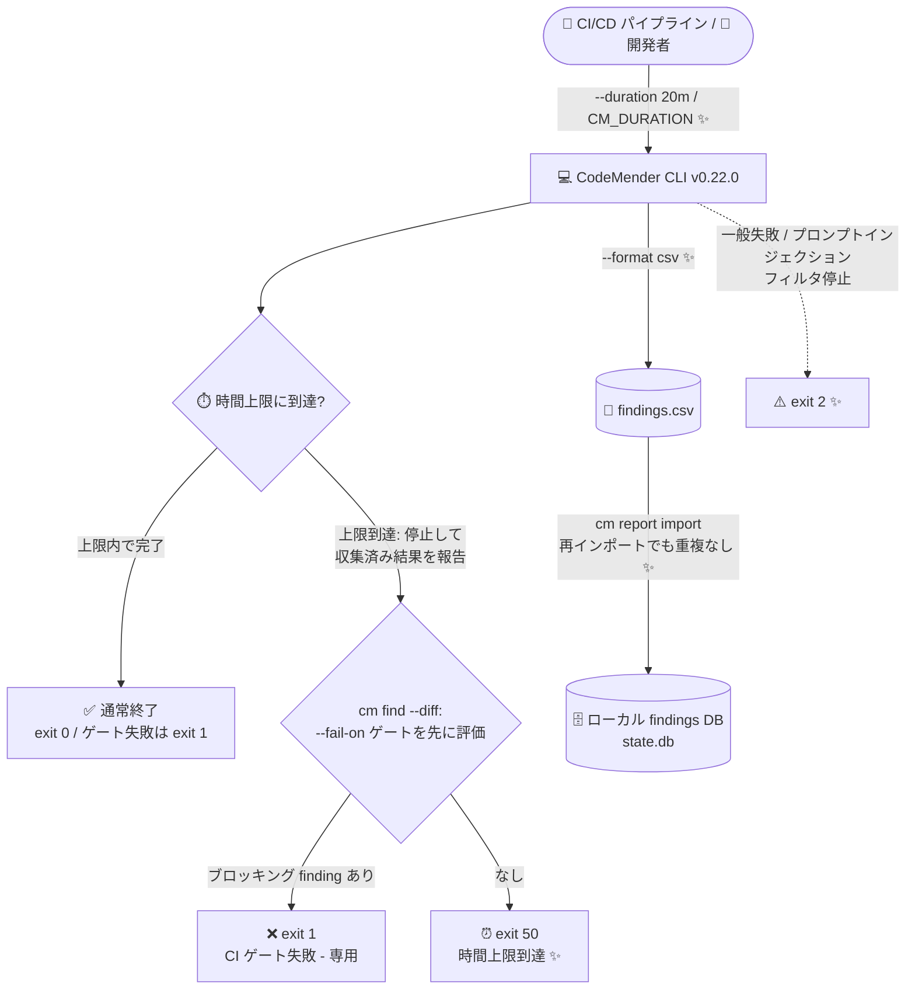

# Gemini Enterprise Agent Platform: CodeMender v0.22.0 アップデート (実行時間上限・CSV 対応・終了コード整理)

**リリース日**: 2026-11-16

**サービス**: Gemini Enterprise Agent Platform (CodeMender)

**機能**: CodeMender v0.22.0 - `--duration` による実行時間上限、CSV エクスポート/インポート、終了コードの整理、セキュリティ関連バグ修正

**ステータス**: Fixed (v0.22.0 アップデート)

📊 [このアップデートのインフォグラフィックを見る](https://takech9203.github.io/google-cloud-news-summary/20261116-codemender-v0-22-0.html)

## 概要

Gemini Enterprise Agent Platform の AI コードセキュリティエージェント「CodeMender」の v0.22.0 がリリースされた。CodeMender は、コードベースの脆弱性をスキャン (`cm find`)、検証 (`cm verify`)、修正 (`cm fix`) する自律型エージェントで、推論はクラウド側のホスト型エンジン、コマンド実行・パッチ適用はローカルの OS レベルサンドボックス内で行う実行モデルを採用している。

v0.22.0 の中心テーマは「CI/CD 運用の予測可能性」である。`cm find`、`cm fix`、`cm verify`、`cm session resume` に `--duration` フラグ (エイリアス `--timeout`、環境変数 `CM_DURATION` でも設定可) が追加され、実行時間の上限に達すると CodeMender は実行を停止し、それまでに得られた結果を報告して終了コード 50 で終了する。`cm find --diff` では `--fail-on` ゲートが先に評価されるため、ブロッキングな finding がある場合は従来どおり終了コード 1 で終了し、CI ゲートとしての動作が維持される。また、`cm find` と `cm report` が `--format csv` および `.csv` 出力ファイルに対応し、`cm report import` も CSV ファイルを受け付けるようになった。終了コードの体系も整理され、一般的な失敗とプロンプトインジェクションフィルタによるセッション停止は終了コード 2、終了コード 1 は CI ゲート失敗専用となった。

さらに、セキュリティ面で重要なバグ修正が複数含まれる。ADC トークンを googleapis.com 以外のエンドポイントへ送信しなくなった修正、サンドボックス外実行 (`--sandbox=false` など) 時の警告表示、hash-based Python バイトコード (`.pyc`) のサンドボックスでのブロックとセッション中に生成されたバイトコードの削除、信頼できないテキスト表示前の双方向テキスト制御文字・不可視文字の除去などである。対象ユーザーは、CodeMender を CI/CD パイプラインに組み込む DevSecOps チーム、既存の脆弱性管理ワークフロー (スプレッドシート、他社スキャナ) と連携したいセキュリティチームである。

**アップデート前の課題**

- `cm find` / `cm fix` / `cm verify` / `cm session resume` の実行時間に上限を設定する CLI オプションがなく、CI でのタイムアウト管理はランナー側の仕組み (GitHub Actions の `timeout-minutes` など) に依存していた。外部からジョブが強制終了されると、それまでに発見した結果も失われていた
- `cm find` / `cm report` の出力形式は table / JSON / SARIF (report は加えて HTML / Markdown) のみで CSV に未対応、`cm report import` も JSON / SARIF のみ受け付けたため、スプレッドシートベースの脆弱性管理や CSV を出力する既存ツールとの連携に変換処理が必要だった
- 一般的な失敗とプロンプトインジェクションフィルタによるセッション停止の終了コードが CI ゲート失敗と明確に区別されておらず、パイプラインで「脆弱性検出によるゲート失敗」と「実行エラー」をハンドリングし分けにくかった
- テストパターンや生成コードマーカーに一致するコメント・文字列を含むだけのソースファイルが、`cm find` のファイル検出でテスト/生成コードと誤判定されスキップされることがあった
- `cm report import` で同じレポートを再インポートすると finding が重複登録された
- ADC トークンが googleapis.com 以外のエンドポイントに送信され得た
- `--sandbox=false` などで OS サンドボックス外でコマンドが実行されても警告が表示されなかった
- hash-based Python バイトコード (`.pyc`) がサンドボックスでブロックされず、セッション中に生成されたバイトコードが残存し得た
- 信頼できないテキスト (スキャン対象コードなど) に含まれる双方向テキスト制御文字や不可視文字が、除去されずにそのまま表示され得た (Trojan Source 型の表示偽装リスク)

**アップデート後の改善**

- `--duration` (エイリアス `--timeout`) または `CM_DURATION` 環境変数で実行時間の上限を設定できるようになり、上限到達時は実行を停止し、それまでに得られた結果を報告したうえで終了コード 50 で終了する。時間切れでも部分的なスキャン結果が失われない
- `cm find --diff` では `--fail-on` ゲートが先に評価されるため、時間切れでもブロッキングな finding があれば終了コード 1 となり、CI ゲートの信頼性が保たれる
- `cm find` / `cm report` が `--format csv` と `.csv` 出力ファイルに対応し、`cm report import` も CSV を受け付けるようになったため、スプレッドシートや CSV ベースのツールチェーンと直接連携できる
- 終了コードが整理され、一般的な失敗とプロンプトインジェクションフィルタによる停止は終了コード 2、終了コード 1 は CI ゲート失敗 (`--fail-on`) 専用となった
- コメント・文字列がテストパターンや生成コードマーカーに一致するだけのソースファイルが `cm find` でスキップされなくなり、スキャンカバレッジが改善した
- `cm report import` の再インポートで finding が重複しなくなった
- ADC トークンの送信先が googleapis.com に限定され、資格情報の漏えい経路が遮断された
- サンドボックス外でコマンドが実行される場合に警告が表示されるようになった
- サンドボックスが hash-based `.pyc` ファイルをブロックし、セッション中に生成されたバイトコードを削除するようになった
- 信頼できないテキストの表示前に双方向テキスト制御文字・不可視文字が除去されるようになった

## アーキテクチャ図



v0.22.0 では `--duration` による時間ボックス化が可能になり、上限到達時も収集済みの結果を報告してから exit 50 で終了する。`cm find --diff` では `--fail-on` ゲートが先に評価されるため CI ゲートの判定が優先され、CSV エクスポート/インポートにより外部ワークフローとの連携も双方向化された。

## サービスアップデートの詳細

### 主要機能

1. **実行時間の上限 (`--duration` / `--timeout` / `CM_DURATION`)**
   - `cm find`、`cm fix`、`cm verify`、`cm session resume` に `--duration` フラグ (エイリアス `--timeout`) が追加された
   - 環境変数 `CM_DURATION` でも上限を設定でき、CI/CD パイプライン全体での一括設定に向く
   - 上限に達すると CodeMender は実行を停止し、それまでに発見した結果を報告したうえで終了コード 50 で終了する
   - `cm find --diff` では `--fail-on` ゲートが先に評価されるため、ブロッキングな finding がある場合は時間切れでも終了コード 1 となる

2. **CSV エクスポート/インポート**
   - `cm find` と `cm report` が `--format csv` と `.csv` 出力ファイルをサポート
   - `cm report import` が CSV ファイルを受け付けるようになり、JSON / SARIF に加えて CSV ベースのワークフローから findings を取り込める
   - スプレッドシートでのトリアージ結果や、CSV を出力する既存スキャナの結果を直接 CodeMender に連携可能

3. **終了コードの整理**
   - 一般的な失敗と、プロンプトインジェクションフィルタがセッションを停止した場合は終了コード 2 で終了する
   - 終了コード 1 は CI ゲート失敗 (`--fail-on`) 専用として予約された
   - パイプラインで「脆弱性検出による意図的なブロック」と「実行エラー」を終了コードだけで判別できる

4. **バグ修正 (6 件)**
   - **ファイル検出の修正**: テストパターンや生成コードマーカーに一致するコメント・文字列を含むソースファイルが `cm find` でスキップされる問題を修正
   - **インポートの冪等化**: `cm report import` の再インポートで finding が重複登録されなくなった
   - **ADC トークン保護**: ADC トークンを googleapis.com 以外のエンドポイントに送信しなくなった
   - **サンドボックス外実行の警告**: `--sandbox=false` などで OS サンドボックス外でコマンドが実行される場合に警告を表示
   - **Python バイトコードの遮断**: サンドボックスが hash-based `.pyc` ファイルをブロックし、セッション中に生成されたバイトコードを削除する
   - **表示偽装対策**: 信頼できないテキストの表示前に、双方向テキスト制御文字 (Bidi 制御文字) と不可視文字を除去する

## 技術仕様

### `--duration` フラグの対象コマンド

| コマンド | `--duration` / `--timeout` | 備考 |
|----------|---------------------------|------|
| `cm find` | ✅ | `--diff` では `--fail-on` ゲートを先に評価 |
| `cm fix` | ✅ | 上限到達時は結果を報告して exit 50 |
| `cm verify` | ✅ | 同上 |
| `cm session resume` | ✅ | 再開したセッションにも上限を適用可能 |

環境変数 `CM_DURATION` でも設定可能。上限到達時は「停止 → 収集済み結果の報告 → exit 50」という順で終了する。

### 終了コード体系 (v0.22.0 時点)

| 終了コード | 意味 | 備考 |
|-----------|------|------|
| 0 | 正常終了 | - |
| 1 | CI ゲート失敗 (`--fail-on` に該当する finding) | ✨ v0.22.0 で専用に予約 |
| 2 | 一般的な失敗 / プロンプトインジェクションフィルタによるセッション停止 | ✨ v0.22.0 で整理 |
| 10 | 資格情報の問題 | `cm health --strict` |
| 20 | 設定の問題 | `cm health --strict` |
| 30 | ネットワーク到達性の問題 | `cm health --strict` |
| 40 | プロジェクト IAM 権限の問題 | `cm health --strict` |
| 50 | 実行時間上限 (`--duration`) 到達 | ✨ v0.22.0 で追加 |

### 出力・インポート形式 (v0.22.0 時点)

| コマンド | 対応形式 |
|----------|---------|
| `cm find --format` | table (デフォルト) / json / sarif / **csv** ✨ |
| `cm report --format` | table (デフォルト) / html / md / json / sarif / **csv** ✨ |
| `cm report import` | JSON / SARIF 2.1.0 / **CSV** ✨ (対応形式は `cm report import --help` で確認) |

## 設定方法

### 前提条件

1. CodeMender へのアクセス権を持つ Google Cloud プロジェクト (CodeMender は限定された顧客向けの Preview)
2. CodeMender CLI のインストールと Application Default Credentials (ADC) の設定
3. CI/CD で利用する場合は、サービスアカウントに Agent Platform User ロール (`roles/aiplatform.user`) を付与

### 手順

#### ステップ 1: CLI を v0.22.0 に更新

```bash
cm update
```

v0.22.0 に更新することで、`--duration` フラグ、CSV 対応、終了コードの整理、セキュリティ関連のバグ修正が適用される。

#### ステップ 2: 実行時間の上限を設定して実行

```bash
# フラグで指定 (エイリアス --timeout も利用可)
cm find . --diff=origin/main --fail-on=CRITICAL,HIGH --duration 20m

# 環境変数で一括設定 (CI/CD 向け)
export CM_DURATION=30m
cm verify FINDING_ID
cm fix FINDING_ID
```

上限に達すると、それまでの結果を報告して exit 50 で終了する。`cm find --diff` では `--fail-on` ゲートが先に評価されるため、ブロッキングな finding があれば exit 1 となる。

#### ステップ 3: CSV エクスポート / インポートを利用

```bash
# スキャン結果を CSV で出力 (--output の拡張子 .csv でも可)
cm find . --diff=origin/main --format csv --output findings.csv

# 登録済み findings を CSV でエクスポート
cm report --format csv --output report.csv

# 外部ツールやスプレッドシート由来の CSV をインポート
cm report import --file ./findings.csv
```

同じファイルを再インポートしても finding は重複登録されない (v0.22.0 で修正)。

#### ステップ 4: CI/CD の終了コードハンドリングを更新

```bash
cm find . --diff=origin/main --fail-on=CRITICAL,HIGH --duration 20m
status=$?
case "$status" in
  0)  echo "クリーン: ブロッキングな finding なし" ;;
  1)  echo "CI ゲート失敗: CRITICAL/HIGH の finding あり"; exit 1 ;;
  2)  echo "実行エラーまたはプロンプトインジェクションフィルタによる停止"; exit 1 ;;
  50) echo "時間上限到達: 部分的な結果を確認 (ブロッキング finding はなし)" ;;
esac
```

終了コード 1 が CI ゲート失敗専用になったため、ゲート判定とエラー処理を明確に分岐できる。

## メリット

### ビジネス面

- **CI/CD コストと実行時間の予測可能性**: `--duration` によりスキャン・修正の実行時間を時間ボックス化でき、パイプラインの SLA とエージェントのトークン消費を制御しやすくなる。時間切れでも部分結果が得られるため、投入した実行時間が無駄にならない
- **既存ワークフローとの統合コスト削減**: CSV 対応により、スプレッドシートでのトリアージや CSV を扱う既存の脆弱性管理ツールとの間でデータを変換なしに往復できる
- **資格情報・サプライチェーンリスクの低減**: ADC トークンの送信先制限、`.pyc` 遮断、Bidi 制御文字の除去により、エージェント実行に伴うセキュリティリスクがさらに下がる

### 技術面

- **CI ゲートの一貫性**: 時間切れ時も `--fail-on` ゲートが先に評価されるため、「時間切れによってブロッキングな finding が見逃される」ことがなく、ゲートとしての信頼性が保たれる
- **終了コードによる明確な分岐**: exit 1 (ゲート失敗) / exit 2 (一般失敗・フィルタ停止) / exit 50 (時間上限) が区別され、パイプラインのエラーハンドリングが単純化される
- **スキャンカバレッジの改善**: テストパターン・生成コードマーカーに一致するコメントや文字列による誤スキップが解消され、本来スキャンすべきソースファイルが漏れなく対象になる
- **インポートの冪等性**: 再インポートで重複が発生しないため、CI で定期的に外部スキャナの結果を取り込む運用が安全になる
- **表示偽装への防御**: 信頼できないコードに含まれる双方向テキスト制御文字・不可視文字が表示前に除去され、Trojan Source 型の攻撃でレビュー担当者の目を欺く手口に対抗できる

## デメリット・制約事項

### 制限事項

- CodeMender は Preview であり、限定された顧客のみ利用可能。Pre-GA Offerings Terms が適用される
- 時間上限到達時の結果は部分的なものであり、スキャンが完了した場合と同等のカバレッジは保証されない。exit 50 を「クリーン」と同一視しない運用設計が必要
- `cm report import` が受け付ける CSV の形式 (必要なカラムなど) は `cm report import --help` で確認する必要がある

### 考慮すべき点

- 終了コードの整理 (一般失敗が 2 に統一、1 が CI ゲート専用化) により、既存パイプラインで終了コードを判定しているスクリプトは挙動が変わる可能性がある。v0.22.0 への更新時にエラーハンドリングを見直すこと
- `CM_DURATION` を CI 環境変数としてグローバルに設定すると、すべての `cm` コマンドに上限が適用される。長時間かかる deep スキャン (`cm find --deep`) には個別の値を検討する
- ファイル検出の修正により、これまで誤ってスキップされていたファイルがスキャン対象に加わるため、スキャン時間・トークン消費・finding 件数が増える可能性がある
- サンドボックス外実行 (`--sandbox=false`) の警告が CI ログに出力されるようになるため、ログベースの監視でノイズにならないよう必要に応じて運用を調整する

## ユースケース

### ユースケース 1: 時間ボックス化された PR ゲートスキャン

**シナリオ**: プルリクエストごとに `cm find --diff` を実行しているが、大きな変更セットでスキャンが長引くと CI 全体が遅延する。ランナーの `timeout-minutes` で強制終了すると結果が一切残らず、再実行コストが高い。

**実装例**:
```bash
cm find . --diff=origin/main \
  --fail-on=CRITICAL,HIGH \
  --duration 15m \
  --format=sarif --output=codemender.sarif
```

**効果**: 15 分で確実にジョブが返ってくるうえ、時間切れでもそれまでの結果が SARIF として得られる。ブロッキングな finding があれば `--fail-on` ゲートが先に評価されて exit 1 となるため、時間切れを理由に危険な変更がすり抜けることはない。

### ユースケース 2: スプレッドシート/外部スキャナとの CSV 連携

**シナリオ**: セキュリティチームが脆弱性のトリアージをスプレッドシートで管理しており、既存の SAST ツールも CSV でレポートを出力する。これらの findings を CodeMender の検証 (`cm verify`)・自動修正 (`cm fix`) パイプラインに流したい。

**実装例**:
```bash
# 外部ツールの CSV をインポート (再実行しても重複しない)
cm report import --file ./external-findings.csv

# finding ID を確認して検証・修正へ
cm report
cm verify FINDING_ID
cm fix FINDING_ID

# 結果を CSV でエクスポートしてスプレッドシートに戻す
cm report --format csv --output triage-results.csv
```

**効果**: JSON/SARIF への変換スクリプトが不要になり、トリアージ台帳と CodeMender の間で findings を双方向に同期できる。インポートが冪等なため、定期ジョブでの再取り込みも安全。

### ユースケース 3: v0.22.0 のセキュリティ修正による防御強化

**シナリオ**: 外部由来のリポジトリ (OSS フォークなど) を CodeMender でスキャンしており、リポジトリに悪意あるコードが含まれる可能性を想定した多層防御を維持したい。

**効果**: v0.22.0 では、(1) ADC トークンが googleapis.com 以外へ送信されないため、エージェントが誘導されても資格情報が外部に漏れない、(2) hash-based `.pyc` のブロックとセッション生成バイトコードの削除により、バイトコード経由のコード実行・永続化が防がれる、(3) Bidi 制御文字・不可視文字の除去により、スキャン対象コードに仕込まれた表示偽装でターミナル上の出力が欺かれない、という 3 つの防御が追加される。`cm update` するだけで適用される。

## 料金

CodeMender の利用はセッションのトークン使用量に基づいて課金される。v0.22.0 自体による料金体系の変更はない。なお、`--duration` で実行時間を制限することはトークン消費の上限管理にも有効である一方、ファイル検出の修正によりスキャン対象ファイルが増えてトークン消費が増加する可能性がある。詳細は料金ページを参照。

- [Gemini Enterprise Agent Platform 料金](https://cloud.google.com/vertex-ai/pricing)

## 利用可能リージョン

CodeMender はグローバルに利用可能 (限定された顧客向けの Preview)。

## 関連サービス・機能

- **Cloud Build / GitHub Actions**: CodeMender の CI/CD 統合先。`--duration` と整理された終了コード (1 = ゲート失敗、2 = 一般失敗、50 = 時間上限) により、パイプラインでの分岐処理が簡潔になる
- **GitHub Code Scanning**: `cm find --diff --format=sarif` の出力先。時間上限到達時も収集済み findings を SARIF として出力できる
- **サードパーティ SAST / 脆弱性スキャナ**: `cm report import` の CSV 対応により、JSON/SARIF を出力しないツールとも連携しやすくなった
- **Application Default Credentials (ADC)**: CodeMender CLI の認証基盤。v0.22.0 でトークン送信先が googleapis.com に限定され、資格情報保護が強化された
- **Cloud Logging**: `cm stats --jsonl` によるトークン利用テレメトリの出力先。`--duration` と組み合わせて実行時間・トークン消費の管理が可能

## 参考リンク

- 📊 [インフォグラフィック](https://takech9203.github.io/google-cloud-news-summary/20261116-codemender-v0-22-0.html)
- [公式リリースノート](https://docs.cloud.google.com/release-notes#November_16_2026)
- [CodeMender ドキュメント](https://docs.cloud.google.com/gemini-enterprise-agent-platform/agents/codemender)
- [スキャンモードと diff スキャンのフラグ (find-modes)](https://docs.cloud.google.com/gemini-enterprise-agent-platform/agents/codemender/find-modes)
- [セッション管理とレポート出力 (manage-sessions)](https://docs.cloud.google.com/gemini-enterprise-agent-platform/agents/codemender/manage-sessions)
- [外部 findings のインポート (import-findings)](https://docs.cloud.google.com/gemini-enterprise-agent-platform/agents/codemender/import-findings)
- [CI/CD 統合とトラブルシューティング (integrate-with-cicd)](https://docs.cloud.google.com/gemini-enterprise-agent-platform/agents/codemender/integrate-with-cicd)
- [環境のセットアップとサンドボックス設定](https://docs.cloud.google.com/gemini-enterprise-agent-platform/agents/codemender/set-up-environment)

## まとめ

CodeMender v0.22.0 は、`--duration` による実行時間の時間ボックス化、CSV エクスポート/インポート、終了コードの整理 (1 = CI ゲート専用 / 2 = 一般失敗・フィルタ停止 / 50 = 時間上限) により、CI/CD 組み込み時の予測可能性と既存ワークフローとの連携性を大きく高めるリリースである。あわせて ADC トークンの送信先制限や Bidi 制御文字の除去などセキュリティ上重要な修正も含まれるため、`cm update` での早期アップデートを推奨する。終了コードの意味が変わるため、既存パイプラインのエラーハンドリングの見直しもあわせて行いたい。

---

**タグ**: #GeminiEnterpriseAgentPlatform #CodeMender #CICD #DevSecOps #セキュリティ #AIエージェント #CSV #Preview
