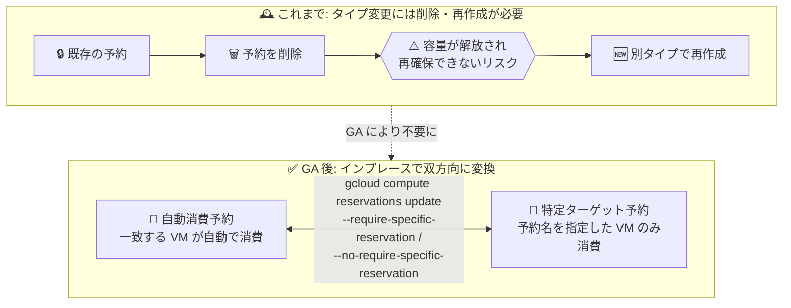

# Compute Engine: 予約の消費タイプ変換 (自動消費 ⇔ 特定ターゲット) が GA

**リリース日**: 2026-11-16

**サービス**: Compute Engine

**機能**: 予約の消費タイプ変換 (自動消費予約 ⇔ 特定ターゲット予約)

**ステータス**: GA (一般提供)

📊 [このアップデートのインフォグラフィックを見る](https://takech9203.github.io/google-cloud-news-summary/20261116-compute-engine-reservation-type-conversion-ga.html)

## 概要

Compute Engine の予約 (Reservation) において、**自動消費予約 (automatically consumed reservation) を特定ターゲット予約 (specifically targeted reservation) に、またはその逆方向に変換する機能が一般提供 (GA) になりました**。既存の予約を削除・再作成することなく、消費タイプをインプレースで変更できます。

Compute Engine の予約には 2 つの消費タイプがあります。自動消費予約は、プロパティが一致する VM が自動的に予約容量を消費するタイプで、特定ターゲット予約は、VM が予約名を明示的に指定 (ターゲット) した場合のみ消費できるタイプです。前者は利用率を最大化しやすく、後者は特定ワークロード専用に容量を確保しやすいという特性があります。

ワークロードの消費ニーズは時間とともに変化します。たとえば、当初は組織全体で柔軟に使わせたかった容量を、後から特定の重要ワークロード専用に確保したくなるケース (またはその逆) です。今回の GA により、このような変化に対して予約を作り直すことなく対応できるようになり、確保済みのキャパシティを手放すリスクを回避できます。キャパシティプランニングを担当するインフラ管理者や、GPU/大規模 VM の容量を管理する Solutions Architect にとって重要なアップデートです。

**アップデート前の課題**

- 予約の消費タイプ (自動消費 / 特定ターゲット) は作成時に決定され、後から変更するには予約の削除と再作成が必要だった
- 予約を削除すると確保していたキャパシティが解放されるため、再作成時に同じゾーンで同じ容量を再確保できない (リソース可用性エラーになる) リスクがあった
- 特に GPU や大規模マシンタイプなど入手困難なリソースでは、タイプ変更のためだけに容量を手放すことが現実的でなかった

**アップデート後の改善**

- 既存の予約に対して `gcloud compute reservations update` (または REST の `reservations.update`) で消費タイプを双方向に変換できるようになった
- 確保済みのキャパシティを維持したまま、ワークロードの消費ニーズの変化 (専用化 ⇔ 共用化) に追従できるようになった
- 予約の再作成に伴う容量喪失リスクや運用手順が不要になった

## アーキテクチャ図



これまで予約の消費タイプを変更するには削除・再作成が必要で容量喪失のリスクがありましたが、GA 後は `reservations.update` により確保済み容量を維持したまま双方向に変換できます。

## サービスアップデートの詳細

### 主要機能

1. **自動消費予約 → 特定ターゲット予約への変換**
   - プロパティが一致する任意の VM が消費できる予約を、予約名を明示的にターゲットした VM のみが消費できる予約に変換
   - 重要ワークロード向けに容量を「専用化」したい場合に有効
   - gcloud では `--require-specific-reservation` フラグを指定

2. **特定ターゲット予約 → 自動消費予約への変換**
   - 特定ワークロード専用だった予約を、プロパティが一致する VM が自動的に消費できる予約に変換
   - 専用確保の必要がなくなった容量を組織内で柔軟に使い、予約の利用率を高めたい場合に有効
   - gcloud では `--no-require-specific-reservation` フラグを指定

3. **確保済みキャパシティの維持**
   - 変換はインプレース (更新操作) で行われるため、予約を削除せずに済み、確保済みのゾーン内キャパシティを失わない

### 2 つの消費タイプの比較

| 項目 | 自動消費予約 | 特定ターゲット予約 |
|------|-------------|-------------------|
| 消費方法 | プロパティが一致する VM が自動的に消費 (デフォルト) | `--reservation-affinity=specific` で予約名を指定した VM のみ消費 |
| プロパティ不一致時 | エラーにならずオンデマンド容量で VM を作成 | VM 作成リクエストが失敗 |
| 向いている用途 | 予約利用率の最大化、汎用的な容量確保 | 特定ワークロードへの容量の確実な割り当て |
| 予約の削除 | 消費中の VM があっても削除可能 | 消費中の VM がない場合のみ削除可能 |

## 技術仕様

### 変換時の要件・挙動

| 項目 | 詳細 |
|------|------|
| 対象 | Compute Engine のオンデマンド予約 (単一プロジェクト / 共有予約) |
| 操作方法 | Google Cloud コンソール、gcloud CLI、REST API (`reservations.update`) |
| 事前条件 | 消費タイプを変更する前に、その予約を消費しているすべての VM を停止・サスペンド・削除する必要がある |
| 変換方向 | 自動消費 → 特定ターゲット、特定ターゲット → 自動消費の双方向 |
| 追加料金 | なし (予約は引き続き予約リソースのオンデマンド料金で課金) |

### gcloud CLI のフラグ

```text
--[no-]require-specific-reservation
    プロパティが一致する VM が自動的に予約を消費できるか、
    VM が予約を明示的にターゲットする必要があるかを切り替える。
    有効化すると --reservation-affinity=specific で予約名を
    指定した VM のみが消費可能になる。
    変更前に、予約を消費しているすべての VM を
    停止・サスペンド・削除する必要がある。
```

## 設定方法

### 前提条件

1. 変換対象の予約が存在すること (予約名とゾーンを確認)
2. 対象の予約を消費しているすべての VM を停止・サスペンド・削除しておくこと
3. プロジェクトに対する Compute Engine の予約を更新できる権限 (例: `roles/compute.admin`) があること

### 手順

#### ステップ 1: 予約を消費している VM を確認し停止する

```bash
# 予約の消費状況を確認
gcloud compute reservations describe RESERVATION_NAME \
    --zone=ZONE

# 予約を消費している VM を停止 (例)
gcloud compute instances stop INSTANCE_NAME \
    --zone=ZONE
```

消費タイプの変更前に、予約を消費しているすべての VM を停止・サスペンド・削除します。特定ターゲット予約を消費していた VM を停止した場合、同等の予約を用意しないと再起動できない点に注意してください。

#### ステップ 2: 消費タイプを変換する

```bash
# 自動消費予約 → 特定ターゲット予約
gcloud compute reservations update RESERVATION_NAME \
    --require-specific-reservation \
    --zone=ZONE

# 特定ターゲット予約 → 自動消費予約
gcloud compute reservations update RESERVATION_NAME \
    --no-require-specific-reservation \
    --zone=ZONE
```

REST API を使用する場合は、[`reservations.update` メソッド](https://docs.cloud.google.com/compute/docs/reference/rest/v1/reservations/update) に PATCH リクエストを送信します。

#### ステップ 3: 変換後の消費方法に合わせて VM を作成・再開する

```bash
# 特定ターゲット予約に変換した場合: 予約名を明示して VM を作成
gcloud compute instances create INSTANCE_NAME \
    --zone=ZONE \
    --reservation-affinity=specific \
    --reservation=projects/OWNER_PROJECT_ID/reservations/RESERVATION_NAME \
    ...
```

自動消費予約に変換した場合は、プロパティが一致する VM (新規・既存の実行中 VM) が自動的に予約を消費します。

## メリット

### ビジネス面

- **キャパシティ喪失リスクの排除**: 入手困難な GPU や大規模マシンタイプの確保済み容量を手放さずに運用方針を変更でき、ビジネス機会の損失を防げる
- **コスト効率の向上**: 専用確保が不要になった特定ターゲット予約を自動消費に変換することで、未消費のまま課金され続ける予約を減らし、予約利用率を高められる

### 技術面

- **運用の簡素化**: 削除 → 再作成という複数ステップの手順が単一の update 操作に置き換わり、オペレーションミスの余地が減る
- **ワークロードライフサイクルへの追従**: 検証フェーズでは自動消費で柔軟に使い、本番昇格時に特定ターゲットへ変換して容量を専用化する、といった段階的な運用が可能

## デメリット・制約事項

### 制限事項

- 消費タイプを変更する前に、その予約を消費しているすべての VM を停止・サスペンド・削除する必要がある (稼働中ワークロードへの影響を伴う)
- 特定ターゲット予約を消費していた VM を停止・サスペンドした場合、同名・同プロパティの予約を用意しない限り再起動・再開できない
- 予約自体の制約として、Spot VM / プリエンプティブル VM、Flex-start VM、単一テナントノードは予約を消費できない

### 考慮すべき点

- 自動消費に変換した直後から、プロパティが一致する既存の実行中 VM が自動的に予約を消費し始めるため、意図しない消費が起きないか事前に確認する
- 特定ターゲットに変換すると、予約名をターゲットしていない VM は予約を消費できなくなり、未消費分も課金が継続するため、変換後の消費計画を立てておく
- 共有予約の場合、コンシューマープロジェクト側の消費状況も含めて事前確認が必要

## ユースケース

### ユースケース 1: 検証用の共用 GPU 容量を本番ワークロード専用に切り替える

**シナリオ**: 組織で GPU VM の自動消費予約を作成し、複数チームが検証用途で柔軟に消費していた。その後、本番の ML 推論基盤に容量を確実に割り当てる必要が生じた。

**実装例**:
```bash
# 消費中の VM を停止した後、特定ターゲット予約に変換
gcloud compute reservations update ml-gpu-reservation \
    --require-specific-reservation \
    --zone=us-central1-a

# 本番ワークロードの VM は予約を明示的にターゲットして作成
gcloud compute instances create prod-inference-01 \
    --zone=us-central1-a \
    --reservation-affinity=specific \
    --reservation=projects/my-project/reservations/ml-gpu-reservation \
    ...
```

**効果**: 確保済みの GPU 容量を失うことなく、本番ワークロードに容量を確実に割り当てられる。

### ユースケース 2: 専用確保が終わった予約を共用化して利用率を改善する

**シナリオ**: 大規模な移行プロジェクト向けに特定ターゲット予約で容量を専用確保していたが、移行完了後は容量が余り、未消費のまま課金が発生していた。

**効果**: `--no-require-specific-reservation` で自動消費予約に変換することで、プロパティが一致する組織内の VM が自動的に容量を消費できるようになり、予約の遊休コストを削減できる。

## 料金

消費タイプの変換自体に追加料金はありません。予約は従来どおり、予約したリソースと同じオンデマンド料金 (実行中 VM と同じ 1 分単位の課金) で、予約が存在する限りリソースの使用有無にかかわらず課金されます。継続利用割引 (SUD)、確約利用割引 (CUD) も実行中の VM と同様に適用されます。

予約を消費している VM は、リソース料金が二重に課金されることはありません。詳細は [VM インスタンスの料金ページ](https://cloud.google.com/compute/vm-instance-pricing) を参照してください。

## 利用可能リージョン

リリースノートにリージョン固有の記載はありません。予約がサポートされるゾーンの詳細は [予約の概要ドキュメント](https://docs.cloud.google.com/compute/docs/instances/reservations-overview) を参照してください。

## 関連サービス・機能

- **GKE / Vertex AI / Dataflow / Batch / Cloud TPU**: Compute Engine の予約はこれらのサービスからも消費可能。消費タイプの変換は、これらのサービスに割り当てる容量の運用方針変更にも活用できる
- **確約利用割引 (CUD)**: 予約と組み合わせることで、確保した容量に対して割引を適用可能。課金は消費タイプにかかわらず同一
- **将来予約 (Future Reservations)**: 将来の特定日からの容量確保を申請する機能。承認後に自動作成される予約もオンデマンド予約と同様に消費できる
- **Capacity Planner**: 予約の消費実績と将来予測を分析し、タイプ変換の判断材料となる消費トレンドを把握できる
- **Cloud Monitoring / Cloud Billing (BigQuery エクスポート)**: 予約の消費状況の監視・分析に利用でき、未消費予約の特定に役立つ

## 参考リンク

- 📊 [インフォグラフィック](https://takech9203.github.io/google-cloud-news-summary/20261116-compute-engine-reservation-type-conversion-ga.html)
- [公式リリースノート](https://docs.cloud.google.com/release-notes#November_16_2026)
- [ドキュメント: 予約の変更 (Modify reservations)](https://docs.cloud.google.com/compute/docs/instances/reservations-modify)
- [ドキュメント: 予約の消費 (Consume reservations)](https://docs.cloud.google.com/compute/docs/instances/reservations-consume)
- [ドキュメント: 予約の概要](https://docs.cloud.google.com/compute/docs/instances/reservations-overview)
- [gcloud compute reservations update リファレンス](https://docs.cloud.google.com/sdk/gcloud/reference/compute/reservations/update)
- [料金ページ (VM インスタンス)](https://cloud.google.com/compute/vm-instance-pricing)

## まとめ

予約の消費タイプを削除・再作成なしで双方向に変換できるようになったことで、確保済みキャパシティを維持したままワークロードの変化に追従できるようになりました。GPU などの希少リソースを予約で管理しているチームは、未消費予約の棚卸しと合わせて、専用化・共用化の切り替えをこの機能で運用フローに組み込むことを推奨します。変換前に消費中 VM の停止が必要になる点だけは、メンテナンスウィンドウの計画に織り込んでください。

---

**タグ**: #ComputeEngine #Reservations #CapacityManagement #GA #CostOptimization #InfraOps
