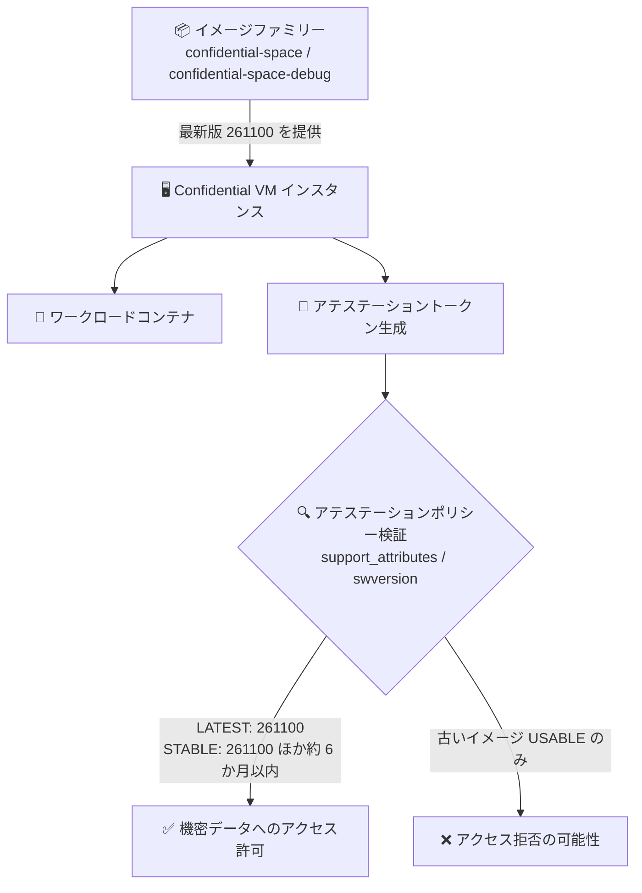

# Confidential Space: 新イメージ 261100 リリース

**リリース日**: 2026-11-16

**サービス**: Confidential Space

**機能**: Confidential Space イメージ 261100

**ステータス**: Announcement

📊 [このアップデートのインフォグラフィックを見る](https://takech9203.github.io/google-cloud-news-summary/20261116-confidential-space-image-261100.html)

## 概要

Confidential Space の新しいイメージ (バージョン 261100) が利用可能になりました。Confidential Space イメージは、Confidential VM 上で単一のワークロードコンテナを実行するためのミニマルな単一目的 OS で、Container-Optimized OS (COS) をベースに、完全性保護付きの暗号化ディスクパーティション、認証付き暗号化ネットワーク接続、ブート測定、リモートアクセスの無効化といったセキュリティ強化が施されています。

今回のリリースノートおよび Confidential Space の公式リリースノートページでは、イメージ 261100 で追加された個別の機能や修正内容は公表されていません。Confidential Space イメージは概ね毎月のペースで更新されており、新イメージの公開に伴い 261100 が `LATEST` 属性を持つイメージとなります。直前のイメージ 261001 では、セキュリティ速報 GCP-2026-071 (侵害された CA 証明書の削除) への対応と非 root コンテナ実行のサポートが追加されており、261001 より古いイメージを使用している環境は、今回の 261100 (または 261001 以降) への更新を強く推奨します。

## アーキテクチャ図



イメージファミリーから Confidential VM を新規作成すると最新イメージ (261100) が使用され、データコラボレーターのアテステーションポリシーでイメージのサポート属性やバージョンが検証されるフローを示しています。

## サービスアップデートの詳細

### 主要なポイント

1. **新イメージ 261100 の提供開始**
   - 2026 年 11 月 16 日付の Google Cloud Release Notes で発表
   - イメージファミリー (`confidential-space` / `confidential-space-debug`) から VM を新規作成すると自動的に最新イメージが使用される
   - 今回のリリースノートには個別の変更内容 (機能追加・修正) の記載はない

2. **サポート属性の移行**
   - 261100 の公開により、`LATEST` 属性は 261100 に移行する (旧イメージの `LATEST` は約 1 か月で外れる)
   - `STABLE` 属性は各イメージで約 6 か月間維持される。2027 年 4 月 1 日以降は、ライフタイム満了後に `STABLE` 属性が削除される運用となる

3. **旧イメージからの移行の推奨 (前リリースからの流れ)**
   - 直前のイメージ 261001 はセキュリティ速報 GCP-2026-071 (CVE-2026-111943、eMudhra (emSign) 下位 CA 証明書の侵害) への対応を含む
   - Google Cloud Attestation は 2026 年 11 月 9 日以降、260701 より古いイメージへのアテステーショントークン送信を停止、Intel Trust Authority (ITA) は 261001 より古いイメージへの送信を停止するスケジュールが公表されている
   - 古いイメージを使用中の環境は、最新イメージ (261100) への更新を推奨

## 技術仕様

### イメージのサポート属性

| サポート属性 | 内容 |
|------|------|
| LATEST | 最新イメージ。有効期間は約 1 か月。脆弱性の監視・サポート対象 |
| STABLE | 有効期間は約 6 か月。脆弱性の監視・サポート対象。アテステーションポリシーには STABLE の使用が推奨される |
| USABLE | 6 か月超の非推奨 (deprecated) イメージ。利用は可能だがサポート対象外 |
| EXPERIMENTAL | プレビュー機能を含むテスト専用イメージ。本番利用不可 |

### イメージの確認方法

```bash
# 利用可能な Confidential Space イメージの一覧 (本番イメージ)
gcloud compute images list \
  --project=confidential-space-images \
  --no-standard-images \
  --filter="family~'confidential-space$'"

# イメージの詳細 (ベース COS バージョン・サポート属性・非推奨予定日など) の確認
gcloud compute images describe confidential-space-261100 \
  --format=json \
  --project=confidential-space-images
```

## デメリット・制約事項

### 考慮すべき点

- 今回のリリースノートでは 261100 の変更内容が公表されていないため、動作差分を確認したい場合は Confidential Space の公式リリースノートやイメージの説明 (`gcloud compute images describe`) を継続的に確認する必要がある
- アテステーションポリシーで `LATEST` を要求している場合、新イメージ公開に伴い旧イメージの `LATEST` 属性が外れ、実行中のワークロードがトークン更新時にアテステーションに失敗する可能性がある。長時間実行ワークロードには `STABLE` 属性ベースのポリシーが推奨される
- イメージの更新には VM の再作成が必要。本番ワークロードの無停止更新には、インスタンステンプレートとマネージドインスタンスグループ (MIG) の活用が推奨される
- 重大な脆弱性が発見された場合、イメージが失効 (revoke) されることがある。失効したイメージではアテステーショントークンの `swname` クレームが `GCE` になる、またはトークン要求時に `RIMS_VALIDATION_FAILED` が返される

## 関連サービス・機能

- **Confidential VM**: Confidential Space イメージが動作する基盤。AMD SEV、Intel TDX (C3)、H100 GPU (a3-highgpu-1g) などに対応
- **Google Cloud Attestation / Intel Trust Authority (ITA)**: アテステーショントークンの発行元。イメージバージョン (`swversion`) やサポート属性 (`support_attributes`) の検証に使用
- **Container-Optimized OS (COS)**: Confidential Space イメージのベース OS
- **マネージドインスタンスグループ (MIG)**: イメージ更新に伴う VM 再作成の自動化・無停止化に活用可能

## 参考リンク

- 📊 [インフォグラフィック](https://takech9203.github.io/google-cloud-news-summary/20261116-confidential-space-image-261100.html)
- [公式リリースノート](https://docs.cloud.google.com/release-notes#November_16_2026)
- [Confidential Space リリースノート](https://docs.cloud.google.com/confidential-computing/confidential-space/docs/release-notes)
- [Confidential Space イメージ (ライフサイクル・サポート属性)](https://docs.cloud.google.com/confidential-computing/confidential-space/docs/confidential-space-images)
- [アテステーションアサーション リファレンス](https://docs.cloud.google.com/confidential-computing/confidential-space/docs/reference/attestation-assertions)

## まとめ

Confidential Space の新イメージ 261100 がリリースされました。個別の変更内容は公表されていませんが、`LATEST` 属性が 261100 に移行するため、`LATEST` ベースのアテステーションポリシーを使用している環境では早期のイメージ更新 (VM 再作成) が必要です。特に、セキュリティ速報 GCP-2026-071 対応前の古いイメージ (261001 より前) を使用している環境は、アテステーショントークン発行停止の影響を避けるためにも、最新イメージへの移行を優先的に実施してください。

---

**タグ**: #ConfidentialSpace #ConfidentialComputing #セキュリティ #イメージ更新 #アテステーション
