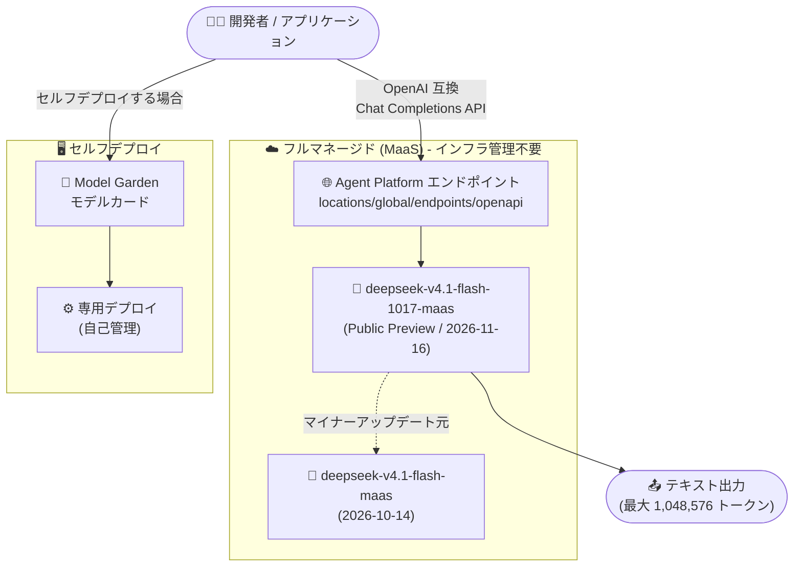

# Gemini Enterprise Agent Platform: DeepSeek-V4.1-Flash-1017 が Model Garden で Public Preview

**リリース日**: 2026-11-16

**サービス**: Gemini Enterprise Agent Platform (Model Garden)

**機能**: DeepSeek-V4.1-Flash-1017 のフルマネージドモデル (MaaS) 提供

**ステータス**: Public Preview

📊 [このアップデートのインフォグラフィックを見る](https://takech9203.github.io/google-cloud-news-summary/20261116-deepseek-v4-1-flash-1017-model-garden.html)

## 概要

DeepSeek 社の **DeepSeek-V4.1-Flash-1017** が、Model Garden のフルマネージドモデル (Model as a Service、MaaS) として Public Preview で利用可能になりました。ユーザーはインフラのプロビジョニングや管理を行うことなく、Gemini Enterprise Agent Platform のエンドポイントにリクエストを送るだけで、サーバーレスでこのモデルを利用できます。

DeepSeek-V4.1-Flash-1017 は、2026 年 10 月 14 日に MaaS 提供が開始された DeepSeek-V4.1-Flash のマイナーアップデート版です。同一のマルチモーダル Mixture-of-Experts (MoE) アーキテクチャを採用し、テキストと画像の入力を受け付け、最大 100 万 (1M) トークンのコンテキストウィンドウをサポートします。DeepSeek 社の報告によると、推論 (reasoning)、コーディング、エージェント (agentic)、視覚 (visual) の各ベンチマークで DeepSeek-V4.1-Flash から性能が向上しており、さらに出力が短くなりタスク完了が高速化されています。

エージェントワークフローやコーディング支援など、長いコンテキストと多数のツール呼び出しを伴うワークロードを、Google Cloud のマネージド環境上でオープンモデルを使って構築したい開発者・企業が主な対象です。MaaS としての利用に加え、Model Garden のモデルカードからセルフデプロイ (自己管理型デプロイ) することも可能です。

**アップデート前の課題**

- Model Garden の MaaS で利用できる DeepSeek モデルは DeepSeek-V4.1-Flash (`deepseek-v4.1-flash-maas`、2026 年 10 月 14 日リリース) のみで、その後 DeepSeek 社が改良したモデルはマネージド API として利用できなかった
- エージェントタスクでは出力の冗長さがタスク完了時間とトークンコストに影響していた (新モデルでは出力の短縮とタスク完了の高速化が報告されている)
- 既存の `deepseek-v4.1-flash-maas` エンドポイントの最低提供期限は 2026 年 11 月 28 日までとされており、それ以降の継続利用は利用状況と需要次第だった

**アップデート後の改善**

- 推論・コーディング・エージェント・視覚ベンチマークで改善されたモデルを、インフラ管理不要のフルマネージド API (`deepseek-v4.1-flash-1017-maas`) として利用できるようになった
- 出力が短くなりタスク完了が高速化されたことで、トークン効率とレイテンシの改善が期待できる
- 新エンドポイントは少なくとも 2026 年 12 月 31 日まで提供が保証され (利用状況によっては延長)、より長い検証期間を確保できるようになった
- Function calling、構造化出力 (Structured output)、Thinking をサポートし、エージェントワークロードに必要な機能を引き続き利用できる

## アーキテクチャ図



アプリケーションは Gemini Enterprise Agent Platform のグローバルエンドポイントに OpenAI 互換の Chat Completions API でリクエストを送るだけで、サーバーレスで DeepSeek-V4.1-Flash-1017 を利用できます。Model Garden のモデルカードからセルフデプロイする選択肢もあります。

## サービスアップデートの詳細

### 主要機能

1. **ベンチマーク性能の向上**
   - DeepSeek 社の報告によると、推論 (reasoning)、コーディング、エージェント (agentic)、視覚 (visual) の各ベンチマークで DeepSeek-V4.1-Flash から結果が改善
   - 出力が短くなり (shorter outputs)、タスク完了が高速化 (faster task completion)。エージェントループでのトークン消費と所要時間の削減が期待できる

2. **マルチモーダル MoE アーキテクチャと 1M トークンコンテキスト**
   - DeepSeek-V4.1-Flash と同一のマルチモーダル Mixture-of-Experts (MoE) アーキテクチャを採用
   - テキストと画像の入力に対応 (出力はテキストのみ)。音声・動画は非対応
   - コンテキストウィンドウは最大 1,048,576 トークン、最大出力も 1,048,576 トークン

3. **フルマネージド (MaaS) 提供**
   - サーバーレスで提供され、インフラのプロビジョニングや管理が不要
   - Standard Pay-as-you-go (PayGo) で利用でき、使った分だけ課金
   - Function calling、構造化出力、Thinking をサポート

4. **セルフデプロイ オプション**
   - Model Garden の DeepSeek-V4.1-Flash-1017 モデルカードから「Deploy model」を選択して、自己管理型のデプロイも可能

## 技術仕様

### Managed API (MaaS) 仕様

| 項目 | 詳細 |
|------|------|
| モデル ID | `deepseek-v4.1-flash-1017-maas` |
| リリース日 / ステージ | 2026 年 11 月 16 日 / Preview |
| モダリティ | テキスト: 入出力、画像: 入力のみ (音声・動画: 非対応) |
| コンテキスト長 | 最大 1,048,576 トークン (global) |
| 最大出力 | 1,048,576 トークン (global) |
| 機能 | Function calling、構造化出力 (Structured output)、Thinking |
| 消費オプション | Standard PayGo のみ (Provisioned Throughput、バッチ推論、固定クォータは非対応) |
| 提供リージョン / ML 処理 | global のみ |
| エンドポイント最低提供期限 | 少なくとも 2026 年 12 月 31 日まで (利用状況と需要により延長の可能性) |

### DeepSeek-V4.1-Flash (ベースモデル) との比較

| 項目 | DeepSeek-V4.1-Flash | DeepSeek-V4.1-Flash-1017 |
|------|---------------------|--------------------------|
| モデル ID | `deepseek-v4.1-flash-maas` | `deepseek-v4.1-flash-1017-maas` |
| MaaS リリース日 | 2026 年 10 月 14 日 | 2026 年 11 月 16 日 |
| アーキテクチャ | マルチモーダル MoE (552B バックボーン、prefill 時のトークンあたり 8B をアクティブ化) | 同一アーキテクチャ |
| 性能 | - | 推論・コーディング・エージェント・視覚ベンチマークで改善、出力短縮、タスク完了高速化 |
| エンドポイント最低提供期限 | 少なくとも 2026 年 11 月 28 日 | 少なくとも 2026 年 12 月 31 日 |

## 設定方法

### 前提条件

1. Google Cloud プロジェクトで課金が有効になっていること
2. Agent Platform API (`aiplatform.googleapis.com`) と Cloud Commerce Consumer Procurement API (`cloudcommerceconsumerprocurement.googleapis.com`) が有効になっていること
3. 以下の IAM ロールが付与されていること
   - Agent Platform User (`roles/aiplatform.user`)
   - Consumer Procurement Entitlement Manager (`roles/consumerprocurement.entitlementManager`)
4. Model Garden の DeepSeek-V4.1-Flash-1017 モデルカードで「Enable」をクリックし、プロジェクトでモデルを有効化していること

### 手順

#### ステップ 1: API の有効化とモデルの有効化

```bash
gcloud services enable aiplatform.googleapis.com \
    cloudcommerceconsumerprocurement.googleapis.com
```

Model Garden コンソールで DeepSeek-V4.1-Flash-1017 のモデルカードを開き、「Enable」をクリックしてプロジェクトでの利用を有効化します。

#### ステップ 2: Chat Completions API でリクエストを送信

OpenAI 互換の Chat Completions API 形式で、グローバルエンドポイントにリクエストを送信します。

```bash
cat > request.json << 'EOF'
{
  "model": "deepseek-v4.1-flash-1017-maas",
  "messages": [
    {
      "role": "user",
      "content": "このリポジトリのバグを分析して修正案を提示してください"
    }
  ],
  "max_tokens": 2048,
  "stream": true
}
EOF

curl -X POST \
  -H "Authorization: Bearer $(gcloud auth print-access-token)" \
  -H "Content-Type: application/json; charset=utf-8" \
  -d @request.json \
  "https://aiplatform.googleapis.com/v1/projects/PROJECT_ID/locations/global/endpoints/openapi/chat/completions"
```

`stream: true` を指定するとサーバー送信イベント (SSE) でレスポンスが逐次ストリーミングされ、体感レイテンシを低減できます。OpenAI SDK (`OPENAI_BASE_URL` を設定) からの呼び出しにも対応しています。

## メリット

### ビジネス面

- **インフラ管理コストの削減**: MaaS はサーバーレス提供のため、GPU インフラの確保・運用なしで最新のオープンモデルを利用開始できる
- **従量課金による低リスクな検証**: Standard PayGo で使った分だけの支払いとなり、Preview 段階のモデル評価を低コストで行える
- **コンプライアンスの継続適用**: MaaS として利用する場合、Gemini Enterprise Agent Platform の生成 AI に対する認証 (コンプライアンス認定) が引き続き適用され、プロンプトとレスポンスが第三者と共有されることもない

### 技術面

- **トークン効率の向上**: 出力の短縮とタスク完了の高速化により、エージェントループでの消費トークンとレイテンシの削減が期待できる
- **1M トークンコンテキスト**: 大規模コードベースの解析や長大なドキュメントを扱うエージェントタスクに対応
- **エージェント向け機能のサポート**: Function calling、構造化出力、Thinking をサポートし、ツール呼び出しを伴うエージェントワークフローを構築できる
- **OpenAI 互換 API**: Chat Completions API 互換のため、既存の OpenAI SDK ベースのコードから移行しやすい

## デメリット・制約事項

### 制限事項

- Public Preview のため、Pre-GA 提供条件 (「現状有姿」での提供、限定サポート) が適用される
- 消費オプションは Standard PayGo のみ。Provisioned Throughput、バッチ推論、固定クォータ、Priority/Flex PayGo は非対応
- 音声・動画入力は非対応 (テキスト入出力と画像入力のみ)
- 提供リージョンは global のみで、特定リージョンへのデータレジデンシー指定はできない
- `deepseek-v4.1-flash-1017-maas` エンドポイントの提供保証は少なくとも 2026 年 12 月 31 日までで、それ以降の提供は利用状況と需要に依存する

### 考慮すべき点

- DeepSeek モデルは Google 製品ではなく、サービス固有規約の AI/ML サービスセクションにおける「Separate Offerings」の条件およびモデルカードの個別規約が適用される
- Preview モデルのため、本番ワークロードへの組み込みは最低提供期限と廃止ポリシー (Minimum availability for Preview models) を確認したうえで判断する必要がある
- ベンチマーク改善は DeepSeek 社の報告に基づくため、自社ユースケースでの評価 (出力品質・トークン消費・レイテンシ) を行うことが推奨される

## ユースケース

### ユースケース 1: コーディングエージェントのモデル刷新

**シナリオ**: DeepSeek-V4.1-Flash (`deepseek-v4.1-flash-maas`) を使って社内のコーディング支援エージェントを運用しているが、エージェントループでの出力が冗長で、タスク完了までのトークン消費と時間が課題になっている。

**実装例**:
```json
{
  "model": "deepseek-v4.1-flash-1017-maas",
  "messages": [
    {"role": "user", "content": "リポジトリ全体のコードを添付します。テスト失敗の原因を特定し、修正パッチを提案してください。..."}
  ],
  "max_tokens": 8192
}
```

**効果**: モデル ID を切り替えるだけで、コーディング・エージェントベンチマークで改善されたモデルに移行でき、出力短縮とタスク完了の高速化によりトークンコストとレイテンシの削減が期待できる。

### ユースケース 2: 画像を含むドキュメントの長文解析

**シナリオ**: スクリーンショットや図表を含む大量の技術ドキュメント・設計資料を読み込ませ、内容の要約や QA を行いたい。

**効果**: テキストと画像入力、1M トークンのコンテキストウィンドウ、視覚ベンチマークの改善により、図表を含む長大な資料を一度のリクエストで横断的に解析できる。MaaS のためピーク時のみ利用するワークロードでもインフラの事前確保が不要。

## 料金

MaaS モデルは Standard Pay-as-you-go (PayGo) で提供され、トークン単位の従量課金です。Provisioned Throughput やバッチ推論の割引オプションは本モデルでは利用できません。最新のトークン単価は公式料金ページを参照してください。

- [Gemini Enterprise Agent Platform の生成 AI 料金](https://cloud.google.com/gemini-enterprise-agent-platform/generative-ai/pricing)

なお、セルフデプロイを選択した場合は、デプロイに使用するコンピュートリソースに対する課金となります。

## 利用可能リージョン

- **global** のみ (モデル提供・ML 処理ともに global)

詳細は [モデルのロケーション](https://docs.cloud.google.com/gemini-enterprise-agent-platform/resources/locations) を参照してください。

## 関連サービス・機能

- **Model Garden**: DeepSeek-V4.1-Flash-1017 を含むオープンモデル・パートナーモデルの検索・有効化・デプロイを行うカタログ。MaaS とセルフデプロイの両方の起点となる
- **Chat Completions API (Agent Platform)**: OpenAI 互換 API としてオープンモデルを呼び出すためのインターフェース。SSE によるストリーミングに対応
- **他の MaaS オープンモデル**: Gemma 4 26B A4B IT、GLM 5.2、gpt-oss 120B、Llama 4 Maverick/Scout などと同じマネージドオープンモデル群の一つで、同一のエンドポイント形式で切り替えて利用できる
- **IAM / Cloud Commerce Consumer Procurement**: オープンモデルの利用には `roles/aiplatform.user` と `roles/consumerprocurement.entitlementManager` の付与、および Procurement API の有効化が必要

## 参考リンク

- 📊 [インフォグラフィック](https://takech9203.github.io/google-cloud-news-summary/20261116-deepseek-v4-1-flash-1017-model-garden.html)
- [公式リリースノート](https://docs.cloud.google.com/release-notes#November_16_2026)
- [DeepSeek-V4.1-Flash-1017 ドキュメント](https://docs.cloud.google.com/gemini-enterprise-agent-platform/models/maas/deepseek/deepseek-v41-flash-1017)
- [DeepSeek モデルの概要](https://docs.cloud.google.com/gemini-enterprise-agent-platform/models/maas/deepseek)
- [マネージドオープンモデルの利用](https://docs.cloud.google.com/gemini-enterprise-agent-platform/models/maas/use-open-models)
- [オープンモデルの MaaS API 呼び出し](https://docs.cloud.google.com/gemini-enterprise-agent-platform/models/maas/call-open-model-apis)
- [料金ページ](https://cloud.google.com/gemini-enterprise-agent-platform/generative-ai/pricing)

## まとめ

DeepSeek-V4.1-Flash-1017 の MaaS 提供開始により、推論・コーディング・エージェント・視覚性能が改善されたオープンモデルを、インフラ管理なしの従量課金で利用できるようになりました。既存の `deepseek-v4.1-flash-maas` 利用者はモデル ID の切り替えだけで移行検証が可能です。Preview 段階のためエンドポイントの最低提供期限 (2026 年 12 月 31 日) を踏まえ、まずは評価ワークロードでトークン効率と出力品質を確認することを推奨します。

---

**タグ**: #GeminiEnterpriseAgentPlatform #ModelGarden #DeepSeek #MaaS #オープンモデル #生成AI #PublicPreview
