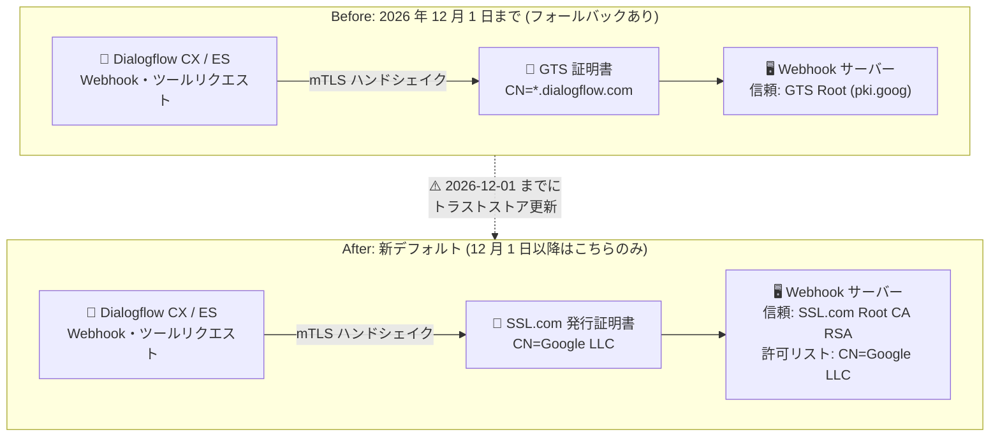

# Dialogflow: mTLS デフォルトクライアント証明書の移行 (Google Trust Services → SSL.com)

**リリース日**: 2026-11-16

**サービス**: Dialogflow (CX / ES)

**機能**: Webhook および Dialogflow CX ツールリクエストにおけるデフォルト mTLS クライアント証明書の発行元変更

**ステータス**: 破壊的変更 (Breaking change)

📊 [このアップデートのインフォグラフィックを見る](https://takech9203.github.io/google-cloud-news-summary/20261116-dialogflow-mtls-certificate-migration.html)

> ⚠️ **重要な破壊的変更**: mTLS を有効にした Webhook サーバーや Dialogflow CX ツールのバックエンドで、証明書のトラストストアやサブジェクト許可リスト (allowlist) を更新しない場合、**2026 年 12 月 1 日以降に TLS ハンドシェイクが失敗し、Webhook / ツール呼び出しが停止する可能性があります。**

## 概要

Dialogflow が Webhook および Dialogflow CX ツールリクエストの際に提示する **デフォルトの mTLS (相互 TLS) クライアント証明書** が、従来の Google Trust Services 発行の証明書 (サブジェクト `CN=*.dialogflow.com`) から、**SSL.com 発行の証明書 (サブジェクト `CN=Google LLC`)** に移行されます。

従来の Google Trust Services 証明書は **2026 年 12 月 1 日まで一時的なフォールバックとしてのみ利用可能** です。それ以降は SSL.com 発行の証明書のみが提示されるため、mTLS でクライアント証明書を検証している Webhook サーバーは、期日までにトラストストアへ **SSL.com Root Certification Authority RSA** を追加し、証明書サブジェクトの許可リストを使用している場合は `CN=Google LLC` を許可するよう更新する必要があります。

この変更の背景には、ブラウザのルートプログラム要件の変更により、Google Trust Services がパブリック TLS 証明書での clientAuth (クライアント認証) EKU のサポートを段階的に廃止していることがあります (2026 年 4 月以降、clientAuth EKU を含む CSR は例外なく拒否される計画が公表されています)。

**アップデート前の課題**

- 従来、Dialogflow からの mTLS 接続では Google Trust Services (GTS) 発行のクライアント証明書 (`CN=*.dialogflow.com`、発行チェーン: GTS Root R1 → GTS CA) が提示されており、Webhook サーバー側は GTS のルート CA ([pki.goog](https://pki.goog/)) を信頼するだけでよかった
- ブラウザルートプログラムの要件変更により、GTS はパブリック証明書での clientAuth サポートを廃止予定であり、従来の証明書を継続利用できなくなった

**アップデート後の改善 (変更点)**

- デフォルトの mTLS クライアント証明書が SSL.com 発行 (`CN=Google LLC`) に変更され、clientAuth EKU 廃止後も Dialogflow の mTLS 機能を継続利用できる
- 移行期間として、従来の GTS 証明書 (`CN=*.dialogflow.com`) は **2026 年 12 月 1 日までフォールバックとして利用可能**
- 対応に必要な作業は「サーバーのトラストストアに SSL.com Root Certification Authority RSA を追加」「証明書サブジェクト許可リストの更新」の 2 点に集約される

## アーキテクチャ図



Dialogflow が mTLS ハンドシェイク時に提示するクライアント証明書が GTS 発行から SSL.com 発行に変わるため、Webhook サーバー側のトラストストアと証明書サブジェクト許可リストの更新が必要になります。

## サービスアップデートの詳細

### 変更内容

1. **デフォルト mTLS クライアント証明書の発行元変更**
   - 対象: Dialogflow の Webhook リクエストおよび Dialogflow CX のツール (tool) リクエスト
   - 旧: Google Trust Services 発行、サブジェクト `CN=*.dialogflow.com`
   - 新: SSL.com 発行、サブジェクト `CN=Google LLC`

2. **移行期限 (2026 年 12 月 1 日)**
   - 旧 Google Trust Services 証明書は一時的なフォールバックとしてのみ提供
   - 2026 年 12 月 1 日以降、フォールバックは終了する

3. **ユーザー側で必要な対応**
   - Webhook サーバーのトラストストアに **SSL.com Root Certification Authority RSA** を追加する
   - 証明書サブジェクトの許可リスト (例: `CN=*.dialogflow.com` のみを許可する設定) を使用している場合、`CN=Google LLC` を許可するよう更新する

### 影響を受けるユーザー / 受けないユーザー

| 構成 | 影響 |
|------|------|
| Webhook サーバーで mTLS (クライアント証明書の検証) を有効化している | **影響あり**。トラストストアの更新が必須 |
| クライアント証明書のサブジェクト (CN) を許可リストで検証している | **影響あり**。`CN=Google LLC` の許可が必須 |
| Dialogflow CX のツールリクエストで mTLS を使用している | **影響あり**。同様の対応が必須 |
| 通常の TLS (サーバー証明書検証のみ) で Webhook を利用している | 影響なし |
| エージェントレベルのカスタムクライアント証明書 (Secret Manager 連携) を構成している | デフォルト証明書を使用しないため、この移行の直接の影響は受けない |

## 技術仕様

### 証明書の新旧比較

| 項目 | 旧 (フォールバック、〜2026-12-01) | 新 (デフォルト) |
|------|----------------------------------|----------------|
| 発行元 CA | Google Trust Services (GTS Root R1 → GTS CA) | SSL.com (SSL.com Root Certification Authority RSA) |
| サブジェクト CN | `*.dialogflow.com` | `Google LLC` |
| 対象リクエスト | Webhook / Dialogflow CX ツール | Webhook / Dialogflow CX ツール |
| ルート証明書の入手先 | [pki.goog](https://pki.goog/) | SSL.com のルート証明書配布ページ |

### 背景: Google Trust Services の clientAuth サポート廃止

Google Trust Services は、ブラウザルートプログラムの要件変更に対応するため、パブリック TLS 証明書における clientAuth EKU (`id-kp-clientAuth`) のサポートを段階的に廃止しています。

- フェーズ 1 (2025 年 11 月〜): clientAuth EKU を含む CSR は原則拒否 (例外条件あり)
- フェーズ 2 (2026 年 4 月〜): clientAuth EKU を含む CSR は例外なく拒否

この方針により、`CN=*.dialogflow.com` のようなパブリック CA 発行のクライアント証明書は継続発行できなくなるため、Dialogflow は SSL.com 発行の証明書への移行を実施しています。

## 設定方法

### 前提条件

1. Webhook サーバー (または Dialogflow CX ツールのバックエンド) で mTLS を有効化しており、クライアント証明書を検証している
2. サーバーのトラストストア (CA バンドル) を更新できる権限がある

### 手順

#### ステップ 1: SSL.com Root Certification Authority RSA をトラストストアに追加

```bash
# 例: Debian/Ubuntu 系でシステムのトラストストアに追加する場合
# (SSL.com の公式サイトから SSL.com Root Certification Authority RSA を取得)
sudo cp ssl-com-root-ca-rsa.crt /usr/local/share/ca-certificates/
sudo update-ca-certificates
```

Nginx や Apache、独自アプリケーションでクライアント CA バンドルを個別指定している場合は、該当するバンドルファイル (例: `ssl_client_certificate` で指定しているファイル) に SSL.com のルート証明書を追加します。移行期間中は GTS と SSL.com の両方のルートを信頼する構成にしておくと安全です。

#### ステップ 2: 証明書サブジェクト許可リストの更新

```bash
# 例: サブジェクト CN を検証するロジックがある場合、新しい CN を許可する
# 旧: CN=*.dialogflow.com
# 新: CN=Google LLC
# 移行期間中は両方を許可する
ALLOWED_CLIENT_CN=("*.dialogflow.com" "Google LLC")
```

アプリケーションやリバースプロキシでクライアント証明書のサブジェクト (CN) を検証している場合、`CN=Google LLC` を許可対象に追加します。

#### ステップ 3: 動作確認

```bash
# openssl s_server でクライアント証明書の提示内容を確認する例
sudo openssl s_server -key key.pem -cert fullchain.pem -accept 443 -verify 1
```

Dialogflow コンソールや API からテストリクエストを送信し、提示されるクライアント証明書のサブジェクト・発行チェーンを確認して、ハンドシェイクが成功することを検証します。クライアント証明書の検証に失敗すると `Failed to verify client's certificate: x509: certificate signed by unknown authority` のようなエラーで TLS ハンドシェイクが失敗し、セッションが終了します。

## メリット

### ビジネス面

- **サービス継続性の確保**: 期日までに対応すれば、GTS の clientAuth 廃止後も mTLS による双方向認証を維持したまま Dialogflow を運用できる
- **明確な移行期限**: 2026 年 12 月 1 日というフォールバック期限が明示されており、計画的な移行作業が可能

### 技術面

- **mTLS 機能の継続提供**: パブリック CA の業界要件変更後も、Dialogflow からのリクエストをクライアント証明書で認証する構成を継続できる
- **対応作業の限定**: 必要な変更はトラストストアと許可リストの更新のみで、Dialogflow エージェント側の設定変更は不要

## デメリット・制約事項

### 制限事項

- 旧 Google Trust Services 証明書 (`CN=*.dialogflow.com`) のフォールバックは **2026 年 12 月 1 日で終了** する
- 新証明書はサブジェクトが `CN=Google LLC` となり、ホスト名ベース (`*.dialogflow.com`) の識別ができなくなる

### 考慮すべき点

- **未対応の場合は Webhook / ツール呼び出しが失敗する**: トラストストア未更新のまま期限を迎えると、TLS ハンドシェイク失敗により会話フローが停止する
- **CN ベースの検証だけでは送信元のエージェントを特定できない**: `CN=Google LLC` は Dialogflow 固有の識別子ではないため、リクエストが自分のエージェントからのものであることの確認には、従来どおり Authorization ヘッダーのサービス ID トークン (Bearer トークン) の検証を併用することが公式ドキュメントで推奨されている
- **検証機構の棚卸しが必要**: ロードバランサー、リバースプロキシ、WAF、アプリケーションコードなど、クライアント証明書を検証している箇所をすべて洗い出して更新する必要がある
- デフォルト証明書に依存しない構成 (エージェントレベルのカスタムクライアント証明書) への移行も選択肢となる

## ユースケース

### ユースケース 1: mTLS を有効化した社内 Webhook サーバーの移行

**シナリオ**: コンタクトセンターの Dialogflow CX エージェントが、mTLS を必須とする社内 API ゲートウェイ経由の Webhook を呼び出している。ゲートウェイは GTS ルートのみを信頼し、`CN=*.dialogflow.com` を許可リストで検証している。

**実装例**:
```
1. ゲートウェイのクライアント CA バンドルに SSL.com Root Certification Authority RSA を追加
2. 許可リストに CN=Google LLC を追加 (移行期間中は旧 CN と併存)
3. テスト環境でテスト発話を実行し、新証明書でのハンドシェイク成功を確認
4. 2026-12-01 以降、旧 GTS ルートと旧 CN を許可リストから削除
```

**効果**: フォールバック期限後も Webhook 呼び出しが中断せず、会話フローの可用性を維持できる。

### ユースケース 2: Dialogflow CX ツール (エージェントツール) バックエンドの事前検証

**シナリオ**: 生成 AI エージェントが Dialogflow CX のツール機能で外部 API を呼び出しており、API 側で mTLS を要求している。

**効果**: 事前にトラストストアと許可リストを更新し、ステージング環境で新証明書のハンドシェイクを検証しておくことで、本番エージェントのツール呼び出し失敗を未然に防げる。

## 料金

この変更は証明書の発行元の移行であり、Dialogflow の料金体系への影響はありません。料金の詳細は [Dialogflow の料金ページ](https://cloud.google.com/dialogflow/pricing) を参照してください。

## 利用可能リージョン

この変更は Dialogflow CX / ES の mTLS を使用するすべての環境に適用されます。リージョン固有の情報はリリースノートに記載されていません。

## 関連サービス・機能

- **Dialogflow CX Webhook / ツール**: 今回の証明書変更の対象となるリクエスト。フルフィルメントや生成 AI エージェントの外部 API 連携で使用
- **Secret Manager**: エージェントレベルのカスタムクライアント証明書を使用する場合、秘密鍵とパスフレーズを Secret Manager で管理 (Dialogflow サービスエージェントに Secret Accessor 権限が必要)
- **Certificate Authority Service**: clientAuth 用途をプライベート PKI に移行する際の選択肢として Google が案内しているマネージド CA サービス
- **Service Directory**: VPC 内のプライベート Webhook サーバーへのアクセスに使用。カスタム CA 証明書と組み合わせて利用可能

## 参考リンク

- 📊 [インフォグラフィック](https://takech9203.github.io/google-cloud-news-summary/20261116-dialogflow-mtls-certificate-migration.html)
- [公式リリースノート](https://docs.cloud.google.com/release-notes#November_16_2026)
- [Dialogflow CX mTLS ドキュメント](https://docs.cloud.google.com/dialogflow/cx/docs/concept/mtls)
- [Dialogflow ES mTLS (フルフィルメント) ドキュメント](https://docs.cloud.google.com/dialogflow/es/docs/fulfillment-mtls)
- [Google Trust Services: clientAuth サポート変更のお知らせ](https://developers.google.com/public-key-infrastructure/updates/may2025-clientauth)
- [Dialogflow 料金ページ](https://cloud.google.com/dialogflow/pricing)

## まとめ

Dialogflow のデフォルト mTLS クライアント証明書が Google Trust Services (`CN=*.dialogflow.com`) から SSL.com (`CN=Google LLC`) に移行される破壊的変更です。mTLS で Dialogflow からのリクエストを検証しているすべての Webhook サーバー・ツールバックエンドは、**2026 年 12 月 1 日のフォールバック終了までに** SSL.com Root Certification Authority RSA のトラストストアへの追加と、証明書サブジェクト許可リストの更新を完了してください。

---

**タグ**: Dialogflow, Dialogflow CX, Dialogflow ES, mTLS, 証明書, Webhook, 破壊的変更, セキュリティ
