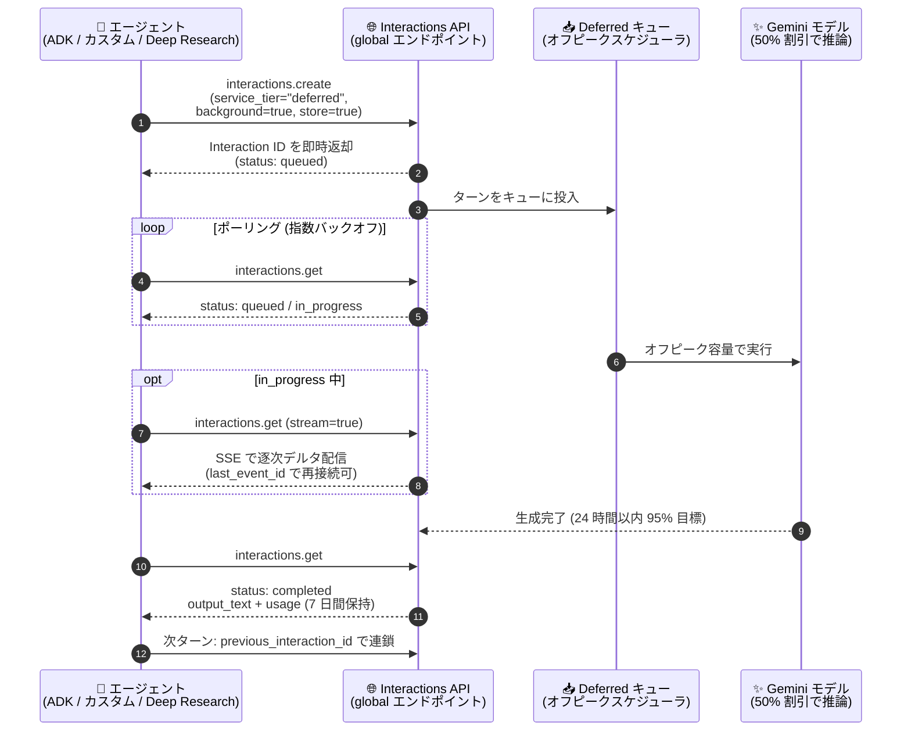

# Gemini Enterprise Agent Platform: Deferred ティア (自律エージェントスケジューリング / Interactions API 非同期モデル呼び出し) GA

**リリース日**: 2026-11-16

**サービス**: Gemini Enterprise Agent Platform

**機能**: Deferred ティア — 自律エージェントスケジューリングと Interactions API の非同期モデル呼び出しが GA

**ステータス**: GA (Generally Available)

📊 [このアップデートのインフォグラフィックを見る](https://takech9203.github.io/google-cloud-news-summary/20261116-gemini-enterprise-agent-platform-deferred-tier-ga.html)

## 概要

Gemini Enterprise Agent Platform の **Deferred ティア** が GA となりました。今回の発表は密接に関連する 2 つの GA を含みます。1 つ目は **自律エージェントスケジューリング (autonomous agent scheduling)** の GA で、従来の Gemini Deep Research Agent に加えて **Agent Development Kit (ADK) エージェント (google-adk v2.10.0 以降)** に対応しました。`use_interactions_api=True` を設定したモデルに対して `RunConfig` に `ServiceTier.DEFERRED` を渡すだけで、レイテンシ許容型のエージェントワークロードをオフピーク時間帯にキューイングできます。2 つ目は **Interactions API 上の非同期モデル呼び出し (`service_tier="deferred"`)** の GA で、カスタム / サードパーティエージェントがグローバルエンドポイント上の Gemini モデルを非同期に呼び出せるようになりました。

Deferred ティアの最大の魅力は **モデル推論料金が Standard PayGo 比で 50% 割引** になる点です。この割引は Agent Runtime、Cloud Run、GKE のいずれで実行するエージェントにも適用され、入力・出力・思考 (thinking) トークンすべてが対象です。Standard PayGo へのフォールバックは発生しないため、割引なしのオンデマンド料金で課金される心配がありません。リアルタイム応答が不要な大規模ドキュメント合成、コードベースの脆弱性スキャン、オフラインのエージェント評価などを、429 (リソース枯渇) エラーを回避しながら低コストで実行したい組織に最適なアップデートです。

Deferred ティアは **24 時間以内の完了 (95% 目標)** と **7 日間の状態保持** を提供し、`background=true` / `store=true` / `previous_interaction_id` によるターン連鎖、Google Gen AI SDK (Python / Node.js) と REST による作成・ポーリング・ストリーミング・キャンセルをサポートします。

**アップデート前の課題**

- Deferred ティアはプレビュー段階であり、利用には Google Cloud プロジェクトの **許可リスト (allowlist) 登録が必要** だった
- 自律エージェントスケジューリングの対象は **Gemini Deep Research Agent のみ** で、ADK で構築したカスタムエージェントはオフピークスケジューリングを利用できなかった
- 長時間実行のバックグラウンドエージェントをリアルタイムモデル (Standard ティア) で実行すると、インフラに不要な負荷がかかり **429 (リソース枯渇) エラー** やレートリミットが発生しやすかった
- レイテンシ許容型のワークロードでも Standard PayGo の通常料金が課金され、コスト最適化の手段が限られていた

**アップデート後の改善**

- Deferred ティアが **GA となり、許可リストなしで利用可能** になった (Cyber モデルを除く)
- **ADK エージェント (google-adk v2.10.0 以降)** が `RunConfig(service_tier=ServiceTier.DEFERRED)` でオフピークスケジューリングを利用できるようになり、1 つのエージェント定義でインタラクティブ用途とバッチ用途を使い分けられる
- Interactions API の `service_tier="deferred"` により、カスタム / サードパーティエージェントの Gemini モデル呼び出しを **50% 割引** で非同期実行できる
- 重い非同期ワークロードをオフピークに逃がすことで、リアルタイム本番トラフィック用の Standard ティアクォータを温存し、429 エラーを緩和できる

## アーキテクチャ図



Deferred 呼び出しのライフサイクルを示したシーケンス図です。リクエストは即座に Interaction ID を返してキューイングされ、オフピーク容量で実行された後、ポーリングまたは SSE ストリーミングで 24 時間以内 (95% 目標) に結果を取得します。

## サービスアップデートの詳細

### 主要機能

1. **自律エージェントスケジューリングの GA と ADK 対応**
   - google-adk v2.10.0 以降で、`use_interactions_api=True` を設定した Gemini モデルに対し `RunConfig(service_tier=ServiceTier.DEFERRED)` を渡すだけで有効化
   - ティア設定はモデルやエージェントではなく **実行 (run) 単位** の設定のため、同一エージェント定義でインタラクティブ要求とバッチワークロードの両方に対応可能
   - ADK Runner が内部でキュー投入・指数バックオフによるポーリング・結果取得までを処理し、アプリケーション側は通常の実行と同じようにイベントを消費するだけでよい
   - Agent Runtime、Cloud Run、GKE のいずれで実行しても 50% 割引が適用される
   - Gemini Deep Research Agent のマネージド実行も引き続きサポート

2. **Interactions API の非同期モデル呼び出し (Deferred ティア) GA**
   - `service_tier="deferred"` + `background=true` + `store=true` で非同期の Gemini モデル呼び出しをキューイング
   - **24 時間以内の完了を目標 (95%)**、状態は **7 日間保持**
   - `previous_interaction_id` によるマルチターン連鎖、`requires_action` (ツール呼び出し)、`requires_continuation` (長い生成の継続) に対応
   - Google Gen AI SDK (Python `google-genai>=2.34.0` / Node.js `@google/genai>=2.32.0`) と REST で作成 (create)・ポーリング (poll)・ストリーミング (stream)・キャンセル (cancel) をサポート
   - `in_progress` になった後は `stream=true` で SSE ストリームにアタッチでき、`last_event_id` で切断からの再接続も可能

3. **50% 割引の料金体系 (フォールバックなし)**
   - 入力・出力・思考トークンすべてが Standard PayGo 比 **50% 割引**
   - 割引は契約割引や暗黙的コンテキストキャッシュのトークン割引と **重ねて適用** される
   - Standard PayGo へのスピルオーバー / ダウングレードは発生せず、割引なし料金で課金されることがない
   - キュー内でキャンセルしたターンは課金されず、24 時間以内に完了せず failed となった単一呼び出しターンも課金対象外

### 対応モデル

グローバルエンドポイント (`locations/global`) 専用です。リージョナルエンドポイントや `us` / `eu` マルチリージョンに `service_tier="deferred"` を送ると HTTP 400 が返ります。

| カテゴリ | モデル |
|------|------|
| Gemini 4 | `gemini-4-carbon`, `gemini-4-argon` |
| Gemini 3.x Flash | `gemini-3.8-flash`, `gemini-3.7-flash`, `gemini-3.6-flash`, `gemini-3.5-flash`, `gemini-3.1-pro-preview` |
| Gemini 3.x Flash-Lite | `gemini-3.5-flash-lite`, `gemini-3.1-flash-lite` |
| Cyber モデル (許可リスト制) | `gemini-4-carbon-cyber-permissive`, `gemini-4-argon-cyber-permissive` |

## 技術仕様

### Interaction のステータス遷移

| ステータス | 最終状態 | 意味 |
|------|------|------|
| `queued` | No | 受理済みで容量待ち。バックオフ付きでポーリングする (この段階では `stream=true` 不可) |
| `in_progress` | No | 実行中。ポーリング継続、または `stream=true` で SSE ストリームにアタッチ可能 |
| `requires_action` | Yes | モデルが `function_call` を出力して終了。ツールを実行し `previous_interaction_id` で新ターンを作成 |
| `requires_continuation` | Yes | 長い生成が部分出力で停止。`continuation_token` 付きで再開 |
| `completed` | Yes | 完了。`output_text` と `usage` を取得、または次ターンへ連鎖 |
| `incomplete` | Yes | `max_output_tokens` 到達などで早期停止 |
| `failed` | Yes | ランタイムエラー、または 24 時間の完了ウィンドウ超過 |
| `cancelled` | Yes | `interactions.cancel` により停止 |

### クォータ・制限

| 項目 | 詳細 |
|------|------|
| モデル呼び出しクォータ | Deferred 専用クォータはなく、Flex PayGo のベースモデル単位クォータを共有 (`flex_requests_per_minute_per_project_per_base_model`、3,000 RPM) |
| 作成クォータ | `stateful_genai_interaction_creations`: 最大 100 RPM またはクォータティアにより無制限 |
| 同時実行 | `concurrent_interaction_generations`: 最大 500 (クォータティアによる) |
| ステートフルスループット | 書き込み 240 GiB/日、読み取り 480 GiB/日 (プロジェクト単位、固定) |
| ペイロード | `interactions.create` 1 回あたり非圧縮 HTTP ボディ最大 9.75 MiB |
| 状態保持 | 7 日間。チェーンあたり Cloud Storage (`gs://`) URI は最大 100 個 |
| 完了目標 | 24 時間以内に 95% のターンを完了 (クレジット保証付きレイテンシ SLA はなし) |

### Python での Deferred 呼び出し例 (Interactions API)

```python
from google import genai

client = genai.Client(
    enterprise=True,
    project="PROJECT_ID",
    location="global",
)

interaction = client.interactions.create(
    model="gemini-4-argon",
    input="リポジトリ全体の脆弱性レポートを作成してください。",
    service_tier="deferred",  # 50% 割引の Deferred ティア
    background=True,          # 即時リターン (キューイング)
    store=True,               # 状態を 7 日間保持
)
print(interaction.id, interaction.status)  # => v1_..., queued
```

## 設定方法

### 前提条件

1. 課金が有効な Google Cloud プロジェクト
2. IAM ロール: `roles/aiplatform.user` (作成・ポーリング・キャンセル)、読み取り専用の監視は `roles/aiplatform.viewer`
3. SDK を利用する場合: Google Gen AI SDK (`google-genai>=2.34.0` または `@google/genai>=2.32.0`)、ADK の場合は `google-adk` v2.10.0 以降
4. グローバルエンドポイント (`locations/global`) を使用すること

### 手順

#### ステップ 1: ADK エージェントで Deferred スケジューリングを有効化

```python
from google.adk.agents import LlmAgent, RunConfig
from google.adk.models import ServiceTier
from google.adk.models.google_llm import Gemini

root_agent = LlmAgent(
    name="batch_agent",
    model=Gemini(
        model="gemini-flash-latest",
        use_interactions_api=True,  # Deferred スケジューリングに必須
    ),
    instruction="入力ドキュメントを処理して要約を生成する。",
)

# この実行のすべてのモデル呼び出しにオフピーク容量をリクエスト
run_config = RunConfig(service_tier=ServiceTier.DEFERRED)
```

`run_async()` に `run_config` を渡すと、ADK がキュー投入と結果待機を内部で処理します。モデルに `use_interactions_api=True` がない場合、ティアは無視され警告ログ (`has no effect for agent`) が出力されるため、ログで適用を確認します。

#### ステップ 2: ポーリングで結果を取得 (Interactions API 直接利用時)

```python
import time

PENDING = {"queued", "in_progress"}
delay = 5.0
current = client.interactions.get(interaction.id)
while current.status in PENDING:
    time.sleep(delay)
    delay = min(delay * 2.0, 30.0)  # 指数バックオフ
    current = client.interactions.get(interaction.id)

print(current.status, current.output_text)
```

`in_progress` になった後は `client.interactions.get(interaction_id, stream=True)` で SSE ストリームにアタッチし、テキストデルタを逐次受信することもできます。

## メリット

### ビジネス面

- **推論コスト 50% 削減**: レイテンシ許容型ワークロードのモデル推論料金が Standard PayGo の半額になり、契約割引やコンテキストキャッシュ割引とも併用できる。フォールバックがないため予算の予測可能性が高い
- **GA による本番利用の解禁**: 許可リスト不要・Pre-GA 条項の制約なしで本番ワークロードに適用でき、FedRAMP High や VPC Service Controls などのガバナンス要件にも対応

### 技術面

- **429 エラーの緩和とクォータの有効活用**: 重い非同期ワークロードをオフピークに逃がすことで、Standard ティアのクォータをリアルタイム本番トラフィック用に温存できる
- **実行単位のティア切り替え**: ADK では `RunConfig` で指定するため、同一エージェント定義を変更せずにインタラクティブ / バッチの両モードで運用できる
- **マルチターンの非同期エージェントループ**: `previous_interaction_id` 連鎖と `requires_action` によるツール呼び出しで、複雑なエージェントワークフロー全体を非同期かつ低コストで実行できる

## デメリット・制約事項

### 制限事項

- グローバルエンドポイント専用。リージョナル / `us` / `eu` マルチリージョンエンドポイントでは HTTP 400 となり、**データレジデンシー要件には対応しない**
- ストリーミングモードとの併用不可: ADK で `ServiceTier.DEFERRED` と `StreamingMode.SSE` を組み合わせると `ValidationError` が発生 (`in_progress` 後の SSE アタッチは可能)
- `store=false` (ステートレスゼロデータ保持) と CMEK は未サポート。DoD IL5 / ITAR にも非対応
- 24 時間以内に完了しないターンは `failed` に遷移する (クレジット保証付きのレイテンシ SLA はない)
- ADK はプロセス再起動をまたいだ実行再開 (in-flight interaction ID の永続化) をサポートしない

### 考慮すべき点

- キュー待ち時間はバックエンドの負荷に依存し上限がないため、ADK ではクライアント側デッドライン (`asyncio.timeout()`) の設定を推奨。ただし **タイムアウトしてもバックエンドの実行はキャンセルされず課金は発生する** 点に注意
- HTTP (`adk api_server`) 経由で Deferred を使う場合、接続がキュー待ちの間保持されるため、Cloud Run などのリクエストタイムアウトを引き上げるか、長時間待機するワークロードは Agent Runtime へのデプロイを推奨
- ツールを呼び出すエージェントでは **各モデルターンが個別にキューイング** されるため、合計レイテンシは全ターンのキュー待ち時間の合計になる
- チェーンされたターンは暗黙的コンテキストキャッシュの対象だが、数時間のキュー待ちの間にキャッシュ済みプレフィックスが失効する可能性がある

## ユースケース

### ユースケース 1: コードベースの脆弱性スキャンと自動修正

**シナリオ**: セキュリティチームが毎晩、全リポジトリに対して脆弱性スキャンと修正提案を行う ADK エージェントを実行する。リアルタイム応答は不要で、翌朝までに結果が揃えばよい。

**実装例**:
```python
run_config = RunConfig(service_tier=ServiceTier.DEFERRED)
async for event in runner.run_async(
    user_id="security_bot",
    session_id=session.id,
    new_message=scan_request,
    run_config=run_config,
):
    process(event)
```

**効果**: モデル推論コストを 50% 削減しつつ、日中の対話型ワークロード用クォータを消費せずに大規模スキャンを完了できる。

### ユースケース 2: 金融・リーガル分野の大規模ドキュメント合成

**シナリオ**: 金融機関が日次・週次の株式市場リサーチや、M&A デューデリジェンスのための複数ドキュメント横断分析を Deep Research Agent / カスタムエージェントで実行する。

**効果**: `previous_interaction_id` で分析ターンを連鎖させながら、半額の推論コストで数時間規模のリサーチパイプラインを安定実行できる。429 エラーによる途中失敗も減少する。

### ユースケース 3: 大規模なオフラインエージェント評価

**シナリオ**: エージェント開発チームが品質ベンチマークのため、数千件の評価ケースをマルチターンで実行する。

**効果**: 評価ジョブをオフピーク容量に逃がすことで、本番環境のレートリミットに影響を与えず、評価コストを半減できる。

## 料金

Deferred ティアのモデル呼び出しは、入力・出力・思考トークンすべてが **Standard PayGo 比 50% 割引** で課金されます。

主な課金ルール:

| ルール | 内容 |
|--------|------|
| 割引の重複適用 | 契約割引、暗黙的コンテキストキャッシュのトークン割引とスタック (キャッシュ済みレートの上にさらに適用) |
| フォールバックなし | Standard PayGo へのスピルオーバー / ダウングレードは発生せず、割引なし料金で課金されない |
| キャンセル | `queued` 中のキャンセルは課金なし。`in_progress` 中のキャンセルは開始済みのモデル呼び出しのみ課金 |
| 失敗 | 24 時間ウィンドウ超過を含む `failed` の単一呼び出しターンは課金なし。マルチステップのツールループでは失敗前に完了した呼び出しのみ課金 |
| チェーン | `previous_interaction_id` チェーンの各ターンは独立して課金 |

モデル別の単価は [Agent Platform 料金ページ](https://cloud.google.com/gemini-enterprise-agent-platform/generative-ai/pricing) を参照してください。

## 利用可能リージョン

グローバルエンドポイント (`locations/global`、`aiplatform.googleapis.com`) のみで利用可能です。リージョナルエンドポイントおよび `us` / `eu` マルチリージョンエンドポイントはサポートされません。

## 関連サービス・機能

- **Agent Development Kit (ADK)**: google-adk v2.10.0 以降で `RunConfig(service_tier=ServiceTier.DEFERRED)` によるオフピークスケジューリングに対応
- **Gemini Deep Research Agent**: 自律エージェントスケジューリングのマネージド実行対象。`agent` パラメータで Deferred ティア実行が可能
- **Agent Runtime / Cloud Run / GKE**: いずれのランタイムで実行するエージェントにも 50% 割引が適用。長時間のキュー待ちには HTTP 接続を保持しない Agent Runtime が推奨
- **Batch API**: 大規模・高スループットのオフライン一括推論向け。エージェント / ツール呼び出し型の非同期ワークロードには Deferred ティアが適する
- **Flex PayGo**: 同期型のレイテンシ許容ワークロード向けの 50% 割引オプション。Deferred ティアはそのクォータ (`flex_requests_per_minute_per_project_per_base_model`) を共有
- **VPC Service Controls / Cloud Audit Logs / Access Transparency**: Deferred ティアがサポートするガバナンス統制 (FedRAMP High 対応。CMEK・データレジデンシーは非対応)

## 参考リンク

- 📊 [インフォグラフィック](https://takech9203.github.io/google-cloud-news-summary/20261116-gemini-enterprise-agent-platform-deferred-tier-ga.html)
- [公式リリースノート](https://docs.cloud.google.com/release-notes#November_16_2026)
- [ドキュメント: Deferred ティア (Interactions API)](https://docs.cloud.google.com/gemini-enterprise-agent-platform/models/deferred-tier)
- [ドキュメント: 自律エージェントスケジューリング](https://docs.cloud.google.com/gemini-enterprise-agent-platform/scale/efficiency/autonomous-scheduling)
- [ADK ドキュメント: Deferred scheduling with Gemini models](https://adk.dev/agents/models/google-gemini/deferred-schedule/)
- [料金ページ](https://cloud.google.com/gemini-enterprise-agent-platform/generative-ai/pricing)

## まとめ

Deferred ティアの GA により、レイテンシ許容型のエージェントワークロードを 50% 割引・フォールバックなしの料金で本番運用できるようになりました。特に ADK エージェント対応 (google-adk v2.10.0+) により、既存のエージェント定義を変更せず `RunConfig` の切り替えだけでコスト最適化が可能です。夜間バッチ、ドキュメント合成、オフライン評価などの非リアルタイムワークロードを運用している場合は、Standard ティアから Deferred ティアへの移行を検討することを推奨します。

---

**タグ**: #GeminiEnterpriseAgentPlatform #DeferredTier #InteractionsAPI #ADK #AutonomousAgentScheduling #GA #コスト最適化 #エージェント
