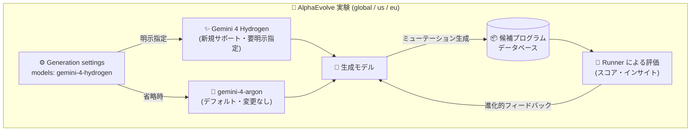
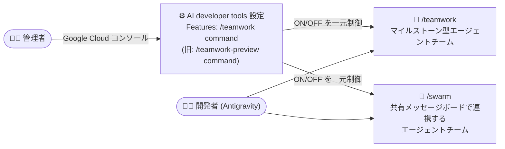

# Gemini Enterprise: AlphaEvolve で Gemini 4 Hydrogen が利用可能に / Antigravity の /teamwork 設定が /swarm コマンドも制御

**リリース日**: 2026-11-16

**サービス**: Gemini Enterprise

**機能**: AlphaEvolve での Gemini 4 Hydrogen サポート、および AI developer tools の /teamwork コマンド設定の名称変更と適用範囲拡大

**ステータス**: Feature (AlphaEvolve での Gemini 4 Hydrogen 提供) / Change (/teamwork-preview 設定の名称変更と /swarm コマンドへの適用)

📊 [このアップデートのインフォグラフィックを見る](https://takech9203.github.io/google-cloud-news-summary/20261116-gemini-enterprise-alphaevolve-gemini-4-hydrogen.html)

## 概要

Gemini Enterprise に関する 2 つの関連アップデートが発表されました。1 つ目は、進化的手法でアルゴリズム探索・組合せ最適化を行う AI コーディングエージェント **AlphaEvolve** で、最新モデル **Gemini 4 Hydrogen** が利用可能になったことです。AlphaEvolve の実験 (experiment) は、`global`、`us`、`eu` の各リージョンで Gemini 4 Hydrogen を使って候補プログラムを生成できるようになりました。利用するには Generation settings (`generationSettings.models`) に `gemini-4-hydrogen` を指定します。なお、Gemini 4 Hydrogen はデフォルトモデルを置き換えるものではなく、明示的に指定した場合のみ使用されます。

2 つ目は、Google Cloud コンソールの AI developer tools 設定に関する変更です。Features セクションの **/teamwork-preview command** 設定が、Google Antigravity のコマンド名と一致する **/teamwork command** に名称変更されました。さらに、サポートされているバージョンの Antigravity では、この設定が **/swarm コマンド** (共有メッセージボードを介して連携するエージェントチームを実行するコマンド) も制御するようになりました。設定をオフにすると、組織内のユーザーは両方のコマンドを使用できなくなります。

前者は AlphaEvolve を利用する開発者・研究者向け、後者は組織の AI developer tools を統制する管理者向けのアップデートです。マルチエージェント機能の利用可否を 1 つの設定で一元管理できるようになる一方、既に /teamwork を許可している組織では /swarm も自動的に利用可能になる点に注意が必要です。

**アップデート前の課題**

- AlphaEvolve の Generation settings で指定できるモデルは `gemini-4-argon`、`gemini-3.8-flash` などに限られており、2026 年 11 月 12 日に GA となった最新の高速・高効率モデル Gemini 4 Hydrogen を候補プログラム生成に使用できなかった
- コンソールの設定名が「/teamwork-preview command」で、Antigravity の実際のコマンド名 (/teamwork) と一致しておらず、管理者にとって分かりにくかった
- Antigravity の /swarm コマンドに対応する組織レベルの管理設定が明示されておらず、マルチエージェント機能の利用可否を個別に把握する必要があった

**アップデート後の改善**

- AlphaEvolve の実験で `gemini-4-hydrogen` を指定でき、`global`、`us`、`eu` の各リージョンで候補プログラムの生成 (ミューテーション) に最新モデルを活用できるようになった
- デフォルトモデルは変更されないため、既存の実験や `models` を省略した実験の挙動に影響はなく、安全に新モデルを試せる
- 設定名が「/teamwork command」となり Antigravity のコマンド名と一致、管理者が設定の対象を直感的に理解できるようになった
- 1 つの設定で /teamwork と /swarm の両方のマルチエージェントコマンドを一元的に有効化・無効化できるようになった

## アーキテクチャ図



AlphaEvolve は生成モデルで候補プログラムのミューテーションを作り、Runner の評価結果をフィードバックして進化的に最適化します。今回のアップデートで、Generation settings に明示指定することで Gemini 4 Hydrogen を生成モデルとして利用できるようになりました (デフォルトは引き続き gemini-4-argon)。



名称変更された /teamwork command 設定は、サポートされているバージョンの Antigravity で /swarm コマンドも制御します。設定をオフにすると組織内のユーザーは両コマンドを使用できません。

## サービスアップデートの詳細

### 主要機能

1. **AlphaEvolve での Gemini 4 Hydrogen サポート (Feature)**
   - AlphaEvolve の実験が `global`、`us`、`eu` リージョンで Gemini 4 Hydrogen を使って候補プログラムを生成可能に
   - 利用するには Generation settings (`generationSettings.models[].name`) に `gemini-4-hydrogen` を指定する
   - デフォルトモデルは置き換えられない (2026 年 10 月 26 日以降に作成された実験のデフォルトは `gemini-4-argon`)。モデルは実験ごとに保存されるため、既存の実験には影響しない
   - 1 つの実験で最大 2 モデルまで `weight` (生成呼び出しの比率) を付けて組み合わせ可能

2. **Gemini 4 Hydrogen の特長 (候補プログラム生成への適性)**
   - 日常的なコーディングとエージェント型ワークフローに最適化された高速・高効率モデル (2026 年 11 月 12 日 GA)
   - 入出力統合の 1,048,576 トークンコンテキストウィンドウ、思考レベル LOW / MEDIUM / HIGH (デフォルト) / XHIGH をサポート
   - Gemini 3.8 Flash と比較して、推測ではなく不足コンテキストの指摘により虚偽の主張を 5 分の 1 以下に削減、ツール呼び出しの並列バッチ化にも対応

3. **/teamwork command 設定への名称変更 (Change)**
   - Google Cloud コンソールの AI developer tools 設定の Features セクションで、**/teamwork-preview command** 設定が **/teamwork command** に名称変更
   - Google Antigravity のコマンド名 (/teamwork) と一致し、設定対象が明確に

4. **/swarm コマンドの制御を追加 (Change)**
   - サポートされているバージョンの Antigravity では、この設定が /swarm コマンドも制御
   - /swarm は、タスクを分割した名前付きワーカーエージェントのチームが共有メッセージボード上で `@mention` を使って連携し、検証担当 (verifier) がレビュー・テストを行うマルチエージェントコマンド
   - 設定をオフにすると、組織内のユーザーは /teamwork と /swarm の両方を使用できない

## 技術仕様

### AlphaEvolve の Generation settings でサポートされるモデル

| モデル名 | 提供リージョン | 備考 |
|------|------|------|
| `gemini-4-hydrogen` | `global`, `us`, `eu` | 今回追加。明示指定が必要 |
| `gemini-4-argon` | `global`, `us`, `eu` | 2026-10-26 以降のデフォルトモデル |
| `gemini-3.8-flash` | `global`, `us`, `eu` | |
| `gemini-3.7-flash` | `global`, `us`, `eu` | |
| `gemini-3.5-flash` | `global`, `us`, `eu` | |
| `gemini-3.1-pro-preview` | `global` | |

- サポート対象外のモデル名やリージョンで利用できないモデルを指定すると、実験作成時に `INVALID_ARGUMENT` が返される
- 1 実験あたり最大 2 モデルまで組み合わせ可能。`weight` は比率であり合計 1 である必要はない

### Generation settings の指定例 (Gemini 4 Hydrogen を使用)

```json
{
  "config": {
    "title": "Sorting Optimization Campaign",
    "problemDescription": "Optimize the custom_heuristic function.",
    "programLanguage": "python",
    "runSettings": {
      "maxPrograms": 250,
      "concurrency": 8
    },
    "generationSettings": {
      "includeFullProgramInPrompt": true,
      "models": [
        { "name": "gemini-4-hydrogen", "weight": 1.0 }
      ]
    }
  }
}
```

### Gemini 4 Hydrogen の主な仕様

| 項目 | 詳細 |
|------|------|
| コンテキストウィンドウ | 1,048,576 トークン (入力・思考・出力を統合) |
| 最大出力 | 同期 1 セグメントあたり 65,536 トークン、long decode で最大 1,048,576 トークン |
| 思考レベル | LOW / MEDIUM / HIGH (デフォルト) / XHIGH (`thinking_budget` と MINIMAL は HTTP 400) |
| コンテキストキャッシュ | 暗黙的キャッシュのみ (最小 4,096 トークン)。明示的キャッシュは非対応 |
| 提供リージョン | `global`、マルチリージョン `us` / `eu` |
| GA 日 | 2026 年 11 月 12 日 |

## 設定方法

### 前提条件

1. Gemini Enterprise のサブスクリプションと、AlphaEvolve を利用する Google Cloud プロジェクト (AlphaEvolve は `global`、`us`、`eu` でのみ利用可能)
2. /teamwork・/swarm の管理には、AI developer tools を管理できる権限 (Gemini Enterprise 管理者ロールなど) が必要
3. /swarm コマンド自体の利用には、対応プランとサポートされているバージョンの Antigravity App または Antigravity CLI が必要

### 手順

#### ステップ 1: AlphaEvolve 実験で Gemini 4 Hydrogen を指定

```bash
# Discovery Engine API (v1alpha) で実験を作成し、
# generationSettings.models に gemini-4-hydrogen を指定
curl -X POST \
  -H "Authorization: Bearer $(gcloud auth print-access-token)" \
  -H "Content-Type: application/json" \
  "https://discoveryengine.googleapis.com/v1alpha/projects/PROJECT_ID/locations/global/collections/default_collection/engines/ENGINE_ID/sessions/SESSION_ID/alphaEvolveExperiments" \
  -d '{
    "config": {
      "title": "Hydrogen Optimization Experiment",
      "problemDescription": "Optimize the target function.",
      "programLanguage": "python",
      "runSettings": { "maxPrograms": 100 },
      "generationSettings": {
        "models": [ { "name": "gemini-4-hydrogen", "weight": 1.0 } ]
      }
    }
  }'
```

`models` を省略すると、実験作成日時点のデフォルトモデル (現在は `gemini-4-argon`) が設定されます。Gemini 4 Hydrogen を使う場合は必ず明示的に指定します。

#### ステップ 2: /teamwork command 設定の確認 (管理者)

1. Google Cloud コンソールで **Gemini Enterprise** に移動
2. **Settings** をクリックし、**AI developer tools** タブを選択
3. **Features** セクションで **/teamwork command** 設定 (旧 /teamwork-preview command) を確認
4. 組織のポリシーに応じてオン / オフを切り替える (オフにすると /teamwork と /swarm の両方が組織内で利用不可)

## メリット

### ビジネス面

- **最新モデルによる探索効率の向上**: アルゴリズム発見や組合せ最適化の候補プログラム生成に、コスト効率と速度に優れた最新世代モデルを利用でき、実験あたりの成果向上が期待できる
- **ガバナンスの簡素化**: マルチエージェント機能 (/teamwork、/swarm) の利用可否を 1 つの設定で統制でき、管理者の運用負荷とポリシー適用漏れのリスクを低減できる
- **データレジデンシーへの対応**: Gemini 4 Hydrogen は `us` / `eu` マルチリージョンでも提供されるため、リージョン要件のある組織でも AlphaEvolve で利用しやすい

### 技術面

- **後方互換性の維持**: デフォルトモデルは変更されず、モデルは実験ごとに保存されるため、既存の実験や自動化パイプラインに影響なく新モデルを導入できる
- **モデルの組み合わせ**: 最大 2 モデルを `weight` 付きで併用でき、たとえば Gemini 4 Hydrogen を主、別モデルを従とした多様性のあるミューテーション生成が構成できる
- **設定名とコマンド名の一致**: コンソール設定名が Antigravity の実コマンド名と揃い、設定の対象機能が明確になった

## デメリット・制約事項

### 制限事項

- AlphaEvolve は `global`、`us`、`eu` でのみ利用可能。その他のロケーションで実験を作成すると `FAILED_PRECONDITION` が返される
- Assured Workloads プロジェクトでは AlphaEvolve を利用できない
- 1 プロジェクトあたり、ロケーションごとに同時アクティブ (STARTED / RUNNING) な実験は 30 件まで
- Gemini 4 Hydrogen はデフォルトモデルにならないため、利用には Generation settings での明示指定が必要
- Gemini 4 Hydrogen ではサンプリングパラメータ (`temperature`、`top_p`、`top_k`) のカスタム値は無視され、`thinking_budget` の指定はエラーになる
- /swarm は Preview であり、Antigravity の対応プラン (Google AI Pro / Ultra 相当) とサポートされているバージョンでのみ利用できる

### 考慮すべき点

- /teamwork command 設定を既にオンにしている組織では、サポートされているバージョンの Antigravity で /swarm も利用可能になるため、組織ポリシー上 /swarm を許可してよいか確認が必要
- /swarm は各ワーカーが独立したエージェントとして動作するため、単一の会話よりもクォータ (トークン) 消費が速い
- 設定をオフにすると /teamwork と /swarm の両方が無効になり、片方だけを許可する粒度の制御はこの設定ではできない
- AlphaEvolve の実験は作成時にモデルが固定されるため、新しいモデルを使うには新しい実験の作成が必要

## ユースケース

### ユースケース 1: 最新モデルによるアルゴリズム最適化実験

**シナリオ**: 研究開発チームが、NP 困難な組合せ最適化問題のヒューリスティック改善に AlphaEvolve を利用している。候補プログラムの生成品質と速度を上げるため、最新の Gemini 4 Hydrogen を試したい。

**実装例**:
```json
"generationSettings": {
  "includeFullProgramInPrompt": true,
  "models": [
    { "name": "gemini-4-hydrogen", "weight": 0.9 },
    { "name": "gemini-4-argon", "weight": 0.1 }
  ]
}
```

**効果**: 生成呼び出しの約 9 割を高速・高効率な Gemini 4 Hydrogen に、残りをデフォルトモデルの gemini-4-argon に振り分け、ミューテーションの多様性を保ちつつ探索スループットを高められる。既存実験はそのまま動き続けるため、新旧実験の結果を比較検証できる。

### ユースケース 2: 組織でのマルチエージェントコマンドの統制

**シナリオ**: 企業の IT 管理者が、開発部門に Antigravity を展開している。トークン消費が速いマルチエージェント機能は、まず一部チームで検証してから全社展開したい。

**効果**: Google Cloud コンソールの /teamwork command 設定をオフにすることで、/teamwork と /swarm の両方を組織全体で無効化できる。検証完了後は設定をオンに切り替えるだけで両コマンドを解放でき、個別のコマンドごとの設定管理が不要になる。

## 料金

AlphaEvolve での Gemini 4 Hydrogen 利用に固有の追加料金は Release Notes には記載されていません。Gemini 4 Hydrogen のモデル利用料金の参考値 (Gemini API 有償ティア) は以下のとおりです。

| 項目 | 料金 (参考) |
|--------|-----------------|
| 入力トークン | $1.50 / 100 万トークン |
| キャッシュ済み入力トークン (暗黙的キャッシュ) | $0.075 / 100 万トークン (95% 割引) |
| 出力トークン (思考トークン含む) | $7.50 / 100 万トークン |

- Gemini 4 Hydrogen は Standard PayGo (Usage Tiers 対応) と Priority PayGo、Provisioned Throughput に対応しています
- モデルが処理するすべてのトークン (思考トークン、グラウンディング利用時の内部ツール命令・関数宣言を含む) が課金対象です
- 最新の正確な料金は [Gemini Enterprise Agent Platform の料金ページ](https://cloud.google.com/gemini-enterprise-agent-platform/generative-ai/pricing) を参照してください

## 利用可能リージョン

- **AlphaEvolve での Gemini 4 Hydrogen**: `global`、`us`、`eu`
- **Gemini 4 Hydrogen (モデル自体)**: `global`、マルチリージョン `us` / `eu` (ML 処理・データレジデンシーは `us` / `eu` に対応)
- /teamwork command 設定は Google Cloud コンソールの AI developer tools 設定 (対象リージョン: `global`、`us`、`eu`) で管理

## 関連サービス・機能

- **Google Antigravity (App / CLI / for IDEs)**: /teamwork、/swarm、/boost などのマルチエージェントコマンドを提供する AI 開発ツール。Gemini Enterprise の AI developer tools 設定で組織統制が可能
- **Gemini Enterprise Agent Platform**: Gemini 4 Hydrogen を含む各モデルの提供基盤。GenerateContent API / Interactions API を通じてモデルを利用
- **Discovery Engine API (v1alpha)**: AlphaEvolve の実験 (alphaEvolveExperiments) を作成・管理する API
- **Cloud Billing / Pay-as-you-go**: AI developer tools とモデル利用の課金管理。クォータ超過分の従量課金設定が可能
- **Enterprise Gateway**: Antigravity のモデル推論リクエストを企業ゲートウェイ経由にルーティングし、ネットワーク経路と課金アトリビューションを統制

## 参考リンク

- 📊 [インフォグラフィック](https://takech9203.github.io/google-cloud-news-summary/20261116-gemini-enterprise-alphaevolve-gemini-4-hydrogen.html)
- [公式リリースノート](https://docs.cloud.google.com/release-notes#November_16_2026)
- [AlphaEvolve の概要](https://docs.cloud.google.com/gemini/enterprise/docs/alphaevolve/developer-guide/overview)
- [AlphaEvolve API リファレンス (Supported models / Default model / 制限事項)](https://docs.cloud.google.com/gemini/enterprise/docs/alphaevolve/reference-guide/api-reference)
- [Gemini 4 Hydrogen モデルカード](https://docs.cloud.google.com/gemini-enterprise-agent-platform/models/gemini/4-hydrogen)
- [Gemini 4 Hydrogen デベロッパーガイド](https://docs.cloud.google.com/gemini-enterprise-agent-platform/models/guides/gemini-4-hydrogen)
- [AI developer tools 設定の構成](https://docs.cloud.google.com/gemini/enterprise/docs/ai-developer-tools-settings)
- [Antigravity Swarm (/swarm) ドキュメント](https://antigravity.google/docs/swarm)
- [Antigravity Teamwork (/teamwork) ドキュメント](https://antigravity.google/docs/teamwork)
- [料金ページ (Gemini Enterprise Agent Platform)](https://cloud.google.com/gemini-enterprise-agent-platform/generative-ai/pricing)

## まとめ

AlphaEvolve で最新の Gemini 4 Hydrogen が候補プログラム生成に使えるようになり、アルゴリズム探索・最適化実験の選択肢が広がりました。デフォルトモデルは変わらないため、まずは新規実験で `gemini-4-hydrogen` を明示指定して既存実験と性能を比較することをおすすめします。また、Antigravity を展開している組織の管理者は、/teamwork command 設定が /swarm コマンドも制御するようになったため、現在の設定値がマルチエージェント機能に関する組織ポリシーと整合しているかを確認してください。

---

**タグ**: Gemini Enterprise, AlphaEvolve, Gemini 4 Hydrogen, Google Antigravity, AI developer tools, swarm, teamwork, マルチエージェント, 生成 AI
