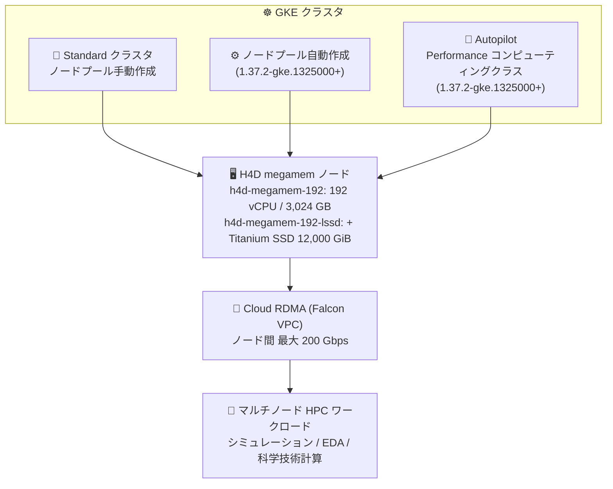

# Google Kubernetes Engine: H4D megamem マシンタイプ (h4d-megamem-192 / h4d-megamem-192-lssd) が GA

**リリース日**: 2026-11-16

**サービス**: Google Kubernetes Engine (GKE)

**機能**: H4D マシンシリーズの megamem マシンタイプ (h4d-megamem-192 / h4d-megamem-192-lssd) の GKE サポート

**ステータス**: GA (一般提供)

📊 [このアップデートのインフォグラフィックを見る](https://takech9203.github.io/google-cloud-news-summary/20261116-gke-h4d-megamem-machine-types-ga.html)

## 概要

H4D マシンシリーズの `h4d-megamem-192` および `h4d-megamem-192-lssd` マシンタイプが GKE で一般提供 (GA) になりました。H4D は AMD EPYC Turin (第 5 世代) プロセッサと Titanium オフロードプロセッサを搭載したコンピューティング最適化マシンシリーズで、HPC (High Performance Computing) ワークロード向けに設計されています。megamem マシンタイプは 192 vCPU と 3,024 GB という H4D シリーズ最大のメモリを備え、`-lssd` バリアントでは 12,000 GiB (32 x 375 GiB) の Titanium SSD が付属します。

Standard クラスタではこれらのマシンタイプを使用したノードプールを作成でき、GKE バージョン 1.37.2-gke.1325000 以降では、ノードプール自動作成 (node pool auto-creation) や Autopilot クラスタの Performance コンピューティングクラスでも利用可能になりました。これにより、メモリ集約型の HPC ワークロードを GKE のマネージドな運用モデル上で実行できます。

対象ユーザーは、製造業のシミュレーション、気象予測、EDA (電子設計自動化)、ライフサイエンス、科学技術計算など、大容量メモリと高速ノード間通信 (Cloud RDMA による最大 200 Gbps) を必要とするマルチノード HPC ワークロードを Kubernetes 上で運用するチームです。

**アップデート前の課題**

- GKE で利用できる H4D マシンタイプはメモリ最大 1,488 GB (highmem) までであり、より大容量のメモリを必要とする HPC ワークロード (大規模なインメモリ計算や巨大なメッシュを扱うシミュレーションなど) には対応が難しかった
- Autopilot の Performance コンピューティングクラスにおける H4D のメモリ上限は 1,400 GiB (1.33.2-gke.4731000 以降、1.37.2-gke.1325000 より前) に制限されていた
- 大容量メモリとローカル SSD を併用するスクラッチ領域重視のワークロードでは、H4D では highmem-lssd (3,750 GiB) までしか選択肢がなかった

**アップデート後の改善**

- 192 vCPU / 3,024 GB メモリの `h4d-megamem-192` を GKE Standard クラスタのノードプールで GA として利用可能になった
- `h4d-megamem-192-lssd` により 12,000 GiB の Titanium SSD を備えた大容量スクラッチストレージ構成が選択可能になった
- GKE 1.37.2-gke.1325000 以降では、ノードプール自動作成および Autopilot の Performance コンピューティングクラスで megamem マシンタイプを利用でき、Autopilot でのメモリ上限も 3,024 GiB に拡大された

## アーキテクチャ図



Standard クラスタのノードプール、ノードプール自動作成、Autopilot の Performance コンピューティングクラスの 3 つの方法で H4D megamem ノードをプロビジョニングでき、Cloud RDMA による高速ノード間通信でマルチノード HPC ワークロードを実行します。

## サービスアップデートの詳細

### 主要機能

1. **h4d-megamem-192 / h4d-megamem-192-lssd の GA 提供**
   - 192 vCPU (SMT 無効のため 1 vCPU = 1 物理コア) と 3,024 GB メモリを搭載した H4D シリーズ最大メモリ構成
   - `-lssd` バリアントは 32 x 375 GiB = 12,000 GiB の Titanium SSD を搭載し、大容量スクラッチ領域を提供
   - Standard クラスタでノードプールを作成して利用可能

2. **ノードプール自動作成への対応 (1.37.2-gke.1325000 以降)**
   - ノードプール自動作成 (node auto-provisioning) により、ワークロードの要求に応じて megamem マシンタイプのノードプールを GKE が自動的に作成
   - クラスタオートスケーリングと組み合わせた柔軟なキャパシティ管理が可能

3. **Autopilot Performance コンピューティングクラスへの対応 (1.37.2-gke.1325000 以降)**
   - `cloud.google.com/compute-class: Performance` と `cloud.google.com/machine-family: h4d` のノードセレクタで megamem ノードを利用可能
   - Performance クラスにおける H4D のメモリ上限が従来の 1,400 GiB から 3,024 GiB に拡大
   - Pod ごとに専有ノードを割り当てる運用モデルで、ノード管理を GKE に委譲しながら HPC 性能を確保

## 技術仕様

### H4D マシンタイプ一覧 (megamem は今回 GKE で GA)

| マシンタイプ | vCPU | メモリ (GB) | Titanium SSD | デフォルト下り帯域 |
|------|------|------|------|------|
| h4d-standard-192 | 192 | 720 | 非対応 | 最大 200 Gbps |
| h4d-highmem-192 | 192 | 1,488 | 非対応 | 最大 200 Gbps |
| h4d-highmem-192-lssd | 192 | 1,488 | 3,750 GiB (10 x 375 GiB) | 最大 200 Gbps |
| **h4d-megamem-192** | **192** | **3,024** | **非対応** | **最大 200 Gbps** |
| **h4d-megamem-192-lssd** | **192** | **3,024** | **12,000 GiB (32 x 375 GiB)** | **最大 200 Gbps** |

### H4D シリーズの特徴

| 項目 | 詳細 |
|------|------|
| プロセッサ | AMD EPYC Turin (第 5 世代)、ベース 2.7 GHz / 最大 4.1 GHz |
| オフロード | Titanium オフロードプロセッサ |
| SMT | 無効 (有効化不可)。1 vCPU = 1 物理コア、オーバーコミットなし |
| ノード間ネットワーク | Cloud RDMA (RDMA over Falcon) で最大 200 Gbps |
| インターネット下り | 1 Gbps に制限 |
| ブロックストレージ | Hyperdisk Balanced (最大 128 ボリューム / VM、合計 512 TiB)、Titanium SSD |
| プロビジョニング | オンデマンド、1 年 / 3 年 CUD、予約 (Dense 配置推奨)、flex-start (Dynamic Workload Scheduler) |

### GKE バージョン要件

| 利用形態 | 必要バージョン |
|------|------|
| Standard クラスタで予約済み H4D ノードプール | 1.32.6-gke.1060000 以降 |
| flex-start / Autopilot / クラスタオートスケーリング / ノード自動プロビジョニング | 1.33.2-gke.4731000 以降 |
| megamem のノードプール自動作成・Autopilot Performance クラス (メモリ 3,024 GiB) | 1.37.2-gke.1325000 以降 |

## 設定方法

### 前提条件

1. GKE API が有効化されていること、gcloud CLI が最新版であること
2. H4D VM のキャパシティを消費オプション (予約、flex-start など) に応じて確保していること。H4D には Dense リソース割り当てが推奨
3. ノードイメージは Container-Optimized OS のみサポート
4. H4D が利用可能なロケーションを使用すること (Compute Engine のリージョン・ゾーン一覧で H4D をフィルタして確認)

### 手順

#### ステップ 1: Standard クラスタで megamem ノードプールを作成

```bash
gcloud container node-pools create h4d-megamem-pool \
    --cluster=CLUSTER_NAME \
    --location=CONTROL_PLANE_LOCATION \
    --node-locations=COMPUTE_ZONE \
    --machine-type=h4d-megamem-192 \
    --reservation-affinity=specific \
    --reservation=RESERVATION_NAME \
    --num-nodes=NODE_COUNT
```

予約済みキャパシティを利用する場合の例です。Cloud RDMA を利用する場合は、Falcon VPC ネットワークプロファイルを使用した専用 VPC / サブネットの作成と、マルチネットワーキングを有効にしたクラスタ構成が必要です。

#### ステップ 2: Autopilot の Performance コンピューティングクラスで利用 (1.37.2-gke.1325000 以降)

```yaml
apiVersion: v1
kind: Pod
metadata:
  name: hpc-megamem-pod
spec:
  nodeSelector:
    cloud.google.com/compute-class: Performance
    cloud.google.com/machine-family: h4d
  containers:
  - name: hpc-container
    image: IMAGE
    resources:
      requests:
        cpu: "180"
        memory: "2900Gi"
```

Performance コンピューティングクラスと H4D マシンファミリーをノードセレクタで指定します。Pod は専有ノードに配置され、メモリは最大 3,024 GiB (1.37.2-gke.1325000 以降) まで要求できます。

## メリット

### ビジネス面

- **大規模 HPC の Kubernetes 集約**: 従来は専用 HPC クラスタで運用していたメモリ集約型ワークロードを GKE に集約でき、インフラ運用の標準化とコスト最適化が進む
- **柔軟なキャパシティ調達**: オンデマンド、1 年 / 3 年 CUD、予約、flex-start (Dynamic Workload Scheduler) から、バースト的な HPC 需要に合わせた調達方法を選択できる

### 技術面

- **H4D 最大のメモリ容量**: ノードあたり 3,024 GB のメモリにより、大規模なインメモリ計算や巨大なモデル・メッシュを扱うシミュレーションを単一ノードまたは少数ノードで実行可能
- **高速スクラッチストレージ**: `-lssd` バリアントの 12,000 GiB Titanium SSD により、I/O 集約的な中間データ処理を高速化
- **一貫した性能**: SMT 無効・オーバーコミットなしの専有ホスト構成と、Cloud RDMA による最大 200 Gbps のノード間通信で、タイトに結合されたマルチノードアプリケーションの性能を安定化
- **運用の自動化**: ノードプール自動作成や Autopilot により、HPC ノードのプロビジョニング・管理を GKE に委譲できる

## デメリット・制約事項

### 制限事項

- H4D は事前定義されたマシンタイプのみで、カスタムマシンタイプは利用不可
- GPU は利用不可
- インターネットへの下り (外向き) データ転送は 1 Gbps に制限
- マシンイメージの作成、インスタンスイメージからのディスク作成、インスタンス間のディスク共有 (マルチライター / 読み取り専用) は非対応
- Hyperdisk Balanced の性能は 15,000 IOPS / 240 MBps に制限
- ライブマイグレーション非対応。ホストメンテナンス時は Terminate 動作 (`-lssd` はローカル SSD データ保持付きの Terminate)、事前通知は 7 日前

### 考慮すべき点

- ノードイメージは Container-Optimized OS のみサポート
- ライブマイグレーション非対応のため、GKE ノードの中断対応 (メンテナンス通知のハンドリングなど) を設計に組み込む必要がある
- 性能維持のため、ワークロードには 192 CPU 全部を割り当てず、システムデーモン用の CPU 余裕を残すことが推奨される (ベストプラクティス)
- Cloud RDMA を利用する場合は、gVNIC に加えて IRDMA 用の vNIC と Falcon VPC ネットワークプロファイルの構成が必要
- H4D が利用可能なリージョン / ゾーンは限定されるため、事前に空き状況とキャパシティ確保方法の確認が必要

## ユースケース

### ユースケース 1: 大規模メモリを必要とする科学技術シミュレーション

**シナリオ**: 気象予測や計算流体力学 (CFD) などで、巨大なメッシュデータをメモリ上に展開して解析する。highmem (1,488 GB) ではメモリが不足し、ノード分割によるオーバーヘッドが課題だった。

**実装例**:
```bash
gcloud container node-pools create cfd-pool \
    --cluster=hpc-cluster \
    --machine-type=h4d-megamem-192 \
    --reservation-affinity=specific \
    --reservation=h4d-reservation \
    --num-nodes=4
```

**効果**: ノードあたり 3,024 GB のメモリにより分割数を削減し、Cloud RDMA (最大 200 Gbps) で残りのノード間通信を高速化することで、シミュレーション全体の実行時間を短縮できる。

### ユースケース 2: Autopilot での EDA ワークロード実行

**シナリオ**: 半導体設計の検証ジョブ (EDA) をメモリ集約型のバッチとして実行したいが、ノードプールの管理負荷を最小化したい。

**効果**: Autopilot の Performance コンピューティングクラスで `machine-family: h4d` を指定するだけで、ジョブごとに専有の megamem ノードが自動プロビジョニングされ、ノード管理なしで最大 3,024 GiB のメモリを利用できる。

## 料金

H4D インスタンスはオンデマンドのほか、1 年 / 3 年のコミットメント利用割引 (CUD) で利用できます。GKE Standard ではノードとして使用する Compute Engine リソース (vCPU、メモリ、Titanium SSD) に対して課金され、Autopilot の Performance コンピューティングクラスではノード単位の課金モデルが適用されます。詳細な単価は料金ページを参照してください。

- [Compute Engine VM インスタンスの料金](https://cloud.google.com/compute/vm-instance-pricing)
- [GKE の料金](https://cloud.google.com/kubernetes-engine/pricing)

## 利用可能リージョン

H4D マシンタイプは一部のリージョン / ゾーンで利用可能です (例: us-west4-a など)。最新の提供状況は [利用可能なリージョンとゾーン](https://docs.cloud.google.com/compute/docs/regions-zones#available) で H4D をフィルタして確認してください。

## 関連サービス・機能

- **Compute Engine (H4D マシンシリーズ)**: GKE ノードの基盤となるコンピューティング最適化マシンシリーズ。AMD EPYC Turin と Titanium を搭載
- **Cloud RDMA / Falcon VPC ネットワークプロファイル**: ノード間最大 200 Gbps の RDMA 通信を実現するネットワーク機能。IRDMA vNIC 用の専用 VPC が必要
- **Dynamic Workload Scheduler (flex-start)**: バースト的な HPC 需要向けに、H4D キャパシティをスケジュールまたは即時にプロビジョニング
- **Cluster Toolkit**: GKE H4D Blueprint を使用して、予約済み H4D VM を利用する本番対応の GKE クラスタを迅速に構築
- **Hyperdisk Balanced**: H4D でサポートされるブロックストレージ (最大 128 ボリューム / VM、合計 512 TiB)

## 参考リンク

- 📊 [インフォグラフィック](https://takech9203.github.io/google-cloud-news-summary/20261116-gke-h4d-megamem-machine-types-ga.html)
- [公式リリースノート](https://docs.cloud.google.com/release-notes#November_16_2026)
- [Run high performance computing (HPC) workloads with H4D](https://docs.cloud.google.com/kubernetes-engine/docs/how-to/run-hpc-workloads)
- [Compute-optimized machine family: H4D machine series](https://docs.cloud.google.com/compute/docs/compute-optimized-machines#h4d_series)
- [Resource requests in GKE Autopilot](https://docs.cloud.google.com/kubernetes-engine/docs/concepts/autopilot-resource-requests)
- [Best practices for running HPC workloads on GKE](https://docs.cloud.google.com/kubernetes-engine/docs/best-practices/run-hpc)
- [料金ページ (Compute Engine VM インスタンス)](https://cloud.google.com/compute/vm-instance-pricing)

## まとめ

H4D megamem マシンタイプの GKE での GA により、ノードあたり 3,024 GB のメモリと最大 12,000 GiB の Titanium SSD を備えた HPC ノードを、Standard・ノードプール自動作成・Autopilot のいずれの運用モデルでも利用できるようになりました。メモリ集約型の HPC ワークロードを Kubernetes に移行・集約したい場合は、GKE 1.37.2-gke.1325000 以降へのアップグレードと、予約や flex-start によるキャパシティ確保方法の検討から始めることを推奨します。

---

**タグ**: #GKE #H4D #HPC #Compute #Autopilot #GA
