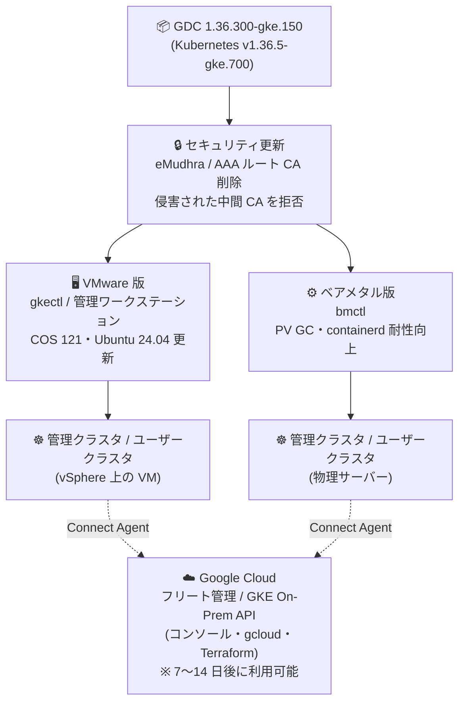

# Google Distributed Cloud (software only): VMware 版・ベアメタル版 1.36.300-gke.150 リリース

**リリース日**: 2026-11-16

**サービス**: Google Distributed Cloud (software only) for VMware / for bare metal

**機能**: バージョン 1.36.300-gke.150 リリース (セキュリティ強化・不具合修正)

**ステータス**: Announcement / Feature / Fixed

📊 [このアップデートのインフォグラフィックを見る](https://takech9203.github.io/google-cloud-news-summary/20261116-google-distributed-cloud-1-36-300.html)

## 概要

Google Distributed Cloud (software only) の VMware 版およびベアメタル版の新パッチバージョン **1.36.300-gke.150** がダウンロード可能になりました。両バリアントとも Kubernetes v1.36.5-gke.700 上で動作します。リリース後、GKE On-Prem API クライアント (Google Cloud コンソール、gcloud CLI、Terraform) でこのバージョンが利用可能になるまでには約 7〜14 日かかります。

本リリースの最大のポイントは **証明書トラストストアのセキュリティ強化**です。両バリアントで、システムコンポーネントとコンテナベースイメージから、信頼が取り消された (distrusted) eMudhra (emSign) および AAA Certificate Services のルート CA 証明書が削除され、侵害された eMudhra の中間 CA 証明書を拒否するようになりました。VMware 版では、Container-Optimized OS のマイルストーン 121 (cos-121-18867-652-7) へのアップグレードと、Ubuntu 24.04 ノード/管理ワークステーションのベースイメージ更新 (ubuntu-gke-op-2404-1-34-v20261027、USN-8944-1 対応) も含まれます。

さらに、脆弱性修正に加えて、クラスタ運用の信頼性に関わる多数の不具合修正が含まれています。VMware 版では MetalLB アドレスプール更新時のスタック問題や手動ロードバランサモードでのプリフライトチェック誤検出などが修正され、ベアメタル版では `bmctl check cluster --snapshot` の panic、ノード削除時のローカル PersistentVolume のガベージコレクション、再起動時の containerd 状態破損への耐性向上、etcd メンバー削除時の IP プレフィックス誤マッチなどが修正されています。オンプレミスで GDC クラスタを運用しているすべての管理者に適用が推奨されるリリースです。

**アップデート前の課題**

- 信頼が取り消された eMudhra (emSign) / AAA Certificate Services ルート CA がシステムコンポーネントやベースイメージのトラストストアに残存しており、侵害された eMudhra 中間 CA を介した証明書が受け入れられるリスクがあった
- (VMware) MetalLB アドレスプールの更新が UPDATING 状態のままスタックすることがあった
- (VMware) 手動ロードバランサモードでプリフライトチェックがコントロール プレーン VIP の検証に失敗することがあった
- (VMware/共通) 孤児化した `k8s-health-check-reader-binding` ClusterRoleBinding が残存していた。また audit-proxy が恒久的なエラーに対して無限リトライしていた
- (ベアメタル) `bmctl check cluster --snapshot` が closed channel への send による競合状態で panic することがあった
- (ベアメタル) ノード削除時にローカル PersistentVolume リソースが残存し、手動削除が必要だった
- (ベアメタル) イメージ展開中の再起動で containerd の状態が破損することがあった
- (ベアメタル) コントロール プレーン ノードの IP が同じプレフィックスを共有する場合 (例: 10.201.0.2 と 10.201.0.26)、etcd メンバー削除が誤動作することがあった

**アップデート後の改善**

- 両バリアントで distrusted な eMudhra (emSign) / AAA Certificate Services ルート CA が削除され、侵害された eMudhra 中間 CA が拒否されるようになり、証明書トラストチェーンの安全性が向上した
- (VMware) COS 121 / Ubuntu 24.04 最新ベースイメージ (USN-8944-1) への更新により OS レベルの脆弱性が解消された
- (VMware) MetalLB アドレスプールの不正な更新はバリデーション時に拒否されるようになり、スタック状態が発生しなくなった (変更が必要な場合は新しいアドレスプールを追加する運用に変更)
- (ベアメタル) ノード削除時にローカル PersistentVolume が自動的にガベージコレクションされるようになった (アップグレード後に作成された PV に適用)
- 両バリアントで孤児化 ClusterRoleBinding の修正 (名前空間スコープの RoleBinding 化)、audit-proxy の無限リトライ修正、Kubernetes プリフライト ヘルスチェックの名前空間スコープ修正が適用され、運用の安定性が向上した

## アーキテクチャ図



同一バージョン 1.36.300-gke.150 が VMware 版 (gkectl) とベアメタル版 (bmctl) の両方で提供され、共通のセキュリティ更新 (CA 削除) と各バリアント固有の修正が適用されます。クラスタは Connect Agent 経由で Google Cloud のフリートに接続されます。

## サービスアップデートの詳細

### 主要機能

1. **信頼取り消し済みルート CA の削除と侵害された中間 CA の拒否 (両バリアント共通)**
   - システムコンポーネントとコンテナベースイメージを更新し、distrusted となった eMudhra (emSign) および AAA Certificate Services のルート CA をトラストストアから削除
   - 侵害された eMudhra の中間 CA 証明書を拒否するように変更
   - クラスタ内コンポーネントが不正な証明書チェーンを信頼してしまうリスクを排除

2. **OS ベースイメージの更新 (VMware 版)**
   - Container-Optimized OS をマイルストーン 121 (cos-121-18867-652-7) にアップグレード
   - Ubuntu 24.04 のノードおよび管理ワークステーションのベースイメージを ubuntu-gke-op-2404-1-34-v20261027 に更新 (USN-8944-1 のセキュリティ修正を含む)

3. **脆弱性修正 (両バリアント共通)**
   - 各バリアントの Vulnerability fixes ページに記載された脆弱性を修正

### 修正された問題 (VMware 版)

| 修正内容 | 詳細 |
|---------|------|
| 孤児化 ClusterRoleBinding | 孤児化していた `k8s-health-check-reader-binding` ClusterRoleBinding をクリーンアップし、名前空間スコープの RoleBinding に変更 |
| プリフライトチェック (手動 LB モード) | 手動ロードバランサモードでコントロール プレーン VIP の検証が失敗する問題を修正 |
| MetalLB アドレスプール更新 | 更新が UPDATING 状態でスタックする問題を修正。不正な更新はバリデーション時に拒否されるようになった (変更したい場合は新しいアドレスプールを追加する) |
| audit-proxy | 恒久的なエラーに対して無限にリトライする問題を修正 |
| プリフライト ヘルスチェック | Kubernetes プリフライト ヘルスチェックの名前空間スコープの問題を修正 |

### 修正された問題 (ベアメタル版)

| 修正内容 | 詳細 |
|---------|------|
| `bmctl check cluster --snapshot` | closed channel への send による競合状態で panic する問題を修正 |
| ローカル PV のガベージコレクション | ノード削除時にローカル PersistentVolume リソースが自動削除されるようになった (アップグレード後に作成された PV に適用。既存の孤児化 PV は手動削除が必要) |
| containerd の耐性向上 | イメージ展開中の再起動による状態破損への耐性を改善 |
| etcd メンバー削除 | コントロール プレーン ノードの IP が同じプレフィックスを共有する場合 (例: 10.201.0.2 と 10.201.0.26) の誤動作を修正 |
| 構成ドリフト ヘルスチェック | アップグレード/ロールバック中に「version not supported」エラーが発生する問題を修正 |
| 孤児化 ClusterRoleBinding / audit-proxy / プリフライト | VMware 版と同様の修正を適用 |

## 技術仕様

### バージョン情報

| 項目 | 詳細 |
|------|------|
| GDC バージョン | 1.36.300-gke.150 (VMware 版・ベアメタル版共通) |
| Kubernetes バージョン | v1.36.5-gke.700 |
| COS (VMware 版) | マイルストーン 121 (cos-121-18867-652-7) |
| Ubuntu ベースイメージ (VMware 版) | ubuntu-gke-op-2404-1-34-v20261027 (USN-8944-1) |
| GKE On-Prem API クライアント対応 | リリースから約 7〜14 日後 (コンソール、gcloud CLI、Terraform) |
| サードパーティ ストレージ | GDC-ready storage partners での本リリースの認定状況を要確認 |

## 設定方法

### 前提条件

1. 既存の Google Distributed Cloud (software only) クラスタ (VMware またはベアメタル) を運用していること
2. サードパーティ ストレージ ベンダーを利用している場合は、本リリースの認定が完了しているかをストレージ パートナーのドキュメントで確認すること
3. アップグレード パスがサポートされているバージョンからの実施であること

### 手順

#### ステップ 1 (VMware 版): gkectl でのアップグレード

```bash
# 管理ワークステーションで新バージョンの gkectl をダウンロードし、
# ユーザークラスタをアップグレード
gkectl upgrade cluster \
    --kubeconfig ADMIN_CLUSTER_KUBECONFIG \
    --config USER_CLUSTER_CONFIG
```

公式のアップグレード手順 (Upgrade clusters) に従い、管理クラスタ・ユーザークラスタを順次アップグレードします。

#### ステップ 2 (ベアメタル版): bmctl でのアップグレード

```bash
# 新バージョンの bmctl をダウンロード
gcloud storage cp gs://anthos-baremetal-release/bmctl/1.36.300-gke.150/linux-amd64/bmctl .
chmod +x ./bmctl

# クラスタ構成ファイルの anthosBareMetalVersion を更新してアップグレード
./bmctl upgrade cluster -c CLUSTER_NAME \
    --kubeconfig ADMIN_KUBECONFIG
```

#### ステップ 3: GKE On-Prem API クライアントからのアップグレード (リリース 7〜14 日後)

```bash
# gcloud CLI での例 (バージョンが利用可能になってから)
gcloud container vmware clusters update CLUSTER_NAME \
    --version=1.36.300-gke.150
```

コンソール、gcloud CLI、Terraform からのアップグレードは、リリースから約 7〜14 日後にバージョンが利用可能になってから実施できます。

## メリット

### ビジネス面

- **セキュリティ コンプライアンスの維持**: 業界全体で信頼が取り消された CA (eMudhra、AAA Certificate Services) への対応が製品レベルで適用され、オンプレミス環境でも最新のトラストストア基準を満たせる
- **運用コストの削減**: ベアメタル版のローカル PV 自動ガベージコレクションや各種ヘルスチェック修正により、手動のクリーンアップ作業やトラブルシューティング工数が削減される

### 技術面

- **証明書チェーンの安全性向上**: 侵害された中間 CA の明示的な拒否により、不正証明書を利用した攻撃のリスクを低減
- **クラスタ ライフサイクル操作の安定化**: MetalLB 更新のスタック、`bmctl --snapshot` の panic、etcd メンバー削除の誤動作、containerd の状態破損など、運用中に遭遇しやすい不具合が解消
- **OS レベルの脆弱性解消 (VMware 版)**: COS 121 と Ubuntu 24.04 最新イメージ (USN-8944-1) により、ノード OS の既知脆弱性が修正される

## デメリット・制約事項

### 制限事項

- GKE On-Prem API クライアント (コンソール、gcloud CLI、Terraform) でこのバージョンが利用可能になるまで、リリースから約 7〜14 日かかる
- (VMware) MetalLB アドレスプールの更新はバリデーション時に拒否されるようになったため、アドレス変更が必要な場合は既存プールの更新ではなく**新しいアドレスプールの追加**で対応する必要がある
- (ベアメタル) ローカル PV の自動ガベージコレクションは**アップグレード後に作成された PV のみ**に適用される。既存の孤児化した PV は手動で削除する必要がある

### 考慮すべき点

- サードパーティ ストレージ ベンダーを利用している場合、本リリースでの認定状況を事前に確認する必要がある
- 削除された eMudhra (emSign) / AAA Certificate Services ルート CA を信頼チェーンに利用している社内システムや外部連携がある場合、アップグレード後に TLS 接続が失敗する可能性があるため、事前に証明書の発行元を確認しておくことが望ましい

## ユースケース

### ユースケース 1: セキュリティ パッチ適用サイクルの一環としての計画的アップグレード

**シナリオ**: 金融機関がオンプレミスの vSphere 環境で GDC for VMware クラスタを運用しており、CA の信頼取り消しに関する社内セキュリティ基準への準拠が求められている。

**実装例**:
```bash
# 1. ストレージ パートナーの認定状況を確認
# 2. 検証環境クラスタで 1.36.300-gke.150 にアップグレード
gkectl upgrade cluster --kubeconfig ADMIN_KUBECONFIG --config USER_CLUSTER_CONFIG
# 3. TLS 接続 (特に eMudhra / AAA CA 利用の有無) を確認後、本番適用
```

**効果**: distrusted CA がトラストストアから排除され、セキュリティ監査要件を満たしつつ OS レベルの脆弱性も同時に解消できる。

### ユースケース 2: ベアメタル環境でのノード入れ替え運用の効率化

**シナリオ**: 通信事業者がエッジ拠点のベアメタル クラスタでノードの追加・削除を頻繁に行っており、ノード削除のたびに残存するローカル PV の手動クリーンアップが運用負荷になっている。

**効果**: 1.36.300-gke.150 へのアップグレード後に作成される PV はノード削除時に自動でガベージコレクションされるため、手動クリーンアップが不要になる。既存の孤児化 PV を一度整理すれば、以降の運用が大幅に簡素化される。

## 料金

Google Distributed Cloud (software only) 自体のバージョン アップグレードに追加料金は発生しません。GDC (software only) はフリートに登録されたクラスタの vCPU 数に基づく課金 (GKE Enterprise) であり、料金体系に変更はありません。

詳細は [Google Kubernetes Engine の料金ページ](https://cloud.google.com/kubernetes-engine/pricing) を参照してください。

## 利用可能リージョン

オンプレミス (vSphere 環境および物理サーバー) で動作するソフトウェアのため、リージョンの制約はありません。ダウンロードによる提供で、GKE On-Prem API クライアント経由での利用はリリースから約 7〜14 日後に可能になります。

## 関連サービス・機能

- **GKE Enterprise / フリート管理**: GDC クラスタは Connect Agent 経由でフリートに登録され、Google Cloud コンソールから一元管理される
- **GKE On-Prem API**: コンソール、gcloud CLI、Terraform によるクラスタ ライフサイクル管理を提供 (本バージョンは約 7〜14 日後に対応)
- **Container-Optimized OS (COS)**: VMware 版のノード OS として利用され、本リリースでマイルストーン 121 に更新
- **Cloud Logging / Cloud Monitoring**: GDC クラスタのログ・メトリクス収集先。audit-proxy の修正は監査ログ転送の安定性に寄与
- **MetalLB**: GDC のバンドル型ロードバランサ。本リリースでアドレスプール更新時の挙動が変更

## 参考リンク

- 📊 [インフォグラフィック](https://takech9203.github.io/google-cloud-news-summary/20261116-google-distributed-cloud-1-36-300.html)
- [公式リリースノート](https://docs.cloud.google.com/release-notes#November_16_2026)
- [GDC for VMware リリースノート](https://docs.cloud.google.com/kubernetes-engine/distributed-cloud/vmware/docs/release-notes)
- [GDC for bare metal リリースノート](https://docs.cloud.google.com/kubernetes-engine/distributed-cloud/bare-metal/docs/release-notes)
- [GDC for VMware クラスタのアップグレード](https://docs.cloud.google.com/kubernetes-engine/distributed-cloud/vmware/docs/how-to/upgrading)
- [GDC for bare metal クラスタのアップグレード](https://docs.cloud.google.com/kubernetes-engine/distributed-cloud/bare-metal/docs/how-to/upgrade)
- [GDC for VMware 脆弱性修正一覧](https://docs.cloud.google.com/kubernetes-engine/distributed-cloud/vmware/docs/vulnerabilities)
- [GDC for bare metal 脆弱性修正一覧](https://docs.cloud.google.com/kubernetes-engine/distributed-cloud/bare-metal/docs/vulnerabilities)
- [料金ページ (GKE)](https://cloud.google.com/kubernetes-engine/pricing)

## まとめ

Google Distributed Cloud (software only) 1.36.300-gke.150 は、信頼が取り消された eMudhra (emSign) / AAA Certificate Services ルート CA の削除という重要なセキュリティ強化と、VMware 版・ベアメタル版それぞれの運用安定性に関わる多数の不具合修正を含むパッチリリースです。1.36 系を運用中のクラスタ管理者は、ストレージ パートナーの認定状況と MetalLB アドレスプールの運用変更 (VMware 版) を確認のうえ、早期の適用を推奨します。既存の孤児化ローカル PV (ベアメタル版) は手動削除が必要な点にも留意してください。

---

**タグ**: #GoogleDistributedCloud #GDC #VMware #BareMetal #Kubernetes #Security #OnPremises #GKEEnterprise
