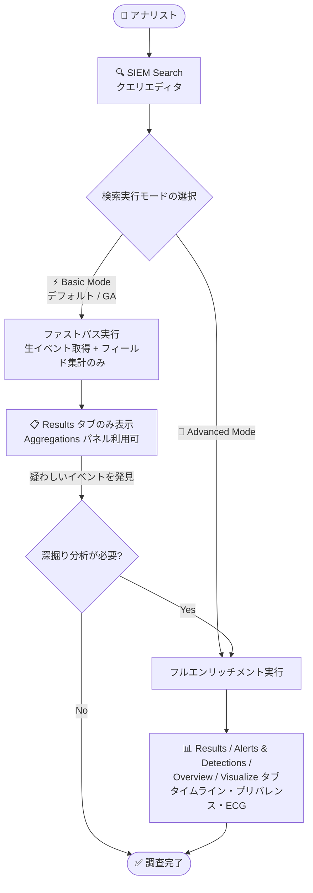

# Google SecOps: SIEM Search の Basic Mode 検索が GA

**リリース日**: 2026-11-16

**サービス**: Google SecOps

**機能**: SIEM Search ページの Basic Mode (検索実行モード) の一般提供開始

**ステータス**: GA (General Availability)

📊 [このアップデートのインフォグラフィックを見る](https://takech9203.github.io/google-cloud-news-summary/20261116-google-secops-basic-mode-search-ga.html)

## 概要

Google SecOps の SIEM Search ページにおける **Basic Mode** 検索オプションが一般提供 (GA) になりました。Basic Mode は、生イベントの取得とフィールド集計にコンピュートリソースを集中させる「ファストパス」実行パイプラインを採用した検索実行モードで、タイムライン集計・プリバレンス (普及度) スコアリング・検出相関などの二次的なエンリッチメント処理をバイパスすることで、検索の待ち時間を大幅に短縮します。GA に伴い、Basic Mode は SIEM Search の **デフォルトモード** として位置づけられています。

Google SecOps の検索実行モードには Basic Mode と Advanced Mode の 2 つがあり、クエリエディタ上で選択できます。Basic Mode は高速なイベント取得とクエリの反復 (イテレーション) 向け、Advanced Mode は標準的な検索ワークフローと多次元的な包括分析向けです。Basic Mode で疑わしいイベントを特定した後、Advanced Mode に切り替えて同じクエリを再実行すれば、タイムラインチャート、アクティビティヒートマップ、プリバレンススコア、相関検出を確認できます。

対象ユーザーは、大量のテレメトリ (AWS VPC Flow、ファイアウォール、プロキシ、Sysmon ログなど) を日常的にトリアージする SOC アナリストや、仮説検証のためにクエリを素早く反復したい脅威ハンターです。クエリ構文とデータの忠実性は Advanced Mode と完全に同一のまま、インタラクティブな応答性だけを高められる点が価値提案です。

**アップデート前の課題**

- 検索のたびにプリバレンス計算、YARA-L 2.0 検出相関、タイムラインのバケット集計、Entity Context Graph (ECG) 解決などの補助的な分析が常に実行され、大量テレメトリの検索では処理・描画のレイテンシが増大していた
- インジケータ (ドメイン、IP アドレス、ファイルハッシュなど) のプリバレンス計算だけで、大量イベントストリームでは最大 20 秒の追加処理時間が発生していた
- クエリ構文や正規表現、リファレンスリストのチューニングといった反復作業でも、毎回フルエンリッチメントの完了を待つ必要があった

**アップデート後の改善**

- Basic Mode が GA となり、プリバレンス計算・検出エンリッチメント・タイムライン集計をバイパスするファストパス実行により、マッチしたイベントが直接クライアントにストリーミングされ、待ち時間が最小化された
- UI は Results タブのみに絞られ、チャートウィジェットが非表示になることで、Events パネルと Event Viewer のための画面スペースが最大化された (Aggregations パネルは引き続き利用可能)
- 選択したモードはブラウザのローカルストレージに保存され、URL クエリパラメータ (`&searchMode=FAST` / `ADVANCED`) や検索履歴にも記録されるため、チーム間での調査 URL 共有や過去クエリの再実行時にモードが正しく引き継がれるようになった

## アーキテクチャ図



Basic Mode はプリバレンス計算・検出相関・タイムライン集計をバイパスして高速に結果を返し、深掘りが必要になった時点で Advanced Mode に切り替えて同じクエリを再実行するワークフローを想定しています。

## サービスアップデートの詳細

### 主要機能

1. **ファストパスのバックエンド実行**
   - プリバレンス計算のバイパス: ドメイン・IP アドレス・ファイルハッシュなどのインジケータに対する企業全体の履歴プリバレンス評価をスキップし、大量イベントストリームで最大 20 秒の処理時間を削減
   - 検出エンリッチメントの抑制: 検出相関の上限を 0 に設定し、イベント取得中のルールエンジンへの二次ルックアップを排除
   - タイムライン集計のプルーニング: 細かいバケット化ヒストグラム計算をスキップし、マッチしたイベントを直接クライアントにストリーミング

2. **合理化されたインターフェース**
   - タブ表示の集約: Results タブのみを表示し、Alerts & Detections / Overview / Visualize タブを非表示にしてタブ切り替えのレイテンシを排除
   - チャートウィジェットの非表示: Activity Over Time / Trend Over Time チャート、Prevalence タブ、Activity ヒートマップテーブルを自動的に非表示にし、Events パネルと Event Viewer の縦方向スペースを最大化
   - フィールド集計の同等性: Aggregations パネルは引き続きアクティブで、値分布カウントの確認、Show only / Filter out フィルタの適用、結果の絞り込みを Basic Mode のまま実行可能

3. **モードの永続化と共有**
   - ブラウザ設定の永続化: 選択したモードはブラウザのローカルストレージ (`searchMode`) に保存され、リフレッシュ・タブ・セッションをまたいで維持される
   - 共有可能な URL 状態: アクティブなモードは URL クエリパラメータ (`&searchMode=FAST` または `ADVANCED`) に反映され、共有された調査 URL のモードが受け取り側のブラウザ設定より優先される
   - 検索履歴への記録: History ダイアログの各クエリに実行時のモードが記録され、履歴からの再実行時に当時のモードが自動復元される

## 技術仕様

### Basic Mode と Advanced Mode の比較

| 機能・観点 | Basic Mode | Advanced Mode |
|------|------|------|
| 表示される結果タブ | Results のみ | Results、Alerts & Detections、Overview、Visualize |
| タイムラインチャート | 非表示 (バケット集計をバイパス) | 表示 (Activity Over Time / Trend Over Time チャート、Prevalence タブ、Activity ヒートマップ) |
| プリバレンススコアリング | バイパス | 有効 (企業全体のプリバレンスを計算) |
| 相関検出 | バイパス | 有効 (トリガーされた YARA-L 2.0 検出を相関) |
| Entity Context Graph (ECG) | バイパス | 有効 |
| レイテンシプロファイル | 最小限の待ち時間 (インタラクティブなフィードバック) | 標準的な待ち時間 (フルエンリッチメントを計算) |

### 推奨される利用シナリオ

| シナリオ | 推奨モード | 理由 |
|------|------|------|
| 初期の脅威ハンティング・仮説検証 | Basic Mode | タイムラインヒストグラムを待たずに広い時間範囲でインジケータ仮説をテスト |
| 大量テレメトリのトリアージ | Basic Mode | AWS VPC Flow、ファイアウォール、プロキシ、Sysmon ログなどを最小レイテンシでクエリ |
| クエリ作成・フィルタチューニング | Basic Mode | UDM 構文、正規表現、リファレンスリスト、データテーブルフィルタを反復調整 |
| インシデントタイムラインの再構築 | Advanced Mode | イベント分布タイムラインとアクティビティヒートマップで時間的バーストを特定 |
| インジケータの希少性・異常分析 | Advanced Mode | プリバレンススコアで観測アーティファクトが一般的か外れ値かを評価 |
| 検出の検証 | Advanced Mode | 特定イベントが YARA-L 2.0 アラートルールをトリガーしたかを確認 |

## 設定方法

### 前提条件

1. Google SecOps のライセンスとインスタンスが有効であること
2. ユーザーアカウントに Google SecOps Search の標準的な権限・ロールが割り当てられていること (データ RBAC を使用している環境では、割り当てられたスコープに一致するデータのみ表示される)

### 手順

#### ステップ 1: SIEM Search ページを開く

1. Google SecOps にログインする
2. ナビゲーションバーで **Investigation > SIEM Search** をクリックする

#### ステップ 2: 検索実行モードを選択する

1. クエリエディタで **Basic Mode** (デフォルト) または **Advanced Mode** を選択する
2. クエリを入力して **Run Search** をクリックする

選択したモードはブラウザのローカルストレージに保存され、以降の検索にも適用されます。

#### ステップ 3: 必要に応じて Advanced Mode に切り替える

Basic Mode の Results タブで疑わしいイベントを特定したら、Advanced Mode に切り替えて同じクエリを再実行し、タイムラインチャート、ヒートマップ、プリバレンススコア、相関検出を確認します。

## メリット

### ビジネス面

- **トリアージの高速化**: 大量テレメトリに対する検索待ち時間が最小化され、SOC アナリストの 1 件あたりの調査時間を短縮できる
- **チームコラボレーションの一貫性**: 調査 URL にモードが埋め込まれるため、共有相手も同じ表示状態で調査を引き継げる

### 技術面

- **クエリ・データの完全互換**: ファストパス実行でもクエリ構文とデータの忠実性は Advanced Mode と同一で、モード間の切り替えにクエリの書き換えは不要
- **最大 20 秒の処理時間削減**: プリバレンス計算のバイパスだけで、大量イベントストリームにおいて最大 20 秒の処理時間を削減
- **画面スペースの最適化**: チャートやタブが非表示になることで、Events パネルと Event Viewer に集中した調査が可能

## デメリット・制約事項

### 制限事項

- Basic Mode ではプリバレンススコアリング、相関検出 (YARA-L 2.0)、Entity Context Graph、タイムラインチャートが利用できない (これらが必要な場合は Advanced Mode で再実行が必要)
- Basic Mode の結果画面は Results タブのみで、Alerts & Detections / Overview / Visualize タブは表示されない

### 考慮すべき点

- モード設定はブラウザのローカルストレージに保存されるため、別のブラウザや端末では再設定が必要
- 共有 URL に含まれるモード指定は受け取り側のブラウザ設定より優先されるため、意図しないモードで開かれる場合がある点に留意する
- インシデントの時系列再構築や異常分析など、エンリッチメント情報が本質的に必要な調査では最初から Advanced Mode を使う方が効率的

## ユースケース

### ユースケース 1: 大量テレメトリに対する初動トリアージ

**シナリオ**: SOC アナリストが、脅威インテリジェンスで共有された不審な IP アドレスについて、過去 30 日間のファイアウォール・プロキシログを横断的に検索して影響範囲を素早く確認したい。

**実装例**:
```
# Basic Mode (デフォルト) で UDM 検索を実行
target.ip = "203.0.113.10"
```

**効果**: タイムライン集計やプリバレンス計算を待たずにマッチしたイベントが直接ストリーミングされ、広い時間範囲でも最小限の待ち時間でヒットの有無を確認できる。疑わしいイベントが見つかったら Advanced Mode に切り替えて深掘りする。

### ユースケース 2: 検出ルール作成前のクエリチューニング

**シナリオ**: 検出エンジニアが YARA-L ルール化する前に、UDM 構文・正規表現・リファレンスリストの組み合わせを何度も試行してノイズを絞り込みたい。

**効果**: クエリの反復実行ごとのエンリッチメント待ちがなくなり、Aggregations パネルの値分布と Show only / Filter out フィルタを使って短いサイクルでフィルタ条件を調整できる。

## 料金

本アップデートは SIEM Search ページの検索実行モードに関する機能であり、追加料金は発生しません。Google SecOps 自体の料金はパッケージベースのライセンス体系です。詳細は料金ページを参照してください。

- 料金ページ: https://cloud.google.com/chronicle/docs/preview/pricing (Google SecOps の価格は営業経由での見積もりが基本)

## 利用可能リージョン

リージョン固有の制限に関する記載はリリースノートおよびドキュメントにありません。Google SecOps が利用可能なリージョンで使用できます。

## 関連サービス・機能

- **UDM Search (SIEM Search)**: 本機能の対象となる検索基盤。UDM / RAW / JOIN / STATS など複数の検索タイプをサポート
- **YARA-L 2.0 検出エンジン**: Advanced Mode で相関検出として統合される検出ルール。Basic Mode ではルックアップがバイパスされる
- **Entity Context Graph (ECG)**: Advanced Mode で解決されるエンティティコンテキスト。Basic Mode ではバイパスされる
- **データ RBAC**: 検索結果はユーザーロールに割り当てられたデータスコープに基づいてフィルタリングされる

## 参考リンク

- 📊 [インフォグラフィック](https://takech9203.github.io/google-cloud-news-summary/20261116-google-secops-basic-mode-search-ga.html)
- [公式リリースノート](https://docs.cloud.google.com/release-notes#November_16_2026)
- [ドキュメント: UDM Search (検索実行モードの選択・理解)](https://docs.cloud.google.com/chronicle/docs/investigation/udm-search)

## まとめ

Google SecOps の SIEM Search における Basic Mode が GA となり、デフォルトの検索実行モードとして大量テレメトリの高速トリアージとクエリ反復を支えるようになりました。日常の初動調査やクエリチューニングは Basic Mode で行い、タイムライン分析・プリバレンス評価・検出検証が必要な場面でのみ Advanced Mode に切り替える、という使い分けを SOC の標準ワークフローに組み込むことを推奨します。

---

**タグ**: Google SecOps, SIEM, Basic Mode, Advanced Mode, UDM Search, 脅威ハンティング, GA
