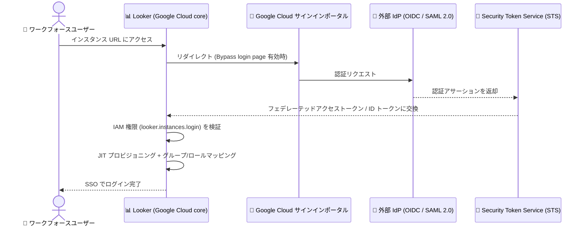

# Looker (Google Cloud core): Workforce Identity Federation が GA に

**リリース日**: 2026-11-16

**サービス**: Looker (Google Cloud core)

**機能**: Workforce Identity Federation による認証の一般提供 (GA)

**ステータス**: GA (一般提供)

📊 [このアップデートのインフォグラフィックを見る](https://takech9203.github.io/google-cloud-news-summary/20261116-looker-workforce-identity-federation-ga.html)

## 概要

Looker (Google Cloud core) インスタンスで、Workforce Identity Federation による認証が一般提供 (GA) になりました。パブリックセキュア接続、プライベート接続、ハイブリッド接続を使用するインスタンスで利用でき、Google Cloud コンソールまたは Google Cloud CLI (`--workforce-auth-enabled` および `--[no-]google-auth-enabled` フラグ) を使って、インスタンスの作成時・更新時に Workforce Identity Federation をプライマリ認証方式として構成できます。セカンダリ認証方式として Google OAuth をオプションで併用することも可能です。

Workforce Identity Federation を使うと、Microsoft Entra ID (旧 Azure AD)、Okta、Ping Identity などの OpenID Connect (OIDC) または SAML 2.0 に対応した外部 IdP で、ユーザーを Looker (Google Cloud core) インスタンスに直接認証 (SSO) できます。ユーザーごとに Google アカウント (Cloud Identity / Google Workspace アカウント) をプロビジョニング・同期する必要がなく、既存の企業 IdP をそのまま認証基盤として利用できる点が最大の価値です。

既存の IdP を標準としている企業で、BI 基盤 (Looker) のためだけに Google アカウント体系を別途運用していた組織にとって、ID 管理の運用負荷とセキュリティリスクを大きく削減できるアップデートです。

**アップデート前の課題**

- Looker (Google Cloud core) へのアクセスには Google アカウント (Cloud Identity / Google Workspace) ベースの OAuth 認証が前提で、外部 IdP のユーザーには Google アカウントのプロビジョニングや同期 (GCDS など) が必要だった
- プレビュー期間中、Looker (Google Cloud core) と Workforce Identity Federation の統合はパブリックセキュア接続 (public IP) を使用するインスタンスのみに限定されていた
- プレビュー機能のため Pre-GA 提供条件が適用され、本番ワークロードでの採用判断が難しかった

**アップデート後の改善**

- GA となり、本番環境で SLA の対象として Workforce Identity Federation を Looker のプライマリ認証方式に採用できるようになった
- 対応ネットワーク構成がパブリックセキュア接続に加えて、プライベート接続、ハイブリッド接続へ拡大された
- Google Cloud コンソールに加え、gcloud CLI (`--workforce-auth-enabled`、`--[no-]google-auth-enabled`) でインスタンス作成・更新時に認証方式を構成できるようになり、IaC / 自動化に組み込みやすくなった
- セカンダリ認証方式として Google OAuth を併用でき、移行期間中の段階的な切り替えが可能になった

## アーキテクチャ図



外部 IdP で認証されたユーザーのアサーションを Security Token Service (STS) がフェデレーテッドトークンに交換し、Looker が IAM 権限を検証したうえで初回ログイン時にユーザーを自動作成 (Just-In-Time プロビジョニング) する認証フローです。

## サービスアップデートの詳細

### 主要機能

1. **外部 IdP による SSO 認証 (GA)**
   - OIDC または SAML 2.0 に対応した IdP (Microsoft Entra ID、Okta、Ping Identity など) で Looker (Google Cloud core) に直接サインイン
   - Google アカウントのプロビジョニングや同期が不要な「同期レス」なフェデレーション
   - パブリックセキュア接続、プライベート接続、ハイブリッド接続のインスタンスに対応

2. **コンソール / gcloud CLI での認証方式の構成**
   - インスタンス作成時・編集時に「Workforce Identity Federation (SAML/OIDC)」をプライマリ認証方式として選択可能
   - gcloud CLI では `--workforce-auth-enabled` で Workforce 認証を、`--[no-]google-auth-enabled` で Google 認証の有効/無効を制御
   - セカンダリ認証方式として Google OAuth をオプションで有効化でき、段階的な移行に対応

3. **JIT プロビジョニングとグループ/ロールマッピング**
   - 初回ログイン時に Looker ユーザーアカウントを自動作成 (Just-In-Time プロビジョニング)
   - IdP のグループクレーム (`google.groups`) を Looker グループにミラーリングし、Viewer / User / Developer などの Looker ロールへマッピング
   - IdP のカスタムクレームを Looker のユーザー属性にマッピングし、DB 接続のパラメータ化や行レベルセキュリティフィルタに利用可能

4. **既存アカウントのマージとログインページバイパス**
   - 初回サインイン時に既存の Google / SAML / OIDC アカウントとユーザーをマージする「Merge Users Using」設定
   - 「Bypass login page」有効時は、未認証ユーザーを企業 SSO ポータルへ自動リダイレクト

## 技術仕様

### 認証フローの構成要素

| 項目 | 詳細 |
|------|------|
| 対応プロトコル | OpenID Connect (OIDC)、SAML 2.0 |
| 対応ネットワーク構成 | パブリックセキュア接続、プライベート接続、ハイブリッド接続 |
| ワークフォースプール作成単位 | Google Cloud 組織レベル (プロジェクトレベルではない) |
| ログインに必要な IAM 権限 | `looker.instances.login` (Looker Instance User `roles/looker.instanceUser` または Looker Admin `roles/looker.admin`) |
| 必須の属性マッピング | `google.email` (メール)、`attribute.given_name` / `attribute.family_name` (氏名) — 未設定の場合は認証が失敗 |
| 任意の属性マッピング | `google.groups` (グループミラーリング用)、`attribute.<name>` (カスタム属性) |
| 必要な API | `iam.googleapis.com`、`sts.googleapis.com`、`cloudresourcemanager.googleapis.com`、`looker.googleapis.com` |
| セッション管理 | ワークフォースプールのセッションポリシーが優先。拡張セッション長ポリシー (Access Context Manager) で最大 90 日を推奨 |

### 構成に必要な IAM ロール

| ロール | 付与先 | 用途 |
|------|------|------|
| IAM Workforce Pool Admin (`roles/iam.workforcePoolAdmin`) | 組織 | ワークフォースプール / プロバイダの作成・管理 |
| Looker Admin (`roles/looker.admin`) | プロジェクト | Looker (Google Cloud core) インスタンスの作成・管理 |
| Project IAM Admin (`roles/resourcemanager.projectIamAdmin`) | プロジェクト | ワークフォースプリンシパルへの IAM ロール付与 |

## 設定方法

### 前提条件

1. Google Cloud 組織が設定済みであること (ワークフォースプールは組織レベルのリソース)
2. OIDC または SAML 2.0 対応の外部 IdP が利用可能であること
3. 必要な API (IAM、STS、Cloud Resource Manager、Looker) が有効化されていること
4. 上記の IAM ロール (Workforce Pool Admin、Looker Admin、Project IAM Admin) を保有していること

### 手順

#### ステップ 1: ワークフォース ID プールとプロバイダの作成

```bash
# ワークフォース ID プールを作成 (組織レベル)
gcloud iam workforce-pools create WORKFORCE_POOL_ID \
  --organization=ORGANIZATION_ID \
  --location=global

# OIDC プロバイダの作成例 (属性マッピングは作成時に定義することを推奨)
gcloud iam workforce-pools providers create-oidc WORKFORCE_PROVIDER_ID \
  --workforce-pool=WORKFORCE_POOL_ID \
  --location=global \
  --issuer-uri="https://your-idp.example.com" \
  --client-id="OIDC_CLIENT_ID" \
  --attribute-mapping="google.subject=assertion.sub,google.email=assertion.email,attribute.given_name=assertion.given_name,attribute.family_name=assertion.family_name,google.groups=assertion.groups"
```

メール (`google.email`) と氏名 (`attribute.given_name` / `attribute.family_name`) のマッピングは必須です。未設定の場合、Looker への認証が失敗します。

#### ステップ 2: ワークフォースプリンシパルへの IAM ロール付与

```bash
# ワークフォースプール内の全プリンシパルに Looker Instance User を付与する例
gcloud projects add-iam-policy-binding PROJECT_ID \
  --member="principalSet://iam.googleapis.com/locations/global/workforcePools/WORKFORCE_POOL_ID/*" \
  --role="roles/looker.instanceUser"
```

個別ユーザー (`principal://.../subject/SUBJECT_ID`) やグループ (`principalSet://.../group/GROUP_ID`) 単位での付与も可能です。

#### ステップ 3: Looker インスタンスで Workforce 認証を有効化

```bash
# インスタンス作成時に Workforce Identity Federation をプライマリ認証に設定
gcloud looker instances create my-looker-instance \
  --region=REGION \
  --edition="LOOKER_CORE_ENTERPRISE_ANNUAL" \
  --workforce-auth-enabled \
  --no-google-auth-enabled

# 既存インスタンスの更新 (セカンダリとして Google OAuth を併用する場合)
gcloud looker instances update my-looker-instance \
  --region=REGION \
  --workforce-auth-enabled \
  --google-auth-enabled
```

Google Cloud コンソールでは、インスタンスの「Authentication」セクションで「Workforce Identity Federation (SAML/OIDC)」を選択し、必要に応じて「Enable Secondary OAuth」を有効化します。

#### ステップ 4: Looker Admin パネルでの詳細設定

Looker インスタンスに Admin ロールでサインインし、**Admin > Authentication > Workforce Identity** から以下を設定します。

- **Merge Users Using**: 既存の Google / SAML / OIDC アカウントとのマージ
- **Bypass login page**: 未認証ユーザーの IdP サインイン画面への自動リダイレクト (デフォルト有効)
- **Attribute Mapping**: IdP クレームから Looker ユーザー属性へのマッピング
- **Groups and roles**: IdP グループのミラーリングと Looker ロールの割り当て、デフォルトロール/グループの指定

## メリット

### ビジネス面

- **ID 管理コストの削減**: Looker 利用者のために Google アカウントをプロビジョニング・同期 (GCDS など) する運用が不要になり、既存の企業 IdP に ID 管理を一元化できる
- **本番採用の確度向上**: GA となり Pre-GA 提供条件の制約がなくなったため、エンタープライズの本番 BI 基盤として安心して採用できる
- **ガバナンスの強化**: 入退社・異動に伴うアクセス権の変更が IdP 側の操作だけで Looker にも反映され、退職者アカウントの放置リスクを低減できる

### 技術面

- **ネットワーク構成の柔軟性**: パブリックセキュア接続に加えプライベート接続・ハイブリッド接続にも対応し、閉域要件のある環境でも外部 IdP 認証を利用できる
- **IaC / 自動化対応**: gcloud CLI のフラグで認証方式を宣言的に構成でき、Terraform やスクリプトによるインスタンス管理に組み込みやすい
- **きめ細かなアクセス制御**: IdP のグループ/カスタムクレームを Looker のロール・ユーザー属性にマッピングし、行レベルセキュリティや DB 接続のパラメータ化まで一貫して制御できる
- **段階的な移行**: セカンダリ認証として Google OAuth を併用できるため、既存ユーザーを残したまま段階的に Workforce 認証へ切り替えられる

## デメリット・制約事項

### 制限事項

- ワークフォースプール / プロバイダは Google Cloud 組織レベルのリソースであり、組織の設定と `roles/iam.workforcePoolAdmin` が必要
- `google.email`、`attribute.given_name`、`attribute.family_name` の属性マッピングが未設定の場合、認証が失敗する
- STS のトークン交換には組織単位のクォータ (`sts.googleapis.com/workforce_requests`、デフォルト 1,000 リクエスト/分) があり、組織内の全ワークフォースプールで共有される

### 考慮すべき点

- スケジュール配信・アラートなどのオフラインジョブは、所有者の IdP セッションが有効な間のみ実行される。拡張セッション長ポリシー (推奨 90 日) を設定しない場合、リフレッシュトークンの失効により配信が一時停止する可能性がある
- SAML プロバイダではリフレッシュトークンが提供されないため、オフラインのスケジュール配信・アラートには SCIM 2.0 プロビジョニングの構成が必要
- ユーザー API キーのアクセストークンは有効期限 1 時間で、有効な IdP セッションが必要 (サービスアカウント API キーはセッションポリシーの影響を受けない)
- 大量のグループに所属するユーザーは OIDC トークンサイズ上限を超える場合があり、SCIM 2.0 によるグループ同期の検討が必要

## ユースケース

### ユースケース 1: Okta を標準 IdP とする企業での Looker SSO 統合

**シナリオ**: 全社の SSO 基盤として Okta を採用している企業が、Looker (Google Cloud core) を BI 基盤として導入する。利用者は数百名規模だが、Google Workspace は利用していない。

**実装例**:
```bash
# Okta 用の SAML プロバイダを作成し、グループクレームをマッピング
gcloud iam workforce-pools providers create-saml okta-provider \
  --workforce-pool=corp-pool \
  --location=global \
  --idp-metadata-path=okta-metadata.xml \
  --attribute-mapping="google.subject=assertion.subject,google.email=assertion.attributes.email[0],attribute.given_name=assertion.attributes.firstName[0],attribute.family_name=assertion.attributes.lastName[0],google.groups=assertion.attributes.groups"
```

**効果**: Google アカウントを一切発行せずに、Okta のユーザー / グループ管理だけで Looker のアクセス制御とロール割り当てが完結する。

### ユースケース 2: 閉域ネットワーク環境での外部 IdP 認証

**シナリオ**: 金融機関などセキュリティ要件の厳しい組織が、Private Service Connect 経由のプライベート接続で Looker (Google Cloud core) を運用しており、認証は社内標準の Microsoft Entra ID に統一したい。

**効果**: GA でプライベート接続・ハイブリッド接続がサポートされたことにより、閉域構成を維持したまま Entra ID による SSO・グループベースのロール管理を実現できる。

### ユースケース 3: Google OAuth からの段階的移行

**シナリオ**: 既存の Looker (Google Cloud core) インスタンスを Google OAuth で運用中の組織が、全社 IdP 統一方針に合わせて Workforce Identity Federation へ移行する。

**効果**: Workforce 認証をプライマリ、Google OAuth をセカンダリとして併用し、「Merge Users Using」設定で既存ユーザーアカウントを初回サインイン時にマージすることで、コンテンツや権限を引き継ぎながら無停止で移行できる。

## 料金

Workforce Identity Federation 自体は無料で利用できます。Looker (Google Cloud core) インスタンスの料金 (エディション・ユーザー数ベース) は通常どおり発生します。

なお、Workforce Identity Federation の詳細監査ログを有効にした場合は Cloud Logging の料金が発生する可能性があります。

- [IAM の料金](https://cloud.google.com/iam/pricing)
- [Looker (Google Cloud core) の料金](https://cloud.google.com/looker/pricing)

## 利用可能リージョン

Looker (Google Cloud core) が提供されているリージョンで利用できます。対応リージョンの一覧は [Looker (Google Cloud core) のドキュメント](https://cloud.google.com/looker/docs/looker-core-overview)を参照してください。

## 関連サービス・機能

- **IAM Workforce Identity Federation**: 本機能の基盤。外部 IdP のユーザーを Google アカウントなしで Google Cloud に認証するフェデレーション機構
- **Security Token Service (STS)**: IdP の認証アサーションをフェデレーテッドアクセストークン / ID トークンに交換するトークン交換サービス
- **Access Context Manager**: ワークフォースプールの拡張セッション長ポリシー (最大 90 日) の設定に使用。スケジュール配信やブラウザセッションの継続に必要
- **Cloud Identity / Google Workspace**: 従来の Google アカウントベース認証 (Google OAuth)。セカンダリ認証方式として併用可能
- **Cloud Logging**: Workforce Identity Federation の詳細監査ログの出力先。属性マッピングのトラブルシューティングに活用

## 参考リンク

- 📊 [インフォグラフィック](https://takech9203.github.io/google-cloud-news-summary/20261116-looker-workforce-identity-federation-ga.html)
- [公式リリースノート](https://docs.cloud.google.com/release-notes#November_16_2026)
- [Workforce Identity Federation for Looker (Google Cloud core)](https://docs.cloud.google.com/looker/docs/looker-core-workforce-identity)
- [Workforce Identity Federation の概要 (IAM)](https://docs.cloud.google.com/iam/docs/workforce-identity-federation)
- [Workforce Identity Federation の構成 (IAM)](https://docs.cloud.google.com/iam/docs/configuring-workforce-identity-federation)
- [Looker (Google Cloud core) の IAM によるアクセス制御](https://docs.cloud.google.com/looker/docs/looker-core-access-control)
- [IAM の料金](https://cloud.google.com/iam/pricing)

## まとめ

Looker (Google Cloud core) の Workforce Identity Federation 対応が GA となり、プライベート接続・ハイブリッド接続を含む全ネットワーク構成で、Google アカウントなしに既存の企業 IdP (OIDC / SAML 2.0) による SSO を本番利用できるようになりました。Entra ID や Okta を標準 IdP とする組織は、gcloud CLI の `--workforce-auth-enabled` フラグやコンソールから認証方式を切り替え、セカンダリ Google OAuth を併用した段階的移行を検討することを推奨します。導入時は属性マッピング (メール・氏名) の必須設定と、スケジュール配信を継続するための拡張セッション長ポリシー (90 日) の構成を忘れないようにしてください。

---

**タグ**: #Looker #WorkforceIdentityFederation #IAM #SSO #認証 #SAML #OIDC #GA #セキュリティ
