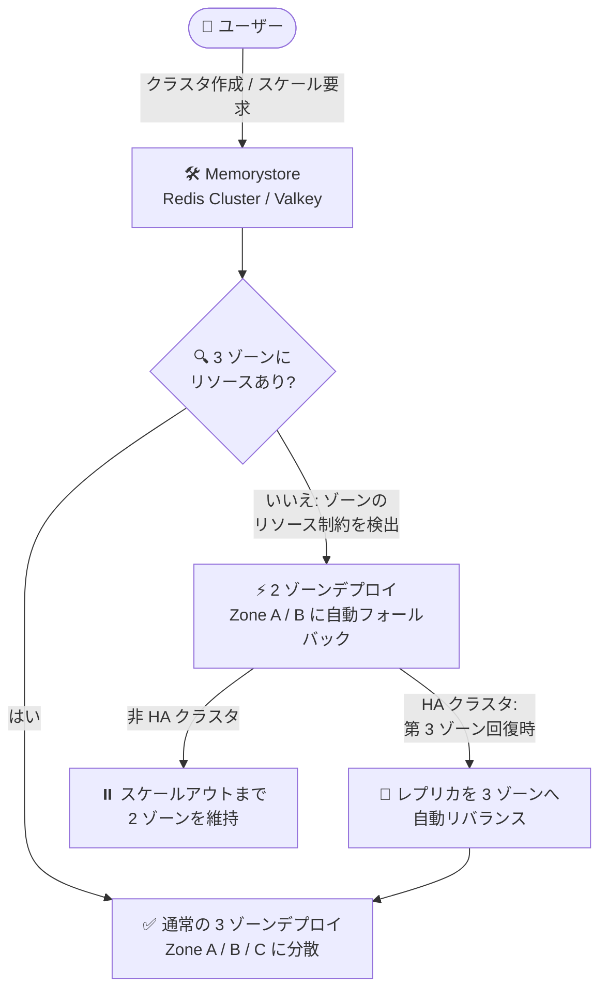

# Memorystore for Redis Cluster / Memorystore for Valkey: 2 ゾーンデプロイメント (Two-zone deployments) GA

**リリース日**: 2026-11-16

**サービス**: Memorystore for Redis Cluster / Memorystore for Valkey

**機能**: 2 ゾーンデプロイメントによる高可用性とレジリエンス (Two-zone deployments for high availability and resilience)

**ステータス**: GA (一般提供)

📊 [このアップデートのインフォグラフィックを見る](https://takech9203.github.io/google-cloud-news-summary/20261116-memorystore-two-zone-deployments-ga.html)

## 概要

Memorystore for Redis Cluster および Memorystore for Valkey において、**2 ゾーンデプロイメント (Two-zone deployments)** が一般提供 (GA) になりました。マルチゾーン構成のクラスタ / インスタンスを作成またはスケールする際に、リージョン内のいずれかのゾーンでリソース制約 (resource constraints) が発生している場合、Memorystore が自動的にクラスタを 2 つのゾーンにまたがってデプロイします。これにより、ゾーン単位の一時的なキャパシティ不足が原因でプロビジョニングやスケーリングが失敗することを防ぎ、確実にクラスタを稼働させることができます。

通常、Memorystore のマルチゾーン構成ではプライマリノードとレプリカノードが 3 つのゾーンに均等に分散されます。しかし、特定のゾーンで一時的に GCE リソースが逼迫している場合、従来はその影響でクラスタの作成やシャード / レプリカ追加のオペレーションが影響を受ける可能性がありました。今回の機能により、リソース制約時には残りの 2 ゾーンへ自動的にフォールバックしてデプロイが完了し、さらに HA クラスタでは 3 つ目のゾーンが利用可能になった時点でレプリカノードが自動的に 3 ゾーンへ再分散 (リバランス) されます。

本機能は Memorystore for Redis Cluster と Memorystore for Valkey の両方で同時に GA となりました。重要な点として、**2 ゾーンで稼働している期間中も 99.99% の高可用性 SLA には影響しません**。キャパシティ起因の運用リスクをマネージドサービス側が吸収してくれるため、大規模クラスタを運用するユーザーや、急激なスケールアウトを行うユーザーにとって信頼性向上につながるアップデートです。

**アップデート前の課題**

- マルチゾーンクラスタの作成・スケール時に、特定ゾーンのリソース制約 (一時的なキャパシティ不足) があると、プロビジョニングやスケーリングのオペレーションが影響を受ける可能性があった
- ゾーンのキャパシティ不足への対処として、別ゾーン・別リージョンでの再作成の検討など、ユーザー側での対応 (キャパシティプランニングのベストプラクティスに沿った回避策) が必要になるケースがあった
- ゾーン障害やリソース逼迫のタイミングによっては、必要なタイミングでシャード / レプリカを追加できないリスクがあった

**アップデート後の改善**

- ゾーンのリソース制約を検出すると、自動的に 2 ゾーン構成でデプロイされ、クラスタの作成・スケールが確実に成功するようになった
- HA クラスタでは、3 つ目のゾーンが利用可能になると、レプリカノードが自動的に 3 ゾーンへ再分散 (リバランス) されるため、ユーザーの手動対応が不要になった
- 2 ゾーンで稼働している間も 99.99% の高可用性 SLA は維持され、可用性保証を損なわずにキャパシティ問題を回避できるようになった

## アーキテクチャ図



マルチゾーンクラスタの作成・スケール時にゾーンのリソース制約が検出されると、自動的に 2 ゾーンへフォールバックしてデプロイが完了します。HA クラスタは第 3 ゾーンが利用可能になった時点で自動的に 3 ゾーン構成へ再分散されます。

## サービスアップデートの詳細

### 主要機能

1. **ゾーンリソース制約時の自動 2 ゾーンデプロイ**
   - マルチゾーンクラスタの作成時またはスケール (シャード / レプリカ追加) 時に、いずれかのゾーンでリソース制約が発生していると、Memorystore が自動的にクラスタを 2 ゾーンにまたがってデプロイする
   - ユーザー側の操作は不要で、プロビジョニング / スケーリングオペレーションが確実に成功する

2. **HA クラスタの自動リバランス**
   - レプリカを持つ HA クラスタの場合、3 つ目のゾーンが利用可能になると、クラスタが自動的にレプリカノードを 3 ゾーン全体へ再分散する
   - ゾーン分散が自動的に最適な状態へ回復するため、運用者による監視・是正作業が不要

3. **非 HA クラスタの動作**
   - レプリカを持たない非 HA クラスタの場合、クラスタはスケールアウトを行うまで 2 ゾーン構成のまま維持される

4. **SLA への影響なし**
   - 2 ゾーンで稼働している期間中も、99.99% の高可用性 SLA には影響しない

## 技術仕様

### 2 ゾーンデプロイメントの特性

| 項目 | 詳細 |
|------|------|
| 発動条件 | マルチゾーンクラスタの作成またはスケール時に、ゾーンのリソース制約を検出した場合 |
| 対象サービス | Memorystore for Redis Cluster / Memorystore for Valkey |
| HA クラスタのリバランス | 第 3 ゾーンが利用可能になると、レプリカノードを 3 ゾーンへ自動再分散 |
| 非 HA クラスタのリバランス | スケールアウトを実行するまで 2 ゾーン構成を維持 |
| SLA | 2 ゾーン稼働中も 99.99% 高可用性 SLA に影響なし |
| コスト / 性能の考慮 | ゾーン間 (inter-zone) エグレス費用に影響する可能性あり。CPU サイジングの再評価が必要になる場合あり |

### 前提となる HA 構成

Memorystore の HA 構成では、シャードごとに 1〜5 個のレプリカをプロビジョニングすることで、プライマリ / レプリカノードが複数ゾーンに分散され、計画メンテナンスや予期しないシャード障害時の自動フェイルオーバーが提供されます。2 ゾーンデプロイメントは、このマルチゾーン分散の仕組みに対するフォールバック動作として機能します。

## メリット

### ビジネス面

- **プロビジョニング成功率の向上**: ゾーンの一時的なキャパシティ不足によってクラスタ作成やスケールが失敗するリスクが低減され、サービス拡張の計画が立てやすくなる
- **SLA の維持**: 2 ゾーン稼働中も 99.99% SLA が維持されるため、可用性要件の厳しいワークロードでも安心して利用できる
- **運用コストの削減**: キャパシティ起因の失敗時のリトライや構成変更といった手動対応が不要になる

### 技術面

- **自動フォールバックと自動復旧**: リソース制約の検出、2 ゾーンへのフォールバック、第 3 ゾーン回復後のリバランスまでがすべて自動化されている
- **スケーリングの確実性**: トラフィック急増時のシャード / レプリカ追加が、ゾーンのリソース状況に左右されにくくなる
- **Redis Cluster / Valkey 両対応**: Redis Cluster から Valkey への移行前後で同じ動作モデルを前提にできる

## デメリット・制約事項

### 制限事項

- 2 ゾーンデプロイメントは自動的に行われるフォールバック動作であり、ユーザーが明示的に 2 ゾーン構成を指定する機能ではない
- 非 HA クラスタ (レプリカなし) は、スケールアウトを行うまで 2 ゾーン構成のまま維持され、自動リバランスは行われない
- 対象はマルチゾーン構成のクラスタ / インスタンスであり、単一ゾーンインスタンスには適用されない

### 考慮すべき点

- **ゾーン間エグレス費用**: 2 ゾーン稼働中はノード間のゾーン分散が通常と異なるため、ゾーン間エグレス費用に影響する可能性がある
- **CPU サイジング**: 2 ゾーン稼働中はゾーンあたりのノード集中度が変わるため、ゾーン障害時に備えた CPU サイジング (CPU 使用率の推奨値に基づくオーバープロビジョニング) の再評価が必要になる場合がある
- 非 HA クラスタで 2 ゾーン構成のままになっている場合、ゾーン障害時には該当ゾーンのキースペース部分が利用不可となるため、本番ワークロードではレプリカを有効化した HA 構成を推奨

## ユースケース

### ユースケース 1: 大規模クラスタの新規プロビジョニング

**シナリオ**: 人気リージョンで数十シャード規模の Memorystore for Valkey インスタンスを新規作成する際、特定ゾーンで一時的なリソース逼迫が発生している。

**効果**: 従来はプロビジョニングに影響が出る可能性があったが、自動的に 2 ゾーンへデプロイされ、インスタンス作成が確実に完了する。HA 構成であれば、第 3 ゾーンのリソースが回復した時点で自動的に 3 ゾーン分散へ戻る。

### ユースケース 2: トラフィック急増時の緊急スケールアウト

**シナリオ**: セールやキャンペーンでキャッシュ層への負荷が急増し、Memorystore for Redis Cluster のシャード数とレプリカ数を即座に増やす必要があるが、ゾーンのキャパシティ状況が不透明。

**実装例**:
```bash
# シャード数のスケールアウト (ゾーンのリソース制約時は自動的に 2 ゾーンへデプロイ)
gcloud redis clusters update my-cluster \
  --region=asia-northeast1 \
  --shard-count=10
```

**効果**: ゾーンのリソース制約があってもスケーリングオペレーションが確実に成功し、ビジネス上クリティカルなタイミングでのキャッシュ容量拡張が阻害されない。

## 料金

2 ゾーンデプロイメント自体に追加料金はありません。Memorystore for Redis Cluster / Memorystore for Valkey の料金は、ノードタイプとノード数 (プロビジョニングした容量)、ネットワーク転送量などに基づいて課金されます。

ただし、公式ドキュメントに記載のとおり、2 ゾーンで稼働している間は**ゾーン間エグレス費用に影響する可能性**があります。詳細は各サービスの料金ページを参照してください。

- [Memorystore for Redis Cluster 料金](https://cloud.google.com/memorystore/docs/cluster/pricing)
- [Memorystore for Valkey 料金](https://cloud.google.com/memorystore/docs/valkey/pricing)

## 利用可能リージョン

リージョン固有の情報はリリースノートに明記されていません。Memorystore for Redis Cluster / Memorystore for Valkey が提供されている各リージョンでの利用可否は、各サービスのドキュメントを参照してください。

## 関連サービス・機能

- **Memorystore 単一ゾーンインスタンス**: レプリカを使用しない場合の推奨構成。コストとレイテンシを優先する場合の選択肢で、マルチゾーン構成 (および本機能) と対になる構成
- **クロスリージョンレプリケーション**: ゾーンを超えたリージョンレベルの災害対策が必要な場合に使用。2 ゾーンデプロイメントはリージョン内のレジリエンス向上、クロスリージョンレプリケーションはリージョン間の DR に対応
- **Cloud Monitoring**: `/instance/cpu/maximum_utilization` などのメトリクスで CPU 使用率を監視し、2 ゾーン稼働中やゾーン障害時に備えたサイジングの評価に活用
- **Database Center**: Memorystore を含むデータベースフリート全体の健全性を一元的に確認できるダッシュボード

## 参考リンク

- 📊 [インフォグラフィック](https://takech9203.github.io/google-cloud-news-summary/20261116-memorystore-two-zone-deployments-ga.html)
- [公式リリースノート](https://docs.cloud.google.com/release-notes#November_16_2026)
- [Two-zone deployments for high availability and resilience (Redis Cluster)](https://docs.cloud.google.com/memorystore/docs/cluster/ha-and-replicas#two-zone-deployments)
- [Two-zone deployments for high availability and resilience (Valkey)](https://docs.cloud.google.com/memorystore/docs/valkey/ha-and-replicas#two-zone-deployments)
- [インスタンス容量のスケーリング (Valkey)](https://docs.cloud.google.com/memorystore/docs/valkey/scale-instance-capacity)
- [料金ページ (Redis Cluster)](https://cloud.google.com/memorystore/docs/cluster/pricing)
- [料金ページ (Valkey)](https://cloud.google.com/memorystore/docs/valkey/pricing)

## まとめ

Memorystore for Redis Cluster と Memorystore for Valkey の 2 ゾーンデプロイメントの GA により、ゾーンのリソース制約が原因でクラスタの作成やスケーリングが失敗するリスクが解消され、99.99% SLA を維持したままキャパシティ問題を自動で回避できるようになりました。追加設定は不要なため、既存ユーザーは 2 ゾーン稼働時のゾーン間エグレス費用と CPU サイジングへの影響を把握しておくこと、また本番ワークロードではレプリカを有効化した HA 構成を採用することを推奨します。

---

**タグ**: Memorystore, Redis Cluster, Valkey, 高可用性, マルチゾーン, GA, インフラストラクチャ, キャッシュ
