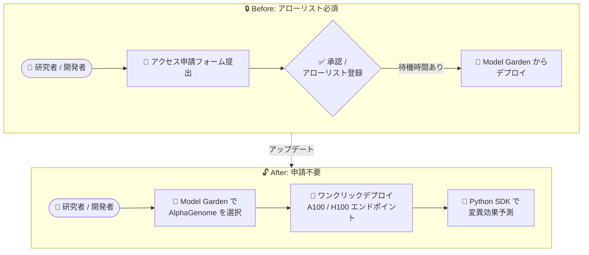

# Gemini Enterprise Agent Platform (Model Garden): AlphaGenome がアローリスト不要で利用可能に

**リリース日**: 2026-11-17

**サービス**: Gemini Enterprise Agent Platform (Model Garden)

**機能**: AlphaGenome のアローリスト (allowlist) 要件撤廃

**ステータス**: Changed (GA、アローリスト不要)

📊 [このアップデートのインフォグラフィックを見る](https://takech9203.github.io/google-cloud-news-summary/20261117-alphagenome-allowlist-removal.html)

## 概要

Google DeepMind が開発したゲノム基盤モデル **AlphaGenome** (`alphagenome-003` および `alphagenome-004`) が、プロジェクトのアローリスト登録なしで利用できるようになりました。これまでは GA ながらアクセス申請フォームの提出と承認が必要でしたが、今回の変更により、任意の Google Cloud プロジェクトから Model Garden 上で AlphaGenome のモデルカードを閲覧し、そのままデプロイできます。

AlphaGenome は、最大 100 万塩基対 (1 MB) の DNA 配列を 1 塩基単位の解像度で解析し、遺伝子変異が分子・生物学的メカニズムに与える影響を予測するディープラーニング基盤モデルです。遺伝子発現 (RNA_SEQ、CAGE、PROCAP)、クロマチンアクセシビリティ (ATAC、DNASE)、ヒストン修飾・転写因子結合 (CHIP_HISTONE、CHIP_TF)、RNA スプライシング (SPLICE_SITES、SPLICE_SITE_USAGE、SPLICE_JUNCTIONS)、3D クロマチン接触マップ (CONTACT_MAPS) の 11 のゲノムモダリティにわたる予測が可能です。

対象ユーザーは、ゲノム研究・創薬・バイオインフォマティクス分野で変異効果予測 (Variant Effect Prediction) を行う研究機関や企業です。アクセス申請のリードタイムがなくなったことで、PoC や研究プロジェクトの立ち上げが大幅に迅速化されます。

**アップデート前の課題**

- AlphaGenome を利用するには、AlphaGenome リクエストフォームからアクセス申請を提出し、プロジェクトがアローリストに登録されるのを待つ必要があった
- 申請・承認のプロセスがあるため、研究プロジェクトや PoC の開始までにリードタイムが発生していた
- アローリスト未登録のプロジェクトでは Model Garden からモデルの閲覧・デプロイができなかった

**アップデート後の改善**

- 任意の Google Cloud プロジェクトが、アクセス申請なしで Model Garden から AlphaGenome を閲覧・デプロイできるようになった
- アローリスト登録の待ち時間が不要になり、GPU クォータさえ確保できれば即座にエンドポイントをデプロイ可能になった
- `alphagenome-003` (レガシー HTTP) と `alphagenome-004` (gRPC/HTTP 統合) の両サービングバージョンが対象

## アーキテクチャ図



アローリスト申請・承認ステップが撤廃され、Model Garden からの直接デプロイが可能になった Before/After の比較図です。

## サービスアップデートの詳細

### 主要機能

1. **アローリスト要件の撤廃**
   - `alphagenome-003` と `alphagenome-004` の両方でプロジェクトのアローリスト登録が不要に
   - 任意の Google Cloud プロジェクトから Model Garden でモデルカードの閲覧・デプロイが可能
   - アクセスリクエストフォームの提出が不要

2. **alphagenome-004 (デフォルト、gRPC/HTTP 統合コンテナ)**
   - `predict_sequence`、`predict_interval`、`predict_variant`、`score_variant`、`score_interval`、`score_ism_variants`、`output_metadata` の 7 つの DnaModelService メソッドを提供
   - ポート 8081 で HTTP/2 gRPC ストリーミング、ポート 8080 で HTTP ストリーミング (`streamRawPredict`) をサポート
   - フォールド選択に対応 (デフォルト `ALL_FOLDS`、個別の `FOLD_0`〜`FOLD_3` も指定可能)

3. **alphagenome-003 (レガシー HTTP)**
   - HTTP/1.1 ストリーミング (`streamRawPredict`、ポート 8080) で予測を提供
   - 既存の HTTP クライアントデプロイメントとの後方互換性のために提供継続

## 技術仕様

### ハードウェア・デプロイ要件

AlphaGenome は深いアーキテクチャと 1 MB のコンテキストウィンドウを持つため、80 GB の GPU メモリが必須です。

| 項目 | 詳細 |
|------|------|
| 必要 GPU メモリ | 80 GB |
| NVIDIA H100 (80 GB) | `a3-highgpu-1g` / `a3-highgpu-2g` / `a3-highgpu-4g` / `a3-highgpu-8g` |
| NVIDIA A100 (80 GB) | `a2-ultragpu-1g` / `a2-ultragpu-2g` / `a2-ultragpu-4g` / `a2-ultragpu-8g` |
| NVIDIA H100 Mega (80 GB) | `a3-megagpu-8g` |
| 非対応 | 40 GB A100 の `a2-highgpu` シリーズ |
| スケーリング | Agent Platform エンドポイントのオートスケーリングでノード追加可能 |

### 必要な GPU サービングクォータ

デプロイ前に、対象リージョンで以下のクォータが十分であることを確認します。

- `aiplatform.googleapis.com/custom_model_serving_nvidia_h100_gpus`
- `aiplatform.googleapis.com/custom_model_serving_nvidia_a100_gpus`
- `aiplatform.googleapis.com/custom_model_serving_nvidia_h100_mega_gpus`
- `compute.googleapis.com/gpus_per_gpu_family`

### エンドポイントアクセス方式 (alphagenome-004)

| 方式 | エンドポイント種別 | 特徴 |
|------|------------------|------|
| gRPC ストリーミング | Public (shared endpoint) | 圧縮バイナリテンソルチャンクを直接転送。JSON/base64 のシリアライズオーバーヘッドがなく、1 MB トラック予測のレイテンシ低減や ISM (`score_ism_variants`) などの高並列ワークロードに有利 |
| HTTP ストリーミング | Public (dedicated endpoint) | チャンク化バイナリ protobuf (`proto_b64`) をストリーミング。共有エンドポイントの 10 MB HTTP レスポンスサイズ制限を回避 |

## 設定方法

### 前提条件

1. Google Cloud プロジェクトで対象リージョンに十分な GPU サービングクォータ (H100/A100 80 GB) を確保していること
2. 実行環境が Agent Platform User (`roles/aiplatform.user`) IAM ロールを持つサービスアカウントまたはユーザー認証情報で認証されていること
3. AlphaGenome は有償サブスクリプションが必要 (Google Cloud アカウントチームに問い合わせ)

### 手順

#### ステップ 1: Model Garden からデプロイ

1. Google Cloud コンソールで **Model Garden** に移動
2. AlphaGenome のモデルカードを選択 (アクセス申請は不要)
3. **Deploy model** をクリックし、マシンタイプ (例: `a3-highgpu-1g`) とエンドポイントアクセス (shared/dedicated) を選択
4. **Deploy** をクリック

#### ステップ 2: Python SDK のインストールとクライアント初期化

```bash
# AlphaGenome Cloud SDK の wheel をダウンロードしてインストール
wget -q https://github.com/GoogleCloudPlatform/vertex-ai-samples/raw/main/notebooks/community/alphagenome/whl/alphagenome_cloud_sdk-0.4.2.12-py3-none-any.whl
pip install alphagenome_cloud_sdk-0.4.2.12-py3-none-any.whl
```

```python
from alphagenome.models import dna_client
from alphagenome_cloud_sdk.models import dna_client_grpc

# shared endpoint に gRPC で接続する場合
endpoint = "projects/PROJECT_ID/locations/LOCATION/endpoints/ENDPOINT_ID"
dna_model = dna_client_grpc.create_vertex_client(endpoint=endpoint)
```

デプロイしたエンドポイントに対して `predict_variant` や `score_variant` などのメソッドで変異効果予測を実行できます。

## メリット

### ビジネス面

- **導入リードタイムの短縮**: アクセス申請・承認待ちが不要になり、ゲノム研究プロジェクトや PoC を即日開始できる
- **利用ハードルの低下**: 承認プロセスを管理する手間がなくなり、研究機関・製薬企業・スタートアップが試しやすくなった

### 技術面

- **セルフサービスでのデプロイ**: Model Garden のワンクリックデプロイで、自プロジェクト・自 VPC 内にセキュアにエンドポイントを構築できる
- **2 つのサービングバージョン**: 新規は gRPC/HTTP 統合の `alphagenome-004`、既存クライアントは `alphagenome-003` で後方互換を維持できる

## デメリット・制約事項

### 制限事項

- **研究用途限定**: AlphaGenome は研究ツールであり、臨床診断用途での使用は意図されておらず、承認もされていない
- **1 MB コンテキスト上限**: 1 回の予測クエリでは 1 MB を超える距離のゲノム相互作用を捉えられない
- **ファインチューニング非対応**: 独自データセットでのファインチューニングはできず、推論専用

### 考慮すべき点

- モデル自体のアローリストは不要になったが、**有償サブスクリプションの契約** と **80 GB GPU のサービングクォータ確保** は引き続き必要
- Google Cloud 専用 Python SDK (wheel ファイル) へのアクセスが制限されている場合があるため、必要に応じて Google Cloud アカウントチームに確認する
- A100 40 GB (`a2-highgpu` シリーズ) は使用できないため、マシンタイプの選定に注意

## ユースケース

### ユースケース 1: 変異効果スコアリング (Variant Effect Prediction)

**シナリオ**: 創薬研究チームが、特定の一塩基多型 (SNV) が RNA 発現に与える影響を定量評価したい。

**実装例**:
```python
from alphagenome.data import genome
from alphagenome.models import dna_client, variant_scorers

variant = genome.Variant(
    chromosome='chr22', position=36201698,
    reference_bases='A', alternate_bases='C',
)
variant_scorer = variant_scorers.RECOMMENDED_VARIANT_SCORERS['RNA_SEQ']
variant_scores = dna_model.score_variant(
    interval=variant.reference_interval.resize(dna_client.SEQUENCE_LENGTH_1MB),
    variant=variant,
    variant_scorers=[variant_scorer],
)
```

**効果**: REF/ALT 配列の比較による変異効果のスコアを即座に取得し、候補変異の優先順位付けを高速化できる。

### ユースケース 2: In Silico 飽和変異導入 (ISM) の大規模解析

**シナリオ**: 研究機関が、プロモーター領域の全塩基置換の影響を網羅的に評価する ISM 解析 (`score_ism_variants`) を実施したい。

**効果**: `alphagenome-004` の gRPC ストリーミングにより、高並列のマルチバリアントワークロードでも HTTP ゲートウェイのタイムアウトを回避し、効率的に解析を実行できる。アローリスト撤廃により、複数プロジェクトでの並行検証もすぐに開始できる。

## 料金

AlphaGenome の利用には有償サブスクリプションが必要です。サブスクリプション料金については、Google Cloud のセールススペシャリストまたはアカウントチームへの問い合わせが必要です。

これに加えて、モデルをホストするインフラストラクチャのコスト (Agent Platform エンドポイントおよびデプロイ先の GPU インスタンス) が発生します。詳細は [Agent Platform の料金ページ](https://cloud.google.com/products/gemini-enterprise-agent-platform/pricing) を参照してください。

## 利用可能リージョン

公式ドキュメントにリージョンの一覧は明記されていません。デプロイ先リージョンで H100/A100 (80 GB) の GPU サービングクォータが利用可能であることが前提となります。詳細は [AlphaGenome ドキュメント](https://docs.cloud.google.com/gemini-enterprise-agent-platform/models/open-models/alphagenome) を参照してください。

## 関連サービス・機能

- **Model Garden**: AlphaGenome を含むオープンモデルの検索・デプロイを行うモデルライブラリ。ワンクリックデプロイに対応
- **Gemini Enterprise Agent Platform エンドポイント**: モデルのサービング基盤。オートスケーリングによるノード追加が可能
- **IAM (Identity and Access Management)**: デプロイ済みエンドポイントへのアクセス制御 (`roles/aiplatform.user`)
- **Compute Engine GPU クォータ**: A3 (H100) / A2 Ultra (A100 80 GB) マシンタイプのサービングクォータ管理

## 参考リンク

- 📊 [インフォグラフィック](https://takech9203.github.io/google-cloud-news-summary/20261117-alphagenome-allowlist-removal.html)
- [公式リリースノート](https://docs.cloud.google.com/release-notes#November_17_2026)
- [AlphaGenome ドキュメント](https://docs.cloud.google.com/gemini-enterprise-agent-platform/models/open-models/alphagenome)
- [Model Garden からオープンモデルをデプロイ](https://docs.cloud.google.com/gemini-enterprise-agent-platform/models/open-models/deploy-model-garden)
- [Agent Platform 料金ページ](https://cloud.google.com/products/gemini-enterprise-agent-platform/pricing)
- [AlphaGenome 論文 (Nature)](https://doi.org/10.1038/s41586-025-10014-0)
- [AlphaGenome クイックスタートノートブック](https://github.com/GoogleCloudPlatform/vertex-ai-samples/blob/main/notebooks/community/alphagenome/cloudai_alphagenome_vai_quickstart.ipynb)

## まとめ

AlphaGenome のアローリスト要件撤廃により、ゲノム変異効果予測の基盤モデルを任意の Google Cloud プロジェクトから即座にデプロイできるようになりました。ゲノム研究・創薬分野のチームは、アクセス申請を待つことなく PoC を開始できます。利用にあたっては、有償サブスクリプションの契約と 80 GB GPU (H100/A100) のサービングクォータ確保を事前に進めることを推奨します。

---

**タグ**: #GeminiEnterpriseAgentPlatform #ModelGarden #AlphaGenome #Genomics #DeepMind #GPU #Changed
