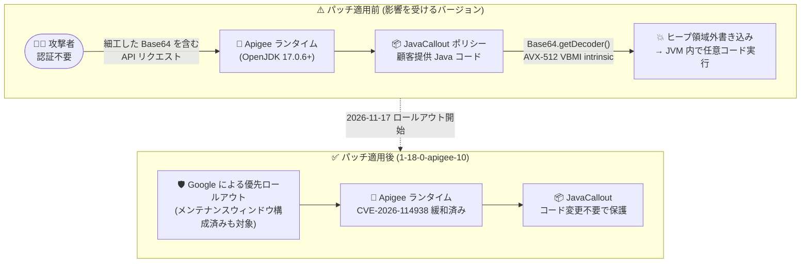

# Apigee X: セキュリティアップデート 1-18-0-apigee-10 (GCP-2026-082 / CVE-2026-114938 対応)

**リリース日**: 2026-11-17

**サービス**: Apigee X

**機能**: セキュリティアップデート (リリースバージョン 1-18-0-apigee-10)

**ステータス**: リリース済み (セキュリティアップデート / Announcement)

📊 [このアップデートのインフォグラフィックを見る](https://takech9203.github.io/google-cloud-news-summary/20261117-apigee-x-security-gcp-2026-082.html)

## 概要

2026 年 11 月 17 日、Google Cloud は Apigee の更新バージョン **1-18-0-apigee-10** をリリースしました。このリリースは、セキュリティ速報 **GCP-2026-082** (Bug ID: 586658318) に記載された脆弱性 **CVE-2026-114938** に対応するセキュリティアップデートです。Apigee ランタイム全体が対象であり、**JavaCallout ポリシーで実行される顧客提供の Java コード**も緩和策の対象に含まれます。顧客側で Java コールアウトのコードを変更する必要はありません。

CVE-2026-114938 は、OpenJDK 17.0.6 以降 (17.0.6+、21.x、25.x、27.x。Eclipse Temurin などの各ディストリビューションを含む) に存在するリモートコード実行 (RCE) の脆弱性で、深刻度は **Critical** です。AVX-512 VBMI をサポートする x86-64 プロセッサ上で、HotSpot の AVX-512 VBMI Base64 デコーダ組み込み関数 (intrinsic) における整数アンダーフローにより、不正な形式の Base64 入力 (`Base64.getDecoder()` / `Base64.getUrlDecoder()`) のデコード時にヒープ領域外書き込みが発生します。C2 JIT コンパイラがデコードパスをコンパイルした後は、**認証不要のリモート攻撃者が細工した Base64 入力を送り込むだけで JVM プロセス内で任意コードを実行**できる可能性があります。

本リリースはセキュリティアップデートであるため、影響を受けるバージョンを実行しているインスタンスは、**メンテナンスウィンドウを構成しているインスタンスも含めて、通常より早い優先スケジュールでパッチが適用**されます。ロールアウトは 2026 年 11 月 17 日に開始されました。

**アップデート前の課題**

- Apigee ランタイム (Java ベースの Message Processor など) は OpenJDK 上で動作しており、CVE-2026-114938 の影響を受けるバージョンでは、不正な Base64 入力を介した任意コード実行のリスクがあった
- JavaCallout ポリシーで顧客提供の Java コードを実行している場合、そのコード内の `Base64.getDecoder()` / `Base64.getUrlDecoder()` 呼び出しも同じ脆弱性の攻撃面となり得た
- マネージドサービスであるため、顧客自身では Apigee ランタイムの JVM にパッチや緩和フラグ (`-XX:UseAVX=2` など) を適用できなかった

**アップデート後の改善**

- 1-18-0-apigee-10 へのアップデートにより、Apigee ランタイム (JavaCallout で実行される顧客提供 Java コードを含む) で CVE-2026-114938 が緩和された
- 顧客は Java コールアウトのコードを変更する必要がなく、Google 側のロールアウトのみで保護が適用される
- メンテナンスウィンドウ構成済みのインスタンスも対象とする優先スケジュールにより、Critical 脆弱性への暴露期間が最小化される

## アーキテクチャ図



パッチ適用前は、不正な Base64 入力が Apigee ランタイムや JavaCallout の Java コードを経由して任意コード実行につながるリスクがありましたが、1-18-0-apigee-10 の優先ロールアウトにより顧客側の作業なしで緩和されます。

## サービスアップデートの詳細

### 主要機能

1. **Apigee ランタイムにおける CVE-2026-114938 の緩和 (Bug ID: 586658318)**
   - Apigee ランタイムを構成する JVM コンポーネントに対して、OpenJDK HotSpot の AVX-512 VBMI Base64 デコーダ intrinsic に起因する脆弱性の修正を適用
   - 深刻度 Critical のリモートコード実行 (RCE) 脆弱性に対応

2. **JavaCallout ポリシーで実行される顧客提供 Java コードの保護**
   - JavaCallout ポリシー経由で実行されるカスタム Java コード (JAR) も緩和策の対象
   - 顧客はコールアウトのコードを変更・再デプロイする必要がない

3. **優先スケジュールでのパッチロールアウト**
   - セキュリティアップデートのため、影響を受けるバージョンを実行しているインスタンスは通常のスケジュールを待たずにパッチ適用
   - メンテナンスウィンドウを構成しているインスタンスも優先スケジュールの対象

## 技術仕様

### CVE-2026-114938 の概要

| 項目 | 詳細 |
|------|------|
| CVE ID | CVE-2026-114938 |
| 深刻度 | Critical |
| 脆弱性の種類 | 整数アンダーフローによるヒープ領域外書き込み → リモートコード実行 (RCE) |
| 発生箇所 | OpenJDK HotSpot の AVX-512 VBMI Base64 デコーダ intrinsic (`UseAVX=3` 有効時) |
| トリガー | 不正な形式の標準 / URL-safe Base64 入力のデコード (`Base64.getDecoder()` / `Base64.getUrlDecoder()`) |
| 攻撃条件 | C2 JIT コンパイラがデコードパスをコンパイルした後、認証不要のリモート攻撃者が細工した Base64 入力を供給 |
| 影響を受ける JDK | OpenJDK 17.0.6 以降 (17.0.6+、21.x、25.x、27.x。Temurin など各ディストリビューション含む) |
| 影響を受けない JDK | OpenJDK 8、11、17.0.0〜17.0.5 |
| 影響を受ける CPU | AVX-512 VBMI をサポートする x86-64 プロセッサ |

### Apigee セキュリティアップデートの内容

| 項目 | 詳細 |
|------|------|
| リリースバージョン | 1-18-0-apigee-10 |
| セキュリティ速報 | GCP-2026-082 (公開日: 2026-11-17) |
| Bug ID | 586658318 |
| 対象 | Apigee ランタイム (JavaCallout ポリシーで実行される顧客提供 Java コードを含む) |
| 顧客側の対応 | コールアウトの変更は不要。インスタンスバージョンの確認方法とロールアウト詳細はセキュリティ速報を参照 |
| ロールアウト | 2026-11-17 開始。影響バージョンのインスタンスは優先スケジュールで適用 (メンテナンスウィンドウ構成済みも対象) |

## 設定方法

### 前提条件

1. Apigee X / Apigee hybrid ではなく、本リリースは Apigee X (Google マネージド) のランタイムが対象
2. インスタンスバージョンの確認には Apigee API への閲覧権限が必要

### 手順

#### ステップ 1: インスタンスのランタイムバージョンを確認する

```bash
# Apigee インスタンスの一覧とランタイムバージョンを確認
curl -s -H "Authorization: Bearer $(gcloud auth print-access-token)" \
  "https://apigee.googleapis.com/v1/organizations/ORG_NAME/instances"
```

レスポンスの `runtimeVersion` フィールドで、自組織のインスタンスが `1-18-0-apigee-10` に更新済みかを確認します。確認方法の詳細はセキュリティ速報 GCP-2026-082 を参照してください。

#### ステップ 2: パッチ適用を待機・確認する

パッチは Google により優先スケジュールで自動適用されるため、顧客側での適用操作は不要です。JavaCallout ポリシーを使用している場合でも、コールアウトのコード変更や再デプロイは必要ありません。

## メリット

### ビジネス面

- **Critical 脆弱性への迅速な対応**: 認証不要の RCE という深刻なリスクが、顧客の運用負荷なしで解消される
- **コンプライアンス対応の簡素化**: マネージドサービス側でのパッチ適用のため、脆弱性管理の報告ではセキュリティ速報とバージョン確認結果を根拠にできる

### 技術面

- **顧客コードの変更不要**: JavaCallout の JAR を再ビルド・再デプロイすることなく緩和が適用される
- **メンテナンスウィンドウをバイパスする優先適用**: 通常は適用タイミングを制御するメンテナンスウィンドウ構成下でも、セキュリティアップデートは優先スケジュールで適用され、暴露期間が最小化される

## デメリット・制約事項

### 考慮すべき点

- セキュリティアップデートはメンテナンスウィンドウの構成に関わらず優先スケジュールで適用されるため、想定外のタイミングでインスタンスの更新 (ローリングアップデート) が発生する可能性がある
- 自組織のインスタンスがパッチ済みバージョンになっているかは、セキュリティ速報の手順に従って自身で確認する必要がある
- Apigee 以外で自己管理している Java ワークロード (GKE、Cloud Run、Compute Engine 上の OpenJDK 17.0.6+ など) は本リリースの対象外であり、GCP-2026-082 に記載の緩和策 (`JDK_JAVA_OPTIONS="-XX:+IgnoreUnrecognizedVMOptions -XX:UseAVX=2"` の設定とパッチ済み JDK へのアップグレード) を別途実施する必要がある

## ユースケース

### ユースケース 1: JavaCallout ポリシーを利用している API プロキシの確認

**シナリオ**: カスタム Java コード (JavaCallout ポリシー) で Base64 デコードを含むメッセージ処理を行っている組織が、CVE-2026-114938 の影響と対応状況を確認したい。

**実装例**:
```bash
# インスタンスのランタイムバージョンを確認
curl -s -H "Authorization: Bearer $(gcloud auth print-access-token)" \
  "https://apigee.googleapis.com/v1/organizations/ORG_NAME/instances" \
  | grep runtimeVersion
```

**効果**: `1-18-0-apigee-10` 以降であれば、JavaCallout の顧客提供コードを含めて緩和済みであることを確認でき、コールアウトの改修は不要と判断できる。

### ユースケース 2: 組織全体の CVE-2026-114938 対応の棚卸し

**シナリオ**: Apigee に加えて GKE / Cloud Run / Dataflow などでも Java 17+ ワークロードを運用している組織が、GCP-2026-082 への対応状況を棚卸しする。

**効果**: Apigee は Google 側の優先ロールアウトで対応されるため確認のみでよく、自己管理の Java ワークロードに `JDK_JAVA_OPTIONS` の暫定緩和策とパッチ済み JDK / ベースイメージへの更新を集中して実施できる。

## 料金

セキュリティアップデートの適用に追加料金は発生しません。Apigee の料金体系は料金ページを参照してください。

- 料金ページ: https://cloud.google.com/apigee/pricing

## 関連サービス・機能

- **JavaCallout ポリシー**: API プロキシのフロー内で顧客提供の Java コード (JAR) を実行するポリシー。本アップデートの緩和対象に含まれる
- **Security Command Center / Artifact Analysis**: CVE-2026-114938 の脆弱性フィード更新に伴い、影響を受けるワークロードの通知を受け取れる
- **Apigee hybrid**: ランタイムを顧客管理の Kubernetes クラスタで実行する形態。ランタイム更新の適用方式が Apigee X と異なるため、hybrid 利用者は Apigee セキュリティ速報の個別ガイダンスを確認する必要がある

## 参考リンク

- 📊 [インフォグラフィック](https://takech9203.github.io/google-cloud-news-summary/20261117-apigee-x-security-gcp-2026-082.html)
- [公式リリースノート (2026 年 11 月 17 日)](https://docs.cloud.google.com/release-notes#November_17_2026)
- [セキュリティ速報 GCP-2026-082](https://cloud.google.com/support/bulletins#gcp-2026-082)
- [JavaCallout ポリシー リファレンス](https://docs.cloud.google.com/apigee/docs/api-platform/reference/policies/java-callout-policy)
- [Apigee セキュリティ速報](https://cloud.google.com/apigee/docs/security-bulletins)
- [料金ページ](https://cloud.google.com/apigee/pricing)

## まとめ

Apigee X のランタイムに対する Critical 深刻度の RCE 脆弱性 (CVE-2026-114938) への緩和策が、リリース 1-18-0-apigee-10 として優先スケジュールでロールアウトされました。顧客側のコールアウト変更は不要ですが、セキュリティ速報 GCP-2026-082 の手順に従って自組織のインスタンスバージョンを確認し、Apigee 以外の自己管理 Java 17+ ワークロードについても暫定緩和策とアップグレード計画を進めることを推奨します。

---

**タグ**: Apigee X, セキュリティ, CVE-2026-114938, GCP-2026-082, JavaCallout, OpenJDK, リモートコード実行, セキュリティアップデート
