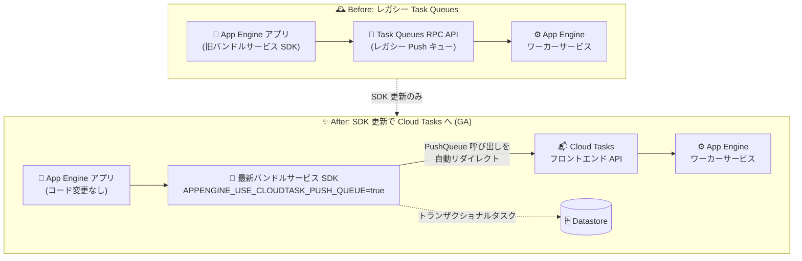

# App Engine standard environment: バンドルサービス SDK 更新による Push キューの Cloud Tasks 移行が GA

**リリース日**: 2026-11-17

**サービス**: App Engine standard environment (Go / Java / PHP / Python)

**機能**: バンドルサービス SDK の更新による Push キューの Cloud Tasks 移行

**ステータス**: GA (一般提供)

📊 [このアップデートのインフォグラフィックを見る](https://takech9203.github.io/google-cloud-news-summary/20261117-app-engine-push-queues-migration-cloud-tasks.html)

## 概要

App Engine standard environment において、バンドルサービス SDK (App Engine services SDK) を最新バージョンに更新するだけで、App Engine Push キュー (Task Queues) を Cloud Tasks に移行できる機能が GA (一般提供) になりました。このアップデートは Go、Java、PHP、Python の 4 つのランタイムすべてで同時に発表されています。

これまで Task Queues から Cloud Tasks への移行には、Cloud Tasks クライアントライブラリを使ったアプリケーションコードのリファクタリングが必要でした。今回 GA となった方式では、SDK を最新版に更新して環境変数を 1 つ設定するだけで、SDK が Push キューの API 呼び出しを Cloud Tasks のフロントエンド API に自動的にリダイレクトします。既存のタスクキューとタスクは Cloud Tasks 側にそのまま保持されるため、追加の移行作業は不要です。

レガシーバンドルサービス (Task Queues) に依存した既存の App Engine アプリケーションを運用しており、コード変更のリスクを最小化しながらモダンな Cloud Tasks 基盤に移行したいチームにとって重要なアップデートです。

**アップデート前の課題**

- Task Queues (Push キュー) から Cloud Tasks への移行には、Cloud Tasks クライアントライブラリへの書き換え (アプリケーションコードのリファクタリング) が必要だった
- クライアントライブラリ方式の移行では、Datastore トランザクション内でのタスク登録、deferred タスクライブラリ、マルチテナント (名前空間) 対応、ローカル開発サーバーでのシミュレーション、非同期タスク追加といった Task Queues 固有の機能が利用できなかった
- レガシーな Task Queues に依存し続けることが、最新ランタイムへのアップグレードやモダナイゼーションの障壁になっていた

**アップデート後の改善**

- SDK の更新と環境変数 `APPENGINE_USE_CLOUDTASK_PUSH_QUEUE: "true"` の設定だけで、アプリケーションコードを変更せずに Cloud Tasks へ移行できるようになった
- 既存のタスクキューとタスクは Cloud Tasks に保持されるため、キューの再作成やデータ移行は不要
- SDK ラッパーを通じて、deferred タスク、名前空間、ローカルシミュレーション、Datastore トランザクション内のタスク登録 (トランザクショナルタスク) など、Task Queues との機能互換性が維持される
- バッチタスク作成 (1 回の呼び出しで最大 100 タスク)、バッチ削除 (最大 1,000 タスク)、タスク単位のリトライ設定もサポート

## アーキテクチャ図



SDK を最新版に更新すると、アプリケーションの PushQueue 呼び出しが Cloud Tasks のフロントエンド API へ自動的にリダイレクトされます。既存のキューとタスクは Cloud Tasks に保持され、ワーカーサービスへのタスク配信は従来どおり継続します。

## サービスアップデートの詳細

### 主要機能

1. **コード変更不要の自動移行**
   - バンドルサービス SDK を最新版に更新し、`app.yaml` (または `appengine-web.xml`) に環境変数 `APPENGINE_USE_CLOUDTASK_PUSH_QUEUE: "true"` を設定するだけで移行が完了する
   - SDK が `PushQueue` の呼び出しを Cloud Tasks フロントエンド API に自動リダイレクトする
   - Cloud Tasks は既存のタスクキューとタスクを保持するため、追加の移行作業は不要

2. **Task Queues との機能互換性 (feature parity)**
   - **バッチタスク作成**: バッチ API により 1 回の呼び出しで最大 100 タスクを追加可能
   - **バッチタスク削除**: 1 回の呼び出しで最大 1,000 タスクを削除可能
   - **タスク単位のリトライ**: タスク固有のリトライ構成をサポート
   - **トランザクショナルタスク**: Datastore トランザクション内でのタスク登録をサポート (信頼性維持のため `cron.yaml` の設定が必要)
   - クライアントライブラリ方式では利用できない deferred タスク、名前空間 (マルチテナント)、ローカル開発サーバーでのシミュレーションも SDK ラッパー経由でサポート

3. **4 ランタイム同時 GA**
   - Go、Java、PHP、Python の App Engine standard environment 第 2 世代ランタイムすべてで同一の移行方式が GA
   - 各言語の最新 SDK バージョン: Python は `appengine-python-standard` 3.1.0 以上、Java は `appengine-api-1.0-sdk` 5.2.0 以上、Go は `google.golang.org/appengine/v2` v2.1.0 以上

## 技術仕様

### 2 つの移行方式の比較

| 項目 | SDK 更新方式 (今回 GA・推奨) | Cloud Tasks クライアントライブラリ方式 |
|------|------------------------------|----------------------------------------|
| コード変更 | 不要 | リファクタリングが必要 |
| 既存キュー/タスク | そのまま保持 | そのまま保持 (操作コードのみ書き換え) |
| Datastore トランザクション内のタスク登録 | サポート | 非サポート |
| deferred タスクライブラリ | サポート | 非サポート |
| 名前空間 (マルチテナント) | サポート | 非サポート |
| ローカル開発サーバーでのシミュレーション | サポート | 非サポート |
| 非同期タスク追加 | サポート (`add_async()` / `addAsync()` など) | 非サポート |

### ランタイム別の SDK 要件

| ランタイム | 必要な SDK / バージョン |
|-----------|------------------------|
| Python | `appengine-python-standard` >= 3.1.0 + `google-cloud-tasks` |
| Java | `com.google.appengine:appengine-api-1.0-sdk` >= 5.2.0 |
| Go | `google.golang.org/appengine/v2` >= v2.1.0 |
| PHP | 最新のバンドルサービス SDK ([PHP 向け移行ガイド](https://docs.cloud.google.com/appengine/migration-center/standard/php/migrating-push-queues-overview)を参照) |

### 必要な IAM ロール

SDK が Cloud Tasks API にタスクをディスパッチできるよう、App Engine サービスアカウントに **Cloud Tasks Enqueuer** (`roles/cloudtasks.enqueuer`) ロールをプロジェクトレベルで付与する必要があります。

## 設定方法

### 前提条件

1. App Engine アプリのソースコードにアクセスできること
2. Cloud Tasks API と Cloud Scheduler API を有効化すること
3. App Engine サービスアカウントに `roles/cloudtasks.enqueuer` ロールを付与すること

### 手順

#### ステップ 1: SDK を最新バージョンに更新する

Python の場合 (`requirements.txt`):

```text
Flask==3.0.0
appengine-python-standard>=3.1.0
google-cloud-tasks
```

Java の場合 (`pom.xml`):

```xml
<dependency>
  <groupId>com.google.appengine</groupId>
  <artifactId>appengine-api-1.0-sdk</artifactId>
  <version>5.2.0</version>
</dependency>
```

Go の場合 (`go.mod`):

```text
module my-app

go 1.27

require (
    google.golang.org/appengine/v2 v2.1.0
)
```

#### ステップ 2: Cloud Tasks ルーティングを有効化する

`app.yaml` に環境変数を追加します。

```yaml
runtime: python315
service: my-service-b
env_variables:
  APPENGINE_USE_CLOUDTASK_PUSH_QUEUE: "true"
```

Java で `appengine-web.xml` を使用している場合:

```xml
<appengine-web-app xmlns="http://appengine.google.com/ns/1.0">
  <service>my-java-service-b</service>
  <runtime>java25</runtime>
  <env-variables>
    <env-var name="APPENGINE_USE_CLOUDTASK_PUSH_QUEUE" value="true" />
  </env-variables>
</appengine-web-app>
```

#### ステップ 3: デプロイして動作を確認する

```bash
gcloud app deploy
```

デプロイ後、Google Cloud コンソールの [Cloud Tasks ページ](https://console.cloud.google.com/cloudtasks) でアプリが Cloud Tasks を使用していることを確認します。

#### ステップ 4: トランザクショナルタスクの設定 (必要な場合)

Datastore トランザクション内でタスクを登録しているアプリでは、コミット時に登録に失敗したタスクを確実に処理するため、内部プロセッサを定期呼び出しする cron ジョブを `cron.yaml` に設定します。

```yaml
cron:
- description: "Process push queue transactional tasks"
  url: /_ah/cloudtask/sweep
  schedule: every 30 minutes  # 利用パターンに応じて変更
```

Java の場合は、`web.xml` に `SweeperServlet` (Java 17 以降の Jakarta EE ランタイムでは `com.google.apphosting.utils.servlet.jakarta.SweeperServlet`) の URL マッピングを追加します。

## メリット

### ビジネス面

- **移行コスト・リスクの大幅な削減**: アプリケーションコードの書き換えが不要なため、テスト工数やリグレッションリスクを最小限に抑えてレガシー Task Queues から脱却できる
- **モダナイゼーションの促進**: レガシーバンドルサービスへの依存を減らし、Cloud Tasks というモダンなフルマネージドのタスク実行基盤へ段階的に移行できる

### 技術面

- **機能互換性の維持**: deferred タスク、名前空間、トランザクショナルタスク、ローカルシミュレーションなど、クライアントライブラリ方式では失われる機能が SDK ラッパーで維持される
- **可観測性の向上**: 移行後は Cloud Tasks コンソールでキューとタスクを一元的に確認・管理できる
- **バッチ API による効率化**: タスクの一括追加 (最大 100 件) と一括削除 (最大 1,000 件) に対応

## デメリット・制約事項

### 制限事項

- Cloud Tasks のリクエストは App Engine のリクエストクォータにもカウントされ、Cloud Tasks 固有の[クォータ](https://cloud.google.com/tasks/docs/quotas)も適用されるため、移行によりクォータの状況が変わる可能性がある
- トランザクショナルタスクを使用する場合、`cron.yaml` (Java では `web.xml` の SweeperServlet) の追加設定が必要

### 考慮すべき点

- **レイテンシ**: 更新後の SDK はリクエストを Cloud Tasks API に直接送信するため、タスクを 1 件ずつ順次登録・削除するとレガシー Task Queues よりレイテンシが増加する可能性がある。バッチ呼び出しや非同期 API (`add_async()` / `addAsync()` など) の活用が推奨される
- **コスト**: Task Queues は無料だったが、Cloud Tasks ではタスクの作成・削除・管理などのオペレーションに課金が発生するため、移行前に [Cloud Tasks の料金](https://cloud.google.com/tasks/pricing)で月額コストを見積もるべき
- **Datastore 課金**: SDK 更新方式でトランザクショナルタスクを登録する場合、タスク 1 件につき Datastore の 3 書き込み・2 読み取り・1 削除が Cloud Tasks の課金に加えて発生する

## ユースケース

### ユースケース 1: レガシー Python アプリの無停止モダナイゼーション

**シナリオ**: Python 2 時代から運用している App Engine アプリを最新ランタイムへ移行中で、`google.appengine.api.taskqueue` を使った Push キュー処理が大量に残っている。コードの全面書き換えは工数的に難しい。

**実装例**:
```text
# requirements.txt を更新
appengine-python-standard>=3.1.0
google-cloud-tasks

# app.yaml に追加
env_variables:
  APPENGINE_USE_CLOUDTASK_PUSH_QUEUE: "true"
```

**効果**: taskqueue API を呼び出す既存コードをそのままに、バックエンドだけを Cloud Tasks に切り替えられる。既存のキューとタスクも保持されるため、サービスを止めずに移行が完了する。

### ユースケース 2: Datastore トランザクションと連動したタスク処理の継続

**シナリオ**: 注文処理などで Datastore トランザクション内にタスクを登録する設計を採用しており、クライアントライブラリ方式では移行できなかった。

**効果**: SDK 更新方式ではトランザクショナルタスクがサポートされるため、設計を変えずに移行できる。`cron.yaml` の sweep ジョブにより、コミット時に登録に失敗したタスクも確実に処理される。

## 料金

移行自体に追加料金はありませんが、移行後は Cloud Tasks の料金体系が適用されます。

- Cloud Tasks の Push ターゲットから App Engine アプリへのリクエスト送信は Task Queues と同様に無料
- ただし Task Queues と異なり、Cloud Tasks ではタスクの作成・削除・管理などの**オペレーションに対して課金**が発生するため、無料だった Task Queues に比べて月額コストが増える可能性がある
- SDK 更新方式でトランザクショナルタスクを使用する場合、タスク 1 件につき Datastore の 3 書き込み・2 読み取り・1 削除が追加で課金される

詳細は [Cloud Tasks の料金ページ](https://cloud.google.com/tasks/pricing)および [Datastore の料金ページ](https://cloud.google.com/datastore/pricing)を参照してください。

## 利用可能リージョン

App Engine standard environment (Go / Java / PHP / Python) が利用可能なすべてのリージョンで利用できます。Cloud Tasks のロケーションについては[公式ドキュメント](https://docs.cloud.google.com/tasks/docs)を参照してください。

## 関連サービス・機能

- **Cloud Tasks**: 移行先となるフルマネージドのタスク実行サービス。App Engine ターゲットに限定されていた Push キューと異なり、任意の HTTP エンドポイントをターゲットにできる
- **Cloud Scheduler**: 移行の前提条件として API の有効化が必要。cron 形式のジョブスケジューリングを提供
- **Datastore (Firestore in Datastore mode)**: トランザクショナルタスク機能と連携。トランザクション内でのタスク登録をサポート
- **Cloud IAM**: SDK が Cloud Tasks にタスクをディスパッチするために `roles/cloudtasks.enqueuer` ロールの付与が必要

## 参考リンク

- 📊 [インフォグラフィック](https://takech9203.github.io/google-cloud-news-summary/20261117-app-engine-push-queues-migration-cloud-tasks.html)
- [公式リリースノート](https://docs.cloud.google.com/release-notes#November_17_2026)
- [Push キュー移行の概要 (Python)](https://docs.cloud.google.com/appengine/migration-center/standard/python/migrating-push-queues-overview)
- [SDK 更新による移行ガイド (Python)](https://docs.cloud.google.com/appengine/migration-center/standard/python/migrating-push-queues-upgrade-sdk)
- [SDK 更新による移行ガイド (Java)](https://docs.cloud.google.com/appengine/migration-center/standard/java/migrating-push-queues-upgrade-sdk)
- [SDK 更新による移行ガイド (Go)](https://docs.cloud.google.com/appengine/migration-center/standard/go/migrating-push-queues-upgrade-sdk)
- [Push キュー移行の概要 (PHP)](https://docs.cloud.google.com/appengine/migration-center/standard/php/migrating-push-queues-overview)
- [Cloud Tasks ドキュメント](https://docs.cloud.google.com/tasks/docs)
- [Cloud Tasks 料金ページ](https://cloud.google.com/tasks/pricing)

## まとめ

バンドルサービス SDK の更新だけで App Engine Push キューを Cloud Tasks に移行できる方式が GA となり、レガシー Task Queues からの脱却がコード変更なしで実現可能になりました。Task Queues に依存する App Engine アプリを運用しているチームは、まず Cloud Tasks の料金とクォータへの影響を見積もったうえで、SDK の更新と `APPENGINE_USE_CLOUDTASK_PUSH_QUEUE` 環境変数の設定による移行を検討することを推奨します。

---

**タグ**: App Engine, Cloud Tasks, Task Queues, Push キュー, 移行, GA, Go, Java, PHP, Python, サーバーレス
